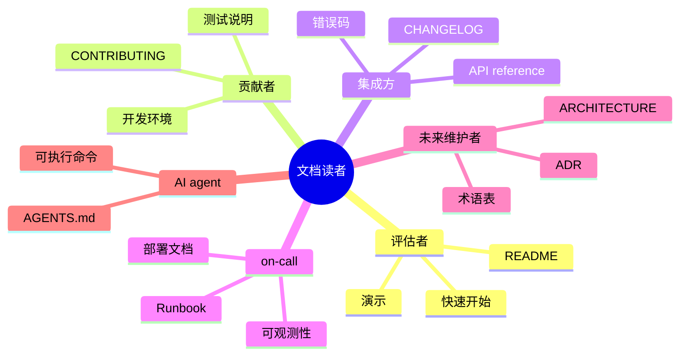
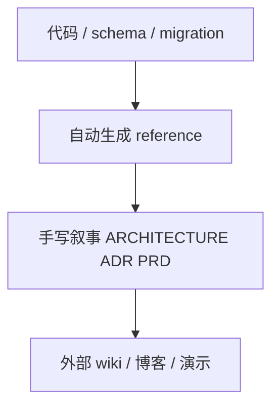

# 项目文档清单：从 README 到 ADR，什么必须写、什么该让机器写

> 本文基于 2026-11 的常见工程实践。示例使用 Node.js 22.22.2、markdownlint-cli2 0.24.2、Redocly CLI 2.82.0、Mermaid CLI 11.17.0；文中的检查命令均在本地实际运行。不同团队和项目阶段的“必备”并不相同，文末给了按阶段的最小集。

## 目录

- [先给结论](#先给结论)
- [生活比喻 医院导视系统](#生活比喻-医院导视系统)
- [三类文件 三种维护方式](#三类文件-三种维护方式)
- [六类读者 六组文档](#六类读者-六组文档)
- [核心必备 五个半](#核心必备-五个半)
- [设计类文档 ARCHITECTURE ADR PRD](#设计类文档-architecture-adr-prd)
- [接口与运行类文档](#接口与运行类文档)
- [按项目类型补充](#按项目类型补充)
- [文档治理 让清单不腐烂](#文档治理-让清单不腐烂)
- [实操 搭一个最小文档骨架](#实操-搭一个最小文档骨架)
- [反模式](#反模式)
- [自检清单](#自检清单)
- [结语](#结语)
- [参考资料](#参考资料)

## 先给结论

文档不是一份文件清单，而是**不同读者在关键时刻要用的接口**。

三句话：

1. **文档的价值 = 读者 × 场景 × 可执行性。** 没人读、找不到、读完不能行动的文档，都是负债。
2. **能由代码或工具生成的事实，不要手写。** 手写只留给 why、权衡、约定和边界。
3. **文档离代码越远，腐烂越快。** 能放仓库就不要放 wiki；能链接就不要复制。

所以这篇文章不按“核心/推荐/可选”平铺，而是先问：**谁在什么时刻，需要哪份文档？**

## 生活比喻 医院导视系统

医院里有很多标识，但没有人会把所有信息贴在门口：

- 大门有**总索引**：科室分布、楼层、出口；
- 每个科室有**门牌**：这是哪一科、找谁；
- 急诊有**绿色通道**：不挂号、先救命；
- 设备旁有**操作卡**：三步开机、异常怎么办；
- 墙上有**消防图**：最近出口、灭火器位置。

好导视系统的共同点：**每块牌子都出现在一个决策点上**。你不会在挂号时读消防图，也不会在起火时找科室介绍。

项目文档也一样：

| 场景 | 读者的问题 | 对应文档 |
|---|---|---|
| 第一次看到项目 | 这是什么？值得用吗？怎么跑？ | README |
| 准备贡献代码 | 怎么搭环境？测试怎么跑？PR 有什么规矩？ | CONTRIBUTING、开发环境、测试说明 |
| 接入 API | 怎么认证？参数是什么？错了返回什么？ | API reference、guide、错误码 |
| 生产告警 | 先看什么？怎么回滚？找谁？ | 部署文档、runbook、可观测性 |
| 半年后改架构 | 为什么当初这么选？否掉了什么？ | ARCHITECTURE、ADR |
| AI agent 接手任务 | 哪些命令能跑？哪些文件不能碰？ | AGENTS.md / CLAUDE.md |

一块牌子只回答一个问题。一份文档也只服务一类读者。

## 三类文件 三种维护方式

很多“文档清单”把下面三类东西混在一起：

- **法律/契约**：LICENSE、SECURITY、CODE_OF_CONDUCT、API 契约；
- **工具/流程配置**：.gitignore、CODEOWNERS、issue/PR 模板、CI 配置；
- **知识文档**：README、ARCHITECTURE、PRD、runbook。

它们的维护方式完全不同：

| 类型 | 例子 | 谁维护 | 怎么防漂移 |
|---|---|---|---|
| 法律/契约 | LICENSE、SECURITY、API 契约 | 负责人/法务 | 签字、版本化、对外公告 |
| 工具/流程配置 | .gitignore、CODEOWNERS、模板 | 工程 | CI 强制、模板约束 |
| 知识文档 | README、ADR、PRD、runbook | 文档 owner | 与代码同仓、review、定期复核 |

把三类混在一张清单里，最容易出现两种错误：**用写文章的方式管配置**（比如靠口头约定 PR 要带测试），或者**用配置的方式管法律**（比如随便贴一个 MIT LICENSE）。

后面主要讲第三类，前两类只在关键处提醒。

## 六类读者 六组文档

把读者列出来，清单会自己收敛：

| 读者 | 只关心 | 最少要有的文档 | 缺了会怎样 |
|---|---|---|---|
| 评估者 | 这是什么？能解决我的问题吗？ | README、演示/截图、快速开始 | 项目被划走 |
| 贡献者 | 怎么跑？怎么测？怎么提交？ | CONTRIBUTING、dev setup、TESTING | 每个新人问一遍老人 |
| 集成方 | 怎么调？错了怎么办？升级会破坏吗？ | API reference、guide、错误码、CHANGELOG、迁移指南 | 集成方读源码猜行为 |
| on-call | 现在什么坏了？怎么止血？ | 部署文档、runbook、可观测性 | 故障时长翻倍 |
| 未来维护者 | 为什么是这样？能不能改？ | ARCHITECTURE、ADR、术语表、数据字典 | 反复推翻旧决策 |
| AI agent | 有哪些硬约束？命令是什么？ | AGENTS.md、可执行脚本、清晰目录 | agent 瞎猜、越改越乱 |



一个实用判断：**如果一份文档说不清“谁在什么时候读”，它大概率不会有人读。**

## 核心必备 五个半

先把结论摆出来：对一个准备给别人用的项目，真正不能缺的是 **五个半**：

| 文档 | 地位 | 一句话标准 |
|---|---|---|
| README.md | 必备 | 新人在 5 分钟内知道这是什么、怎么跑 |
| LICENSE | 对外分发必备 | 别人能做什么、不能做什么，写清楚 |
| .gitignore | 工程必备（不是文档） | 构建产物、依赖、密钥不会误入仓库 |
| CHANGELOG.md | 有版本发布就必备 | 用户能看懂每个版本变了什么 |
| CONTRIBUTING.md | 有外部贡献者就必备 | 贡献者知道怎么搭环境、怎么提 PR |
| CODE_OF_CONDUCT.md | 有条件必备 | 有公开社区，且有执行渠道 |

“半个”是 CODE_OF_CONDUCT：它很重要，但不是每个项目都需要。内部项目贴一份没有举报渠道的行为准则，只是装饰。

### README 项目的门面

README 只做四件事：

1. 这是什么、解决什么问题；
2. 怎么在最短时间内跑起来；
3. 去哪里看更深的文档；
4. 许可证和基本状态。

一个够用的模板：

````markdown
# Project Name

One sentence: what it does and who it is for.

## Quickstart

```bash
cp .env.example .env
docker compose up --build
```

Open <http://localhost:8080/health>.

## Documentation

- [Architecture](docs/architecture.md)
- [API](docs/api/openapi.yaml)
- [Runbook](docs/operations/runbook.md)

## License

[MIT](LICENSE)
````

常见坑：

- **徽章墙**：十几排 badge，没有一句说人话；
- **只写功能，不写快速开始**：读者不知道下一步；
- **README 当百科**：架构、API、部署全塞进去，最后谁都不更新；
- **截图过期**：界面已经改了三版，图还是两年前的。

记住：README 是**产品页面**，不是说明书。深的内容放 `docs/`，README 只负责把人送到正确的门口。

### LICENSE 没有协议就是保留所有权利

很多人以为“公开在 GitHub 上”就等于“可以随便用”。不是。

没有 LICENSE 时，默认是**保留所有权利**：别人可以看、可以在 GitHub 允许的范围内 fork，但不能合法地用于商业项目、不能修改后分发。GitHub 的条款只给了平台内的基本权利，不是开源许可。

怎么选：

| 目的 | 常见选择 | 注意 |
|---|---|---|
| 想让别人随便用 | MIT | 最简单，保留版权声明即可 |
| 想带专利授权 | Apache-2.0 | 需要保留 NOTICE，专利条款更明确 |
| 想强制衍生作品开源 | GPL-2.0/3.0、AGPL-3.0 | 商业集成前要确认兼容性 |
| 内部/闭源 | 专有许可或版权声明 | 不要默认贴 MIT |

几个实操点：

- 用 SPDX 标识符，机器和人都能读；
- Apache-2.0 项目要维护 `NOTICE` 和第三方许可证清单；
- 依赖的许可证要扫描，别让 GPL 依赖混进闭源分发；
- 换许可证不是改个文件，涉及历史贡献者版权，先问法务。

LICENSE 不是“文档写得好看”的问题，它是法律契约。

### .gitignore 不是安全边界

`.gitignore` 很重要，但它不是文档，也不是安全措施。

它只影响**未跟踪文件**。一旦密钥被提交：

- 文件还在 Git 历史里；
- fork、CI 缓存、制品里可能已经有副本；
- 删掉当前文件不等于删掉历史。

正确做法：

1. `.gitignore` 防误提交；
2. pre-commit / secret scanning 在提交前拦截；
3. 最小权限，CI 不拿长期密钥；
4. 真泄露了，先轮换密钥，再考虑清理历史。

不要把 `.gitignore` 当成“密钥保险箱”。它只是门口的“禁止入内”牌子，门本身还得有锁。

### CHANGELOG 读者是用户，不是 git log

CHANGELOG 最常见的错误，是把 `git log` 直接贴出来：

```text
a1b2c3d fix typo
d4e5f6a wip
7h8i9j0 merge branch 'tmp'
```

用户不关心你合并了什么分支。CHANGELOG 写的是**用户能感知的变化**。

用 [Keep a Changelog](https://keepachangelog.com/en/1.1.0/) 的分类：

- Added：新增功能；
- Changed：行为变化；
- Deprecated：即将废弃；
- Removed：已移除；
- Fixed：修复；
- Security：安全相关。

版本号遵循 [Semantic Versioning](https://semver.org/spec/v2.0.0.html)：MAJOR.MINOR.PATCH。

可以自动生成，但别全自动发布：

- 用 Conventional Commits 约束提交信息；
- 用 git-cliff、release-please、Changesets 生成草稿；
- 发布前人工改写成用户能懂的话。

CHANGELOG 和 release notes 也不是一回事：CHANGELOG 是仓库里的完整账本，release notes 是给这次发布读者的摘要，可以更短、更有场景。

### CONTRIBUTING 把“怎么做”写清楚

CONTRIBUTING 不是“欢迎贡献”的口号，它要回答：

- 怎么搭开发环境（链接到 dev setup，不要复制）；
- 怎么跑测试、lint、类型检查；
- 提交信息和 PR 的规范；
- review 的预期（谁审、多久、什么算 blocker）；
- 哪些改动需要先开 issue 或 RFC；
- 行为准则在哪里。

一个好的 CONTRIBUTING 通常长这样：

```markdown
## Setup

See the quickstart in README.md, then run `make install`.

## Before opening a PR

- `make test`
- `make lint`
- Update CHANGELOG.md for user-visible changes
- Update docs/ when behavior or contracts change

## PR rules

- One change per PR
- Include a test plan and rollback note
- Link the issue or ADR
```

配套的 issue/PR 模板比长篇大论有效：模板会强制提交者提供版本、环境、复现步骤、测试计划和回滚方案。

### CODE_OF_CONDUCT 没有执行渠道就不要写

行为准则的价值不在文本，而在**执行**：

- 举报渠道是什么？
- 谁处理？多久响应？
- 处理结果如何申诉？
- 维护者自己违反怎么办？

如果这些问题没有答案，贴一份 Contributor Covenant 只会给人一种“我们很规范”的错觉。

适用场景：

- 公开社区、接受外部贡献：建议有；
- 公司内部项目：公司层面的行为准则通常已经覆盖，仓库里不必重复；
- 个人小项目：可以没有，但 CONTRIBUTING 里要写清沟通边界。

## 设计类文档 ARCHITECTURE ADR PRD

这一类文档回答“为什么”，也是最容易被写成一次性竣工文档的地方。

| 文档 | 回答的问题 | 读者 | 更新方式 |
|---|---|---|---|
| PRD | 为什么做、给谁做、怎么算成功 | 产品/研发/业务 | 需求变化时更新 |
| RFC/设计文档 | 打算怎么做、否掉了什么、风险是什么 | 研发/评审者 | 决策前讨论，决策后归档 |
| ADR | 最终选了什么、代价是什么 | 未来维护者 | 一页一决策，不修改，只被新 ADR 取代 |
| ARCHITECTURE | 现在系统长什么样、边界在哪 | 新人/维护者 | 随系统演进，保持短 |


### PRD 一页也能写清楚

不是所有项目都需要几十页 PRD。内部工具用一页纸回答清楚就够了：

- 问题：谁在什么场景下遇到什么困难？
- 目标：这次要改变什么？怎么衡量？
- 非目标：这次明确不做什么？
- 方案概要：大概怎么做，有什么取舍？
- 验收：什么条件下算完成？

PRD 不负责技术方案。把“怎么做”塞进 PRD，评审会变成架构辩论，需求反而没人看。

### 设计文档 先讨论再动手

设计文档（RFC、tech design、design doc）是**决策前的讨论载体**。一个好的设计文档至少有：

- 背景和约束；
- 目标与非目标；
- 方案对比（至少两个，包括“不做的代价”）；
- 数据流、失败模式、回滚方案；
- 迁移和兼容性；
- 开放问题；
- 决策记录（最后选了什么，为什么）。

设计文档不需要完美，它需要**在写代码前暴露分歧**。

### ADR 一页一个决定

ADR（Architecture Decision Record）是我最推荐补的一项。

它和 ARCHITECTURE.md 的关系：

- ARCHITECTURE 是地图：现在系统长什么样；
- ADR 是施工日志：为什么变成这样，当时否掉了什么。

模板可以很短：

```markdown
# 0001. Use PostgreSQL as the primary database

- Status: accepted
- Date: 2026-11-20
- Deciders: backend team
- Supersedes: none

## Context

Orders, payments, and inventory need transactional writes and ad hoc queries.

## Decision

Use PostgreSQL 18 as the primary database. Use one schema per service.

## Consequences

- ACID transactions and foreign keys are available.
- The team owns migrations and index maintenance.
- Cross-service joins are not allowed.

## Alternatives considered

- MySQL: viable, but less operational experience on the team.
- MongoDB: weaker fit for multi-table transactional invariants.
```

规则：

- 一页一个决策；
- 写清状态：proposed / accepted / superseded / deprecated；
- 已接受的 ADR 不修改，只能被新 ADR 取代；
- 索引放在 `docs/adr/README.md`，按编号排序；
- 决策变了，新增 ADR，不要偷偷改旧文。

ADR 最大的价值不是“记录正确答案”，而是**阻止团队在同一个问题上反复推翻自己**。

### ARCHITECTURE 保持短 保持活

ARCHITECTURE.md 最常见的失败模式：写的时候很认真，写完就没人看。

建议：

- 只画到 C4 的 Context 和 Container 层，组件和代码层交给代码；
- 图用 Mermaid/PlantUML 的文本格式，跟代码一起 review；
- 每个关键决策链接到 ADR；
- 明确边界：哪些模块能依赖哪些模块，哪些不能；
- 最多一两页，超出就拆到 `docs/architecture/`。

一张好的架构图，应该让新人回答三个问题：

1. 请求从哪进来，经过哪些服务，最后落到哪？
2. 数据的所有者是谁，谁能写？
3. 哪个服务挂了会影响谁？

## 接口与运行类文档

这类文档的读者是**集成方和 on-call**，它们必须可执行、可验证。

### API 文档 reference 和 guide 分开

API 文档通常有两种：

- **Reference**：每个端点、参数、响应、错误码。适合查，不适合学。
- **Guide**：认证、分页、限流、重试、错误处理、完整示例。适合第一次接入。

Swagger UI 只是 reference 的渲染壳，不是完整的 API 文档。

关键原则：**OpenAPI 是单一事实源**。

- 能由代码生成（FastAPI、springdoc、NestJS）就生成；
- 或者用 OpenAPI 生成代码和文档；
- 不要手写一份 Markdown，再手写一份 OpenAPI，最后两份不一致。

一个 API 文档至少覆盖：

| 项目 | 说明 |
|---|---|
| 认证 | 怎么拿 token，怎么传，过期怎么办 |
| 错误码 | 业务错误码 + HTTP 状态码，能否重试 |
| 分页 | 参数名、上限、游标还是 offset |
| 限流 | 配额、响应头、退避策略 |
| 幂等 | 哪些写操作支持 Idempotency-Key |
| 版本 | URL/Header 版本策略，废弃提前多久通知 |
| 示例 | 请求和响应的完整示例，最好能直接跑 |

错误码尤其重要：它是契约的一部分，不是“文档里顺便提一句”。最好由代码里的错误码注册表生成，CI 校验文档和代码一致。

### 数据库文档 schema 是事实源

数据库设计文档不要手抄表结构。schema 和 migration 才是事实源，文档负责解释**为什么**：

- ER 图：表之间的关系，用 Mermaid `erDiagram` 或工具生成；
- 数据字典：字段含义、枚举值、单位、是否可空；
- 索引说明：为什么建这个索引，支撑哪个查询；
- 数据生命周期：哪些是 PII、保留多久、怎么删除；
- 迁移规范：向前兼容、回滚、大表变更策略；
- 备份恢复：RTO/RPO、恢复演练频率。

一个最小的数据字典示例：

| Table | Column | Type | Nullable | Notes |
|---|---|---|---|---|
| orders | id | uuid | no | Primary key |
| orders | customer_id | uuid | no | Pseudonymous; references customers.id |
| orders | status | text | no | `pending`, `paid`, `shipped`, `cancelled` |
| orders | total_cents | integer | no | Non-negative; stored in cents |
| orders | created_at | timestamptz | no | Defaults to `now()` |

注意 `customer_id` 的注释：它不是“用户 ID”这么简单，它是**假名化数据**。如果这里再存姓名、邮箱、地址，数据地图和合规范围就变了。

### 配置与密钥 列清楚每一个变量

“配置说明”经常写成一段散文。更好的做法是一张表：

| 变量 | 类型 | 必填 | 默认值 | 敏感 | 说明 |
|---|---|---|---|---|---|
| `DATABASE_URL` | URL | 是 | — | 是 | PostgreSQL 连接串 |
| `REDIS_URL` | URL | 是 | — | 是 | Redis 连接串 |
| `LOG_LEVEL` | enum | 否 | `info` | 否 | `debug`/`info`/`warn`/`error` |
| `FEATURE_NEW_CHECKOUT` | bool | 否 | `false` | 否 | 新结算流程开关 |

配套：

- 仓库里放 `.env.example`，只放占位值；
- `.env` 永不提交；
- 生产密钥放 secret manager，不放 CI 变量明文；
- 配置的优先级写清楚（例如：命令行 > 环境变量 > 配置文件 > 默认值）；
- 启动时校验必填项，缺了就 fail fast，不要等到第一次请求才报错。

### 开发环境 一条命令跑起来

开发环境文档的目标不是“写全”，而是**让新人用最短路径跑起来**。

最低标准：

1. 列出前置依赖和版本；
2. 一条命令安装；
3. 一条命令启动；
4. 一个健康检查或 smoke test；
5. 常见错误和解决办法；
6. 需要哪些权限/账号，找谁申请。

如果团队用 Docker/Dev Container，把环境固化成 `docker compose up` 或 `.devcontainer/`，比写十页“请安装以下软件”可靠。

### 测试 发布 与迁移

这三类文档经常被塞进 CONTRIBUTING，最后谁都找不到：

- **TESTING.md**：测试分层（unit/integration/e2e）、怎么跑、CI 矩阵、测试数据从哪来、flaky 测试怎么处理。
- **RELEASING.md**：版本号规则、分支策略、发布检查单、审批人、发布渠道、回滚方式。
- **MIGRATION.md / 升级指南**：破坏性变更、从旧版本到新版本的步骤、兼容窗口、废弃时间表。

它们服务的是贡献者和集成方，不是 on-call；放在 `docs/contributing/` 或 `docs/operations/` 都可以，关键是和代码同仓、随版本更新。

### 部署文档 和 runbook 分开

部署文档回答“怎么发”，runbook 回答“挂了怎么办”。

部署文档至少写：

- 拓扑：几个服务、依赖什么、流量怎么走；
- 前置检查：配置、迁移、证书、容量；
- 发布步骤：谁执行、怎么审批、灰度还是全量；
- 验证：健康检查、关键指标、smoke test；
- 回滚：什么条件下回滚、命令是什么、数据迁移怎么处理；
- 变更记录：这次发布包含哪些 PR/版本。

Runbook 至少写：

- 每个告警的含义和第一检查点；
- 止血步骤（重启、限流、切流、回滚）；
- 升级路径和联系人；
- 常见故障的排查树；
- 事后动作：开 incident、写 postmortem。

一个没有回滚步骤的部署文档，只写了一半。

### 可观测性 让 on-call 知道看哪里

可观测性文档不是“我们用了 Prometheus”。它要告诉 on-call：

- 哪个 dashboard 看总览；
- 关键 SLI/SLO 是什么，错误预算剩多少；
- 日志在哪查，常用查询是什么；
- trace 怎么串起来，采样率多少；
- 告警分级：P0/P1/P2 分别怎么处理。

如果 on-call 半夜要先花 20 分钟找 dashboard，文档就失败了。

## 按项目类型补充

前面的通用清单之外，不同项目类型还有各自的必答题。

| 项目类型 | 额外需要的文档 |
|---|---|
| 后端/全栈 | API reference、数据库设计、配置清单、错误码、迁移指南 |
| 前端 | 路由表、状态管理边界、组件库/设计规范、浏览器兼容矩阵、构建发布流程、可访问性说明 |
| 移动端/客户端 | 打包签名、发布渠道、权限说明、系统版本兼容矩阵、隐私清单 |
| 开源项目 | SECURITY、ROADMAP、FAQ、SUPPORT、GOVERNANCE、CITATION（按需） |
| 商业产品 | 隐私政策、服务条款、威胁模型、SBOM、第三方许可证、SLA/支持说明 |
| AI/Agent 项目 | AGENTS.md/CLAUDE.md、prompt 版本管理、评测数据说明、工具调用边界 |

几个容易漏的点：

- **前端路由表**：不是给用户看的，是给新人和测试看的；哪个路由对应哪个页面、权限是什么。
- **状态管理边界**：哪些状态是服务端事实，哪些是 UI 状态，哪些是 URL 状态；不写清楚，最后所有东西都塞进全局 store。
- **移动端权限**：每个权限为什么需要、什么时候申请、用户拒绝后怎么办；应用商店审核会看。
- **兼容矩阵**：支持哪些浏览器/系统版本，测试到什么程度；不要写“支持现代浏览器”。
- **SECURITY.md 不是开源专属**：只要有外部用户或攻击面，就应该写清漏洞报告渠道；开源只是最典型的场景。
- **开源 SUPPORT.md**：告诉用户“去哪里问问题”，把 issue 区留给 bug 和需求。
- **ROADMAP**：公开 roadmap 是方向性说明，不是承诺；不维护就不要放。
- **FAQ**：FAQ 越长，说明正式文档越缺；答案放回对应章节，FAQ 只做索引。
- **术语表**：领域复杂时，把核心实体、状态、角色、缩写列出来；同一个词在业务、代码、文档里必须同义。
- **商业隐私文档**：数据收集、使用、保留、删除、跨境传输；这通常由法务拥有，但工程要提供数据地图。
- **AI agent 文档**：`AGENTS.md` 正在成为一种事实约定，`CLAUDE.md` 是 Claude Code 的入口；写短、写可执行命令、写硬约束，不要复制整本手册。

## 文档治理 让清单不腐烂

文档写出来只是开始。真正难的是半年后它还对不对。

### 单一事实源金字塔



规则：

- 下层可以引用上层，但不能复制事实；
- 能生成的不手写：OpenAPI、ER 图、CLI help、配置表；
- 能链接的不复制：CONTRIBUTING 链接到 dev setup，而不是再写一遍；
- 事实变了，先改最上层，再让生成物更新。

### 每篇文档带元信息

`docs/README.md` 是文档地图：列出每篇文档的 owner、status、last_reviewed。适用版本可以放在每篇文档头部。没有这张地图，`docs/` 很快会变成垃圾场。

每篇文档头部可以维护：

```yaml
---
owner: @example-org/backend
status: active        # draft | active | deprecated
last_reviewed: 2026-11-20
applies_to: v1.x
---
```

最小要求：

- **owner**：出问题找谁；
- **status**：草稿、有效、已废弃；
- **last_reviewed**：最后一次确认内容仍正确的时间；
- **applies_to**：适用版本，避免用旧版本文档指导新版本。

过期文档要么更新，要么标 `deprecated`，要么删除。最糟糕的是“看起来还在，其实早就不对”。

### CI 检查 把文档当代码

| 检查 | 工具 | 作用 |
|---|---|---|
| Markdown 格式 | markdownlint-cli2 | 标题层级、列表、表格、代码围栏 |
| 链接 | lychee、markdown-link-check | 站内锚点、外部死链 |
| 文风 | Vale | 术语一致、禁用词、可读性 |
| OpenAPI | Redocly CLI、Spectral | 契约合法性、规范一致性 |
| Mermaid | mermaid-cli | 图能渲染，不是坏代码 |
| 生成物 | schema/ER/CLI 生成脚本 | 文档和代码不漂移 |

一个坑：**工具版本要锁定**。我这次跑 demo 时，markdownlint 0.42 的 MD060 表格样式规则把旧表格判为不合格。规则升级应该单独开 PR，不要让它和业务改动混在一起。

### PR 规则 文档和代码一起 review

最有效的机制不是“每季度检查一次”，而是**把文档纳入 PR 定义**：

- 行为变更：必须更新 CHANGELOG 和相关 guide；
- 契约变更：必须更新 OpenAPI 和迁移指南；
- 架构决策：必须新增 ADR；
- 文档改动：CODEOWNERS 指定 owner review；
- 新功能：PR 模板里加一条“文档是否更新”。

Danger、reviewdog 或 CI 脚本都可以做机械检查。但规则要少而硬，太多会逼大家写 `[skip docs]`。

### 四个验收标准

文档是否合格，不看字数，看能不能通过这四个测试：

- **README 测试**：新人 5 分钟内能跑起来；
- **Runbook 测试**：on-call 5 分钟内能找到回滚步骤；
- **API 测试**：集成方不看源码能完成一次调用；
- **ADR 测试**：新人能回答“为什么不用 X”。

## 实操 搭一个最小文档骨架

下面这个骨架在 `/tmp/doc-demo` 里实际搭过，文中的检查命令都实际跑通了。它是一个文档骨架，不是可运行服务；README 里的启动命令只是模板。

目录结构：

```text
doc-demo/
├── README.md
├── LICENSE
├── CHANGELOG.md
├── CONTRIBUTING.md
├── SECURITY.md
├── .env.example
├── .markdownlint-cli2.jsonc
├── docs/
│   ├── README.md
│   ├── architecture.md
│   ├── glossary.md
│   ├── adr/
│   │   ├── README.md
│   │   └── 0001-use-postgresql.md
│   ├── api/
│   │   └── openapi.yaml
│   ├── database/
│   │   └── er.md
│   └── operations/
│       └── runbook.md
├── scripts/
│   └── check_links.py
└── .github/
    ├── PULL_REQUEST_TEMPLATE.md
    └── CODEOWNERS
```

几个关键文件的内容前面已经给过，这里看校验结果。

### 格式检查

```bash
$ npx --yes markdownlint-cli2 "**/*.md"
markdownlint-cli2 v0.24.2 (markdownlint v0.42.2)
Finding: **/*.md
Linting: 12 files
Summary: 0 issues in 0 files
```

`0 issues in 0 files` 不是没检查文件，而是 12 个文件里 0 个有问题。第一次跑并不是 0：MD060 判了一批表格样式不合格，`--fix` 在 6 个文件里尝试修复 40 处；把表格统一成 compact 风格后通过。这个过程本身说明：**文档格式也要有工具兜底**，靠人眼对齐表格不现实。

### 契约检查

```bash
$ npx --yes @redocly/cli lint docs/api/openapi.yaml
No configurations were provided -- using built in recommended configuration by default.
validating docs/api/openapi.yaml...
docs/api/openapi.yaml: validated in 15ms
Woohoo! Your API description is valid. 🎉
```

中间踩了两个规则：

- `security-defined`：每个 operation 必须有 security，或者在根级别定义；
- `no-server-example.com`：示例服务器不要用 `example.com` 或 `localhost`，改成相对路径 `/v1` 后消失。

这说明 OpenAPI lint 不只是“语法检查”，它会把契约设计问题也指出来。

### 链接检查

`scripts/check_links.py` 只做一件事：扫描 Markdown 里的相对链接，确认目标文件存在。

```python
#!/usr/bin/env python3
"""Check relative links in Markdown files."""

from __future__ import annotations

import re
import sys
from pathlib import Path

ROOT = Path(__file__).resolve().parent.parent
LINK = re.compile(r"\[[^\]]*\]\(([^)]+)\)")
errors = 0
files = sorted(ROOT.rglob("*.md"))

for md in files:
    for target in LINK.findall(md.read_text(encoding="utf-8")):
        if target.startswith(("http://", "https://", "mailto:", "#")):
            continue
        path = (md.parent / target.split("#", 1)[0]).resolve()
        if not path.exists():
            print(f"{md.relative_to(ROOT)}: missing {target}")
            errors += 1

print(f"checked {len(files)} markdown files, {errors} broken relative links")
sys.exit(1 if errors else 0)
```

```bash
$ python3 scripts/check_links.py
checked 12 markdown files, 0 broken relative links
```

为了确认这个检查真的会失败，我复制了一份仓库，故意加了一个坏链接：

```bash
$ printf '\n[broken](missing.md)\n' >> docs/glossary.md
$ python3 scripts/check_links.py
docs/glossary.md: missing missing.md
checked 12 markdown files, 1 broken relative links
exit=1
```

**一个不会失败的检查，只是装饰。** 链接检查、契约检查、Mermaid 渲染都一样：先证明它能在坏输入上失败，再相信它。

### Mermaid 渲染

```bash
$ mmdc -p /tmp/pptr.json -i docs/database/er.md -o /tmp/doc-demo-er.md
Found 1 mermaid charts in Markdown input
 ✅ ./doc-demo-er-1.svg
 ✅ /tmp/doc-demo-er.md
```

图能渲染，才有资格进文档。把 Mermaid 放进 CI，可以拦住“语法看起来对、渲染出来是空白”的图。

### 这个骨架还缺什么

它不是完整方案，只是最小闭环：

- 外部链接没查（demo 里的脚本只查相对链接，生产用 lychee）；
- 锚点没查（标题改名会让 TOC 链接失效）；
- 没有生成 OpenAPI 的代码，所以契约还是手写的；
- 没有接 CI，只是本地命令。

下一步是把这些命令放进 CI，并在 PR 模板里加一条“文档检查通过”。

## 反模式

| 反模式 | 症状 | 修法 |
|---|---|---|
| 手抄事实 | OpenAPI、schema、CLI help 维护两份 | 选一个事实源，其余生成 |
| 一次性大文档 | 写完就过期，没人敢改 | 拆成短文档，一页一个主题 |
| 没有 owner 的 wiki | 谁都能改，谁都不负责 | 每篇有 owner，放进代码仓库 |
| 复述代码 | `getUser` 获取用户 | 只写 why、边界、约束 |
| 文档 KPI | 按篇数/字数考核 | 看新人上手时间、支持问题数量 |
| FAQ 当垃圾桶 | 所有问题都往 FAQ 塞 | 答案回到对应文档，FAQ 只做索引 |
| 公开 roadmap 当承诺 | 日期一拖再拖，用户失望 | 标“方向性、非承诺”，定期更新 |
| 把 .gitignore 当安全边界 | 密钥进了历史还不知道 | secret scanning、轮换、最小权限 |
| 只写 happy path | 没有失败模式、回滚、排查 | 每个关键流程补失败路径 |
| 文档和代码分仓 | wiki 更新了，代码没更新 | 文档跟代码同仓、同 PR |

## 自检清单

### 按阶段的最小集

| 项目阶段 | 最小文档集 |
|---|---|
| 个人脚本/原型 | README、.gitignore |
| 内部服务 | + 开发环境、配置清单、部署、runbook、ADR、CHANGELOG |
| 对外库/SDK | + LICENSE、API reference（生成）、版本/废弃策略、SECURITY |
| 开源社区 | + CONTRIBUTING、CoC（有执行渠道）、issue/PR 模板、SUPPORT、GOVERNANCE |
| 商业产品 | + PRD、隐私政策/ToS、威胁模型、SBOM/第三方许可证、SLA/支持说明 |

### 十分钟自检

- [ ] 新人能按 README 在 5 分钟内跑起来
- [ ] LICENSE 明确，对外分发时没有“默认保留所有权利”的坑
- [ ] 密钥不在仓库，`.env.example` 只有占位值
- [ ] CHANGELOG 写的是用户能感知的变化
- [ ] CONTRIBUTING 说清测试、PR 规则和 review 预期
- [ ] ARCHITECTURE 有图，且链接到关键 ADR
- [ ] ADR 记录了几个“为什么不用 X”的决策
- [ ] API 有 OpenAPI、guide、错误码和版本策略
- [ ] 数据库有 ER、数据字典、PII/保留策略
- [ ] 部署文档有回滚和 smoke test
- [ ] Runbook 覆盖告警、止血、升级路径
- [ ] `docs/README.md` 有 owner、status、last_reviewed
- [ ] CI 检查 Markdown、链接、OpenAPI、Mermaid
- [ ] 过期文档已标记或删除

## 结语

文档不是写给人看的，是写给**某个时刻的某个人**用的。

那个人可能是第一次打开项目的评估者，可能是凌晨两点被叫醒的 on-call，可能是半年后想改架构的同事，也可能是一个 AI agent。

所以，写文档之前先问：

1. 谁会在什么时候读它？
2. 读完他能不能做出一个动作？
3. 这个事实能不能由代码生成？

如果三个问题都有答案，这份文档就值得写。否则，它可能只是清单上的一行装饰。

## 参考资料

- [Keep a Changelog](https://keepachangelog.com/en/1.1.0/)
- [Semantic Versioning 2.0.0](https://semver.org/spec/v2.0.0.html)
- [Contributor Covenant](https://www.contributor-covenant.org/)
- [Architecture Decision Records](https://adr.github.io/)
- [MADR](https://adr.github.io/madr/)
- [C4 model](https://c4model.com/)
- [OpenAPI Specification](https://spec.openapis.org/oas/latest.html)
- [Redocly CLI](https://redocly.com/docs/cli/)
- [markdownlint-cli2](https://github.com/DavidAnson/markdownlint-cli2)
- [lychee](https://github.com/lycheeverse/lychee)
- [Vale](https://github.com/errata-ai/vale)
- [Mermaid](https://mermaid.js.org/)
- [Diátaxis](https://diataxis.fr/)
- [AGENTS.md](https://agents.md/)
- [llms.txt](https://llmstxt.org/)
- [CycloneDX](https://cyclonedx.org/)
- [SPDX](https://spdx.dev/)
- [Choose a License](https://choosealicense.com/)
- [GitHub Docs: About code owners](https://docs.github.com/en/repositories/managing-your-repositorys-settings-and-features/customizing-your-repository/about-code-owners)
- [GitHub Docs: Community health files](https://docs.github.com/en/communities/setting-up-your-project-for-healthy-contributions/creating-a-default-community-health-file)
- [WCAG 2.2 Quick Reference](https://www.w3.org/WAI/WCAG22/quickref/)
- [STRIDE threat model](https://learn.microsoft.com/en-us/azure/security/develop/threat-modeling-tool-threats)
