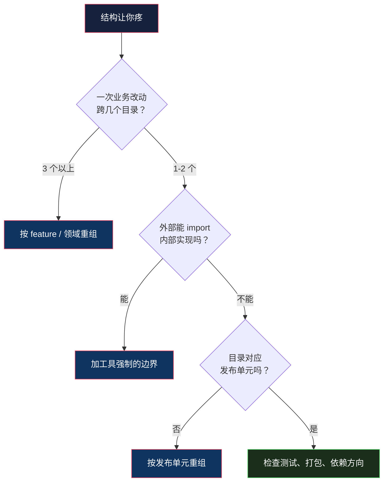

# 项目结构反模式：八种“看起来整齐”的坏结构

> 系列收尾。本文把前面各语言分册反复出现的坏结构集中起来，给一张自检表和一套重构顺序。
> 示例跨 Go、Python、TypeScript、Rust、Java、C#/.NET，不绑定单一语言版本。

## 目录

- [先给结论](#先给结论)
- [生活比喻：万能收纳箱](#生活比喻万能收纳箱)
- [反模式地图](#反模式地图)
- [1. 按技术层切一切](#1-按技术层切一切)
- [2. 把目录名当边界](#2-把目录名当边界)
- [3. 万能 shared / common / utils](#3-万能-shared-common-utils)
- [4. 过早拆模块和 monorepo](#4-过早拆模块和-monorepo)
- [5. 把语言习惯硬搬](#5-把语言习惯硬搬)
- [6. 测试和产物混进发布包](#6-测试和产物混进发布包)
- [7. 目录和发布单元错位](#7-目录和发布单元错位)
- [8. 只搬目录，不改依赖](#8-只搬目录不改依赖)
- [一张自检表](#一张自检表)
- [重构顺序](#重构顺序)
- [决策清单](#决策清单)
- [结语](#结语)
- [参考资料](#参考资料)

## 先给结论

项目结构的反模式有一个共同点：

> **它们都在用“看起来整齐”替代“边界清楚”。**

- 目录按技术层排得整整齐齐，但一次业务改动要横跨四层；
- 所有东西都有自己的目录，但没有一个目录对应可独立构建/发布的单元；
- `utils/`、`common/`、`shared/` 名字很中性，最后变成没人敢删的垃圾场；
- 小项目提前套用大厂模板，结构比业务还复杂；
- 目录搬了，依赖方向没变，循环依赖照旧。

**结构不是分类，是边界。** 判断一个目录该不该存在，不是看它名字对不对，而是看它对应什么边界、被什么工具强制。

## 生活比喻：万能收纳箱

很多人整理房间的方式，是买一个“万能收纳箱”，把所有东西都放进去。箱子看起来很整齐，找东西时还是要全部倒出来。

项目里的 `utils/`、`common/`、`shared/` 就是这种箱子。它们不表达任何边界，只表达“我不知道放哪”。

还有一种反模式：给每个房间装一扇门，但墙是纸糊的。目录名写得像边界，工具却不检查——外部代码照样能 import 内部实现，依赖照样能反向。

**真正的结构，应该像承重墙：不是画在图纸上，而是拆了会塌。**

## 反模式地图

| 反模式 | 典型症状 | 本质 | 最小修复 |
|--------|----------|------|----------|
| 按技术层切一切 | 一次业务改 4 个目录 | 按岗位分房间，不按业务 | 按 feature/领域拆 |
| 目录名当边界 | 深层 import、所有东西 public | 边界没有工具强制 | 用编译器/包管理器边界 |
| 万能 shared | 所有模块依赖、没人敢删 | 共享没有消费者和所有者 | 先本地，两个消费者再提升 |
| 过早拆模块 | 5 个文件 6 个 module | 用结构复杂度替代业务复杂度 | 按发布/部署单元拆 |
| 语言习惯硬搬 | Go 有 `src/`、Rust 有 `cmd/` | 把别的语言的工具链当审美 | 跟当前语言的工具链 |
| 测试/产物混入 | wheel 里有 tests、仓库有 dist | 发布边界和源码边界不分 | 构建、打包、检查 |
| 目录和发布单元错位 | 一个目录两个部署物 | 目录没对准构建单元 | 按发布单元重组 |
| 只搬目录不改依赖 | 目录变了，循环依赖还在 | 重构只做了表面 | 先画依赖，再搬 |



## 1. 按技术层切一切

**症状**

```text
src/
├── controllers/
├── services/
├── repositories/
└── models/
```

每次改一个业务功能，都要同时修改四个目录；新人问“订单逻辑在哪”，答案分布在四个地方。

**为什么疼**

按技术层组织，服务的是“岗位分工”的直觉：写 controller 的、写 service 的、写 repository 的各一层。但软件改动是按**业务功能**发生的，不是按岗位发生的。

- 小项目、CRUD：按层没问题，因为业务本来就简单；
- 业务变复杂：一次改动跨四层，读者需要在目录间来回跳，边界感消失。

**怎么修**

按 feature/领域组织：

```text
src/
├── orders/
│   ├── order.controller.ts
│   ├── order.service.ts
│   └── order.repository.ts
└── billing/
    ├── invoice.controller.ts
    └── invoice.service.ts
```

判断信号：

> **一次业务改动，通常要打开几个目录？**

如果答案是“四个层目录”，说明该考虑 feature-first；如果答案是“一个业务目录”，结构就在帮你。

**例外：** 小 CRUD、框架强约束、团队还没有领域语言时，按层反而更简单。不要为了“先进”把 5 个类拆成 20 个 feature 目录。

## 2. 把目录名当边界

**症状**

```text
packages/ui/src/button.tsx
```

应用里直接：

```ts
import { Button } from "../../packages/ui/src/button";
```

或者：

```go
import "example.com/shop/internal/..."
```

看起来有 `internal/`、`packages/`、`exports`，实际上没人检查。

**为什么疼**

目录名只是字符串。没有工具强制时，边界会在第一次“赶进度”时被绕过；绕过一次，后面就会成为惯例。

**怎么修**

用**工具能检查的边界**：

| 生态 | 边界手段 |
|------|----------|
| Go | `internal/` 导入限制、module |
| Python | 安装后的 distribution + `src/`，CI 构建 wheel 测试 |
| TypeScript / Node | `package.json` 的 `exports`、workspace 包名 |
| Rust | crate 边界、`pub` / `pub(crate)` |
| Java | Maven/Gradle 多模块、JPMS（可选） |
| C#/.NET | `.csproj` ProjectReference、`internal` |
| C++ | `include/` + CMake target 的 `PUBLIC` / `PRIVATE` |

**边界的第一标准：绕过它会报错。** 不报错的边界，只是注释。

## 3. 万能 shared / common / utils

**症状**

```text
shared/
├── utils/
├── helpers/
├── common/
└── misc/
```

所有模块都依赖它；想删任何一个函数，都有 20 个 import 指向它。

**为什么疼**

`shared` 没有表达“共享什么、给谁共享、谁负责”。它把多个模块绑在一起，最后：

- 不能独立发布；
- 不能独立测试；
- 不能删代码；
- 改一个工具函数，影响整个仓库。

**怎么修**

1. **先在本地实现。** 只有第二个消费者出现时，才考虑提升为共享。
2. **共享要有明确名字和所有者。** `money`、`pagination`、`auth-contracts` 比 `utils` 好。
3. **共享要有稳定 API。** 共享包也要有 `exports` / `public` / 版本策略。
4. **共享模块不能反向依赖业务模块。** 依赖方向必须单向。

**同一个反模式的不同方言：**

| 语言 | 垃圾抽屉的常见名字 |
|------|--------------------|
| Go | `pkg/utils`、`internal/common` |
| Python | `utils.py`、`helpers.py` |
| TypeScript | `src/utils.ts`、`components/index.ts` |
| Rust | `pub mod utils`、`common` crate |
| Java | `common` module、`*Utils` 类 |
| C#/.NET | `Common` / `Shared` project |
| C++ | `include/common.hpp`、`utils.hpp` |

## 4. 过早拆模块和 monorepo

**症状**

- 5 个文件的项目有 6 个 module；
- 单应用拆成 20 个 npm package；
- 每次改代码都要 `replace`、`workspace:*`、重新构建依赖链。

**为什么疼**

模块、workspace、monorepo 都有真实成本：

- 版本管理；
- 依赖解析；
- 构建时间；
- 发布顺序；
- 新人理解成本。

**拆分的理由是独立发布/部署/复用/编译隔离，不是“目录多”。**

**怎么修**

先问三个问题：

1. 这个模块会独立发布吗？
2. 会被别的仓库复用吗？
3. 需要独立编译/测试/部署吗？

三个都否，就留在单项目里。等第一个真实需求出现，再拆。

**判断信号：**

| 信号 | 该拆 |
|------|------|
| 两个产物需要独立发版 | 多 module / workspace |
| 某个库被两个以上项目复用 | 独立包 |
| 测试/示例依赖很重，污染库依赖 | 独立测试/示例 crate/package |
| proc-macro / 编译器插件等特殊编译单元 | 独立 crate/project |
| 只是“看起来应该分” | 不拆 |

## 5. 把语言习惯硬搬

**症状**

- Go 项目里建 `src/`；
- Rust 项目里建 `cmd/`；
- Java 项目每个都套 `controller/service/dao`；
- Python Django 项目硬套 `src/`；
- TypeScript 应用直接 import 另一个包的 `src/`；
- C# 项目里按 Go 的 `internal/` 目录习惯组织，却不用 `internal` 关键字。

**为什么疼**

每个语言的工具链有自己的默认值和强制点。硬搬别的语言的目录，通常只得到“看起来像”，得不到对应的边界：

- Go 的 `internal/` 由编译器强制；别的语言没有同样机制；
- Rust 的 `src/bin/` 由 Cargo 识别；`cmd/` 不会自动变成二进制；
- Java 的 `src/main/java` 由 Maven/Gradle 识别；自定义目录要额外配置；
- TypeScript 的 `exports` 才是包入口；`src/` 只是源码目录。

**怎么修**

跟当前语言的工具链走：

| 语言 | 默认入口/布局 |
|------|----------------|
| Go | `go.mod` + 根目录 / `cmd/` + `internal/` |
| Python | `pyproject.toml` + `src/` 或 flat |
| TypeScript | `package.json` + `src/` + `dist/` + `exports` |
| Rust | `Cargo.toml` + `src/main.rs` / `src/lib.rs` |
| Java | `pom.xml` / `build.gradle` + `src/main/java` |
| C#/.NET | `.csproj` + `src/` / `tests/` |
| C++ | `CMakeLists.txt` + `include/` / `src/` |

**框架已经规定的，优先跟框架。** Django 的 app、Spring Boot 的包扫描、Next.js 的 `app/`、Nest 的 module，都是运行时依赖的约定。

## 6. 测试和产物混进发布包

**症状**

- 仓库里提交了 `dist/`、`build/`、`target/`、`bin/`、`obj/`；
- Python wheel 里有 `tests/`；
- npm tarball 里有测试和源码；
- CI 测试的是工作区源码，不是安装后的包。

**为什么疼**

发布包是用户实际拿到的东西。测试和源码混进去：

- 包变大；
- 内部实现被迫暴露；
- 测试依赖进入运行时；
- 打包遗漏问题被工作区掩盖。

**怎么修**

每个生态都有检查命令：

| 生态 | 检查 |
|------|------|
| Python | `uv build` + `unzip -l dist/*.whl`；CI 安装 wheel 再跑测试 |
| TypeScript | `npm pack --dry-run`；`files` 白名单 |
| Go | 编译产物默认不进仓库；`go list` / `go build` |
| Rust | `cargo package --list`；`target/` 忽略 |
| Java | `mvn package` 后检查 jar；`target/` 忽略 |
| .NET | `dotnet publish` 后检查输出；`bin/obj` 忽略 |
| C++ | `cmake --install` 后检查安装树；`build/` 忽略 |

**测试要面对发布产物，而不是工作区。** 这是 src layout、wheel 安装、`npm pack` 检查的共同目的。

## 7. 目录和发布单元错位

**症状**

- 一个目录里放了两个需要独立部署的服务；
- 一个服务横跨五个目录，每个目录都“共享”一点；
- 目录叫 `core`，但所有东西都依赖它；
- 目录叫 `api`，但里面既有 HTTP 又有数据库访问。

**为什么疼**

目录是人和工具的导航图。目录和发布单元错位，会导致：

- 无法独立构建/部署；
- 依赖关系不可见；
- 团队所有权不清；
- 发布一个服务要带上另一个服务的代码。

**怎么修**

先列发布单元，再画目录：

```text
发布单元 A → 一个目录 / 一个 module / 一个 package
发布单元 B → 另一个目录 / module / package
共享代码 → 独立共享单元，单向依赖
```

**目录名应该回答“这是什么发布单元”，而不是“这是哪一层”。**

## 8. 只搬目录，不改依赖

**症状**

重构时把 `controller/service/repository` 搬进 `orders/`，但：

- `orders` 仍然 import `billing` 的内部实现；
- `shared` 仍然反向依赖业务；
- 循环依赖还在；
- 测试仍然只能从仓库根目录跑。

**为什么疼**

目录只是表面。**结构的本质是依赖方向。** 只搬目录，等于把家具换个房间，但门还锁着、电线还乱着。

**怎么修**

按顺序：

1. **画依赖图**：谁 import 谁，哪些是循环；
2. **定方向**：领域层不依赖框架，内层不依赖外层；
3. **先断依赖，再搬文件**：用接口/事件/共享契约解耦；
4. **每次只动一个边界**，保持构建和测试绿；
5. **用工具锁住**：`internal`、`exports`、ProjectReference、Maven module、`pub(crate)`；
6. **最后再改目录名**，让目录跟随边界，而不是相反。

## 一张自检表

给现有项目打分，不用全“是”，但要知道“不是”的代价：

| 问题 | 是 / 否 |
|------|---------|
| 新功能通常只改一个业务目录吗？ | |
| 外部代码能 import 内部实现吗？ | |
| 这个边界能被编译器/包管理器检查吗？ | |
| 目录对应独立构建/发布单元吗？ | |
| 测试面对的是安装后的包/构建产物吗？ | |
| 发布包里没有 tests、src、构建缓存吗？ | |
| 依赖方向是单向的吗？ | |
| 共享模块有明确消费者和所有者吗？ | |
| 有没有为了“未来”提前拆的模块？ | |
| 框架约定被遵守了吗？ | |
| 配置和密钥没有混进源码/仓库吗？ | |
| 干净环境（CI）能构建和测试吗？ | |

**如果只能改一项：先让边界可被工具检查。** 目录可以慢慢调，依赖方向错了，搬多少次都没用。

## 重构顺序

不要一次性大搬迁。推荐顺序：

### 第一步：量化

- 用 `git log` 看哪些文件总是一起改；
- 用 IDE / `madge` / `jdeps` / `cargo tree` / `go list` 看依赖；
- 找出循环依赖和“所有东西都依赖”的模块。

### 第二步：定发布单元

- 哪些东西需要独立部署/发布？
- 哪些是共享库？
- 哪些只是内部实现？

### 第三步：定依赖方向

- 领域/核心不依赖框架；
- 外层依赖内层；
- 共享不反向依赖业务。

### 第四步：一次切一个边界

- 先处理最疼、最独立的部分；
- 保持构建、测试、发布绿；
- 用 `git mv` 保留历史。

### 第五步：加工具约束

- Go：`internal/`；
- Python：`src/` + 安装后测试；
- TypeScript：`exports` + workspace；
- Rust：`pub(crate)` + crate 边界；
- Java：多模块 + 依赖方向；
- C#：ProjectReference + `internal`。

### 第六步：写下来

- README / ADR / CONTRIBUTING 里写清楚目录约定和依赖方向；
- 让新人能回答“新功能放哪”；
- 结构是团队约定，不是个人审美。

## 决策清单

| 项目阶段 | 推荐结构 | 不要做 |
|----------|----------|--------|
| 一个脚本 | 单文件 / 扁平目录 | 建 module、workspace |
| 小应用 | 一个包 + 测试 | 拆四层 |
| 中型应用 | 按 feature/领域分包 | 共享垃圾场 |
| 需要发布的库 | 公共入口 + 私有实现 + 打包检查 | 把内部实现暴露成 API |
| 多部署单元 | monorepo / workspace / 多 module | 用一个目录装两个服务 |
| 多团队 | 明确边界 + 工具强制 + 所有权 | 只靠目录名和口头约定 |
| 老项目重构 | 先依赖、后目录、每次一个边界 | 大爆炸式搬目录 |

## 结语

项目结构没有“正确答案”，但有很明确的**错误答案**：

- 用目录名假装边界；
- 用共享目录逃避设计；
- 用过早拆分掩盖业务复杂度；
- 用搬目录代替改依赖；
- 把某一种语言的布局当成万能模板。

**好的结构只做三件事：**

1. 让该隐藏的实现藏得住；
2. 让该独立的产物分得开；
3. 让新人在半天内知道一个新功能该放哪。

结构是演进的结果，不是起点。先让边界成立，再让目录好看。

## 参考资料

- [入口：结构是发布单元的投影](index.md)
- [Go 分册](go.md)
- [Python 分册](python.md)
- [TypeScript / Node 分册](typescript.md)
- [Rust 分册](rust.md)
- [Java 分册](java.md)
- [C# / .NET 分册](csharp-dotnet.md)
- [C++ 分册](cpp.md)
- [Go 官方：Organizing a Go module](https://go.dev/doc/modules/layout)
- [Python Packaging：src layout vs flat layout](https://packaging.python.org/en/latest/discussions/src-layout-vs-flat-layout/)
- [Node.js：Packages and exports](https://nodejs.org/api/packages.html)
- [Cargo Reference：Workspaces](https://doc.rust-lang.org/cargo/reference/workspaces.html)
- [Maven：Standard Directory Layout](https://maven.apache.org/guides/introduction/introduction-to-the-standard-directory-layout.html)
- [.NET：Project SDK overview](https://learn.microsoft.com/dotnet/core/project-sdk/overview)
