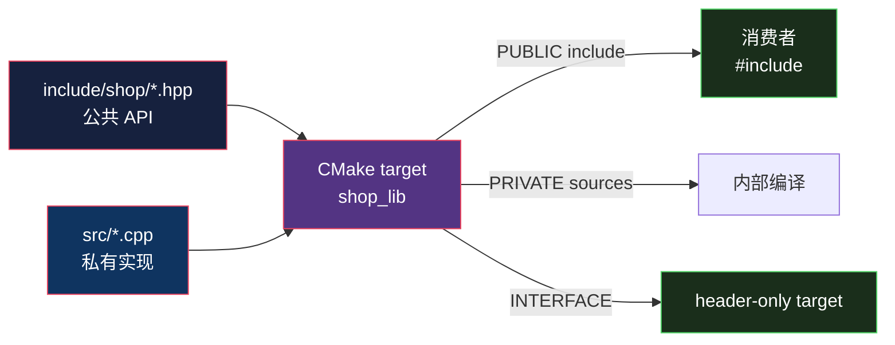

# C++ 项目结构：include 是借阅区，CMake target 才是边界

> 本文基于 Apple Clang 21.0.0 与 CMake 4.4.1，示例使用 C++23，在 macOS arm64 上实际编译运行。
> C++ 标准与目录结构无关；换成 GCC/Clang 或 C++20，布局思路不变。
> 系列：各语言项目结构最佳实践（C++ 分册）。

## 目录

- [先给结论](#先给结论)
- [生活比喻：图书馆的借阅区和书库](#生活比喻图书馆的借阅区和书库)
- [C++ 没有标准布局，但 CMake 有 target](#c-没有标准布局但-cmake-有-target)
- [最小项目：一个 main.cpp](#最小项目一个-maincpp)
- [库项目：include/ 与 src/ 分开](#库项目include-与-src-分开)
- [header-only 还是编译成库](#header-only-还是编译成库)
- [CMake 的目录和 target](#cmake-的目录和-target)
- [真实仓库之一：fmt 的 include/src/test](#真实仓库之一fmt-的-includesrctest)
- [真实仓库之二：OpenCV 的 modules](#真实仓库之二opencv-的-modules)
- [依赖、ABI 和二进制边界](#依赖abi-和二进制边界)
- [关键争议速查](#关键争议速查)
- [反模式](#反模式)
- [决策清单](#决策清单)
- [骨架代码与验证](#骨架代码与验证)
- [结语](#结语)
- [参考资料](#参考资料)

## 先给结论

C++ 没有官方项目布局。CMake 也不强制目录名，但它提供了一套非常清晰的**目标（target）模型**：

- 一个 CMake target 是一个构建/链接单元，通常对应一个库或可执行文件；
- `include/` 放公共头文件，`src/` 放实现；
- `target_include_directories(... PUBLIC ...)` 决定消费者能不能 `#include <...>`；
- `install(EXPORT ...)`、包管理器和 ABI 决定发布边界。

所以 C++ 结构的主线不是“目录怎么排”，而是：

> **哪些头文件是公共 API？哪些实现是私有的？哪个 target 是发布单元？**

`include/` 只是借阅区，**CMake target 才是门禁系统**。

## 生活比喻：图书馆的借阅区和书库

把 C++ 项目想成一座图书馆：

| 目录/文件 | 图书馆里的角色 | 作用 |
|-----------|----------------|------|
| `include/` | 借阅区 | 公共头文件，读者可以 `#include` |
| `src/` | 书库/后场 | 实现细节，不对外借阅 |
| `tests/` | 质检区 | 验证图书馆的目录和内容 |
| `CMakeLists.txt` | 馆藏总目录 + 借阅规则 | 定义 target、依赖和公开路径 |
| `build/` | 临时打包区 | 构建生成，不对外展示 |
| `third_party/` | 捐赠书架 | 外部依赖，必须标清来源和许可证 |
| target | 一个借阅窗口 | 有明确的开放范围和规则 |

公共头文件和私有实现的区别，就像“目录卡片”和“书库内部排架”：读者需要目录卡片（`include/`），但不需要知道书库怎么摆（`src/`）。**把书库暴露给读者，迟早会有人依赖内部排架。**

## C++ 没有标准布局，但 CMake 有 target

C++ 社区没有类似 Java Maven 那样的官方目录标准。常见约定来自 CMake 生态、Boost/Google 风格和大量开源项目：

```text
shop/
├── CMakeLists.txt
├── include/
│   └── shop/
│       └── pricing.hpp
├── src/
│   ├── pricing.cpp
│   └── main.cpp
├── tests/
│   └── pricing_test.cpp
└── build/                 # 构建生成，不提交
```

这套布局不是语言强制的，但它解决了三个实际问题：

1. **公共头文件和私有实现分开**：消费者只看到 `include/`；
2. **include 路径有命名空间**：`include/shop/pricing.hpp` → `#include <shop/pricing.hpp>`；
3. **CMake target 决定依赖和传播**：`PUBLIC` / `PRIVATE` / `INTERFACE` 不是装饰。

如果只记一句：

> **目录是给人看的，target 是给构建系统看的；C++ 的边界主要靠后者。**

## 最小项目：一个 main.cpp

一个单文件程序不需要 `include/src` 分离：

```text
hello/
├── CMakeLists.txt
└── main.cpp
```

```cpp
#include <iostream>

int main() {
    std::cout << "hello, C++\n";
}
```

```cmake
cmake_minimum_required(VERSION 3.25)
project(hello LANGUAGES CXX)

set(CMAKE_CXX_STANDARD 23)
set(CMAKE_CXX_STANDARD_REQUIRED ON)

add_executable(hello main.cpp)
```

```bash
$ cmake -S . -B build
$ cmake --build build
$ ./build/hello
hello, C++
```

**什么时候可以继续这样？**

- 只有一个可执行程序；
- 没有外部消费者；
- 没有需要单独发布的库；
- 代码量还不需要按模块拆。

**什么时候该动？**

- 出现了第二个可执行程序；
- 有人要 `#include` 你的代码；
- 你开始需要“公共头/私有实现”的区分；
- 构建开始需要多个 target 和依赖关系。

## 库项目：include/ 与 src/ 分开

一个典型的编译型库：

```text
shop/
├── CMakeLists.txt
├── include/
│   └── shop/
│       └── pricing.hpp
├── src/
│   └── pricing.cpp
└── tests/
    └── pricing_test.cpp
```

### 公共头文件

```cpp
// include/shop/pricing.hpp
#pragma once

namespace shop {

int total(int unit_cents, int quantity);

}  // namespace shop
```

消费者这样使用：

```cpp
#include <shop/pricing.hpp>
```

注意路径：**`include/shop/pricing.hpp` → `<shop/pricing.hpp>`**。这层 `shop/` 目录不是装饰，它防止不同库的 `pricing.hpp` 在 include 路径上互相冲突。

### 实现文件

```cpp
// src/pricing.cpp
#include <shop/pricing.hpp>

#include <stdexcept>

namespace shop {

int total(int unit_cents, int quantity) {
    if (unit_cents < 0 || quantity < 0) {
        throw std::invalid_argument("unit price and quantity must be non-negative");
    }
    return unit_cents * quantity;
}

}  // namespace shop
```

### CMake target

```cmake
add_library(shop_lib src/pricing.cpp)
target_include_directories(shop_lib PUBLIC ${CMAKE_CURRENT_SOURCE_DIR}/include)

add_executable(shop src/main.cpp)
target_link_libraries(shop PRIVATE shop_lib)
```

`PUBLIC` 的意思是：

- `shop_lib` 自己编译时用这个 include 路径；
- 链接 `shop_lib` 的 target（`shop`、测试）也自动获得这个路径。

如果写成 `PRIVATE`，只有 `shop_lib` 自己能找到 `<shop/pricing.hpp>`，消费者就得自己猜路径。**公共头文件的 include 路径必须传播，私有实现的路径不应该传播。**



## header-only 还是编译成库

### header-only

```text
json/
├── CMakeLists.txt
├── include/
│   └── nlohmann/
│       └── json.hpp
├── single_include/
│   └── nlohmann/
│       └── json.hpp
└── tests/
```

CMake：

```cmake
add_library(json INTERFACE)
target_include_directories(json INTERFACE ${CMAKE_CURRENT_SOURCE_DIR}/include)
```

- `INTERFACE` 表示“这个 target 没有自己的编译产物，只传播使用要求”；
- 适合模板库、小工具、单头文件库；
- 代价是编译时间、代码膨胀、ABI 不可控。

[nlohmann/json](https://github.com/nlohmann/json) 就是典型的 header-only 项目：`single_include/nlohmann/json.hpp` 是单头文件分发版，`include/nlohmann/*.hpp` 是拆分源。

### 编译成库

```text
shop/
├── include/shop/pricing.hpp
├── src/pricing.cpp
└── CMakeLists.txt
```

- 公共头文件只放声明；
- 实现放 `src/`；
- 编译成静态库或动态库；
- 可以控制 ABI、隐藏符号、减少编译时间。

**选择标准：**

| 场景 | 建议 |
|------|------|
| 模板库、小工具、单头文件 | header-only |
| 大型实现、需要 ABI 稳定 | 编译成库 |
| 多个消费者、想减少编译时间 | 编译成库 |
| 只有一两个源文件、内部使用 | 都可以，别过度设计 |

## CMake 的目录和 target

现代 CMake 的核心是 **target-based**，不是全局变量：

### 不要这样

```cmake
include_directories(include)       # 污染所有 target
link_directories(lib)              # 全局状态
add_definitions(-DFOO)             # 全局宏
```

### 应该这样

```cmake
target_include_directories(shop_lib PUBLIC include)
target_compile_features(shop_lib PUBLIC cxx_std_23)
target_link_libraries(shop PRIVATE shop_lib)
```

常用目录：

| 目录 | 放什么 | 是否公开 |
|------|--------|----------|
| `include/` | 公共头文件 | 是 |
| `src/` | 实现、私有头文件 | 否 |
| `tests/` | 测试代码 | 否 |
| `benchmarks/` | 性能测试 | 否 |
| `examples/` | 示例 | 否 |
| `cmake/` | `find_package` / 工具脚本 | 安装时可能需要 |
| `third_party/` | 第三方源码 | 按许可证处理 |
| `build/` | 构建生成 | 不提交 |

### 多模块

```text
shop/
├── CMakeLists.txt
├── libs/
│   ├── pricing/
│   │   ├── CMakeLists.txt
│   │   ├── include/shop/pricing.hpp
│   │   └── src/pricing.cpp
│   └── storage/
│       ├── CMakeLists.txt
│       ├── include/shop/storage.hpp
│       └── src/storage.cpp
└── apps/
    └── cli/
        ├── CMakeLists.txt
        └── src/main.cpp
```

每个子目录一个 target，顶层用 `add_subdirectory(...)` 组织。**目录边界和 target 边界最好一一对应**；否则 `add_subdirectory` 只是把文件堆在一起。

### 构建目录

```bash
$ cmake -S . -B build
$ cmake --build build
$ ctest --test-dir build --output-on-failure
```

`build/` 是 out-of-source 构建目录，不应提交。需要固定配置时用 `CMakePresets.json`，而不是把一堆 `-D` 参数散落在 README 里。

## 真实仓库之一：fmt 的 include/src/test

[fmt](https://github.com/fmtlib/fmt) 是一个现代 C++ 格式化库，结构很干净：

```text
fmt/
├── CMakeLists.txt
├── include/
│   └── fmt/
│       ├── core.h
│       ├── format.h
│       ├── base.h
│       ├── chrono.h
│       ├── color.h
│       └── ...
├── src/
│   ├── format.cc
│   ├── fmt.cc
│   ├── os.cc
│   └── fmt-c.cc
├── test/
│   ├── format-test.cc
│   ├── core-test.cc
│   └── ...
├── doc/
└── support/
```

（只列部分；main 分支，2026-11-16 快照，commit `14ac0d5a9d40`。）

值得学的点：

1. **`include/fmt/` 是公共头文件目录。** 消费者写 `#include <fmt/format.h>`；头文件路径带 `fmt/`，避免和别的库冲突。
2. **`src/` 是实现。** `format.cc`、`os.cc` 等编译进库；公共头文件只暴露声明和模板。
3. **`test/` 是独立测试目录。** 测试代码不会进入库的发布头文件或安装包。
4. **CMake target 是发布边界。** 库 target、头文件安装规则、`find_package(fmt)` 都围绕 target 组织。

**结论：库项目的核心不是“有没有 include 目录”，而是“公共头文件是否只依赖公共头文件，私有实现是否真的私有”。**

## 真实仓库之二：OpenCV 的 modules

[OpenCV](https://github.com/opencv/opencv) 是一个大型计算机视觉库，采用模块化结构：

```text
opencv/
├── CMakeLists.txt
├── modules/
│   ├── core/
│   │   ├── CMakeLists.txt
│   │   ├── include/opencv2/core/
│   │   │   ├── core.hpp
│   │   │   ├── base.hpp
│   │   │   └── ...
│   │   ├── src/
│   │   ├── test/
│   │   └── perf/
│   ├── imgproc/
│   ├── dnn/
│   ├── video/
│   └── ...
├── apps/
├── samples/
├── cmake/
├── 3rdparty/
├── platforms/
└── doc/
```

（只列部分；5.x 分支，2026-11-20 快照，commit `4b0b7c60864e`。）

它的结构逻辑：

1. **每个 module 是一个独立 CMake target。** `core`、`imgproc`、`dnn` 可以单独构建、链接和测试。
2. **每个 module 自带 `include/`、`src/`、`test/`、`perf/`。** 公共头文件在 `include/opencv2/<module>/`，实现和私有代码在 `src/`。
3. **`3rdparty/` 与 `cmake/` 是支撑设施。** 第三方依赖和 CMake 辅助脚本不混进业务模块。
4. **`apps/`、`samples/` 是消费方。** 它们链接模块 target，不反向被模块依赖。

**结论：大型 C++ 项目的模块化，不是把 `src/` 分成很多子目录，而是把每个可独立构建/链接的单元做成一个 target，并让公共头文件跟着 target 走。**

## 依赖、ABI 和二进制边界

C++ 的项目结构不只是源码目录，还包括二进制边界：

### 依赖管理

- **vcpkg / Conan**：用 manifest 或 conanfile 声明依赖，可复现；
- **CMake FetchContent**：构建时拉取源码，适合小依赖；
- **系统包管理器**：适合平台统一提供的库；
- **`third_party/` 直接 vendoring**：可以，但必须保留许可证、版本和来源。

**不要把依赖源码直接复制进 `src/`。** 这样既没有版本记录，也没有许可证边界。

### ABI 和导出

动态库需要明确哪些符号对外：

```cpp
#if defined(_WIN32)
#  ifdef SHOP_EXPORTS
#    define SHOP_API __declspec(dllexport)
#  else
#    define SHOP_API __declspec(dllimport)
#  endif
#else
#  define SHOP_API __attribute__((visibility("default")))
#endif

SHOP_API int total(int unit_cents, int quantity);
```

这不是“高级技巧”，而是公共 C++ 库的基本结构：

- 公共头文件暴露 API；
- 私有实现隐藏在 `src/`；
- 编译时用 `-fvisibility=hidden` 控制符号；
- pimpl 把实现细节从公共头文件里移走。

**如果你的公共头文件包含 `src/` 的内部头文件，你的 ABI 边界就已经漏了。**

## 关键争议速查

| 争议 | 我的建议 | 理由 |
|------|----------|------|
| 要不要 `include/` + `src/` | 对外库要；小工具可以不要 | 公共头和私有实现分离 |
| 头文件放 `include/foo/` 还是 `include/` | 带库名/命名空间子目录 | 避免 include 冲突 |
| `PUBLIC` 还是 `PRIVATE` include | 公共头路径用 `PUBLIC` | 消费者需要找到头文件 |
| header-only 还是编译库 | 模板/小库可 header-only；大实现编译成库 | 编译时间、ABI、符号控制 |
| 全局 `include_directories` | 不用；用 target 属性 | 避免污染所有 target |
| `build/` 提交吗 | 不提交 | 构建产物可重建 |
| 依赖放 `third_party/` 还是包管理器 | 优先包管理器；vendoring 要留来源/许可证 | 可复现和合规 |
| 要不要 pimpl | 公共 ABI 需要稳定时用 | 降低头文件依赖和 ABI 暴露 |
| 要不要导出宏 | 动态库、跨平台库要 | 明确符号可见性 |
| `#pragma once` 还是 include guard | 二选一，项目统一 | 都是防止重复包含 |

## 反模式

### 1. 所有头文件和源文件堆在根目录

```text
shop/
├── pricing.hpp
├── pricing.cpp
├── main.cpp
├── json.hpp
└── CMakeLists.txt
```

小项目可以；一旦有外部消费者，公共 API 和内部实现就分不清。

### 2. 公共头文件不带命名空间目录

```text
include/pricing.hpp
```

多个库都有 `pricing.hpp` 时，include 路径冲突。改成 `include/shop/pricing.hpp`，消费者写 `<shop/pricing.hpp>`。

### 3. 把 `src/` 加进公共 include 路径

```cmake
target_include_directories(shop_lib PUBLIC include src)
```

消费者会开始 include 你的私有头文件，`src/` 变成事实上的公共 API。**公共路径只放公共头。**

### 4. 全局 `include_directories`

```cmake
include_directories(include third_party/foo)
```

它污染所有 target，导致“谁都能 include 谁”，依赖关系不可见。用 `target_include_directories`。

### 5. 提交 `build/`

构建目录可能包含绝对路径、缓存和临时文件。它不属于源码，也不应该进 Git。

### 6. 公共头文件 include 私有头文件

```cpp
// include/shop/pricing.hpp
#include "../src/internal.hpp"  // 错
```

消费者会被迫依赖私有路径；安装后头文件也不完整。公共头只能依赖公共头或标准库。

### 7. `third_party/` 没有来源和许可证

直接复制一份第三方源码，既没有版本记录，也可能违反许可证。用包管理器，或保留完整来源、版本和 LICENSE。

## 决策清单

| 场景 | 推荐结构 | 关键动作 |
|------|----------|----------|
| 单文件小工具 | `main.cpp` + `CMakeLists.txt` | 不建 include/src |
| 内部小型库 | `include/<lib>/` + `src/` | 公共头路径用 `PUBLIC` |
| 对外发布的库 | `include/` + `src/` + install/export | 设计 ABI、导出符号 |
| header-only 库 | `include/<lib>/` + `INTERFACE` target | 控制编译时间 |
| 多模块项目 | `libs/<module>/` + `apps/` | 每个模块一个 target |
| 大型框架 | `modules/<module>/{include,src,test}` | 模块 target 独立构建 |
| 依赖第三方库 | vcpkg/Conan/FetchContent | 记录版本和许可证 |
| 需要稳定 ABI | pimpl + 导出宏 + 隐藏符号 | 公共头不泄漏实现 |

## 骨架代码与验证

下面是我实际编译运行的 CMake demo。

### 目录树

```text
shop/
├── CMakeLists.txt
├── include/
│   └── shop/
│       └── pricing.hpp
├── src/
│   ├── pricing.cpp
│   └── main.cpp
├── tests/
│   └── pricing_test.cpp
└── build/                 # 构建生成
```

### `CMakeLists.txt`

```cmake
cmake_minimum_required(VERSION 3.25)
project(shop LANGUAGES CXX)

set(CMAKE_CXX_STANDARD 23)
set(CMAKE_CXX_STANDARD_REQUIRED ON)
set(CMAKE_CXX_EXTENSIONS OFF)

add_library(shop_lib src/pricing.cpp)
target_include_directories(shop_lib PUBLIC ${CMAKE_CURRENT_SOURCE_DIR}/include)

add_executable(shop src/main.cpp)
target_link_libraries(shop PRIVATE shop_lib)

enable_testing()
add_executable(pricing_test tests/pricing_test.cpp)
target_link_libraries(pricing_test PRIVATE shop_lib)
add_test(NAME pricing COMMAND pricing_test)
```

### 公共头文件（骨架）

```cpp
// include/shop/pricing.hpp
#pragma once

namespace shop {

int total(int unit_cents, int quantity);

}  // namespace shop
```

### 实现与入口

```cpp
// src/pricing.cpp
#include <shop/pricing.hpp>

#include <stdexcept>

namespace shop {

int total(int unit_cents, int quantity) {
    if (unit_cents < 0 || quantity < 0) {
        throw std::invalid_argument("unit price and quantity must be non-negative");
    }
    return unit_cents * quantity;
}

}  // namespace shop
```

```cpp
// src/main.cpp
#include <shop/pricing.hpp>

#include <iostream>

int main() {
    std::cout << "total=" << shop::total(1250, 3) << '\n';
    return 0;
}
```

### 测试

```cpp
// tests/pricing_test.cpp
#include <shop/pricing.hpp>

#include <cassert>

int main() {
    assert(shop::total(1250, 3) == 3750);
    return 0;
}
```

### 验证命令与输出

```bash
$ cmake -S . -B build
-- The CXX compiler identification is AppleClang 21.0.0.21000099
-- Detecting CXX compiler ABI info
-- Check for working CXX compiler: /usr/bin/c++ - skipped
-- Configuring done
-- Generating done
-- Build files have been written to: .../shop/build

$ cmake --build build
[ 16%] Building CXX object CMakeFiles/shop_lib.dir/src/pricing.cpp.o
[ 33%] Linking CXX static library libshop_lib.a
[ 33%] Built target shop_lib
[ 50%] Building CXX object CMakeFiles/shop.dir/src/main.cpp.o
[ 66%] Linking CXX executable shop
[ 66%] Built target shop
[ 83%] Building CXX object CMakeFiles/pricing_test.dir/tests/pricing_test.cpp.o
[100%] Linking CXX executable pricing_test
[100%] Built target pricing_test

$ ./build/shop
total=3750

$ ctest --test-dir build --output-on-failure
    Start 1: pricing
1/1 Test #1: pricing ..........................   Passed

100% tests passed out of 1
```

（输出有删节，CMake 的路径做了简化。）

这里的边界是：

- `include/` 只放公共头；
- `src/` 放实现；
- `shop_lib` 是库 target，`shop` 和 `pricing_test` 是消费者；
- 公共 include 路径通过 `PUBLIC` 传播，私有实现不暴露。

## 结语

C++ 项目结构可以收束成三句话：

1. **C++ 没有官方布局，但 CMake target 是真实边界。** 目录可以自由，target 的依赖和可见性不能含糊。
2. **`include/` 是借阅区，`src/` 是书库。** 公共头文件只依赖公共头；实现细节留在 `src/`。
3. **发布边界要显式。** 安装规则、导出宏、ABI、依赖管理，都是结构的一部分，不只是目录。

系列到这里，七种语言分册 + 一篇反模式总纲已经齐了。项目结构没有唯一答案，但有一条稳定的判断线：**先找发布单元，再让目录和工具边界跟着它走。**

## 参考资料

- [CMake：target_include_directories](https://cmake.org/cmake/help/latest/command/target_include_directories.html)
- [CMake Tutorial](https://cmake.org/cmake/help/latest/guide/tutorial/)
- [C++ Core Guidelines](https://isocpp.github.io/CppCoreGuidelines/CppCoreGuidelines)
- [fmt 源码](https://github.com/fmtlib/fmt)
- [OpenCV 源码](https://github.com/opencv/opencv)
- [nlohmann/json 源码](https://github.com/nlohmann/json)
- [vcpkg](https://vcpkg.io/)
- [Conan](https://conan.io/)
