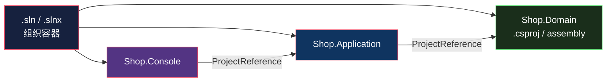

# C# / .NET 项目结构：.csproj 是墙，.sln 是园区地图

> 本文基于 .NET SDK 11.0.100；示例在 macOS arm64 上实际构建运行。
> 系列：各语言项目结构最佳实践（C# / .NET 分册）。

## 目录

- [先给结论](#先给结论)
- [生活比喻：园区、楼栋和房间](#生活比喻园区楼栋和房间)
- [solution / project / namespace 三层](#solution-project-namespace-三层)
- [SDK-style csproj 与目录](#sdk-style-csproj-与目录)
- [src/ + tests/：单应用](#src-tests单应用)
- [Clean Architecture：多 project 的依赖方向](#clean-architecture多-project-的依赖方向)
- [eShop：按服务拆 project](#eshop按服务拆-project)
- [共享构建：Directory.Build.props 与 Packages.props](#共享构建directorybuildprops-与-packagesprops)
- [测试项目](#测试项目)
- [关键争议速查](#关键争议速查)
- [反模式](#反模式)
- [决策清单](#决策清单)
- [骨架代码与验证](#骨架代码与验证)
- [结语](#结语)
- [参考资料](#参考资料)

## 先给结论

.NET 项目结构有三层，但很多人只看到两层：

| 层级 | 文件/概念 | 作用 |
|------|-----------|------|
| solution | `.sln` / `.slnx` | 组织容器，把多个 project 放进一张地图 |
| project | `.csproj` | 编译/发布单元，通常对应一个 assembly |
| namespace | `namespace Shop.Domain;` | 代码命名空间，不负责构建边界 |

关键判断：

> **`.csproj` 才是墙，`.sln` 只是园区地图。** 项目引用（ProjectReference）决定哪些楼能互通；`internal` 决定哪些房间只对楼内开放。

Clean Architecture 之所以常见，不是因为它有四个好听的名字，而是因为 `.NET` 的项目引用天然能表达**依赖方向**：

```text
Domain ← Application ← Infrastructure
                  ↑
                 Web
```

箭头指向内层：外层可以引用内层，内层不能引用外层。

## 生活比喻：园区、楼栋和房间

把 .NET 解决方案想成一个园区：

| 概念 | 园区里的角色 | 作用 |
|------|--------------|------|
| `.sln` / `.slnx` | 园区地图 | 组织多个 project，不决定依赖 |
| `.csproj` | 一栋楼 / assembly | 编译、打包、引用的边界 |
| `namespace` | 楼里的房间编号 | 代码命名空间 |
| ProjectReference | 楼与楼之间的天桥 | 只有被引用的楼才能互通 |
| `internal` | 楼内门禁 | 同一 assembly 可见，外部不可见 |
| `Directory.Build.props` | 园区统一规范 | 所有楼共享的 MSBuild 属性 |
| `Directory.Packages.props` | 园区统一采购清单 | 集中管理 NuGet 包版本 |
| `global.json` | 园区准入证 | 固定 SDK 版本 |
| `bin/` / `obj/` | 施工垃圾 | 构建产物，不提交 |

Clean Architecture 就像园区规划：`Domain` 是最里面的核心区，`Application` 围绕它，`Infrastructure` 和 `Web` 在外围。**外围可以依赖核心，核心不能反过来依赖外围。**

## solution / project / namespace 三层

### solution：组织容器

```text
Shop.slnx
├── src/Shop.Domain/Shop.Domain.csproj
├── src/Shop.Application/Shop.Application.csproj
├── src/Shop.Console/Shop.Console.csproj
└── tests/Shop.Domain.Tests/Shop.Domain.Tests.csproj
```

`.slnx` 是较新的 XML solution 格式，`.sln` 是经典格式。SDK 11 的 `dotnet new sln` 默认生成 `.slnx`；旧工具链和部分 IDE 仍用 `.sln`。两者都能被 `dotnet build` / `dotnet test` 使用。

**solution 不决定依赖。** 把两个 project 放进同一个 solution，不代表它们可以互相引用；依赖由 `.csproj` 的 `ProjectReference` 决定。

### project：编译和发布单元

一个 `.csproj` 通常产出一个 assembly：

- `classlib` → `.dll`；
- `console` / `web` → 可执行程序；
- `xunit` → 测试 assembly。

项目之间的引用：

```xml
<ItemGroup>
  <ProjectReference Include="..\Shop.Domain\Shop.Domain.csproj" />
</ItemGroup>
```

**循环引用会直接构建失败。** 这是 .NET 项目边界比目录边界更可靠的地方：依赖关系由编译器检查。

### namespace：代码命名空间

```csharp
namespace Shop.Domain;

public static class Pricing
{
    public static int Total(int unitCents, int quantity)
        => unitCents * quantity;
}
```

namespace 可以和 project 名不一致，但通常保持一致：

- `Shop.Domain` project → `Shop.Domain` namespace；
- 子目录可以形成子命名空间；
- namespace 不是安全边界；`internal` 才是 assembly 边界。



## SDK-style csproj 与目录

现代 .NET 使用 SDK-style `.csproj`：

```xml
<Project Sdk="Microsoft.NET.Sdk">
  <PropertyGroup>
    <TargetFramework>net11.0</TargetFramework>
    <OutputType>Exe</OutputType>
    <ImplicitUsings>enable</ImplicitUsings>
    <Nullable>enable</Nullable>
  </PropertyGroup>

  <ItemGroup>
    <ProjectReference Include="..\Shop.Application\Shop.Application.csproj" />
  </ItemGroup>
</Project>
```

和旧的 `.csproj` 相比，SDK-style 不需要：

- 手动列每个 `.cs` 文件（默认按目录包含）；
- 手动写 `AssemblyInfo.cs`（SDK 生成）；
- 手动配置 `bin/obj`（默认约定）。

**目录约定：**

```text
shop/
├── Shop.slnx
├── global.json
├── Directory.Build.props
├── Directory.Packages.props
├── src/
│   ├── Shop.Domain/
│   ├── Shop.Application/
│   └── Shop.Console/
└── tests/
    └── Shop.Domain.Tests/
```

- `src/` 放生产 project；
- `tests/` 放测试 project；
- `global.json` 固定 SDK；
- `Directory.Build.props` / `Directory.Packages.props` 放共享构建配置；
- `bin/`、`obj/` 不提交。

**小项目可以只有一个 project，不一定要 `src/`。** `dotnet new console` 生成的就是根目录一个 `.csproj` + `Program.cs`；先跑起来，再按需要拆。

## src/ + tests/：单应用

一个典型的单应用：

```text
shop/
├── Shop.slnx
├── src/
│   └── Shop.Api/
│       ├── Shop.Api.csproj
│       ├── Program.cs
│       ├── appsettings.json
│       ├── appsettings.Development.json
│       └── Endpoints/
└── tests/
    └── Shop.Api.Tests/
        └── Shop.Api.Tests.csproj
```

- `Program.cs` 是入口；
- `appsettings.json` 是配置；
- `Endpoints/` 可以按 feature 放 Minimal API 端点；
- 测试 project 单独放 `tests/`，通过 `ProjectReference` 引用 API project；
- **生产 project 不引用测试 project**，依赖方向单向。

如果是 ASP.NET Core MVC，常见目录是 `Controllers/`、`Views/`、`Models/`；如果是 Minimal API，常见是 `Endpoints/` 或按 feature 分目录。**跟项目模板和团队约定走，不要为了“统一”把 MVC 改成 Minimal API 的目录。**

## Clean Architecture：多 project 的依赖方向

[jasontaylordev/CleanArchitecture](https://github.com/jasontaylordev/CleanArchitecture) 是一个流行的 .NET Clean Architecture 模板：

```text
CleanArchitecture/
├── CleanArchitecture.slnx
├── Directory.Build.props
├── Directory.Packages.props
├── global.json
├── src/
│   ├── AppHost/
│   ├── Application/
│   ├── Domain/
│   ├── Infrastructure/
│   ├── ServiceDefaults/
│   ├── Shared/
│   └── Web/
└── tests/
    ├── Application.FunctionalTests/
    ├── Application.UnitTests/
    ├── Domain.UnitTests/
    ├── Infrastructure.IntegrationTests/
    ├── TestAppHost/
    └── Web.AcceptanceTests/
```

（只列部分；main 分支，2026-11-17 快照，commit `9e1042be109b`。）

依赖方向：

| Project | 可以依赖 | 不应该依赖 |
|---------|----------|------------|
| `Domain` | 无（或极少的 BCL） | Application、Infrastructure、Web |
| `Application` | Domain | Infrastructure、Web |
| `Infrastructure` | Application、Domain | Web |
| `Web` | Application、Infrastructure | — |
| `AppHost` / `ServiceDefaults` | 编排/基础设施 | 业务逻辑 |

几个关键点：

1. **`Domain` 不依赖 EF Core、ASP.NET Core。** 它只放实体、值对象、领域规则；这样才能独立测试和演进。
2. **`Application` 依赖 `Domain`，定义用例和接口。** 它不关心数据库怎么实现。
3. **`Infrastructure` 实现 `Application` 的接口。** EF Core、HTTP 客户端、消息队列都在这里。
4. **`Web` 是组合根。** 它引用 Application/Infrastructure，把依赖注入容器拼起来。
5. **测试按层拆。** 单元测试、集成测试、验收测试各有自己的 project；测试依赖不会进入生产 assembly。

**Clean Architecture 不是“必须有四个 project”。** 一个小 API 用一个 project 也完全可以；只有当你需要隔离领域、替换基础设施、独立测试时才拆。

### `internal` 是 assembly 边界

```csharp
internal sealed class OrderRepository
{
    // 只能在当前 assembly 内访问
}
```

- `internal` 默认对同一 assembly 可见；
- 测试 project 如果需要访问内部类型，可以用 `InternalsVisibleTo`：

```csharp
[assembly: InternalsVisibleTo("Shop.Domain.Tests")]
```

- 不要把 `InternalsVisibleTo` 当成默认配置；它扩大了测试与实现的耦合。

## eShop：按服务拆 project

[dotnet/eShop](https://github.com/dotnet/eShop) 是一个云原生示例，结构更接近真实的多服务系统：

```text
eShop/
├── eShop.slnx
├── Directory.Build.props
├── Directory.Packages.props
├── global.json
├── src/
│   ├── Basket.API/
│   ├── Catalog.API/
│   ├── Identity.API/
│   ├── Ordering.API/
│   ├── Ordering.Domain/
│   ├── Ordering.Infrastructure/
│   ├── PaymentProcessor/
│   ├── WebApp/
│   ├── EventBus/
│   ├── EventBusRabbitMQ/
│   ├── Shared/
│   ├── eShop.AppHost/
│   └── eShop.ServiceDefaults/
└── tests/
    ├── Basket.UnitTests/
    ├── Basket.FunctionalTests/
    ├── Catalog.UnitTests/
    ├── Catalog.FunctionalTests/
    ├── Ordering.UnitTests/
    ├── Ordering.FunctionalTests/
    ├── Webhooks.FunctionalTests/
    └── ...
```

（只列部分；main 分支，2026-11-19 快照，commit `ab10e4c68fd2`。）

它的拆分逻辑：

1. **每个可部署服务一个 project。** `Basket.API`、`Catalog.API`、`Ordering.API` 各自是部署单元。
2. **复杂服务再拆 Domain / Infrastructure。** `Ordering` 有独立的 `Ordering.Domain` 和 `Ordering.Infrastructure`；不是所有服务都需要。
3. **共享基础设施独立成 project。** `EventBus`、`EventBusRabbitMQ`、`Shared` 被多个服务引用。
4. **AppHost / ServiceDefaults 负责本地编排。** `eShop.AppHost` 用 Aspire 把服务、数据库、消息队列串起来；`ServiceDefaults` 放共享的服务默认配置。
5. **测试按服务和测试类型拆。** 单元测试、功能测试分别放在对应目录，测试引用生产 project，反向不成立。

**结论：多服务项目按“部署单元”拆 project，而不是按“技术层”拆整个仓库。**

## 共享构建：Directory.Build.props 与 Packages.props

大型 .NET 仓库通常有这些根文件：

```text
Directory.Build.props
Directory.Packages.props
global.json
nuget.config
```

### `Directory.Build.props`

MSBuild 会从项目目录向上查找 `Directory.Build.props`，把属性应用到所有子项目：

```xml
<Project>
  <PropertyGroup>
    <Nullable>enable</Nullable>
    <ImplicitUsings>enable</ImplicitUsings>
    <TreatWarningsAsErrors>true</TreatWarningsAsErrors>
  </PropertyGroup>
</Project>
```

适合放：

- `Nullable`、`LangVersion`、`ImplicitUsings`；
- 统一的 `TreatWarningsAsErrors`；
- 版本号、公司名、构建输出路径。

**不要把所有配置都塞进去。** 项目特有的属性留在 `.csproj`；共享配置才放根文件。

### `Directory.Packages.props`

集中管理 NuGet 包版本：

```xml
<Project>
  <PropertyGroup>
    <ManagePackageVersionsCentrally>true</ManagePackageVersionsCentrally>
  </PropertyGroup>

  <ItemGroup>
    <PackageVersion Include="Microsoft.EntityFrameworkCore" Version="10.0.0" />
  </ItemGroup>
</Project>
```

子项目只写包名，不写版本：

```xml
<ItemGroup>
  <PackageReference Include="Microsoft.EntityFrameworkCore" />
</ItemGroup>
```

好处是版本不会在 20 个 project 里漂移；升级只改一处。

### `global.json`

```json
{
  "sdk": {
    "version": "10.0.100",
    "rollForward": "latestMajor",
    "allowPrerelease": false
  }
}
```

- 固定 SDK 版本，避免“我机器上能编译”；
- `rollForward` 决定找不到指定 SDK 时是否允许升级；
- CI 和本地用同一份 `global.json`。

（CleanArchitecture 当前 pin 的是 `10.0.100`，同时提供 `net10.0` / `net11.0` 的包版本文件；本文示例用 SDK 11 构建。）

## 测试项目

.NET 的测试项目约定很清楚：

```text
tests/
├── Shop.Domain.Tests/
│   ├── Shop.Domain.Tests.csproj
│   └── PricingTests.cs
└── Shop.Api.FunctionalTests/
    ├── Shop.Api.FunctionalTests.csproj
    └── ...
```

- 测试 project 引用生产 project；
- 生产 project 不引用测试 project；
- `xunit` / `nunit` / `mstest` 都是独立模板；
- `dotnet test` 自动发现并运行；
- 集成测试常用 `WebApplicationFactory`、Testcontainers；
- 测试项目命名通常以 `.Tests`、`.UnitTests`、`.FunctionalTests` 结尾。

**不要为了方便，把测试代码放进生产 project。** 它会把测试依赖、测试入口和测试数据带进发布产物。

## 关键争议速查

| 争议 | 我的建议 | 理由 |
|------|----------|------|
| 一个 project 还是多个 | 先一个；有独立部署/复用/依赖隔离再拆 | project 是 assembly/发布边界 |
| Clean Architecture 四层 | 复杂业务再上；小项目别硬套 | 依赖方向比目录名重要 |
| `.sln` 还是 `.slnx` | 新项目可用 `.slnx`；老工具链用 `.sln` | SDK 11 默认 `.slnx`，两者都支持 |
| 要不要 `Common` / `Shared` | 谨慎；必须有明确消费者 | 容易变成全局依赖 |
| `internal` 还是 `public` | 默认 `internal`；对外才 `public` | 公开就是兼容性承诺 |
| `InternalsVisibleTo` | 只在测试确需内部访问时用 | 会扩大测试与实现的耦合 |
| 集中包版本 | 大型仓库用 `Directory.Packages.props` | 避免版本漂移 |
| `global.json` | 推荐提交 | 固定 SDK，保证 CI 一致 |
| 测试放哪 | 独立 `tests/` project | 不污染生产 assembly |
| `bin/obj` 提交吗 | 不提交 | 构建产物可重建 |

## 反模式

### 1. 五个类的项目拆四层

```text
src/
├── Domain/
├── Application/
├── Infrastructure/
└── Web/
```

一个只有 5 个类的 CRUD 应用拆四层，每改一个字段要动四个 project。**分层是复杂度工具，不是身份象征。**

### 2. `Common` / `Shared` 变成万能仓库

所有 project 都引用它，最后它不能独立发布、不能删代码、不能升级。共享代码必须有明确消费者；否则放在使用方本地。

### 3. 循环 ProjectReference

`Order.Application` 引用 `Order.Infrastructure`，`Order.Infrastructure` 又引用 `Order.Application`。.NET 构建会失败；正确做法是抽接口/契约，或重新划依赖方向。

### 4. 所有类型都 `public`

没有 `internal`，等于放弃 assembly 边界。库的公共 API 要克制；内部实现尽量 `internal`。

### 5. Clean Architecture 只学了目录

四个 project 都在，但 `Domain` 引用了 EF Core，`Application` 直接 new `DbContext`。**依赖方向已经反了，目录只是装饰。**

### 6. 提交 `bin/` / `obj/` / `.vs/`

构建产物和 IDE 缓存不该进 Git。`.gitignore` 要覆盖它们；发布由 `dotnet build` / `dotnet publish` 生成。

### 7. 多个重叠的 solution

仓库里有 5 个 `.sln`，每个包含不同的 project 子集，没人知道哪个是权威。**一个仓库通常一个主 solution；子集用 solution filter (`.slnf`) 或 build 脚本表达。**

### 8. 不固定 SDK

没有 `global.json`，本地和 CI 用不同 SDK，构建行为不一致。把 SDK 版本当成依赖的一部分。

## 决策清单

| 场景 | 推荐结构 | 关键动作 |
|------|----------|----------|
| 小工具 / 单 API | 一个 project + 可选 `tests/` | 先跑起来，别拆层 |
| 有单元测试的应用 | `src/` + `tests/` | 测试 project 引用生产 project |
| 复杂业务应用 | Domain / Application / Infrastructure / Web | 依赖向内，Domain 不依赖框架 |
| 多服务系统 | `src/<Service>.API/` + 共享 project | 按部署单元拆 |
| 可复用库 | `src/<Lib>/` + `tests/` | 设计 `public` API，`internal` 藏实现 |
| 多服务本地编排 | `AppHost` + `ServiceDefaults` | Aspire 管服务依赖 |
| 大型仓库 | `Directory.Build.props` + `Directory.Packages.props` + `global.json` | 构建配置集中管理 |

## 骨架代码与验证

下面是我实际构建运行的 demo。

### 目录树

```text
dotnet-demo/
├── Shop.slnx
└── src/
    ├── Shop.Domain/
    │   ├── Shop.Domain.csproj
    │   └── Pricing.cs
    ├── Shop.Application/
    │   ├── Shop.Application.csproj
    │   └── PricingService.cs
    └── Shop.Console/
        ├── Shop.Console.csproj
        └── Program.cs
```

### `Shop.slnx`

```xml
<Solution>
  <Folder Name="/src/">
    <Project Path="src/Shop.Domain/Shop.Domain.csproj" />
    <Project Path="src/Shop.Application/Shop.Application.csproj" />
    <Project Path="src/Shop.Console/Shop.Console.csproj" />
  </Folder>
</Solution>
```

### `.csproj` 依赖

```xml
<!-- Shop.Application.csproj -->
<ItemGroup>
  <ProjectReference Include="..\Shop.Domain\Shop.Domain.csproj" />
</ItemGroup>
```

```xml
<!-- Shop.Console.csproj -->
<PropertyGroup>
  <OutputType>Exe</OutputType>
  <TargetFramework>net11.0</TargetFramework>
</PropertyGroup>

<ItemGroup>
  <ProjectReference Include="..\Shop.Application\Shop.Application.csproj" />
</ItemGroup>
```

### 代码

```csharp
// src/Shop.Domain/Pricing.cs
namespace Shop.Domain;

public static class Pricing
{
    public static int Total(int unitCents, int quantity)
    {
        if (unitCents < 0 || quantity < 0)
        {
            throw new ArgumentOutOfRangeException(nameof(quantity), "unit price and quantity must be non-negative");
        }

        return unitCents * quantity;
    }
}
```

```csharp
// src/Shop.Application/PricingService.cs
using Shop.Domain;

namespace Shop.Application;

public static class PricingService
{
    public static int Total(int unitCents, int quantity)
        => Pricing.Total(unitCents, quantity);
}
```

```csharp
// src/Shop.Console/Program.cs
using Shop.Application;

Console.WriteLine($"total={PricingService.Total(1250, 3)}");
```

### 验证命令与输出

```bash
$ dotnet --version
11.0.100

$ dotnet sln Shop.slnx list
Project(s)
----------
src/Shop.Application/Shop.Application.csproj
src/Shop.Console/Shop.Console.csproj
src/Shop.Domain/Shop.Domain.csproj

$ dotnet build Shop.slnx --nologo
...
Shop.Domain -> .../Shop.Domain/bin/Debug/net11.0/Shop.Domain.dll
Shop.Application -> .../Shop.Application/bin/Debug/net11.0/Shop.Application.dll
Shop.Console -> .../Shop.Console/bin/Debug/net11.0/Shop.Console.dll

Build succeeded.
    0 Warning(s)
    0 Error(s)

$ dotnet run --project src/Shop.Console/Shop.Console.csproj
total=3750
```

（构建路径做了简化，重复的构建行有删节。）

依赖方向是：

```text
Shop.Console → Shop.Application → Shop.Domain
```

如果让 `Shop.Domain` 反过来引用 `Shop.Application`，构建会失败；这是 project 引用提供的真实边界。

## 结语

C# / .NET 项目结构可以收束成三句话：

1. **`.sln` 是地图，`.csproj` 是楼。** solution 只组织，project 才决定编译、发布和依赖。
2. **依赖方向比目录名重要。** Clean Architecture 的核心是“外层依赖内层”，不是“必须有四个文件夹”。
3. **共享构建配置要集中，项目边界要克制。** `Directory.Build.props` / `Directory.Packages.props` / `global.json` 统一环境；`internal` 和 ProjectReference 守住边界。

下一篇是系列的收尾：把前面各语言反复出现的反模式集中起来，给一张“项目结构自检表”。

## 参考资料

- [.NET：Project SDK overview](https://learn.microsoft.com/dotnet/core/project-sdk/overview)
- [.NET：dotnet sln command](https://learn.microsoft.com/dotnet/core/tools/dotnet-sln)
- [.NET：global.json overview](https://learn.microsoft.com/dotnet/core/tools/global-json)
- [NuGet：Central Package Management](https://learn.microsoft.com/nuget/consume-packages/central-package-management)
- [.NET：MSBuild props and targets](https://learn.microsoft.com/visualstudio/msbuild/customize-by-directory)
- [Clean Architecture 模板](https://github.com/jasontaylordev/CleanArchitecture)
- [eShop 示例](https://github.com/dotnet/eShop)
