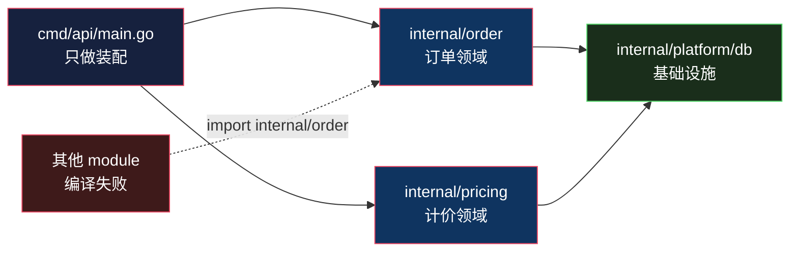

# Go 项目结构：没有官方标准，只有编译器替你守住的边界

> 本文基于 Go 1.26.2（`go version`），示例在 macOS arm64 上实际编译运行。
> 系列：各语言项目结构最佳实践（Go 分册）。

## 目录

- [先给结论](#先给结论)
- [生活比喻：园区、门禁和对外窗口](#生活比喻园区门禁和对外窗口)
- [Go 的构建模型：module、package、目录](#go-的构建模型modulepackage目录)
- [官方怎么说：按项目类型给建议](#官方怎么说按项目类型给建议)
- [小项目：一个 main.go 就够了](#小项目一个-maingo-就够了)
- [中大型：cmd/ + internal/ + 领域包](#中大型cmd-internal-领域包)
- [亲身验证：internal 是编译器在守门](#亲身验证internal-是编译器在守门)
- [pkg/ 到底该不该有](#pkg-到底该不该有)
- [真实仓库之一：Gin 把根目录当公共 API](#真实仓库之一gin-把根目录当公共-api)
- [真实仓库之二：Prometheus 用领域目录代替 pkg](#真实仓库之二prometheus-用领域目录代替-pkg)
- [关键争议速查](#关键争议速查)
- [反模式](#反模式)
- [决策清单](#决策清单)
- [骨架代码与验证](#骨架代码与验证)
- [结语](#结语)
- [参考资料](#参考资料)

## 先给结论

Go 官方没有规定唯一布局。官方文档按项目类型给建议，社区里流传最广的 `golang-standards/project-layout` 也明确写着：

> This is **NOT an official standard defined by the core Go dev team**.

那 Go 的项目结构为什么还相对好讨论？因为它有一条别的语言少有的**编译器强制边界**：

- `go.mod` 定义 module 边界；
- 目录定义 package 边界；
- 路径里出现 `internal/`，目录树外部的代码就**不能 import**，这是工具链拒绝，不是代码规范。

所以 Go 的结构问题可以浓缩成一句话：

> **先分清哪些包要给外人用，哪些包只给自己用；其余的目录，都是导航问题。**

## 生活比喻：园区、门禁和对外窗口

把 Go 项目想成一个园区：

| 目录 | 园区里的角色 | 作用 |
|------|--------------|------|
| `main.go` / `cmd/` | 大门 | 每个可执行程序一个入口； `main` 只负责开门、指路、装配 |
| `internal/` | 员工通道 | 门禁由 Go 编译器把守；外部 module 刷不开 |
| `pkg/`（如果存在） | 对外营业窗口 | 明确给外部 import 的包；没有对外业务就不需要开窗 |
| `go.mod` | 地契 | 定义 module 边界和依赖版本 |
| `go.work` | 园区总平面图 | 本地把多个 module 串起来，不改变各自的地契 |

小项目就是临街小店：门就是柜台，不需要大门、门禁和营业窗口。**给一间 20 平米的小店装三层门禁，只会让客人进不来。**

## Go 的构建模型：module、package、目录

理解 Go 结构，先记住三层关系：

```text
module ──包含──> package ──对应──> 目录
  │                 │
  │                 └── 一个目录里的 .go 文件必须属于同一个 package
  └── go.mod 定义 import 前缀和版本
```

几个直接推论：

1. **Go 没有 `src/` 目录。** 目录本身就是 package；import 路径 = module path + 相对目录。Java 的 `src/main/java`、Python 的 `src/` 都不是 Go 的习惯。
2. **入口也是一个 package。** `package main` + `func main` 才能编译成可执行文件；`main` 可以放在根目录，也可以放在 `cmd/<name>/`。
3. **测试通常和代码同目录。** 单元测试是 `*_test.go`，跟被测试文件放一起；`testdata/` 是 Go 工具链特殊忽略的测试数据目录。
4. **一个目录只能有一个包名。** 你不能在同一个目录里混 `package order` 和 `package pricing`；想拆包，先拆目录。（测试文件可以用 `package order_test` 从外部测试同一个包，这是唯一常见的例外。）

这也是为什么 Go 的项目结构看起来比 Java/Python“浅”：**目录不是分类标签，它就是编译单元。**

## 官方怎么说：按项目类型给建议

Go 官方文档 [Organizing a Go module](https://go.dev/doc/modules/layout) 开头就说：

> This guide is organized by project type.

它没有给出一棵“标准树”，而是按项目类型分别建议。

### 1. 基础库：所有代码在根目录

```text
project-root/
├── go.mod
├── modname.go
└── modname_test.go
```

`go.mod` 里写 `module github.com/someuser/modname`，根目录的 Go 文件声明 `package modname`。别人这样 import：

```go
import "github.com/someuser/modname"
```

这是最简单的 Go 库。**根目录就是公共 API**，没有 `src/`，没有 `lib/`。

### 2. 基础命令：根目录一个 `main.go`

```text
project-root/
├── go.mod
├── main.go
├── auth.go
└── auth_test.go
```

所有文件都声明 `package main` 也可以，只要没有多个 `func main`。`main.go` 只是约定，不是编译器要求。

### 3. 多包项目 / 服务：`internal/`，必要时加 `cmd/`

官方给的服务项目结构大致是：

```text
project-root/
├── go.mod
├── internal/
│   ├── auth/
│   ├── metrics/
│   └── model/
├── cmd/
│   ├── api-server/
│   │   └── main.go
│   └── metrics-analyzer/
│       └── main.go
└── ...非 Go 文件目录
```

官方原话有两条很关键：

> Initially, it's recommended placing such packages into a directory named `internal`; this prevents other modules from depending on packages we don't necessarily want to expose and support for external uses.

> It's recommended to keep packages in `internal` as much as possible.

翻译成人话：**默认把实现藏进 `internal/`；只有明确要给别人用的包，才放到外面。**

这不是审美建议，是 API 治理建议。

## 小项目：一个 main.go 就够了

先看一个真实可运行的最小项目：

```text
hello/
├── go.mod
└── main.go
```

```go
// main.go
package main

import "fmt"

func main() {
	fmt.Println("hello, Go")
}
```

```bash
$ go mod init example.com/hello
go: creating new go.mod: module example.com/hello

$ go run .
hello, Go
```

**什么时候可以继续这样？**

- 只有一个可执行程序；
- 只有一个作者（或很小的小组）；
- 没有外部用户 import 你的代码；
- 业务逻辑还没有多到需要按领域分目录。

**什么时候该动？** 出现下面任意一个信号：

- 根目录的 `.go` 文件超过十来个，找文件开始靠搜索；
- 出现了第二个可执行入口（比如 `server` 和 `migrate`）；
- 你开始想把某些函数“藏起来”，不让别的项目 import；
- 测试文件和生产文件混在一起已经影响阅读。

注意：**“文件多”本身不是拆包的充分理由。** 拆包的驱动力应该是边界，不是数量。

## 中大型：cmd/ + internal/ + 领域包

一个典型的单服务结构：

```text
shop/
├── go.mod
├── cmd/
│   └── api/
│       └── main.go
├── internal/
│   ├── order/
│   │   ├── order.go
│   │   ├── service.go
│   │   └── repository.go
│   ├── pricing/
│   │   ├── pricing.go
│   │   └── pricing_test.go
│   └── platform/
│       └── db/
│           └── postgres.go
├── api/
│   └── openapi.yaml
├── configs/
│   └── config.example.yaml
├── migrations/
└── scripts/
```

每一层都有自己的职责：



### `cmd/`：入口薄，业务厚

`cmd/api/main.go` 只做四件事：

1. 解析启动参数 / 环境变量；
2. 初始化依赖（数据库、日志、配置）；
3. 组装 `internal/` 里的服务；
4. 启动 HTTP server 或 worker。

**不要把业务逻辑写进 `main.go`。** 一旦写进去，你就没法在测试里单独调用它，也没法给第二个入口复用。

### `internal/`：默认私有

`internal/` 下的包，只能被**以 `internal` 的父目录为根**的代码 import。举例：

- module 是 `example.com/shop`；
- `internal/pricing` 的 import 路径是 `example.com/shop/internal/pricing`；
- 只有 `example.com/shop/...` 这棵树里的包能 import 它；
- `example.com/other` 不行。

这条规则由 Go 工具链执行，不依赖 code review。

### 领域包 vs 技术层包

两种拆法：

```text
internal/
├── order/
│   ├── order.go
│   ├── service.go
│   └── repository.go
└── pricing/
    ├── pricing.go
    └── pricing_test.go
```

或者：

```text
internal/
├── handler/
├── service/
├── repository/
└── model/
```

小 CRUD 用后者没问题；当业务开始复杂，前者通常更抗变化。判断标准还是那个：

> **一次业务改动，通常落在几个目录？**

如果每次改订单都要在 `handler/`、`service/`、`repository/`、`model/` 之间来回跳，说明技术层目录已经在阻碍你理解业务；该考虑按领域拆了。

## 亲身验证：internal 是编译器在守门

空口说“编译器会拦住”不够直观。下面是我在本机实际跑出来的结果。

项目结构：

```text
shop/
├── go.mod
├── cmd/
│   └── api/
│       └── main.go
└── internal/
    └── pricing/
        ├── pricing.go
        └── pricing_test.go
```

`internal/pricing/pricing.go`：

```go
package pricing

import "fmt"

func Total(unitCents, quantity int) (int, error) {
	if unitCents < 0 || quantity < 0 {
		return 0, fmt.Errorf("unit price and quantity must be non-negative")
	}
	return unitCents * quantity, nil
}
```

`cmd/api/main.go` 正常 import：

```go
package main

import (
	"fmt"

	"example.com/shop/internal/pricing"
)

func main() {
	total, err := pricing.Total(1250, 3)
	if err != nil {
		panic(err)
	}
	fmt.Printf("total=%d\n", total)
}
```

同一个 module 内编译、测试都通过：

```bash
$ go list ./...
example.com/shop/cmd/api
example.com/shop/internal/pricing

$ go run ./cmd/api
total=3750

$ go test ./...
?   	example.com/shop/cmd/api	[no test files]
ok  	example.com/shop/internal/pricing	0.212s
```

现在换一个**外部 module** `example.com/other`，通过 `replace` 指向本地 shop，尝试 import 同一个包：

```go
// other/main.go
package main

import "example.com/shop/internal/pricing"

func main() {
	_, _ = pricing.Total(1, 1)
}
```

```bash
$ cd other && go build ./...
package example.com/other
	main.go:3:8: use of internal package example.com/shop/internal/pricing not allowed
```

**这就是“编译器守门”的含义。** 不是命名约定，不是文档提醒，是构建直接失败。

几个容易忽略的细节：

- `internal` 可以出现在路径的任意层级，比如 `internal/order/internal/cache`；规则看的是“包含 `internal` 的那段路径的父目录”。
- `internal` 按 import 路径的目录树判断：**目录树外部的代码**（通常就是其他 module）会被拒绝；同一个 module 里的代码一般都能 import。如果你的团队在一个大 module 里，`internal` 并不能隔离团队，只能隔离外部消费者。
- 不要把 `internal` 当垃圾桶。它是 API 边界，不是“不知道放哪就放这里”。

## pkg/ 到底该不该有

`pkg/` 是 Go 社区争议最大的目录之一。

先说事实：

- `pkg/` **没有特殊语义**。Go 工具链不认识它，不会因为它叫 `pkg` 就强制什么。
- `golang-standards/project-layout` 推荐它，但该仓库自己声明不是官方标准。
- Go 官方文档更偏向 `internal/`：能藏就藏，只有明确对外才暴露。

那什么时候该有 `pkg/`？

**只有一个理由：你明确希望外部项目 import 这个目录下的包，并且愿意为它维护兼容性。**

如果你的项目是这样的：

```text
shop/
├── internal/
│   └── pricing/
└── pkg/
    └── money/
```

`pkg/money` 的潜台词是：“这是一个对外承诺的公共包。” 但 `pkg/` 本身并不提供任何保护；真正能保护你的是：

- 把公共包拆成**独立的 module**（比如 `example.com/shop/money`），有独立版本号；
- 或者至少在文档和 CI 里明确公共 API 的稳定性承诺。

**没有外部消费者时，`pkg/` 只是多了一层目录。** 很多项目把 `internal/` 的内容复制一份到 `pkg/`，最后两边行为不一致——这是典型的“为了布局而布局”。

## 真实仓库之一：Gin 把根目录当公共 API

[Gin](https://github.com/gin-gonic/gin) 是一个 HTTP Web 框架，属于“给别人 import 的库”。它的结构是：

```text
gin/
├── go.mod
├── gin.go
├── context.go
├── routergroup.go
├── auth.go
├── binding/
├── render/
├── internal/
│   ├── bytesconv/
│   └── fs/
├── examples/
└── docs/
```

（只列与结构相关的部分；master 分支，2026-10-10 快照。）

几个值得注意的点：

1. **根目录的 `.go` 文件就是公共 API。** `gin.go`、`context.go`、`routergroup.go` 全部声明 `package gin`，用户直接 `import "github.com/gin-gonic/gin"`。它没有 `src/`，也没有把公共代码塞进 `pkg/`。
2. **`internal/` 只放实现辅助。** `bytesconv`（字节转换）、`fs`（文件系统辅助）不是给用户用的，所以藏起来。
3. **没有 `cmd/`。** Gin 是库，不是应用；它不需要可执行入口。`examples/` 是示例，不是产品入口。
4. **没有 `pkg/`。** 对库来说，根包已经是最自然的公共入口；再加一层 `pkg/` 只会让 import 路径更长。

**结论：库的结构和“应用”不一样。** 根目录是公共 API，不是“乱放文件”；`internal/` 是私有实现；`cmd/` 只在有可执行程序时才需要。

## 真实仓库之二：Prometheus 用领域目录代替 pkg

[Prometheus](https://github.com/prometheus/prometheus) 是一个大型服务，顶层结构大致是：

```text
prometheus/
├── go.mod
├── cmd/
│   ├── prometheus/
│   └── promtool/
├── scrape/
├── tsdb/
├── promql/
├── discovery/
├── rules/
├── storage/
├── web/
├── config/
├── model/
├── internal/
├── documentation/
└── docs/
```

（只列部分；main 分支，2026-11-19 快照，commit `2b311b9762bb`。）

它的选择是：

- **`cmd/` 放可执行入口**：`prometheus` 是主服务，`promtool` 是运维工具，各自一个目录；
- **领域目录直接放在根下**：`scrape` 负责抓取，`tsdb` 负责时序存储，`promql` 负责查询语言，`discovery` 负责服务发现；这些都是从包名就能看懂的业务边界；
- **`internal/` 收内部实现**；
- **没有 `pkg/`**。它不需要用 `pkg/` 来标记“这些是公共包”；对外的查询、模型等 API 直接由根下的包（如 `promql`、`model`）承担，版本由整个 module 的 tag 管理。

**结论：大型应用不一定要 `pkg/`。** 领域目录本身就能承担导航职责；`internal/` 负责隐藏实现；`cmd/` 负责入口。三者各司其职，`pkg/` 不是必需品。

再看一个极端：Kubernetes 的顶层有 `cmd/`、`pkg/`、`staging/`、`go.work`、`vendor/`。它的 `pkg/` 和 `staging/` 存在，是因为大量包需要被其他项目依赖，`staging/` 里的 module 会被发布成 `k8s.io/*`。**那是发布边界，不是审美选择。** 没有这种规模的外部消费者，不要照抄。

## 关键争议速查

| 争议 | 我的建议 | 理由 |
|------|----------|------|
| 要不要 `cmd/` | 有多个可执行入口时一定要；只有一个入口时可从根目录 `main.go` 开始 | `cmd/` 解决“入口与库混在一起”的问题 |
| 要不要 `internal/` | 只要代码会被其他 module import，就默认用 | 编译器强制，不是口头约定 |
| 要不要 `pkg/` | 默认不要；明确有外部消费者且愿意维护兼容性时再考虑 | `pkg/` 没有强制力；真正的公共边界是独立 module/API 承诺 |
| 按层还是按领域 | 小 CRUD 可按层；业务复杂后按领域 | 领域目录减少跨目录跳转 |
| `utils/`、`common/` | 尽量不建；按用途命名 | 垃圾抽屉会吸引更多垃圾 |
| `models/` 放所有实体 | 不推荐；类型跟着领域包走 | 共享 `models` 容易造成循环依赖和全局耦合 |
| 要不要 `vendor/` | 默认不用；需要离线构建/可复现供应链时再提交 | `go.mod` + `go.sum` 已能固定版本和校验和；`vendor` 增加审查成本 |
| 要不要 `go.work` | 多 module 本地开发时用；不要把它当成拆分 module 的理由 | `go.work` 只影响本地工作区，不改变发布边界 |

## 反模式

### 1. 在 Go 项目里建 `src/`

```text
shop/
└── src/
    └── ...
```

Go 的 import 路径不包含 `src`，工具链也不认识它。`src/` 会让你多一层无意义的路径，还会让 `go.mod` 的位置变得尴尬。**Go 项目从根目录开始。**

### 2. 到处都是 `pkg/`

```text
pkg/
├── utils/
├── common/
├── models/
└── config/
```

这不是“标准布局”，这是把垃圾抽屉换了四个名字。`pkg/` 只有在明确对外时才成立；否则用 `internal/` 或直接放领域包。

### 3. `internal/` 当垃圾桶

```text
internal/
├── misc/
├── helpers/
└── todo/
```

`internal` 是 API 边界，不是“不知道放哪”的收容所。里面的包也应该按领域/用途命名。

### 4. `main.go` 里写业务

```go
func main() {
	// 连接数据库、解析参数、写订单逻辑、发邮件、启动 HTTP……
}
```

`main` 只负责装配和启动。业务逻辑放进 `internal/`，否则无法单独测试，也无法复用。

### 5. 过早拆 module

一个 5 个包的项目拆成 8 个 module，每次改代码都要 `replace` 一圈。**module 是发布/版本边界，不是目录边界。** 没有独立发版需求，就不要拆。

### 6. 共享 `models` 包

```text
internal/models/
├── order.go
├── user.go
└── payment.go
```

所有领域都 import 它，最后 `models` 反过来又要 import 各领域的行为，循环依赖就来了。类型应该跟着使用它的领域包走；真正跨领域的契约，用小的接口或独立的公共 module。

## 决策清单

| 场景 | 推荐结构 | 关键理由 |
|------|----------|----------|
| 一个文件能写完的小工具 | `main.go` + `go.mod` | 减少跳转 |
| 单服务，早期 | `cmd/api/main.go` + `internal/<domain>/` | 入口和实现分离 |
| 单服务，多个二进制 | `cmd/<name>/main.go` 每个入口一个 | 入口清晰，共享逻辑在 `internal/` |
| 对外库 | 根包/子包 + `internal/` | 根目录就是公共 API |
| 库 + CLI 工具 | 根包 + `cmd/<tool>/` | 公共 API 和可执行入口分开 |
| 多个独立发版的 module | 每 module 一个 `go.mod`，本地用 `go.work` | 版本边界清晰 |
| 需要对外稳定 API | 独立 module + 语义化版本 | `pkg/` 不提供兼容性保证 |

## 骨架代码与验证

最终骨架（也就是上面实际运行的 demo）：

```text
shop/
├── go.mod
├── cmd/
│   └── api/
│       └── main.go
└── internal/
    └── pricing/
        ├── pricing.go
        └── pricing_test.go
```

`cmd/api/main.go` 保持薄：

```go
package main

import (
	"fmt"

	"example.com/shop/internal/pricing"
)

func main() {
	total, err := pricing.Total(1250, 3)
	if err != nil {
		panic(err)
	}
	fmt.Printf("total=%d\n", total)
}
```

`internal/pricing/pricing.go` 承担业务：

```go
package pricing

import "fmt"

func Total(unitCents, quantity int) (int, error) {
	if unitCents < 0 || quantity < 0 {
		return 0, fmt.Errorf("unit price and quantity must be non-negative")
	}
	return unitCents * quantity, nil
}
```

验证命令与结果：

```bash
$ go list ./...
example.com/shop/cmd/api
example.com/shop/internal/pricing

$ go vet ./...
# 无输出，退出码 0

$ go test ./...
?   	example.com/shop/cmd/api	[no test files]
ok  	example.com/shop/internal/pricing	0.212s
```

外部 module 的失败结果：

```bash
$ cd other && go build ./...
package example.com/other
	main.go:3:8: use of internal package example.com/shop/internal/pricing not allowed
```

这套骨架的重点不是目录名，而是三条边界：

1. **module 边界**：`go.mod` 决定 module 路径和依赖版本；
2. **package 边界**：目录决定编译单元和 import 路径；
3. **`internal` 边界**：编译器决定外部能不能 import。

## 结语

Go 没有官方标准布局，但这反而是好事：它逼你先想清楚边界，而不是先找模板。

记住三个判断：

- **入口**：只有一个 `main` 时，根目录就够；有多个可执行程序，再上 `cmd/`。
- **私有实现**：默认进 `internal/`；这是唯一被编译器强制的“藏”。
- **公共 API**：只有明确要给别人用时才暴露；`pkg/` 不是许可证，独立 module 和兼容性承诺才是。

下一篇看 Python：一个没有编译器门禁的语言，怎么用 `src/` 和 `pyproject.toml` 把“安装后的包”变成真正的边界。

## 参考资料

- [Go 官方：Organizing a Go module](https://go.dev/doc/modules/layout)
- [Go 官方：Go Modules Reference](https://go.dev/ref/mod)
- [Go 官方：Internal directories](https://pkg.go.dev/cmd/go#hdr-Internal_Directories)
- [社区布局（非官方）：golang-standards/project-layout](https://github.com/golang-standards/project-layout)
- [Gin 源码](https://github.com/gin-gonic/gin)
- [Prometheus 源码](https://github.com/prometheus/prometheus)
- [Kubernetes 源码](https://github.com/kubernetes/kubernetes)
