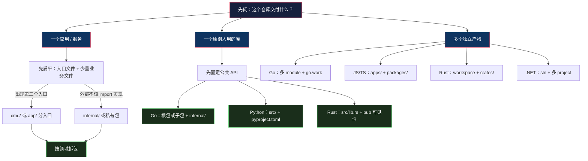
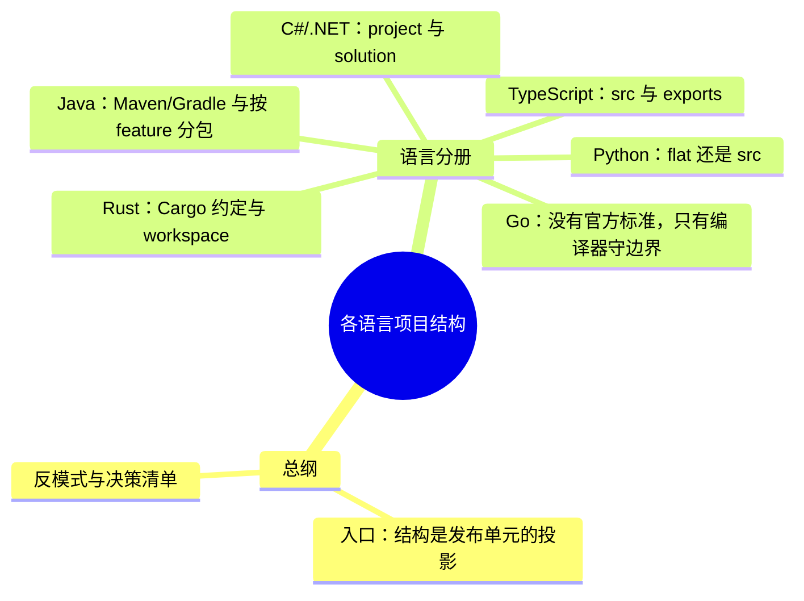

# 各语言项目结构最佳实践：结构是发布单元的投影

> 系列入口。这里不提供“万能目录模板”，只提供一套判断「这个目录该不该存在」的标准。
> 系列共 8 篇，已完成。各语言分册在各自篇章标注版本；真实仓库结构快照截至 2026-11-20。

## 目录

- [先给结论](#先给结论)
- [生活比喻：小镇、大都市和门禁](#生活比喻小镇大都市和门禁)
- [三个问题，而不是三种模板](#三个问题而不是三种模板)
- [一条主线：结构跟着发布单元走](#一条主线结构跟着发布单元走)
- [通用决策树](#通用决策树)
- [跨语言速查表](#跨语言速查表)
- [三条原则](#三条原则)
- [什么时候该加结构](#什么时候该加结构)
- [系列地图](#系列地图)
- [怎么读这个系列](#怎么读这个系列)
- [边界与版本](#边界与版本)
- [参考资料](#参考资料)
- [结语：结构是演进的结果](#结语结构是演进的结果)

## 先给结论

三句话：

1. **绝大多数语言没有“官方强制”的项目结构。** 有的是工具链默认值、包管理器约定、框架脚手架，以及社区里流传很广的模板。
2. **先确定发布单元，再决定目录。** 发布单元是会被独立构建、版本化、部署或被别人依赖的东西：Go 的 module、Python 的 distribution、Rust 的 crate、Java 的 artifact、.NET 的 project、npm 的 package。目录如果不对应任何发布单元，大概率只是分类癖。
3. **能被工具强制的边界才算边界。** Go 的 `internal/`、Rust 的 `pub`、.NET 的 assembly、Node 的 `exports`、Maven 的 module——这些边界会在编译或安装时报错。只靠命名和口头约定的边界，迟早会被绕过。

这三句话会贯穿整个系列。每讲一个语言，我们都会问：

> **这个目录，是哪个发布单元的边界？如果不是，它凭什么存在？**

## 生活比喻：小镇、大都市和门禁

一个小镇只有一条主街：前面开店，后面住人，邮局旁边就是菜市场。它不是“没有规划”，而是**规划和小镇规模刚好重合**。

大都市不一样：住宅区、商业区、工业区、环路、地铁、小区门禁、写字楼闸机。结构变复杂，不是因为城里的人“更高级”，而是因为**需要同时管理的边界变多了**。

| | 小镇 | 大都市 |
|---|---|---|
| **道路** | 一条主街 | 分区 + 环路 + 支路 |
| **边界** | 店铺后面就是家 | 住宅 / 商业 / 工业分区 |
| **门禁** | 不需要 | 小区、写字楼、园区各有门禁 |
| **结构成本** | 低 | 高，但换来可管理性 |
| **失败模式** | 永远长不大 | 给小镇修八车道，居民每天绕路 |

项目结构是同一件事：

- 一个 `main.go` + `go.mod` 的 Go 小工具，把 `main`、业务逻辑、配置全放根目录，不是“脏”，是**减少跳转**；
- 一个会被外部 import 的 Go 库，如果没有 `internal/`，所有实现细节都会变成事实上的公共 API；
- 一个 20 人的前端团队把 300 个组件全塞进 `src/components/`，不是“按层组织”，是**没有组织**。

**结构的复杂度，应该等于你需要管理的边界数量，而不是代码行数。**

## 三个问题，而不是三种模板

看到任何“最佳实践目录树”之前，先回答三个问题：

### 问题一：这个仓库交付什么？

| 交付物 | 结构的核心问题 | 典型起点 |
|--------|----------------|---------|
| 一个应用 / 服务 | 入口在哪里？部署单元是什么？ | 一个入口文件 + 业务包 |
| 一个给别人用的库 | 公共 API 是什么？实现怎么藏？ | 根包 / `src/` + 私有模块 |
| 多个独立产物 | 哪些东西需要独立发版？ | monorepo / workspace / 多 module |
| 一个框架或平台 | 使用者的约定是什么？ | 框架自己的脚手架优先 |

**同一个语言，这三种项目的“最佳结构”经常互相矛盾。** Go 库把包放根目录是合理的，Go 服务把业务代码放根目录就可能变成一团；Python 库用 `src/` 是加分项，Django 项目硬套 `src/` 反而在和框架打架。

### 问题二：谁依赖它？

- 只有自己：结构服务于**导航**，怎么顺手怎么来；
- 团队内共享：结构服务于**协作**，需要稳定的包边界和所有权；
- 外部用户依赖：结构服务于**兼容性**，公共 API 必须被明确圈出来，不能靠“大家都懂”。

### 问题三：变更会在哪里发生？

如果一次业务改动总是同时改 `controllers/`、`services/`、`repositories/`、`models/` 四个目录，说明你的结构是**按技术层**切的；如果一次改动通常只落在一个业务目录里，说明是**按领域/特性**切的。

两种都可以，但要知道自己在选哪一种：

| 组织方式 | 适合 | 不适合 |
|----------|------|--------|
| 按技术层（controller/service/repository） | 小团队、CRUD、框架强约束 | 业务规则复杂、改动跨多个层 |
| 按领域/特性（orders/billing/inventory） | 中大型、多人协作、领域边界清晰 | 很小的项目、团队还没形成领域语言 |

**框架已经替你选了的，先跟框架走。** Django 的 `models.py`、Rails 的 `app/`、Spring Boot 的 `src/main/java`、Nest 的模块目录，都是“框架约定大于个人审美”的例子。

## 一条主线：结构跟着发布单元走

这是整个系列最重要的一张表。**先找到发布单元，再看目录怎么长。**

| 生态 | 发布单元 | 构建/发布入口 | 最接近“强制”的边界 | 小项目起点 |
|------|----------|---------------|---------------------|-----------|
| Go | module | `go.mod` | `internal/` 导入限制、module 路径 | `main.go` + `go.mod` |
| Python | distribution（wheel/sdist） | `pyproject.toml` | 没有编译期强制；wheel 是发布边界 | 一个包目录 + `pyproject.toml` |
| TypeScript / Node | npm package | `package.json` | `exports` 子路径限制（需配置）、workspace 依赖 | `src/index.ts` + `package.json` |
| Rust | crate | `Cargo.toml` | crate 边界、`pub` / `pub(crate)` 可见性 | `cargo new` 生成的 `src/main.rs` 或 `src/lib.rs` |
| Java | artifact（jar） | `pom.xml` / `build.gradle(.kts)` | 构建模块、JPMS（可选）、包可见性 | `src/main/java` + `src/test/java` |
| C# / .NET | project（assembly） | `.sln` + `.csproj` | 项目引用、`internal`、`InternalsVisibleTo` | `dotnet new console` |

注意几个容易混淆的点：

- **Python 的 wheel 是发布单元，不是目录边界。** 一个 wheel 可以包含多个 import package；反过来，目录里有 `__init__.py` 也不代表它会单独发布。
- **Go 的 module 不等于仓库。** 一个仓库可以有多个 module（Kubernetes 的 `staging/` 就是典型），靠 `go.work` 在本地串起来。
- **Rust 的 crate 既是编译单元，也是发布单元。** 所以 workspace 拆 crate 的门槛比 Go 拆 module 低，也更常见。
- **Java 的“包”和构建模块是两回事。** `com.example.order` 只是命名空间；真正阻止跨模块依赖的是 Maven/Gradle 的 module 拆分。
- **.NET 的 solution 不是发布单元。** `.sln` 只是组织容器，`.csproj` 才是编译和引用的边界。

## 通用决策树



这张图只回答“第一刀切在哪”。真实项目会在每个分支上继续演化，但**第一次切分的方向，决定了后面是越走越顺还是越补越乱**。

## 跨语言速查表

| 生态 | 官方是否规定唯一布局 | 社区最容易被误解的说法 | 实际情况 |
|------|----------------------|------------------------|----------|
| Go | 否，官方按项目类型给建议 | “照着 `golang-standards/project-layout` 抄” | 该仓库自己声明**不是官方标准**；小项目用它属于过度设计 |
| Python | 否，PyPA 给打包建议 | “必须用 `src/`” | `src/` 主要解决“测试工作区代码而不是安装包”的问题；应用可以 flat |
| TypeScript / Node | 否 | “monorepo 就是 `apps/` + `packages/`” | 这是主流约定，不是唯一解；单包项目不需要 monorepo |
| Rust | Cargo 约定很强 | “每个 crate 都要拆” | 小项目一个 crate 足够；workspace 是为了独立编译/发布/复用 |
| Java | Maven/Gradle 默认布局是事实标准 | “必须 controller/service/dao 三层” | 目录标准是构建工具约定；包结构应该按业务演进 |
| C# / .NET | 模板和工具约定 | “必须 Clean Architecture 四层” | 多 project 是常态；分层数量和命名取决于复杂度 |

## 三条原则

### 原则一：结构跟着发布单元走

目录的价值，首先来自它对应的构建/发布边界，而不是“看起来整齐”。

**什么时候违反这条原则会疼：**

- Go 项目没有 `internal/`，外部用户直接 import 你的 `service` 包；你想重构，发现已经变成公共 API。
- Python 项目把所有东西塞进一个 distribution，两个团队想独立发版，只能互相等。
- 前端单包项目提前拆 20 个 npm package，每次改一个按钮要发 5 个包。

**判断方法：** 指着任何一个目录问——“它会单独构建吗？会单独发版吗？会被别的仓库依赖吗？”三个都否，它可能只是一个文件夹，不是一个边界。

### 原则二：从最小结构开始，按痛演进

小项目最大的坑，不是“结构太烂”，而是**提前套用大厂模板**。

一个 3 个文件的 Go 服务，不需要 `cmd/`、`internal/`、`pkg/`、`api/`、`configs/`、`deployments/`、`test/` 七件套。一个 5 个页面的 Python 脚本，不需要 `src/`、`tests/`、`docs/`、`scripts/`、`Makefile`、`tox.ini` 全家桶。

**结构不是越早越好，是越晚越难改。** 所以正确策略不是“一开始就完美”，而是：

1. 先用最少的结构跑起来；
2. 记录让你疼的信号；
3. 疼到第二次、第三次时，再引入对应的边界。

### 原则三：按领域切，但别和框架对着干

按领域/特性组织，通常比按技术层组织更抗变化：

```text
orders/
  order.ts
  order-service.ts
  order-repository.ts
billing/
  invoice.ts
  invoice-service.ts
```

而不是：

```text
controllers/
services/
repositories/
models/
```

前者一次业务改动通常落在一个目录；后者一次改动要在四个目录之间跳。**但这不是绝对规则**：小 CRUD、框架脚手架、团队还没形成领域语言时，按层反而更简单。

**框架已经规定好的，优先跟框架。** Django 的 app、Rails 的 `app/`、Nest 的 module、Spring Boot 的包扫描，都是框架运行时依赖的约定。你可以不喜欢，但和它对着干通常不划算。

## 什么时候该加结构

不要问“应该用哪个模板”，问“出现了什么信号”。下面这张表可以直接当 checklist：

| 你遇到的信号 | 该加的结构 | 不该做的事 |
|--------------|------------|------------|
| 出现第二个可执行入口 | Go 的 `cmd/<name>/`、.NET 的多 project | 复制一份 `main.go` 改改 |
| 外部用户开始 import 你的实现 | `internal/`、`pub(crate)`、`exports`、私有包 | 口头约定“这些别用” |
| 一次业务改动总在 4 个层目录来回跳 | 按领域/特性拆包 | 继续加更多层 |
| 两个产物需要独立发版 | monorepo / workspace / 多 module | 共用一个版本号硬绑 |
| 测试只有在仓库根目录能跑 | Python 的 `src/` + 安装后测试 | `sys.path.append` 打补丁 |
| 同一个工具函数被复制到 3 个地方 | 一个明确的 shared 包 | 建一个 `utils/` 垃圾抽屉 |
| 新人总问“这个文件放哪” | 先写文档 + 目录约定，再考虑重构 | 直接搬目录但不改依赖方向 |

## 系列地图



全部分册：

- [Go 项目结构：没有官方标准，只有编译器替你守住的边界](go.md)
- [Python 项目结构：flat 还是 src，先搞清楚你在装修谁的家](python.md)
- [TypeScript / Node 项目结构：src 是源码，exports 才是门](typescript.md)
- [Rust 项目结构：Cargo 把约定写进了工具链](rust.md)
- [Java 项目结构：Maven 给你地基，包结构才决定房间怎么分](java.md)
- [C# / .NET 项目结构：.csproj 是墙，.sln 是园区地图](csharp-dotnet.md)
- [项目结构反模式：八种“看起来整齐”的坏结构](anti-patterns.md)

语言分册沿用同一套模板：**一句话态度 → 小项目 → 中大型 → 争议点 → 真实仓库 → 反模式**。

## 怎么读这个系列

- **只关心某个语言**：直接跳到对应分册，不用按顺序读；每篇都能独立成立。
- **正在做技术选型**：先看[跨语言速查表](#跨语言速查表)和[通用决策树](#通用决策树)，再看目标语言分册的“真实仓库”部分。
- **正在重构目录**：先看[什么时候该加结构](#什么时候该加结构)，把“想整理”翻译成“出现了什么边界”，再决定动不动。
- **想找反例**：每篇最后的“反模式”比前面的“推荐结构”更值得读；知道什么不该做，通常比知道什么该做更有用。

## 边界与版本

- 本系列讨论**工程组织**，不讨论语言语法；语言版本在各自分册开头标注。
- 真实仓库的目录结构会变。文中标注了快照日期和 commit（部分仓库），引用时请以你 clone 下来的版本为准。
- “官方”与“社区”会明确区分。`golang-standards/project-layout`、各种 `awesome-*-structure` 列表都不是官方标准。
- 目录树只展示与结构讨论相关的部分，省略 `.github/`、`vendor/`、`node_modules/` 等噪声目录；省略会标注“只列部分”。
- 所有带终端输出的示例命令都在本机实际执行过；终端输出会标注版本和运行环境，纯示意命令不伪造输出。

## 参考资料

- Go 官方：[Organizing a Go module](https://go.dev/doc/modules/layout)
- 社区（非官方）：[golang-standards/project-layout](https://github.com/golang-standards/project-layout)
- Python 官方打包指南：[src layout vs flat layout](https://packaging.python.org/en/latest/discussions/src-layout-vs-flat-layout/)
- Python 官方示例：[pypa/sampleproject](https://github.com/pypa/sampleproject)
- Rust 官方：[The Cargo Book](https://doc.rust-lang.org/cargo/guide/)
- Maven 官方：[Standard Directory Layout](https://maven.apache.org/guides/introduction/introduction-to-the-standard-directory-layout.html)
- .NET 官方：[.NET project and solution files](https://learn.microsoft.com/dotnet/core/project-sdk/overview)
- Django 官方教程：[Writing your first Django app](https://docs.djangoproject.com/en/6.1/intro/tutorial01/)
- FastAPI 官方文档：[Bigger Applications](https://fastapi.tiangolo.com/tutorial/bigger-applications/)

## 结语：结构是演进的结果

项目结构不是一张一开始就要画完的施工图。它更像城市的路网：先有人的活动，才有路；路修好之后，又会反过来影响人怎么走。

**好的结构，是当前规模下刚好够用的结构。** 它让该隐藏的实现藏得住，让该独立的产物分得开，让新人在半天内知道一个新功能该放哪。它不需要看起来像某个大厂的开源仓库。

下一篇从 Go 开始：一个连官方都不规定布局的语言，为什么反而有最清晰的“强制边界”。
