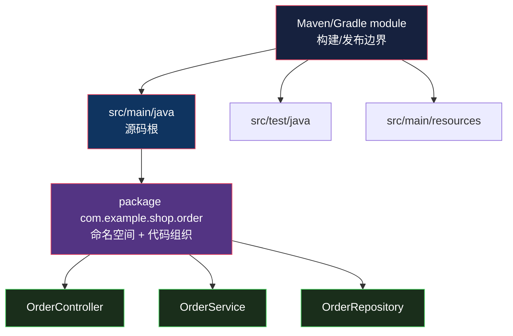

# Java 项目结构：Maven 给你地基，包结构才决定房间怎么分

> 本文基于 OpenJDK 17.0.19（LTS）与 Maven 3.9.16；示例在 macOS arm64 上实际编译运行。
> Maven / Gradle 的标准目录布局与 Java 版本无关；用 Java 21/25 时结构不变。
> 系列：各语言项目结构最佳实践（Java 分册）。

## 目录

- [先给结论](#先给结论)
- [生活比喻：写字楼、楼层和工位](#生活比喻写字楼楼层和工位)
- [Maven / Gradle 的标准目录：地基](#maven-gradle-的标准目录地基)
- [包结构：按层还是按领域](#包结构按层还是按领域)
- [单模块：Spring PetClinic 怎么分](#单模块spring-petclinic-怎么分)
- [多模块：Nacos 怎么拆](#多模块nacos-怎么拆)
- [Spring Boot 的包扫描：根包决定一切](#spring-boot-的包扫描根包决定一切)
- [JPMS：可选的模块边界](#jpms可选的模块边界)
- [测试与资源](#测试与资源)
- [关键争议速查](#关键争议速查)
- [反模式](#反模式)
- [决策清单](#决策清单)
- [骨架代码与验证](#骨架代码与验证)
- [结语](#结语)
- [参考资料](#参考资料)

## 先给结论

Java 生态的项目结构，最“硬”的部分来自构建工具：

- Maven 的 `src/main/java`、`src/main/resources`、`src/test/java`、`src/test/resources` 是事实标准；
- Gradle 的 Java 插件默认使用同一套目录；
- `pom.xml` / `build.gradle` 决定模块边界、依赖和打包方式。

但构建工具只管“楼怎么盖”，不管“房间怎么分”。真正决定代码导航的，是 **package**：

> **Maven/Gradle 的 module 是发布/编译边界；Java package 是命名空间和代码组织单位。两者不能混为一谈。**

一个典型的错误是：把 `controller/`、`service/`、`dao/` 当成所有项目的标准三层，结果每个业务改动都要横跨三个包。另一个错误是：建了一个 `common` 模块，最后所有东西都依赖它，模块边界名存实亡。

## 生活比喻：写字楼、楼层和工位

把 Java 项目想成一栋写字楼：

| 概念 | 写字楼里的角色 | 作用 |
|------|----------------|------|
| Maven/Gradle module | 一栋楼 / 一个独立单元 | 可独立编译、打包、发布的边界 |
| `src/main/java` | 办公楼层 | 生产代码的根 |
| package | 部门 / 工位区 | 代码的命名空间和组织方式 |
| `src/test/java` | 质检层 | 测试代码，和主代码同构 |
| `src/main/resources` | 仓库 / 水电间 | 配置、模板、静态资源 |
| `pom.xml` / `build.gradle` | 大楼总图 | 依赖、插件、打包、模块关系 |
| `target/` / `build/` | 施工垃圾 | 构建产物，不提交 |

package-by-layer 像把“所有部门的经理”放一层、“所有工程师”放一层、“所有财务”放一层：找人办事要坐电梯上下跑。package-by-feature 像每个业务团队占一层，团队内部自带经理、工程师和财务：一次业务改动少跑几层。

## Maven / Gradle 的标准目录：地基

Maven 的 [Standard Directory Layout](https://maven.apache.org/guides/introduction/introduction-to-the-standard-directory-layout.html) 是 Java 生态最接近“官方标准”的东西：

```text
shop/
├── pom.xml
├── src/
│   ├── main/
│   │   ├── java/
│   │   │   └── com/example/shop/
│   │   │       ├── App.java
│   │   │       └── pricing/
│   │   │           └── Pricing.java
│   │   └── resources/
│   │       └── application.properties
│   └── test/
│       ├── java/
│       │   └── com/example/shop/
│       │       └── pricing/
│       │           └── PricingTest.java
│       └── resources/
└── target/                 # 构建生成，不提交
```

Gradle 的 Java 插件默认使用同一套目录：

```text
shop/
├── build.gradle
├── settings.gradle
├── gradlew
├── src/main/java/
├── src/main/resources/
├── src/test/java/
├── src/test/resources/
└── build/                  # 构建生成，不提交
```



几个直接后果：

1. **`src/main/java` 不是 package。** package 从它下面开始：`com/example/shop` → `package com.example.shop`。
2. **测试和主代码同构。** 测试类放在 `src/test/java` 下，包名与被测类一致，才能方便地访问包级可见成员。
3. **资源有固定位置。** `src/main/resources` 会进入 classpath；配置文件、模板、SQL 迁移脚本通常放这里。
4. **构建产物目录不要提交。** Maven 的 `target/`、Gradle 的 `build/` 都是可重建的。

这也是为什么 Java 项目的“最小结构”看起来比 Go/Python 更重：**目录布局由构建工具约定，不是个人选择。**

## 包结构：按层还是按领域

标准目录只规定“源码放哪”，package 才决定“代码怎么分”。

### 按层

```text
com/example/shop/
├── controller/
│   ├── OrderController.java
│   └── UserController.java
├── service/
│   ├── OrderService.java
│   └── UserService.java
├── repository/
│   ├── OrderRepository.java
│   └── UserRepository.java
└── model/
    ├── Order.java
    └── User.java
```

这是教程里最常见的结构。小项目、CRUD、团队还没有形成领域语言时，它很直观。

### 按领域

```text
com/example/shop/
├── order/
│   ├── Order.java
│   ├── OrderController.java
│   ├── OrderService.java
│   └── OrderRepository.java
├── user/
│   ├── User.java
│   ├── UserController.java
│   └── UserService.java
└── shared/
    └── Money.java
```

业务变大后，按领域通常更抗变化：一次订单改动集中在一个包，不需要跨 `controller/service/repository/model` 四个目录。

**判断标准：**

> **一次业务改动，通常要打开几个 package？**

如果每次改订单都要同时改四个层包，说明目录在阻碍你理解业务；如果一次改动只落在一个领域包，说明边界更贴近业务。

**例外：** 框架约定优先。Spring Boot 的组件扫描、Nest 的 module、Django 的 app 都有自己的约定；先跟框架，再谈个人偏好。

## 单模块：Spring PetClinic 怎么分

[Spring PetClinic](https://github.com/spring-projects/spring-petclinic) 是 Spring 官方的示例项目，结构很典型：

```text
spring-petclinic/
├── pom.xml
├── build.gradle
├── settings.gradle
├── mvnw
├── gradlew
└── src/
    ├── main/
    │   ├── java/org/springframework/samples/petclinic/
    │   │   ├── PetClinicApplication.java
    │   │   ├── model/
    │   │   ├── owner/
    │   │   ├── vet/
    │   │   └── system/
    │   └── resources/
    └── test/
        └── java/org/springframework/samples/petclinic/
```

（只列部分；HEAD 快照，commit `500158f73241`，2026-09-29。）

它值得注意的地方：

1. **同一套标准目录同时支持 Maven 和 Gradle。** 根目录既有 `pom.xml` 也有 `build.gradle`，源码布局完全一样；这就是标准目录的价值。
2. **主类在根包，业务按领域分包。** `PetClinicApplication` 在 `org.springframework.samples.petclinic`；`owner`、`vet`、`model`、`system` 是领域/职责包，不是 `controller/service/repository` 三层。
3. **`model` 只放共享的基础类型。** `BaseEntity`、`NamedEntity`、`Person` 这类跨领域模型放这里；具体的 `Owner`、`Pet`、`Visit` 跟着 `owner` 包走。
4. **测试目录和主目录同构。** `src/test/java` 下按同样的包名组织，方便定位。

**结论：单模块应用不需要为了“看起来分层”而拆多模块；标准目录 + 按领域分包已经足够。**

## 多模块：Nacos 怎么拆

[Nacos](https://github.com/alibaba/nacos) 是一个多模块 Maven 项目。根 `pom.xml` 声明了一批模块：

```xml
<modules>
  <module>api</module>
  <module>client</module>
  <module>common</module>
  <module>config</module>
  <module>core</module>
  <module>naming</module>
  <module>console</module>
  <module>distribution</module>
  ...
</modules>
```

每个模块仍然是标准目录：

```text
nacos/
├── pom.xml
├── api/
│   └── src/main/java/com/alibaba/nacos/api/...
├── client/
│   └── src/main/java/com/alibaba/nacos/client/
│       ├── config/
│       ├── naming/
│       ├── lock/
│       └── ...
├── common/
├── config/
├── core/
├── naming/
│   └── src/main/java/com/alibaba/nacos/naming/
│       ├── NamingApp.java
│       ├── controllers/
│       ├── core/
│       ├── consistency/
│       ├── healthcheck/
│       └── ...
└── console/
```

（只列部分；develop 分支，2026-11-20 快照，commit `5d7de40a0fdb`。）

它的拆分逻辑大致是：

| 模块 | 职责 | 边界类型 |
|------|------|----------|
| `api` | 对外 API / 契约 | 发布边界 |
| `client` | 客户端 SDK | 发布边界 |
| `common` | 共享基础类型/工具 | 共享库 |
| `config` | 配置中心领域 | 业务领域模块 |
| `naming` | 服务发现领域 | 业务领域模块 |
| `console` | 控制台 | 部署/UI 边界 |
| `distribution` | 打包/分发 | 发布装配 |

几个值得学的点：

1. **模块名对应业务域，而不是技术层。** `config`、`naming` 是领域；它们内部再有 `controllers`、`core`、`consistency` 等子包。
2. **模块是构建/发布边界。** Maven 的 module 可以独立编译、独立打 jar；依赖方向由 `pom.xml` 决定，不由 package 名决定。
3. **`api` 和 `client` 是对外边界。** 一个给服务端/插件用，一个给应用接入用；它们比内部实现更稳定。
4. **`common` 要克制。** 共享模块一旦变成“什么都往里放”，所有模块都会依赖它，最后无法独立演进。

**结论：多模块不是“目录分得细”，而是“每个模块有独立的编译/发布理由”。** 没有独立发布、独立复用或依赖隔离需求，就不要拆。

## Spring Boot 的包扫描：根包决定一切

Spring Boot 的组件扫描从主类所在包开始向下扫描。主类在：

```java
package com.example.shop;

@SpringBootApplication
public class ShopApplication {
    public static void main(String[] args) {
        SpringApplication.run(ShopApplication.class, args);
    }
}
```

它会扫描 `com.example.shop` 及其子包。因此：

- `com.example.shop.order.OrderController` 会被扫描；
- `com.example.other.OrderController` 不会被扫描（除非显式配置 `scanBasePackages`）；
- 把主类放到 `com.example`，把业务放到 `com.example.shop`，通常也能工作；但让主类位于根包更直观。

**不要为了目录好看，把主类挪到一个业务子包里。** 这会让扫描范围和启动行为变得不直观。

## JPMS：可选的模块边界

Java 9 引入的 JPMS（Java Platform Module System）允许在 `src/main/java` 下放 `module-info.java`：

```java
module com.example.shop {
    requires java.sql;
    exports com.example.shop.order;
}
```

它不是 Spring Boot 项目的默认做法。JPMS 的价值在于：

- 在 JDK 层面声明 `requires` / `exports`；
- 对反射和深层依赖做更强限制；
- 适合库、JDK 工具、需要强封装的项目。

但大多数 Spring Boot 应用用 Maven/Gradle 多模块 + package 可见性就够了。**不要为了“模块化”强行上 JPMS**；它会和框架的反射、类路径扫描产生额外摩擦。

## 测试与资源

Java 的测试目录约定非常稳定：

```text
src/
├── main/
│   ├── java/
│   └── resources/
└── test/
    ├── java/
    └── resources/
```

- 单元测试放 `src/test/java`，包名与被测类一致；
- 测试资源放 `src/test/resources`，不会进入生产 jar；
- 集成测试通常用 Maven Failsafe / Gradle 的独立 test task，避免和单元测试混跑；
- Spring Boot 测试常用 `@SpringBootTest`、`@WebMvcTest`、`MockMvc` / `WebTestClient`；
- 生产资源（`application.yml`、模板、SQL）放 `src/main/resources`，测试覆盖放 `src/test/resources`。

**测试目录不是“随便放”的。** 它和主目录同构，才能让包级可见性、资源加载和构建工具都按预期工作。

## 关键争议速查

| 争议 | 我的建议 | 理由 |
|------|----------|------|
| 单模块还是多模块 | 先单模块；有独立发布/复用/编译隔离再拆 | 多模块增加构建和依赖管理成本 |
| package-by-layer 还是 feature | 小 CRUD 可按层；业务复杂后按领域 | 按“一次改动打开几个包”判断 |
| 要不要 `common` 模块 | 谨慎；共享必须有明确消费者 | 容易变成全局依赖和垃圾抽屉 |
| 要不要 JPMS | 大多数 Spring Boot 应用不需要 | 框架反射/扫描与 JPMS 有摩擦 |
| 包名怎么起 | 公司域名倒序 + 业务域，如 `com.example.order` | 稳定、可读、避免冲突 |
| 主类放哪 | 根包 | Spring Boot 扫描范围直观 |
| `src/main/resources` 放什么 | 配置、模板、静态资源、迁移脚本 | 会进入 classpath |
| 测试资源放哪 | `src/test/resources` | 不污染生产包 |
| 要不要提交 `target/` | 不提交 | 构建产物可重建 |
| 多模块要不要统一版本 | 用 parent POM / BOM / `dependencyManagement` | 避免版本漂移 |

## 反模式

### 1. 所有项目都套 controller/service/dao

```text
com/example/shop/
├── controller/
├── service/
├── repository/
└── model/
```

一个只有 5 个类的 CRUD 项目这样分没问题；但业务变复杂后，每次改动横跨四层，代码阅读变成“坐电梯”。

### 2. `common` 模块变成万能仓库

```text
common/
├── utils/
├── helpers/
├── constants/
└── misc/
```

所有模块都依赖它，最后它既不能独立发布，也不能删任何东西。共享代码必须有明确消费者和稳定 API；否则留在使用方本地。

### 3. 模块之间循环依赖

`order` 模块依赖 `user`，`user` 又依赖 `order`。Maven/Gradle 会构建失败或迫使你加更多中间模块。正确做法是抽 `api` 契约、用接口倒置依赖，或重新划边界。

### 4. 主类不在根包

```java
package com.example.shop.bootstrap;
```

业务代码在 `com.example.shop.order`，扫描不到，启动后 404。把主类放根包，或者显式配置扫描范围；不要靠猜。

### 5. 把资源放错位置

把 `application.yml` 放进 `src/main/java`，Maven 不会把它当资源打包；运行时找不到配置。资源放 `src/main/resources`，测试资源放 `src/test/resources`。

### 6. 所有类都 `public`

Java 的 package-private 是很好用的边界；所有类都 `public`，等于放弃包内封装。库的公共 API 要克制，内部实现尽量包级可见。

### 7. 提交 `target/` / `build/`

构建产物不应该进 Git。它们会冲突、过期，并让“本地能跑、CI 构建失败”的问题更难发现。

## 决策清单

| 场景 | 推荐结构 | 关键动作 |
|------|----------|----------|
| 小工具 / 单服务 | 单模块 + 标准目录 | 按领域分包，别急着拆模块 |
| 小型 CRUD | `controller/service/repository` 或 feature 包 | 选一种，别混用 |
| 中大型业务 | 单模块 + 按领域分包 | 一次改动尽量落在一个包 |
| 多团队/多发布物 | Maven/Gradle 多模块 | 模块名对应业务域，依赖单向 |
| 对外 SDK | 独立 `api` / `client` 模块 | 稳定 API，版本独立 |
| 需要强封装 | 可选 JPMS | 先确认框架兼容性 |
| Spring Boot 应用 | 根包主类 + 领域包 | 确保组件扫描覆盖 |

## 骨架代码与验证

下面是我实际编译运行的 Maven 标准目录 demo。

### 目录树

```text
shop/
├── pom.xml
├── src/
│   ├── main/
│   │   ├── java/com/example/shop/
│   │   │   ├── App.java
│   │   │   └── pricing/
│   │   │       └── Pricing.java
│   │   └── resources/
│   └── test/java/com/example/shop/pricing/
└── target/                 # 构建生成
```

### `pom.xml`

```xml
<project xmlns="http://maven.apache.org/POM/4.0.0"
         xmlns:xsi="http://www.w3.org/2001/XMLSchema-instance"
         xsi:schemaLocation="http://maven.apache.org/POM/4.0.0 https://maven.apache.org/xsd/maven-4.0.0.xsd">
  <modelVersion>4.0.0</modelVersion>

  <groupId>com.example</groupId>
  <artifactId>shop</artifactId>
  <version>0.1.0</version>

  <properties>
    <maven.compiler.release>17</maven.compiler.release>
    <project.build.sourceEncoding>UTF-8</project.build.sourceEncoding>
  </properties>
</project>
```

### 代码

```java
// src/main/java/com/example/shop/pricing/Pricing.java
package com.example.shop.pricing;

public final class Pricing {
    private Pricing() {
    }

    public static int total(int unitCents, int quantity) {
        if (unitCents < 0 || quantity < 0) {
            throw new IllegalArgumentException("unit price and quantity must be non-negative");
        }
        return unitCents * quantity;
    }
}
```

```java
// src/main/java/com/example/shop/App.java
package com.example.shop;

import com.example.shop.pricing.Pricing;

public final class App {
    private App() {
    }

    public static void main(String[] args) {
        System.out.println("total=" + Pricing.total(1250, 3));
    }
}
```

### 验证

标准 Maven 项目的构建命令是 `mvn package`。为了不依赖 Maven 插件下载，下面用 JDK 自带的 `javac` 验证同一份目录结构：

```bash
$ javac -d target/classes $(find src/main/java -name '*.java')
$ java -cp target/classes com.example.shop.App
total=3750
```

```text
target/classes/com/example/shop/App.class
target/classes/com/example/shop/pricing/Pricing.class
```

**目录结构不依赖 Maven 是否联网。** 只要源码在 `src/main/java`、包名和目录一致，Maven/Gradle 的编译结果就是同一套 classpath 布局。

## 结语

Java 项目结构可以用三句话收束：

1. **标准目录是地基。** `src/main/java`、`src/test/java`、`src/main/resources` 是 Maven/Gradle 的共同约定，不要自创。
2. **module 是边界，package 是导航。** 多模块对应独立编译/发布理由；package 对应业务/职责。
3. **框架优先，别和扫描机制对着干。** Spring Boot 的主类根包、组件扫描、资源位置，都是运行时行为的一部分。

下一篇看 C# / .NET：solution、project、namespace 三层，以及 Clean Architecture 为什么总是从 `Domain` 开始。

## 参考资料

- [Maven：Standard Directory Layout](https://maven.apache.org/guides/introduction/introduction-to-the-standard-directory-layout.html)
- [Maven：Guide to Working with Multiple Modules](https://maven.apache.org/guides/mini/guide-multiple-modules.html)
- [Gradle 源码](https://github.com/gradle/gradle)
- [Spring Boot 源码](https://github.com/spring-projects/spring-boot)
- [Spring PetClinic 源码](https://github.com/spring-projects/spring-petclinic)
- [Nacos 源码](https://github.com/alibaba/nacos)
- [Oracle：Java Platform Module System](https://docs.oracle.com/en/java/javase/17/docs/api/java.base/java/lang/module/ModuleDescriptor.html)
