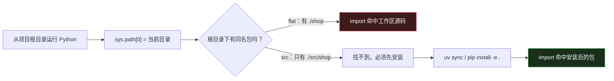

# Python 项目结构：flat 还是 src，先搞清楚你在装修谁的家

> 本文基于 Python 3.14.6 与 uv 0.11.8；示例在 macOS arm64 上实际运行。
> 系列：各语言项目结构最佳实践（Python 分册）。

## 目录

- [先给结论](#先给结论)
- [生活比喻：玄关和样板间](#生活比喻玄关和样板间)
- [两个词先分清：distribution 与 import package](#两个词先分清distribution-与-import-package)
- [flat layout：方便，但你在测试施工现场](#flat-layout方便但你在测试施工现场)
- [src layout：多一道玄关，测试安装后的包](#src-layout多一道玄关测试安装后的包)
- [pyproject.toml：现代项目的总开关](#pyprojecttoml现代项目的总开关)
- [库、应用、脚本分别怎么选](#库应用脚本分别怎么选)
- [框架优先：Django 的项目与 app](#框架优先django-的项目与-app)
- [框架优先：FastAPI 的 app 结构](#框架优先fastapi-的-app-结构)
- [真实仓库之一：black 的 src 布局](#真实仓库之一black-的-src-布局)
- [真实仓库之二：Django 自己的 flat 布局](#真实仓库之二django-自己的-flat-布局)
- [关键争议速查](#关键争议速查)
- [反模式](#反模式)
- [决策清单](#决策清单)
- [骨架代码与验证](#骨架代码与验证)
- [结语](#结语)
- [参考资料](#参考资料)

## 先给结论

Python 没有官方强制的项目布局。Python Packaging User Guide 解释了 `src/` 布局的价值，但它讨论的是 project，并没有把“库必须 src、应用必须 flat”写成规则。我的建议是：**库/CLI 优先 src，应用按部署边界选择。**

但“flat 还是 src”经常被讨论成一场审美战争，真正的问题其实是：

> **你运行和测试的，是工作区里那份源码，还是安装之后的那份包？**

- flat layout 把包放在项目根目录，`python` 从根目录启动时会直接 import 到工作区源码；
- src layout 把包放进 `src/`，而 `src/` 默认不在 `sys.path` 上；从项目根目录 import 不到 `shop`，想 import 必须先安装（通常是 editable install）。

所以 src layout 的价值不是“看起来更专业”，而是**制造一个安装边界**：测试、CI、打包都面对同一个“装好的包”，而不是“碰巧在正确目录下”的源码。

## 生活比喻：玄关和样板间

flat layout 像一间没有玄关的小户型：门一开就是客厅，沙发、鞋柜、餐桌全在眼前。收拾得好，很高效；但客人一进门就会踩到你的拖鞋——在 Python 里，这双“拖鞋”就是当前目录被自动放进 `sys.path`，同名的工作区包会悄悄覆盖已安装的包。

src layout 像给房子加了一道玄关：进门先换鞋、放伞，再进客厅。多了一道安装步骤，但保证你测试的是“装好的家”，不是“施工现场”。

再往下分：

- **库 / CLI** 像样板间：别人要来看、要来用，入口和展品必须明确，不能把施工工具摆在客厅；
- **应用 / 服务** 像自住房：可以按自己的生活习惯来，但如果要交付给运维、部署到容器，最好还是有一个明确的“入户门”（安装后的 distribution 或镜像）；
- **Django 项目**像精装房：承重墙、水电点位是框架定好的，别为了追求某种“标准布局”去砸墙。

## 两个词先分清：distribution 与 import package

Python 项目结构的第一大困惑，来自把两个东西混为一谈：

| 概念 | 是什么 | 例子 |
|------|--------|------|
| **distribution** | 你构建/发布的东西，通常是 wheel 或 sdist | `pillow`、`beautifulsoup4` |
| **import package** | 代码里 `import` 的名字 | `PIL`、`bs4` |
| **module** | 一个 `.py` 文件 | `shop/pricing.py` |
| **package** | 一个目录（传统上带 `__init__.py`） | `shop/` |

它们可以不同名：

```bash
pip install pillow
python -c "import PIL"
```

`distribution name` 和 `import package name` 是两套命名空间。`pyproject.toml` 里的 `[project].name` 是 **distribution name**，不一定是你要 import 的名字。

这带来几个直接后果：

- 一个 distribution 可以包含多个 import package；
- 一个 import package 也可以由多个 distribution 共同提供（命名空间包，高级用法）；
- 目录里有 `__init__.py`，不代表它会单独发布；
- 测试“能不能 import”，不等于测试“安装后能不能用”。

**项目结构首先要对齐的是 distribution 边界，而不是目录看起来整不整齐。**

## flat layout：方便，但你在测试施工现场

一个最小的 flat 项目：

```text
shop/
├── pyproject.toml
├── shop/
│   ├── __init__.py
│   └── pricing.py
└── tests/
    └── test_pricing.py
```

从项目根目录运行：

```bash
$ python3 -c "import shop; print(shop.__name__)"
shop
```

它为什么能 import？因为 `python -c` 会把当前目录放进 `sys.path`，而根目录下正好有一个 `shop/`。同理，`pytest` 从根目录运行时，也可能直接 import 到工作区里的包。

**这很方便，但会掩盖两类问题：**

1. **打包遗漏**：`MANIFEST.in` 或构建配置没把某个文件放进 wheel，但工作区里文件在，测试全绿；用户装完却报 `FileNotFoundError`。
2. **同名覆盖**：你安装了一个也叫 `shop` 的包，但当前目录的 `shop/` 优先级更高；你测试的其实不是安装版本。

flat layout 不是错的。对“只在自己机器上跑”的脚本、Notebook 配套代码、部署边界由 Docker 镜像保证的应用，它完全可以工作。**但你要知道自己放弃了什么：安装边界。**

## src layout：多一道玄关，测试安装后的包

同样的项目，换成 src layout：

```text
shop/
├── pyproject.toml
├── src/
│   └── shop/
│       ├── __init__.py
│       └── pricing.py
└── tests/
    └── test_pricing.py
```

现在从项目根目录直接 import：

```bash
$ python3 -c "import shop"
Traceback (most recent call last):
  File "<string>", line 1, in <module>
    import shop
ModuleNotFoundError: No module named 'shop'
```

这不是坏事，是设计目标：**项目根目录下没有可直接 import 的 `shop/`，`src/` 也不在默认路径上。** 想运行，先安装：

```bash
$ uv sync --python 3.14.6
Using CPython 3.14.6 interpreter at: /opt/homebrew/opt/python@3.14/bin/python3.14
Creating virtual environment at: .venv
Resolved 7 packages in 23ms
   Building shop @ file:///.../shop
      Built shop @ file:///.../shop
Prepared 1 package in 398ms
Installed 6 packages in 7ms
 + iniconfig==2.3.1
 + packaging==26.3
 + pluggy==1.7.0
 + pygments==2.21.0
 + pytest==9.2.0
 + shop==0.1.0 (from file:///.../shop)
```

（输出有删节。）

然后：

```bash
$ uv run python -m shop
total=3750

$ uv run pytest -q
.                                                                        [100%]
1 passed in 0.01s
```

Python Packaging User Guide 对 src layout 的理由说得很直接：

> The src layout requires installation of the project to be able to run its code.

> The src layout helps prevent accidental usage of the in-development copy of the code.

翻译一下：

- 你必须先安装，才能跑；这强制你走一遍“用户会走的路”；
- 当前目录不会抢在安装包前面，测试更接近真实安装结果。

指南没有把这条建议限定为库；应用同样可以受益，只是应用常常有镜像/部署边界，flat 也可以工作。

**代价**是开发时多一步 `uv sync` / `pip install -e .`，以及运行脚本不能直接 `python src/shop/main.py`（路径和 import 都会变）。这点不便，换来的是打包和测试的可信度。



## pyproject.toml：现代项目的总开关

不管 flat 还是 src，现代 Python 项目的入口都是 `pyproject.toml`。示例：

```toml
[project]
name = "shop"
version = "0.1.0"
description = "Project layout demo"
requires-python = ">=3.14"

[build-system]
requires = ["hatchling"]
build-backend = "hatchling.build"

[dependency-groups]
dev = ["pytest>=8"]

[tool.pytest.ini_options]
testpaths = ["tests"]
```

逐段看：

| 配置 | 作用 | 常见坑 |
|------|------|--------|
| `[project]` | 元数据、运行依赖、Python 版本要求 | `name` 是 distribution name，不一定是 import 名 |
| `[build-system]` | 用哪个构建后端把源码打成 wheel/sdist | 不写就可能走 legacy setuptools 行为 |
| `[dependency-groups]` | 开发依赖（PEP 735），如 pytest、ruff | 不是运行时依赖；不要塞进 `[project.dependencies]` |
| `[tool.pytest.ini_options]` | pytest 配置 | `testpaths` 能避免 pytest 从仓库根目录乱扫 |
| `[tool.ruff]` / `[tool.mypy]` | lint / 类型检查配置 | 工具配置也集中到这里，少建一堆散落文件 |

构建后端可以选：

- `setuptools`：兼容性最好，老项目多；
- `hatchling`：现代、配置少，本文示例用它；
- `poetry-core`：Poetry 项目；
- `flit-core`：纯 Python 小库。

**没有“必须用哪个”的标准。** 新项目选一个能自动识别 `src/` 的后端，别在构建配置上花太多时间。

依赖管理还有两条实践：

- **应用提交 lock 文件**（如 `uv.lock`、`poetry.lock`），保证部署可复现；
- **库在 `pyproject.toml` 里写版本范围**，不把 lock 当运行时约束；lock 只用于开发环境复现。

`requirements.txt` 不是原罪：很多部署系统仍然只认它。它可以由 `pyproject.toml` + lock 导出，但不要让两份依赖声明各自维护、互相漂移。

## 库、应用、脚本分别怎么选

| 项目类型 | 推荐布局 | 为什么 |
|----------|----------|--------|
| 要发布到 PyPI 的库 | `src/<package>/` + `tests/` + `pyproject.toml` | 测试安装后的包，避免工作区源码掩盖打包问题 |
| CLI 工具 | `src/<package>/` + `__main__.py` 或 `[project.scripts]` | 入口明确，`python -m` 和命令名都能用 |
| Web 服务 / 应用 | `app/`（flat）或 `src/<package>/` | 部署边界通常是镜像；两种都能工作，但要选一个并写进 README |
| 一次性脚本 / Notebook 辅助 | 单文件或扁平目录 | 不需要 distribution 边界，别过度设计 |
| Django 项目 | `manage.py` + 项目包 + 领域 app | 跟框架约定走，别硬套 src |
| FastAPI 应用 | `app/main.py` + `routers/` 或领域包 | 跟官方 bigger applications 结构走 |
| 多包仓库 | uv workspace / monorepo：`apps/` + `packages/` | 包之间有明确依赖和独立发布边界 |

这里最重要的区分不是“库 vs 应用”，而是**这个仓库有没有一个会被安装、被交付的 distribution**。

- 有：让目录和 distribution 对齐，测试安装结果；
- 没有：目录主要服务于导航，flat 完全合理。

## 框架优先：Django 的项目与 app

Django 是“框架约定大于个人审美”的典型。下面是我在本机用 Django 6.1.3 实际生成的结构：

```bash
$ django-admin startproject config .
$ python manage.py startapp orders
```

```text
djangotutorial/
├── manage.py
├── config/
│   ├── __init__.py
│   ├── settings.py
│   ├── urls.py
│   ├── asgi.py
│   └── wsgi.py
└── orders/
    ├── __init__.py
    ├── admin.py
    ├── apps.py
    ├── migrations/
    │   └── __init__.py
    ├── models.py
    ├── tests.py
    └── views.py
```

（`startproject config .` 让项目包叫 `config`，避免和仓库名重复；`orders/urls.py` 不会自动生成，需要时自己加。）

每个文件都有明确职责：

| 路径 | 作用 |
|------|------|
| `manage.py` | 命令行入口：`runserver`、`migrate`、`makemigrations` 等 |
| `config/settings.py` | 全局配置；变大后拆成 `settings/base.py`、`dev.py`、`prod.py` |
| `config/urls.py` | 项目级路由总表 |
| `config/asgi.py` / `wsgi.py` | ASGI / WSGI 服务器入口 |
| `orders/apps.py` | app 配置 |
| `orders/models.py` | 数据模型 |
| `orders/views.py` | 请求处理 |
| `orders/admin.py` | Django Admin 注册 |
| `orders/migrations/` | 数据库迁移 |
| `orders/tests.py` | 测试；变大后改成 `tests/` 包 |

**Django 的“结构”不是目录树，而是 app 边界。** 一个 app 应该对应一个业务领域：`orders`、`billing`、`inventory`，而不是 `utils`、`common`、`misc`。跨 app 的外键用字符串引用（如 `"orders.Order"`）可以避免 import 循环。

几个常见误区：

- **把所有模型塞进一个 `core` app。** 最后 `core/models.py` 几千行，迁移历史互相纠缠；按领域拆 app 更稳。
- **在 Django 项目里硬套 `src/`。** Django 默认假设 `manage.py` 所在的目录就是项目根，项目包和 app 都在这里。你可以改，但收益通常抵不过和教程、部署脚本、`manage.py` 默认行为对齐的成本。
- **过早拆 settings。** 小项目一个 `settings.py` 够用；需要多环境时再拆，别一上来就五个 settings 文件。

## 框架优先：FastAPI 的 app 结构

FastAPI 官方教程里，“更大的应用”推荐用 `APIRouter` 按关注点拆路由：

```text
app/
├── __init__.py
├── main.py
├── dependencies.py
├── routers/
│   ├── __init__.py
│   ├── items.py
│   └── users.py
└── internal/
    ├── __init__.py
    └── admin.py
```

- `app/main.py`：创建 `FastAPI` 实例，把各个 router 拼起来；
- `app/routers/users.py`、`app/routers/items.py`：每个文件一个 `APIRouter`；
- `app/dependencies.py`：共享依赖（认证、分页参数等）；
- `app/internal/admin.py`：内部管理路由。

这是官方示例，不是强制标准。业务变复杂后，常见的演进是**按领域**而不是按 router 类型拆：

```text
app/
├── main.py
├── orders/
│   ├── router.py
│   ├── schemas.py
│   ├── service.py
│   └── models.py
├── billing/
│   ├── router.py
│   ├── schemas.py
│   └── service.py
└── core/
    ├── config.py
    └── security.py
```

两种都可以。判断标准仍然是：**一次业务改动通常落在几个目录？** 如果每次改订单都要同时动 `routers/orders.py`、`schemas/order.py`、`services/order.py`、`models/order.py`，按领域拆会更顺手。

## 真实仓库之一：black 的 src 布局

[black](https://github.com/psf/black) 是一个代码格式化工具，既是库也是 CLI。它的顶层结构是：

```text
black/
├── pyproject.toml
├── src/
│   └── black/
│       ├── __init__.py
│       ├── __main__.py
│       ├── _width_table.py
│       ├── files.py
│       ├── linegen.py
│       ├── lines.py
│       ├── mode.py
│       ├── parsing.py
│       └── ...
├── tests/
│   ├── conftest.py
│   ├── data/
│   ├── test_black.py
│   └── ...
├── docs/
├── scripts/
├── action/
├── autoload/
├── plugin/
└── profiling/
```

（只列部分；main 分支，2026-11-19 快照。）

值得学的点：

1. **`src/black/` 是明确的 distribution 边界。** 构建时只有 `src/` 里的包进入 wheel；`tests/`、`docs/`、`scripts/` 不会混进去。
2. **`__main__.py` 提供 `python -m black` 入口。** CLI 和库共用同一个包，不需要在根目录再放一个脚本。
3. **私有模块用下划线前缀**：`_width_table.py` 这种命名是团队约定，不是 Python 强制；真正要藏的实现，靠“不写进公共 API 文档”和 code review。
4. **测试独立在 `tests/`。** 测试文件不进入 wheel，但可以在安装后的包上运行。

**结论：库/CLI 用 `src/`，最大的收益是“测试和发布面对同一个包”。** 这也是 PyPA 推荐 src layout 的核心原因。

## 真实仓库之二：Django 自己的 flat 布局

[Django](https://github.com/django/django) 仓库本身是另一种答案：

```text
django/
├── django/
│   ├── __init__.py
│   ├── apps/
│   ├── conf/
│   ├── contrib/
│   │   └── auth/
│   │       ├── admin.py
│   │       ├── apps.py
│   │       ├── models.py
│   │       ├── views.py
│   │       ├── urls.py
│   │       ├── migrations/
│   │       ├── management/
│   │       └── templates/
│   ├── core/
│   ├── db/
│   ├── http/
│   ├── template/
│   ├── urls/
│   └── views/
├── tests/
├── docs/
├── scripts/
├── js_tests/
└── extras/
```

（只列部分；main 分支，2026-11-19 快照，commit `c67d872765e0`。）

它为什么不用 `src/`？

- **仓库本身就是框架的 distribution**，顶层 `django/` 就是 import package；再套一层 `src/` 只是换路径，没有增加新的发布边界；
- **Django 的 app 是运行时的组织单位**：`django/contrib/auth/` 就是一个典型 app，`models.py`、`views.py`、`admin.py`、`apps.py`、`migrations/`、`management/`、`templates/` 各自承担固定角色；
- **测试单独放在 `tests/`**，和包目录平级，而不是塞进每个 app 里。

**结论：框架仓库可以 flat，因为它的“产品”就是那个包；而你的 Django 项目应该跟的是 app 约定，不是把 Django 仓库的顶层目录照搬过来。**

顺便提一句：[pypa/sampleproject](https://github.com/pypa/sampleproject) 是官方维护的最小 src layout 示例，只有 `src/sample/`、`tests/` 和 `pyproject.toml`，适合拿来对照“最小正确结构”。

## 关键争议速查

| 争议 | 我的建议 | 理由 |
|------|----------|------|
| 库用 flat 还是 src | 优先 src | 测试安装后的包，避免工作区源码掩盖打包问题 |
| 应用用 flat 还是 src | 都可以；选一个并写进 README | 部署边界通常是镜像；一致性比“标准”重要 |
| 测试放 `tests/` 还是 `testing/` | 新项目用 `tests/`；跟仓库现有约定 | pytest 的 `testpaths` 可配置；名字不是关键 |
| 要不要 `__init__.py` | 普通包要；命名空间包只在明确需要时用 | 显式包更可预测；命名空间包是高级用法 |
| `setup.py` 还要不要 | 新项目不用；老项目迁移到 `pyproject.toml` | `setup.py` 是 legacy，动态构建逻辑才需要保留 |
| `requirements.txt` 还是 `pyproject.toml` | 以 `pyproject.toml` 为源，按部署需要导出 `requirements.txt` | 避免两份依赖各自漂移 |
| 要不要提交 lock 文件 | 应用提交；库只锁开发环境 | 应用要可复现；库不能被单一环境锁死 |
| monorepo 怎么放 | `apps/` + `packages/`，用 uv workspace | `apps/` 是可部署产物，`packages/` 是可复用库 |
| 能不能 `sys.path.append("src")` | 不要 | 你绕过了安装边界，等于把 src 布局变成 flat，还多了一层欺骗 |

## 反模式

### 1. 用 `sys.path.append` 让测试跑起来

```python
# conftest.py
import sys
sys.path.append("src")
```

这会让测试 import 到工作区源码，src layout 的意义直接归零。正确做法是 `uv sync` / `pip install -e .`，让测试面对安装后的包。

### 2. 测试只在仓库根目录通过

如果 CI 里换个工作目录就失败，说明测试依赖了当前路径，而不是安装后的包。**在 CI 里构建 wheel、安装、再跑测试**，才能发现 `package data` 缺失、模块没被打包等问题。

### 3. `utils.py` / `common.py` / `helpers.py` 三大件

```text
app/
├── utils.py
├── common.py
└── helpers.py
```

名字越泛，越容易变成垃圾抽屉。按用途命名：`pagination.py`、`security.py`、`money.py`；宁可多几个小模块，也不要一个什么都往里塞的大文件。

### 4. 一个巨大的 `models.py`

Django 新手尤其容易把几十个模型塞进一个 app 的 `models.py`。模型应该跟着领域走；一个 app 对应一个业务边界，跨 app 用字符串引用外键，避免 import 循环。

### 5. `src/` 里再搞一套 `sys.path` 魔法

```bash
python src/shop/main.py
```

在 src layout 里，这种运行方式会让 `shop` 的 import 路径取决于脚本所在目录，和安装后的行为不一致。用 `python -m shop` 或 `[project.scripts]` 定义入口。

### 6. 把构建产物和虚拟环境提交进 Git

`.venv/`、`__pycache__/`、`build/`、`dist/`、`*.egg-info/` 都不该进仓库。`.gitignore` 要覆盖它们；发布靠构建，不靠提交产物。

## 决策清单

| 场景 | 推荐结构 | 关键动作 |
|------|----------|----------|
| 要发布到 PyPI 的库 | `src/<package>/` + `tests/` | CI 构建 wheel、安装、跑测试 |
| 内部共享库 | `src/<package>/` 或 workspace 的 `packages/` | 明确公共 API；版本范围写进 `pyproject.toml` |
| CLI 工具 | `src/<package>/` + `__main__.py` / `[project.scripts]` | 用 `python -m` 和命令名各验证一次 |
| 单体 Web 应用 | `app/` flat 或 `src/<package>/` | 选一个；Dockerfile 只复制需要的目录 |
| Django 项目 | `manage.py` + 项目包 + 领域 app | 按领域拆 app；别硬套 src |
| FastAPI 应用 | `app/main.py` + `routers/` 或领域包 | 先按官方 bigger applications 起步 |
| 多包仓库 | `apps/` + `packages/` + uv workspace | 每个包有自己的 `pyproject.toml`，共享 lock |
| 一次性脚本 | 单文件或扁平目录 | 不要为了“规范”建 distribution |

## 骨架代码与验证

下面是我实际跑过的 src layout demo。终端输出中的绝对路径做了简化，部分包列表有删节；命令和结果本身没有改写。

### 目录树

```text
shop/
├── pyproject.toml
├── src/
│   └── shop/
│       ├── __init__.py
│       ├── __main__.py
│       └── pricing.py
└── tests/
    └── test_pricing.py
```

### `pyproject.toml`

```toml
[project]
name = "shop"
version = "0.1.0"
description = "Project layout demo"
requires-python = ">=3.14"

[build-system]
requires = ["hatchling"]
build-backend = "hatchling.build"

[dependency-groups]
dev = ["pytest>=8"]

[tool.pytest.ini_options]
testpaths = ["tests"]
```

### 包代码

```python
# src/shop/pricing.py
def total(unit_cents: int, quantity: int) -> int:
    if unit_cents < 0 or quantity < 0:
        raise ValueError("unit price and quantity must be non-negative")
    return unit_cents * quantity
```

```python
# src/shop/__main__.py
from shop.pricing import total

print(f"total={total(1250, 3)}")
```

### 验证结果

```bash
$ python3 -c "import shop"
Traceback (most recent call last):
  File "<string>", line 1, in <module>
    import shop
ModuleNotFoundError: No module named 'shop'

$ uv sync --python 3.14.6
Using CPython 3.14.6 interpreter at: /opt/homebrew/opt/python@3.14/bin/python3.14
Creating virtual environment at: .venv
Resolved 7 packages in 23ms
Installed 6 packages in 7ms
 + pytest==9.2.0
 + shop==0.1.0 (from file:///.../shop)

$ uv run python -m shop
total=3750

$ uv run pytest -q
.                                                                        [100%]
1 passed in 0.01s
```

### 构建 wheel，检查包里到底有什么

```bash
$ uv build
Building source distribution...
Building wheel from source distribution...
Successfully built dist/shop-0.1.0.tar.gz
Successfully built dist/shop-0.1.0-py3-none-any.whl

$ unzip -l dist/shop-0.1.0-py3-none-any.whl
  Length      Date    Time    Name
---------  ---------- -----   ----
       62  02-02-2020 00:00   shop/__init__.py
       65  02-02-2020 00:00   shop/__main__.py
      195  02-02-2020 00:00   shop/pricing.py
      101  02-02-2020 00:00   shop-0.1.0.dist-info/METADATA
       87  02-02-2020 00:00   shop-0.1.0.dist-info/WHEEL
      409  02-02-2020 00:00   shop-0.1.0.dist-info/RECORD
```

（输出有删节。）

注意两件事：

1. `tests/` 没有进入 wheel——测试不是运行时依赖；
2. 包内容来自 `src/shop/`，不是项目根目录。

再用 flat 布局对照一次：

```bash
$ python3 -c "import shop; print(shop.__name__)"
shop
```

同样是“能 import”，但 flat 布局下你 import 的是工作区源码；src 布局下你 import 的是安装后的包。**这就是那道玄关的价值。**

## 结语

Python 项目结构没有唯一答案，但有一组很实用的判断顺序：

1. **这是要发布/安装的 distribution 吗？** 是，优先 `src/`；不是，flat 可以。
2. **有框架吗？** 有，先跟框架约定（Django 的 app、FastAPI 的 router）。
3. **测试面对的是源码还是安装包？** 如果是源码，打包问题会一直藏到你第一次发布。
4. **目录对应的是发布单元，还是只是分类？** 不对应发布单元的目录，别赋予它过多意义。

flat 不是懒，src 也不是高级。**它们只是两种不同的“入户方式”：一种让你更快进门，一种让你先换鞋。** 选哪种，取决于你是在自住，还是在给别人交付样板间。

下一篇看 TypeScript / Node：`src/` 是后厂，`dist/` 是货架，而 `package.json` 的 `exports` 才是真正的门。

## 参考资料

- [Python Packaging User Guide：src layout vs flat layout](https://packaging.python.org/en/latest/discussions/src-layout-vs-flat-layout/)
- [PyPA 官方示例：sampleproject](https://github.com/pypa/sampleproject)
- [Python Packaging User Guide：pyproject.toml](https://packaging.python.org/en/latest/guides/writing-pyproject-toml/)
- [PEP 621：Storing project metadata in pyproject.toml](https://peps.python.org/pep-0621/)
- [PEP 735：Dependency Groups](https://peps.python.org/pep-0735/)
- [uv 文档](https://docs.astral.sh/uv/)
- [Django 官方教程](https://docs.djangoproject.com/en/6.1/intro/tutorial01/)
- [FastAPI：Bigger Applications](https://fastapi.tiangolo.com/tutorial/bigger-applications/)
- [black 源码](https://github.com/psf/black)
- [Django 源码](https://github.com/django/django)
