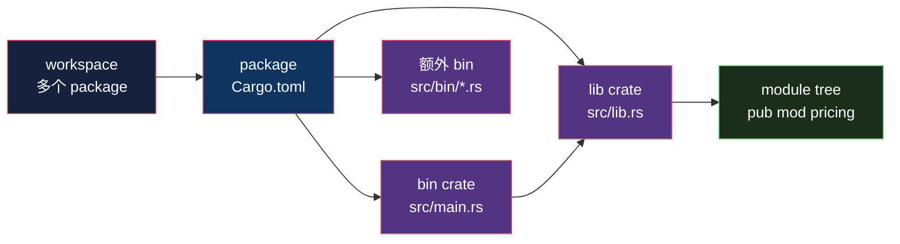

# Rust 项目结构：Cargo 把约定写进了工具链

> 本文基于 Rust 1.95.0 / Cargo 1.95.0；示例在 macOS arm64 上实际编译运行。
> 系列：各语言项目结构最佳实践（Rust 分册）。

## 目录

- [先给结论](#先给结论)
- [生活比喻：工厂、车间和质检线](#生活比喻工厂车间和质检线)
- [Cargo 的三层：package、crate、module](#cargo-的三层packagecratemodule)
- [最小项目：main.rs 与 lib.rs](#最小项目mainrs-与-librs)
- [模块树：foo.rs 还是 foo/mod.rs](#模块树foors-还是-foomodrs)
- [测试、示例、基准](#测试示例基准)
- [库 + 二进制](#库-二进制)
- [workspace：什么时候拆 crate](#workspace什么时候拆-crate)
- [可见性：pub 是门](#可见性pub-是门)
- [真实仓库之一：Serde 的 workspace 与 proc-macro](#真实仓库之一serde-的-workspace-与-proc-macro)
- [真实仓库之二：Tokio 的 workspace 与领域模块](#真实仓库之二tokio-的-workspace-与领域模块)
- [关键争议速查](#关键争议速查)
- [反模式](#反模式)
- [决策清单](#决策清单)
- [骨架代码与验证](#骨架代码与验证)
- [结语](#结语)
- [参考资料](#参考资料)

## 先给结论

Rust 是少数“项目结构约定很强”的语言，因为 Cargo 把很多东西变成了工具链行为：

- `src/main.rs` 默认是二进制 crate 的根；
- `src/lib.rs` 默认是库 crate 的根；
- `tests/` 下的每个文件默认是独立的集成测试 crate；
- `examples/`、`benches/`、`src/bin/` 都有默认语义；
- workspace 的成员、锁文件、构建目录由 Cargo 统一管理。

但“约定强”不等于“结构只有一种”。真正的选择是：

> **一个 package 里放多少 crate？一个 workspace 里放多少 package？模块边界怎么用 `pub` 表达？**

Cargo 给了你一套很清晰的默认值；workspace 是当你需要**独立编译、独立发布、独立复用**时才加的。

## 生活比喻：工厂、车间和质检线

把 Rust 项目想成一座工厂：

| 概念 | 工厂里的角色 | 作用 |
|------|--------------|------|
| package | 工厂 | 一个 `Cargo.toml` 管理的整体 |
| crate | 车间 / 生产线 | 编译单元；库或可执行文件 |
| module | 车间里的工位 | 代码组织单位，`mod` 树 |
| `pub` | 对外窗口 | 其他 crate 能访问 |
| `pub(crate)` | 厂内通道 | 同 crate 内能访问，外部不行 |
| `tests/` | 质检线 | 独立于生产线的集成测试 |
| `examples/` | 样品间 | 可运行的示例 |
| `benches/` | 性能测试台 | 基准测试 |
| workspace | 工业园区 | 多个工厂共享道路、仓库和锁文件 |

一个工厂可以只有一条生产线（一个 bin crate），也可以既生产零件（lib crate）又组装成品（bin crate）。**不是每个工厂都需要工业园区；但工业园区的每个工厂应该有自己的产品边界。**

## Cargo 的三层：package、crate、module

这是 Rust 项目结构最重要的区分：

| 层级 | 由什么定义 | 回答什么问题 |
|------|------------|--------------|
| package | `Cargo.toml` + 一个源码目录 | 这是哪个可发布/可管理的单元？ |
| crate | 一个编译根（`lib.rs` / `main.rs` / `src/bin/*.rs`） | 编译器一次编译出什么？ |
| module | `mod` 声明 + 文件/目录 | 代码在 crate 内怎么组织？ |

一个 package 可以包含：

- **一个库 crate**：`src/lib.rs`；
- **一个默认二进制 crate**：`src/main.rs`；
- **多个额外二进制 crate**：`src/bin/*.rs`；
- **集成测试 crate**：`tests/*.rs`；
- **示例 crate**：`examples/*.rs`；
- **基准 crate**：`benches/*.rs`。

关键点：**crate 是编译单元，package 是管理单元，module 是代码组织单元。** 三者不是一回事。



## 最小项目：main.rs 与 lib.rs

### 只有二进制

```text
hello/
├── Cargo.toml
└── src/
    └── main.rs
```

```rust
fn main() {
    println!("hello, Rust");
}
```

```bash
$ cargo run
hello, Rust
```

这是 `cargo new hello` 的默认结构。适合小工具、脚本、单文件服务。

### 只有库

```text
shop/
├── Cargo.toml
└── src/
    └── lib.rs
```

```rust
pub fn total(unit_cents: u32, quantity: u32) -> u32 {
    unit_cents * quantity
}
```

```bash
$ cargo test
```

库 crate 没有 `main`，它的“产品”是给别的 crate 调用的 API。`pub` 决定哪些函数/类型是公开的。

### 库 + 二进制：两个根文件

```text
shop/
├── Cargo.toml
└── src/
    ├── lib.rs
    └── main.rs
```

- `src/lib.rs` 是库 crate 的根；
- `src/main.rs` 是二进制 crate 的根；
- `main.rs` 可以通过 `use shop::...` 使用同一个 package 的库；
- 集成测试和示例也可以使用这个库。

这是 CLI 工具最常见、也最健康的起点：**逻辑放库，入口放二进制。**

## 模块树：foo.rs 还是 foo/mod.rs

Rust 的模块可以有两种文件布局：

```text
# 2015 风格
src/
├── lib.rs
└── pricing/
    └── mod.rs
```

```text
# 更常见的现代风格
src/
├── lib.rs
├── pricing.rs
└── pricing/
    └── discount.rs
```

在 `src/lib.rs` 里：

```rust
pub mod pricing;
```

如果 `pricing` 还有子模块：

```rust
// src/pricing.rs
pub mod discount;

pub fn total(unit_cents: u32, quantity: u32) -> u32 {
    unit_cents * quantity
}
```

对应 `src/pricing/discount.rs`。两种布局都能工作，**同一个项目里选一种，不要混用**；现代项目更常见 `pricing.rs` + `pricing/` 目录。

模块树的判断标准：

- 按**领域/职责**分模块（`pricing`、`orders`、`storage`），不要按“文件类型”分；
- 模块是 crate 内部的导航，不是发布边界；真正的发布边界是 crate；
- `mod` 树太深通常意味着 crate 太大，或者你在用目录名替代设计。

## 测试、示例、基准

Cargo 的目录约定非常明确：

```text
shop/
├── src/
│   ├── lib.rs
│   └── pricing.rs
├── tests/
│   └── pricing.rs
├── examples/
│   └── total.rs
└── benches/
    └── pricing.rs
```

| 目录 | 编译成什么 | 能访问什么 |
|------|------------|------------|
| `src/` 里的 `#[cfg(test)]` | 单元测试，和库/二进制一起编译 | 可以访问私有项（同模块） |
| `tests/*.rs` | 每个文件一个独立集成测试 crate | 只能访问库的公开 API |
| `examples/*.rs` | 每个文件一个示例 crate | 通过库的公开 API 使用 |
| `benches/*.rs` | 基准测试 crate | 通常用 criterion 等框架 |

### 单元测试 vs 集成测试

单元测试放在源码旁边：

```rust
// src/pricing.rs
pub fn total(unit_cents: u32, quantity: u32) -> u32 {
    unit_cents * quantity
}

#[cfg(test)]
mod tests {
    use super::*;

    #[test]
    fn calculates_total() {
        assert_eq!(total(1250, 3), 3750);
    }
}
```

集成测试放在 `tests/`：

```rust
// tests/pricing.rs
#[test]
fn integration_total() {
    assert_eq!(shop::pricing::total(1250, 3), 3750);
}
```

集成测试是**外部消费者视角**：它只能看到 `pub` 的 API。这正是它的价值——如果你改了内部结构但公共 API 没变，集成测试不应该受影响。

共享测试辅助代码要放在 `tests/common/mod.rs`，而不是 `tests/common.rs`。因为 `tests/` 下每个 `.rs` 文件都会被当成一个独立测试 crate；`common/mod.rs` 作为子模块不会被单独编译成测试目标。

### 示例

```rust
// examples/total.rs
fn main() {
    println!("total={}", shop::pricing::total(1250, 3));
}
```

```bash
$ cargo run --example total
total=3750
```

示例既是文档，也是可执行的验收用例；它只能使用公共 API，所以能暴露“库的入口不好用”的问题。

## 库 + 二进制

什么时候同时有 `lib.rs` 和 `main.rs`？

- 逻辑需要被单元测试/集成测试直接调用；
- 同一套逻辑要给多个二进制入口使用；
- 你想把“可执行程序”做成很薄的壳，把业务放库里。

```text
shop/
├── Cargo.toml
├── src/
│   ├── lib.rs        # 业务库
│   ├── pricing.rs
│   └── main.rs       # 薄入口
├── tests/
│   └── pricing.rs
└── examples/
    └── total.rs
```

`main.rs` 只做参数解析、初始化和输出：

```rust
fn main() {
    println!("total={}", shop::pricing::total(1250, 3));
}
```

**如果只有 `main.rs`，业务逻辑会越来越难测。** 把逻辑移进 `lib.rs`，`main.rs` 保持薄，是 Rust CLI 的常见演进路径。

## workspace：什么时候拆 crate

workspace 是多个 package 的集合，共用一个 `Cargo.lock` 和 `target/`：

```text
shop-workspace/
├── Cargo.toml          # [workspace]
├── Cargo.lock
├── crates/
│   ├── pricing/
│   │   ├── Cargo.toml
│   │   └── src/lib.rs
│   └── api/
│       ├── Cargo.toml
│       └── src/main.rs
└── ...
```

根 `Cargo.toml`：

```toml
[workspace]
members = ["crates/pricing", "crates/api"]
resolver = "2"

[workspace.dependencies]
serde = "1"
```

成员之间用路径依赖：

```toml
# crates/api/Cargo.toml
[dependencies]
pricing = { path = "../pricing" }
```

```bash
$ cargo test --workspace
$ cargo run -p api
```

### 什么时候值得拆

满足下面任意一条，再考虑 workspace：

1. **需要独立发布**：某个 crate 要单独发到 crates.io，有独立版本节奏；
2. **需要独立复用**：被其他项目/仓库使用；
3. **需要隔离编译**：某个 crate 编译很重，或需要不同的 feature/profile；
4. **proc-macro 边界**：过程宏必须放在独立的 proc-macro crate；
5. **测试/示例/基准需要独立依赖**：避免 dev-dependencies 污染库的依赖图。

**不要因为“目录多”就拆 workspace。** 一个 crate 里的模块也能组织得很好；拆 workspace 会增加版本、依赖、构建和发布的管理成本。

### workspace 的共享配置

```toml
[workspace.package]
version = "0.1.0"
edition = "2024"

[workspace.dependencies]
serde = { version = "1", features = ["derive"] }
tokio = { version = "1", features = ["full"] }
```

成员可以继承：

```toml
[package]
name = "pricing"
version.workspace = true
edition.workspace = true

[dependencies]
serde.workspace = true
```

这能避免每个 crate 各写一套版本。**但共享依赖不等于共享边界**；每个 crate 的 `pub` API 仍然要自己设计。

## 可见性：pub 是门

Rust 的可见性不是装饰，是编译器强制的边界：

```rust
pub fn public_api() {}        // 外部 crate 可见
pub(crate) fn internal() {}   // 当前 crate 内可见
fn private() {}               // 当前模块及子模块可见
```

更细的还有 `pub(super)`、`pub(in path)`。实际项目里，常见的分层是：

- `pub`：真正的公共 API，愿意为兼容性负责；
- `pub(crate)`：跨模块共享但不出 crate；
- 默认私有：模块内部实现。

**不要所有东西都 `pub`。** 一旦公开，用户就可能依赖；以后想改就是 breaking change。库 crate 尤其要把 `pub` 当承诺，而不是“省事的默认值”。

## 真实仓库之一：Serde 的 workspace 与 proc-macro

[Serde](https://github.com/serde-rs/serde) 是一个序列化/反序列化框架。它的顶层是一个 workspace：

```text
serde/
├── Cargo.toml          # [workspace]
├── serde/              # 核心库 crate
│   └── src/
│       ├── lib.rs
│       └── ...
├── serde_core/         # 核心实现
│   └── src/
│       ├── lib.rs
│       ├── de/
│       └── ser/
├── serde_derive/       # proc-macro crate
├── serde_derive_internals/
└── test_suite/         # 独立测试 crate
```

根 `Cargo.toml` 的成员：

```toml
[workspace]
members = [
    "serde",
    "serde_core",
    "serde_derive",
    "serde_derive_internals",
    "test_suite",
]
resolver = "2"
```

（master 分支，2026-11-16 快照，commit `e306b0c7c40a`。）

几个关键设计：

1. **`serde_derive` 是独立的 proc-macro crate。** 过程宏 crate 的编译方式和普通库不同；把它拆出去，才能在 `derive` feature 打开时才编译宏依赖（syn、quote 等）。
2. **`serde_core` 承载共享实现。** `serde` 是用户面对的 facade，`serde_core` 提供内部核心；这是“公共 API crate”和“实现 crate”分离的典型。
3. **`test_suite` 是独立 crate。** 测试依赖不会污染 `serde` 的运行时依赖图。
4. **workspace 的成员对应发布/编译边界。** 不是为了目录好看，而是为了让每个 crate 的依赖和 feature 可控。

**结论：当拆 crate 能减少依赖泄漏、隔离编译成本或提供独立发布时，workspace 才是对的。**

## 真实仓库之二：Tokio 的 workspace 与领域模块

[Tokio](https://github.com/tokio-rs/tokio) 是异步运行时。它的 workspace 顶层：

```text
tokio/
├── Cargo.toml          # [workspace]
├── tokio/              # 核心 runtime crate
│   ├── Cargo.toml
│   └── src/
│       ├── lib.rs
│       ├── fs/
│       ├── io/
│       ├── net/
│       ├── process/
│       ├── runtime/
│       ├── signal/
│       ├── sync/
│       ├── task/
│       ├── time/
│       └── util/
├── tokio-macros/       # proc-macro crate
├── tokio-stream/       # 流适配
├── tokio-test/         # 测试工具
├── tokio-util/         # 通用工具
├── benches/
├── examples/
├── stress-test/
├── tests-build/
└── tests-integration/
```

根 `Cargo.toml` 的成员包括：

```toml
[workspace]
members = [
  "tokio",
  "tokio-macros",
  "tokio-test",
  "tokio-stream",
  "tokio-util",
  "benches",
  "examples",
  "stress-test",
  "tests-build",
  "tests-integration",
]
resolver = "2"
```

（master 分支，2026-11-19 快照，commit `3f0ffc85f51c`。）

几个值得学的点：

1. **核心 runtime 是一个 crate，内部按领域分模块。** `net`、`sync`、`time`、`fs`、`runtime` 这些目录是模块，不是独立 crate；它们共享 runtime 的内部状态和 feature 配置。
2. **适配器和宏是独立 crate。** `tokio-macros`（过程宏）、`tokio-stream`（Stream 适配）、`tokio-util`（通用工具）有独立发布和依赖边界。
3. **测试和示例也是 workspace 成员。** `tests-integration`、`tests-build`、`benches`、`examples` 作为独立 crate，避免它们的 dev-dependencies 混进 `tokio` 的库依赖图。
4. **feature 是编译期 API。** `tokio/Cargo.toml` 用 `[features]` 控制 `fs`、`net`、`rt` 等能力；这是 Rust 项目结构的一部分，不是“额外配置”。

**结论：workspace 不是越拆越好，而是让“独立发布/独立编译/独立测试”的边界显式化；核心领域仍然可以放在一个 crate 里按模块组织。**

## 关键争议速查

| 争议 | 我的建议 | 理由 |
|------|----------|------|
| 单 crate 还是 workspace | 先单 crate；出现独立发布/复用/编译隔离需求再拆 | 拆 workspace 会增加版本和依赖管理成本 |
| `src/bin/` 还是 `cmd/` | 用 `src/bin/` | Cargo 默认识别；`cmd/` 是 Go 习惯 |
| `foo.rs` 还是 `foo/mod.rs` | 选一种，现代项目多用 `foo.rs` + `foo/` | 同一项目混用会让模块路径难找 |
| 测试放源码还是 `tests/` | 单元测试在源码；集成测试在 `tests/` | 集成测试应只看公共 API |
| `tests/common.rs` 还是 `tests/common/mod.rs` | 用 `common/mod.rs` | 避免被当成独立测试 crate |
| 要不要所有东西 `pub` | 不要；默认私有，按需 `pub`/`pub(crate)` | 公开就是兼容性承诺 |
| 多 feature 还是多 crate | 能力可组合用 feature；独立发布/依赖隔离用 crate | 两者解决的问题不同 |
| 要不要提交 `Cargo.lock` | 应用提交；库通常不作为发布约束 | 应用要可复现；库的消费者自己解析版本 |
| `build.rs` 放什么 | 只做构建期代码生成/环境探测 | 不要在构建脚本里做网络/业务 IO |
| 要不要提交 `target/` | 不提交 | 构建缓存，体积大且可重建 |

## 反模式

### 1. 用 Go 的 `cmd/` 布局

```text
shop/
└── cmd/
    └── api/
        └── main.rs
```

Cargo 默认不认识 `cmd/`；你要么写 `[[bin]]` 的 `path`，要么把入口放回 `src/bin/api/main.rs`。**Rust 的默认约定是 `src/bin/`，不是 `cmd/`。**

### 2. 所有逻辑塞进 `main.rs`

`main.rs` 变成几千行，测试只能通过启动进程来做。把业务放进 `lib.rs`，`main.rs` 只做装配；这是 Rust CLI 最基本的结构投资。

### 3. `tests/helpers.rs` 被当成测试 crate

`tests/` 下每个 `.rs` 文件都会被编译成独立测试目标。共享辅助代码放 `tests/common/mod.rs`，否则会多出一个没有测试的测试 crate，甚至造成编译错误。

### 4. 所有东西都 `pub`

```rust
pub struct Order;
pub fn internal_step() {}
pub(crate) mod private;
```

公开面越大，兼容性负担越重。默认私有，按需暴露；库 crate 的 `pub` 是 API 合同。

### 5. 过早拆 workspace

一个只有两个模块的项目拆成 6 个 crate，每次改代码都要处理路径依赖和版本继承。**workspace 是发布/编译边界，不是目录分层工具。**

### 6. crate 之间循环依赖

`pricing` 依赖 `orders`，`orders` 又依赖 `pricing`。Cargo 会拒绝循环依赖；正确的做法是抽公共类型、用 trait 倒置依赖，或者重新划边界，而不是继续加 crate。

### 7. `build.rs` 做网络请求/业务逻辑

构建脚本应该在离线、可复现的环境里工作。把网络请求、数据库连接、业务初始化放进 `build.rs`，会让构建不可靠，也会污染 CI 缓存。

### 8. 提交 `target/`

`target/` 是构建缓存，可能几个 GB。它不应该进 Git；需要缓存就交给 CI 的 cache 机制。

## 决策清单

| 场景 | 推荐结构 | 关键动作 |
|------|----------|----------|
| 小工具/脚本 | `src/main.rs` | 保持单文件，别提前拆模块 |
| 可复用库 | `src/lib.rs` + 模块目录 | 设计 `pub` API；写 doc test |
| CLI 工具 | `src/lib.rs` + `src/main.rs` | 逻辑在库，入口薄 |
| 多命令 CLI | `src/bin/<name>.rs` 或 `[[bin]]` | 每个入口独立，共享逻辑在 lib |
| 需要过程宏 | 独立 proc-macro crate | 宏 crate 与运行时 crate 分开 |
| 多个独立发布 crate | workspace + `crates/` | 共享 `workspace.dependencies` |
| 大型核心库 | 一个 crate + 领域模块 | 不要为了目录拆 crate |
| 测试/示例依赖重 | workspace 成员 `tests-integration`/`examples` | 隔离 dev-dependencies |

## 骨架代码与验证

下面是我实际跑过的 demo。

### 目录树

```text
shop/
├── Cargo.toml
├── src/
│   ├── lib.rs
│   ├── main.rs
│   └── pricing.rs
├── tests/
│   └── pricing.rs
└── examples/
    └── total.rs
```

### `Cargo.toml`

```toml
[package]
name = "shop"
version = "0.1.0"
edition = "2024"

[dependencies]
```

### 库与二进制

```rust
// src/lib.rs
pub mod pricing;
```

```rust
// src/pricing.rs
pub fn total(unit_cents: u32, quantity: u32) -> u32 {
    unit_cents * quantity
}

#[cfg(test)]
mod tests {
    use super::*;

    #[test]
    fn calculates_total() {
        assert_eq!(total(1250, 3), 3750);
    }
}
```

```rust
// src/main.rs
fn main() {
    println!("total={}", shop::pricing::total(1250, 3));
}
```

### 集成测试与示例

```rust
// tests/pricing.rs
#[test]
fn integration_total() {
    assert_eq!(shop::pricing::total(1250, 3), 3750);
}
```

```rust
// examples/total.rs
fn main() {
    println!("total={}", shop::pricing::total(1250, 3));
}
```

### 验证命令与输出

```bash
$ cargo fmt --check
# 无输出，退出码 0

$ cargo run --quiet
total=3750

$ cargo test
   Compiling shop v0.1.0 (...)
    Finished `test` profile [unoptimized + debuginfo] target(s) in 0.23s
     Running unittests src/lib.rs (target/debug/deps/shop-...)

running 1 test
test pricing::tests::calculates_total ... ok

test result: ok. 1 passed; 0 failed; 0 ignored; 0 measured; 0 filtered out

     Running unittests src/main.rs (target/debug/deps/shop-...)

running 0 tests

     Running tests/pricing.rs (target/debug/deps/pricing-...)

running 1 test
test integration_total ... ok

test result: ok. 1 passed; 0 failed; 0 ignored; 0 measured; 0 filtered out

$ cargo run --quiet --example total
total=3750
```

（输出有删节，编译哈希和部分段落省略。）

这里有两个不同的测试：

- `pricing::tests::calculates_total` 是单元测试，和库一起编译，可以访问内部；
- `integration_total` 是集成测试，从 `tests/pricing.rs` 编译成独立 crate，只使用公开 API。

示例 `examples/total.rs` 也通过公开 API 使用库，`cargo run --example` 能直接运行。

## 结语

Rust 的项目结构判断可以收束成三句话：

1. **Cargo 的默认约定很强，先跟着默认走。** `src/main.rs`、`src/lib.rs`、`tests/`、`examples/`、`src/bin/` 已经覆盖了大多数项目。
2. **crate 是发布/编译边界，module 是导航边界。** 不要用拆 crate 解决“目录太多”的问题。
3. **`pub` 是真边界。** 默认私有，按需公开；公开 API 要像对待合同一样对待。

下一篇如果继续，会看 Java：一个由 Maven/Gradle 默认布局主导、但包结构经常被写成“controller/service/dao 三层满天飞”的生态，怎么把构建模块和业务边界对齐。

## 参考资料

- [The Cargo Book](https://doc.rust-lang.org/cargo/guide/)
- [Cargo Reference：Manifest](https://doc.rust-lang.org/cargo/reference/manifest.html)
- [Cargo Reference：Workspaces](https://doc.rust-lang.org/cargo/reference/workspaces.html)
- [Cargo Reference：Features](https://doc.rust-lang.org/cargo/reference/features.html)
- [The Rust Book：Packages, Crates, and Modules](https://doc.rust-lang.org/book/ch07-00-managing-growing-projects-with-packages-crates-and-modules.html)
- [Serde 源码](https://github.com/serde-rs/serde)
- [Tokio 源码](https://github.com/tokio-rs/tokio)
