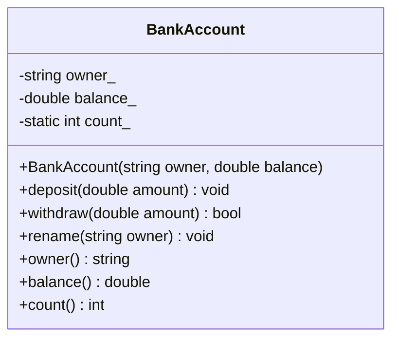

# C++ 基础语法：类与对象，把状态和行为装进同一个盒子

> 本文基于 C++23，编译器 Apple Clang 21.0.0（macOS arm64）。`explicit` 从 C++98 就有；类内默认成员初始化、委托构造从 C++11 开始；`inline static` 变量从 C++17 开始。

类是图纸，对象是按图纸造出来的实物。图纸上写着这栋房子有几个房间（数据成员）、能做什么（成员函数）、哪些门对外开（public）、哪些门只给内部用（private）。

C++ 的类不只是“把函数和数据放在一起”，它还负责**建立不变量（invariant）**：比如一个银行账户的余额不能为负，一个日期对象的月份必须在 1~12 之间。类的构造函数负责把对象带到合法状态，成员函数负责在合法状态之间迁移。

## 从 struct 到 class

```cpp
struct Point {
    double x = 0.0;
    double y = 0.0;

    double norm() const {
        return x * x + y * y;
    }
};

class BankAccount {
public:
    // ...
private:
    // ...
};
```

`struct` 和 `class` 在 C++ 里几乎一样，区别在默认访问权限：

- `struct` 的成员和基类默认 `public`；
- `class` 的成员和基类默认 `private`。

习惯上，`struct` 用于“被动数据聚合”（比如 `Point`、配置项、返回值），`class` 用于“有不变量的对象”（比如账户、连接、状态机）。这只是习惯，不是语法强制。

## 一个带不变量的类

```cpp
#include <cstdio>
#include <stdexcept>
#include <string>
#include <utility>

class BankAccount {
public:
    explicit BankAccount(std::string owner, double balance = 0.0)
        : owner_(std::move(owner)), balance_(balance) {
        if (balance_ < 0.0) {
            throw std::invalid_argument("balance must be >= 0");
        }
        ++count_;
    }

    ~BankAccount() { --count_; }

    BankAccount(const BankAccount&) = delete;
    BankAccount& operator=(const BankAccount&) = delete;

    void deposit(double amount) {
        if (amount <= 0.0) {
            throw std::invalid_argument("amount must be > 0");
        }
        balance_ += amount;
    }

    bool withdraw(double amount) {
        if (amount <= 0.0 || amount > balance_) {
            return false;
        }
        balance_ -= amount;
        return true;
    }

    void rename(std::string owner) {
        this->owner_ = std::move(owner);
    }

    const std::string& owner() const { return owner_; }
    double balance() const { return balance_; }
    static int count() { return count_; }

private:
    std::string owner_;
    double balance_ = 0.0;
    static inline int count_ = 0;
};

int main() {
    BankAccount a{"Alice", 100.0};
    BankAccount b{"Bob"};

    a.deposit(50.0);
    a.rename("Alicia");

    std::printf("%s: %.2f\n", a.owner().c_str(), a.balance());
    std::printf("withdraw 200: %s\n", a.withdraw(200.0) ? "ok" : "rejected");

    {
        BankAccount c{"Carol"};
        std::printf("inside count=%d\n", BankAccount::count());
    }
    std::printf("after count=%d\n", BankAccount::count());
}
```

```bash
$ clang++ -std=c++23 -Wall -Wextra -O2 classes.cpp -o classes
$ ./classes
Alicia: 150.00
withdraw 200: rejected
inside count=3
after count=2
```

这个类里有几个关键点：

- `owner_`、`balance_` 是 **private**，外部不能直接改，只能通过 `deposit`、`withdraw` 这些成员函数操作；
- 构造函数检查 `balance >= 0`，保证对象从出生起就合法；
- `withdraw` 在余额不足时返回 `false`，不抛异常；`deposit` 在参数非法时抛 `std::invalid_argument`。错误处理方式取决于业务语义，没有统一答案；
- `count_` 是 `static` 成员，属于类而不是某个对象，记录当前账户数量；
- 拷贝构造和拷贝赋值被 `= delete`，因为账户身份不应该被复制。删除拷贝后，`count_` 不会因为“复制了一个账户但没加计数”而错乱。

## 构造函数

构造函数负责把对象带到合法状态。它和类同名，没有返回类型，可以重载。

### 成员初始化列表

```cpp
BankAccount(std::string owner, double balance)
    : owner_(std::move(owner)), balance_(balance) {
    // 函数体
}
```

冒号后面是**成员初始化列表**。成员在进入函数体之前就已经构造完成，所以：

- 初始化列表里的顺序不影响实际构造顺序；实际顺序是**成员在类中的声明顺序**；
- 如果成员是 `const`、引用或没有默认构造函数的类型，必须在初始化列表里初始化；
- 在函数体里写 `owner_ = ...` 是赋值，不是初始化，可能多一次默认构造 + 赋值。

一个常见 bug：

```cpp
class Bad {
    int b_;
    int a_;
public:
    Bad() : a_(1), b_(a_) {}   // b_ 先初始化，此时 a_ 还没初始化
};
```

实际构造顺序是 `b_` 先、`a_` 后，所以 `b_(a_)` 读到了未初始化的 `a_`。开 `-Wall -Wextra` 会这样警告：

```text
warning: field 'a_' will be initialized after field 'b_' [-Wreorder-ctor]
warning: field 'a_' is uninitialized when used here [-Wuninitialized]
```

最好的做法是让初始化列表顺序和声明顺序一致。

### explicit：阻止隐式转换

```cpp
class Meters {
public:
    explicit Meters(double value) : value_(value) {}
private:
    double value_;
};

void print(Meters m);
print(3.14);   // 错误：explicit 阻止 double 隐式转换成 Meters
```

如果构造函数只有一个参数（或者其余参数都有默认值），它默认允许隐式转换。`explicit` 关掉这个转换，避免“3.14 突然变成了一个 Meters 对象”这种意外。

试试没有 `explicit` 时容易发生的错误：

```cpp
class BankAccount {
public:
    explicit BankAccount(std::string owner, double balance = 0.0);
};

int main() {
    BankAccount account = "Alice";
}
```

```text
error: no viable conversion from 'const char[6]' to 'BankAccount'
note: explicit constructor is not a candidate
```

对于有多个参数的构造函数，C++11 的列表初始化 `BankAccount a{"Alice", 100.0};` 仍然可用；`explicit` 只阻止隐式转换，不影响直接初始化。

### 默认构造与默认成员初始化

```cpp
class Config {
public:
    Config() = default;   // 让编译器生成默认构造
private:
    int timeout_ = 30;    // 类内默认成员初始化（C++11）
    bool verbose_ = false;
};
```

`= default` 表示“按默认规则生成”。注意：如果类里已经有用户声明的构造函数，编译器不会再生成默认构造；需要时显式 `= default`。

### 委托构造

```cpp
class Point {
public:
    Point() : Point(0.0, 0.0) {}
    Point(double x, double y) : x_(x), y_(y) {}
private:
    double x_;
    double y_;
};
```

一个构造函数可以委托给另一个构造函数，避免重复初始化逻辑。C++11 起支持。

## 析构函数

析构函数在对象生命周期结束时自动调用，负责释放资源：

```cpp
~BankAccount() {
    --count_;
}
```

这里只是维护计数；真正管理内存、文件、锁的析构函数要遵循 [RAII](raii.md)。几条基础规则：

- 析构函数不能重载，不能有参数；
- 析构函数通常不要抛异常；
- 如果类会被继承并通过基类指针删除，基类析构函数必须是 `virtual`（见[虚函数](virtual-functions.md)）；
- 析构函数里不要调用虚函数，也不要假设派生类部分还活着。

## const 成员函数

成员函数后面加 `const`，表示这个函数不修改对象状态：

```cpp
const std::string& owner() const { return owner_; }
double balance() const { return balance_; }
```

`const` 对象只能调用 `const` 成员函数：

```cpp
const BankAccount account{"Alice", 100.0};
std::printf("%.2f\n", account.balance());   // ok
// account.deposit(10.0);                   // error: 不能在 const 对象上调用非 const 成员
```

这是一个编译期契约：看到 `const` 成员函数，调用方就知道它不会改对象。`mutable` 成员可以在 `const` 函数里修改，通常用于缓存、互斥量等“逻辑上不改变对象状态”的成员，但不要滥用。

## static 成员：属于类，不属于对象

```cpp
class BankAccount {
public:
    static int count() { return count_; }
private:
    static inline int count_ = 0;   // C++17：类内定义
};
```

`static` 成员变量在所有对象之间共享，不属于某个具体对象；`static` 成员函数没有 `this` 指针，不能直接访问非静态成员。

C++17 之前，`static` 成员变量通常要在类外定义：

```cpp
// C++17 之前
int BankAccount::count_ = 0;
```

C++17 的 `inline static` 允许在类内定义，并且整个程序只有一个实体（ODR 规则见[编译与链接](compile-and-link.md)）。

## 拷贝与移动：默认行为不一定对

如果类没有自己声明拷贝/移动操作，并且**没有用户声明的析构函数**，编译器会生成默认的移动操作。拷贝操作则在没有用户声明拷贝操作时生成；如果用户声明了移动操作，拷贝操作会被定义为 deleted。默认版本的行为是：

- 默认拷贝构造：逐个成员拷贝；
- 默认移动构造：逐个成员移动（如果成员支持移动）；
- 有指针成员时，默认拷贝是**浅拷贝**，可能导致 double free。

只要声明了析构函数（哪怕是 `~S() = default;`），隐式移动构造和移动赋值就不会生成，右值会退回拷贝构造。`BankAccount` 声明了析构函数并删除了拷贝，所以它没有隐式移动。

`BankAccount` 直接删除了拷贝：

```cpp
BankAccount(const BankAccount&) = delete;
BankAccount& operator=(const BankAccount&) = delete;
```

因为账户有身份，复制一个账户在业务上没有意义。如果你的类需要拷贝，优先使用 Rule of Zero：让成员自己管理资源（`std::string`、`std::vector`、`std::unique_ptr`），不要手写析构函数和拷贝函数。详细规则见[RAII](raii.md)和[移动语义](move-semantics.md)。

## 类的结构



`-` 表示 private，`+` 表示 public；`owner_`、`balance_` 是状态，`deposit`、`withdraw` 是行为。外部只能通过 public 方法改变状态，不变量由类自己维护。

## 常见坑

| 坑 | 说明 |
|----|------|
| 成员未初始化 | 内置类型成员不会自动变 0；用类内默认值或初始化列表 |
| 初始化顺序写反 | 实际按声明顺序构造，可能读到未初始化成员 |
| 在构造函数体里赋值 | 能初始化就放初始化列表，避免默认构造 + 赋值 |
| 忘记 `explicit` | 单参数构造函数可能发生意外隐式转换 |
| 返回成员引用但对象已销毁 | 引用的生命周期不能超过对象 |
| 通过基类指针删除派生类 | 基类析构函数不是 virtual 会 UB |
| 默认拷贝有指针成员 | 浅拷贝导致 double free；用 Rule of Zero/Five |
| 在 `const` 函数里修改成员 | 除非成员是 `mutable`，否则编译错误 |
| 静态成员未定义 | C++17 之前类内声明只是声明，需要类外定义 |

## 收尾

类和对象的核心不是语法，而是**责任划分**：

- 数据成员负责保存状态；
- 构造函数负责建立不变量；
- 成员函数负责在合法状态之间迁移；
- 析构函数负责释放资源；
- 访问控制负责阻止外部绕过不变量。

当你写一个类时，先问：这个对象的合法状态是什么？哪些操作会破坏它？谁能修改它？把这些问题回答清楚，类比语法背得熟更重要。

---

**相关文章**

- [C++ 基础语法：变量、类型与初始化](basics-types.md)
- [C++ 基础语法：指针与引用](basics-pointers-references.md)
- [C++ RAII：让析构函数替你收拾房间](raii.md)
- [C++ 移动语义：std::move 到底搬走了什么](move-semantics.md)
- [C++ 虚函数：一张 vtable 背后的点菜流程](virtual-functions.md)
