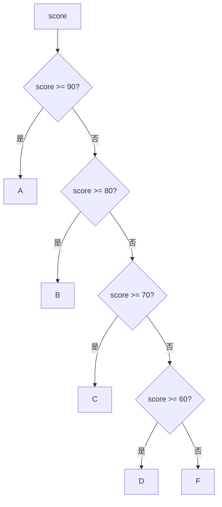

# C++ 基础语法：条件、循环与函数，把执行路径写清楚

> 本文基于 C++23，编译器 Apple Clang 21.0.0（macOS arm64）。范围 for 从 C++11 开始；`[[nodiscard]]`、`[[fallthrough]]` 从 C++17 开始。

城市道路有岔路口、环岛和单行道。程序也一样：`if` 是岔路口，`switch` 是多岔路口，`for`/`while` 是环岛，函数则是一条可以反复走的固定路线。

语法本身不难，难的是**把路径写清楚**：什么条件下走哪条路、循环什么时候停、函数拿到的是副本还是原件。这篇把条件和循环讲透，再落到函数参数的选择上。

## if / else：岔路口

```cpp
int score = 83;

if (score >= 90) {
    std::puts("A");
} else if (score >= 80) {
    std::puts("B");
} else if (score >= 70) {
    std::puts("C");
} else {
    std::puts("D");
}
```

几个细节：

- `if` 的条件会转换成 `bool`；整数 0 为假，非 0 为真。
- `&&`、`||` 有短路求值：`p != nullptr && p->valid()` 只有在 `p` 非空时才会解引用 `p`。这是空指针检查能写在一行里的原因。
- 花括号不是必须的，但**建议永远写**。省略花括号后加一行代码，很容易变成“这行到底在不在 if 里”的 bug。

比较浮点数不要用 `==`，用容差；有符号/无符号混用也可能让条件永远为真或永远为假，这些在[类型那篇](basics-types.md)里已经踩过。

## switch：多岔路口

```cpp
switch (values.size()) {
    case 5:
        std::printf("five elements\n");
        break;
    default:
        std::printf("other\n");
}
```

`switch` 的条件必须是整数或枚举类型；类类型必须能隐式转换到整数/枚举。浮点、字符串、`std::string` 都不能直接作为条件。每个 `case` 后面的值必须是编译期常量。

最容易忘的是 `break`：没有 `break` 会**贯穿（fallthrough）**到下一个 `case`，继续执行。有时候这是故意的，比如：

```cpp
switch (command) {
    case 'q':
    case 'Q':
        quit();
        break;
    case 'h':
        help();
        [[fallthrough]];   // C++17：明确告诉编译器“我是故意贯穿的”
    case '?':
        print_help();
        break;
}
```

如果你确实想贯穿，C++17 的 `[[fallthrough]]` 能让意图显式化，也能避免编译器警告。绝大多数情况下，忘记 `break` 都是 bug。

## 四种循环

| 循环 | 什么时候用 | 例子 |
|------|-----------|------|
| `for` | 次数确定，或需要下标 | `for (int i = 0; i < n; ++i)` |
| `while` | 条件满足就继续，次数不确定 | `while (!done)` |
| `do-while` | 至少执行一次，再判断 | 读取输入直到合法 |
| range-for | 遍历整个容器 | `for (int x : values)` |

```cpp
int i = 0;
while (i < 3) {
    std::printf("while %d\n", i);
    ++i;
}

do {
    std::printf("do %d\n", i);
    --i;
} while (i > 0);
```

```text
while 0
while 1
while 2
do 3
do 2
do 1
```

`while` 先判断再执行；`do-while` 先执行一次再判断，所以即使条件一开始就是假，循环体也会跑一次。

`break` 立即退出整个循环，`continue` 跳过本次循环剩余部分、直接进入下一次。它们只影响最内层循环；嵌套循环想一次跳出，通常要加一个标志位或者把循环抽成函数。

### range-for：遍历容器

```cpp
std::vector<int> values{1, 2, 3, 4, 5};

for (int value : values) {
    std::printf("%d ", value);
}

for (int& value : values) {
    value *= 2;          // 修改容器里的元素
}

for (const auto& value : values) {
    std::printf("%d ", value);   // 只读，避免拷贝
}
```

三种写法的区别：

- `int value`：每次拷贝一个元素；修改副本不影响容器。
- `int& value`：引用，能修改原元素；不能绑定临时对象。
- `const auto& value`：只读引用，避免大对象拷贝；最常用的只读写法。

range-for 的本质是用 `begin()`/`end()` 遍历。**循环期间不要对容器做`push_back`、`erase` 等可能改变容量或元素位置的操作**，否则迭代器会失效，行为未定义。具体规则见[迭代器失效](stl-iterators.md)。

## 函数：可复用的路线

```cpp
[[nodiscard]] const char* grade(int score) {
    if (score >= 90) return "A";
    if (score >= 80) return "B";
    if (score >= 70) return "C";
    if (score >= 60) return "D";
    return "F";
}
```

`[[nodiscard]]`（C++17）表示“返回值不应该被忽略”。如果调用方只写 `grade(83);` 而不使用结果，编译器会警告。它适合那些“调用是为了拿结果”的函数，比如 `open()`、`find()`、`parse()`。

### 参数：传值还是传引用

```cpp
int add(int a, int b);                       // 小对象：传值
void print(const std::string& text);         // 只读大对象：const 引用
void fill(std::vector<int>& values);         // 需要修改：非 const 引用
void maybe_log(const std::string* message);  // 可能为空：指针
```

| 写法 | 语义 | 适用场景 |
|------|------|---------|
| `T x` | 拷贝一份 | 小类型（`int`、`double`、指针） |
| `const T& x` | 只读引用，不拷贝 | 大对象只读参数 |
| `T& x` | 可修改原对象 | 输出参数/需要修改调用方对象 |
| `T* x` | 可修改，可能为空 | 可选参数、C API 风格 |
| `const T* x` | 只读，可能为空 | 可选只读参数 |

一个常见误区是“引用一定比传值快”。对于 `int`、`double` 这种小类型，传值往往更快；引用不是对象，常见实现仍然需要通过地址间接访问，而拷贝一个小整数几乎没有成本。对于 `std::string`、`std::vector` 这种大对象，`const&` 才明显省拷贝。

### 返回值和重载

```cpp
int add(int a, int b) { return a + b; }
double add(double a, double b) { return a + b; }
```

同名函数参数类型不同，叫**重载（overload）**。编译器根据实参类型选择版本；返回类型不参与重载决议，所以不能只靠返回值区分。

函数还可以有默认参数：

```cpp
void greet(const std::string& name = "world") {
    std::printf("hello, %s\n", name.c_str());
}

greet();        // hello, world
greet("C++");   // hello, C++
```

默认参数只能从右往左连续设置；调用时不能跳过中间的参数。默认参数在**编译期**填入调用点，所以如果默认值在头文件里改了，调用方需要重新编译。

## 一个完整的例子

```cpp
// control.cpp
#include <cstdio>
#include <string>
#include <vector>

[[nodiscard]] const char* grade(int score) {
    if (score >= 90) return "A";
    if (score >= 80) return "B";
    if (score >= 70) return "C";
    if (score >= 60) return "D";
    return "F";
}

int total(const std::vector<int>& values) {
    int sum = 0;
    for (int value : values) {
        sum += value;
    }
    return sum;
}

int add(int a, int b) { return a + b; }
double add(double a, double b) { return a + b; }

void greet(const std::string& name = "world") {
    std::printf("hello, %s\n", name.c_str());
}

int main() {
    for (int score : {95, 83, 61, 42}) {
        std::printf("%d -> %s\n", score, grade(score));
    }

    std::vector<int> values{1, 2, 3, 4, 5};
    std::printf("total=%d\n", total(values));
    std::printf("add(int)=%d add(double)=%.1f\n", add(1, 2), add(1.5, 2.5));
    greet();
    greet("C++");

    int i = 0;
    while (i < 3) {
        std::printf("while %d\n", i);
        ++i;
    }

    do {
        std::printf("do %d\n", i);
        --i;
    } while (i > 0);

    switch (values.size()) {
        case 5:
            std::printf("five elements\n");
            break;
        default:
            std::printf("other\n");
    }
}
```

```bash
$ clang++ -std=c++23 -Wall -Wextra -O2 control.cpp -o control
$ ./control
95 -> A
83 -> B
61 -> D
42 -> F
total=15
add(int)=3 add(double)=4.0
hello, world
hello, C++
while 0
while 1
while 2
do 3
do 2
do 1
five elements
```

注意 `61 -> D`：`61 >= 60`，所以是 D。条件顺序很重要；如果先写 `score >= 60`，所有 60 分以上都会落到 D 分支。

## 条件分支的形状



这类“逐级判断”的分支，条件应该从严格到宽松排列；否则后面的分支永远进不去。

## 常见坑

| 坑 | 说明 |
|----|------|
| `if (x = 1)` | 赋值表达式的结果是 1，条件永远为真；编译器通常会警告 |
| 无符号循环反向 | `for (unsigned i = n; i >= 0; --i)` 永远停不下来；用有符号或用 `i != 0` 配合前置递减 |
| off-by-one | `<=` 和 `<` 差一位，循环边界要单独测 |
| 省略花括号 | 后续加代码容易跑到 if 外面 |
| switch 忘 break | 意外贯穿到下一个 case |
| range-for 里改容器 | 迭代器可能失效，行为未定义 |
| 返回局部变量的引用/指针 | 函数结束对象销毁，引用/指针悬空 |
| 递归没有终止条件 | 栈溢出；递归深度大时考虑改成迭代 |

## 收尾

条件和循环解决“怎么走”，函数解决“哪段路可以复用”。写基础代码时，优先选择**最容易读**的写法，而不是最省行的写法：

- 分支多且条件复杂时，抽成有名字的函数；
- 循环边界用有意义的变量名，不要用魔法数；
- 参数能只读就 `const&`，需要修改才 `T&`；
- 返回值该检查就检查，`[[nodiscard]]` 是给调用方的提醒。

程序不是写给编译器看的，是写给下一个维护的人看的。路径画清楚，比少写两行重要得多。

---

**相关文章**

- [C++ 基础语法：变量、类型与初始化](basics-types.md)
- [C++ 基础语法：指针与引用](basics-pointers-references.md)
- [C++ 基础语法：类与对象](basics-classes.md)
- [C++ 基础语法：vector、string、map 与标准库入门](basics-stl.md)
