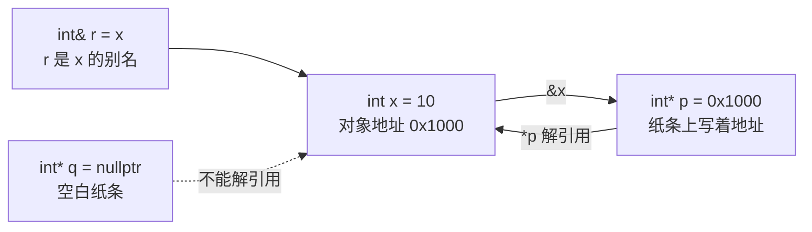

# C++ 基础语法：指针与引用，地址、别名和空指针

> 本文基于 C++23，编译器 Apple Clang 21.0.0（macOS arm64）。`nullptr` 从 C++11 开始；`std::array`、`std::span` 分别从 C++11、C++20 开始。

想象你有一本书，书放在图书馆 3 楼 A 区 12 号架。你可以给别人一张纸条，上面写着“3 楼 A 区 12 号”——这是**指针**：纸条本身不是书，它只是地址。你也可以给这本书起个小名，比如“那本 C++ 书”——这是**引用**：小名不是另一本书，它就是这本书的另一个称呼。

这两个概念经常被混为一谈，因为它们在底层都和地址有关。但语义完全不同：

- **指针**是一个对象，里面存着地址；它可以为空、可以改指向、可以做算术。
- **引用**是已有对象的别名；它必须绑定到一个对象，不能为空、不能改绑。

## 指针：一张写着地址的纸条

```cpp
int x = 10;
int* p = &x;    // p 保存 x 的地址
*p = 20;        // 通过 p 修改 x
```

`&x` 取地址，`*p` 解引用（dereference），也就是“顺着地址找到那个对象”。`p` 的类型是 `int*`，读作“指向 int 的指针”。

```cpp
int y = 30;
p = &y;         // 指针可以改指向
*p = 40;        // 现在修改的是 y

int** pp = &p;  // 指向指针的指针
**pp = 50;      // 修改 p 指向的对象
```

指针可以为空：

```cpp
int* q = nullptr;   // C++11 的空指针常量
if (q != nullptr) {
    std::printf("%d\n", *q);
}
```

`nullptr` 不是 0，也不是 `NULL`。它是一个独立的类型 `std::nullptr_t`，能隐式转换成任意指针类型，但不能转换成整数。新代码统一用 `nullptr`，不要用 `NULL` 或 `0`。

**空指针不能解引用。** `*q` 是未定义行为，通常会段错误。使用指针前先判空，或者用引用表达“一定不为空”的契约。

## const 与指针：四种组合

`const` 和指针放一起，位置不同含义完全不同：

```cpp
int x = 1;
int y = 2;

const int* p1 = &x;        // 指向 const int：不能通过 p1 改 x
int* const p2 = &x;        // const 指针：p2 不能改指向
const int* const p3 = &x;  // 两者都不能改
```

记忆口诀：**`const` 在 `*` 左边，修饰指向的对象；在 `*` 右边，修饰指针本身。**

| 写法 | 能否改指向 | 能否通过指针改对象 |
|------|:---:|:---:|
| `int* p` | ✅ | ✅ |
| `const int* p` | ✅ | ❌ |
| `int* const p` | ❌ | ✅ |
| `const int* const p` | ❌ | ❌ |

编译器会严格检查：

```cpp
const int cx = 42;
const int* p1 = &cx;
int y = 7;
int* const p2 = &y;

*p1 = 0;    // error: read-only variable is not assignable
p2 = &cx;   // error: cannot assign to variable 'p2' with const-qualified type
```

实际输出：

```text
error: read-only variable is not assignable
error: cannot assign to variable 'p2' with const-qualified type 'int *const'
```

`const int*` 是函数参数里最常见的写法之一：函数不修改对象，也不承诺对象本身是 const。比如 `void print(const std::string* s)` 表示“我只看，不改；而且 s 可能为空”。

## 引用：对象的别名

```cpp
int x = 10;
int& r = x;    // r 是 x 的别名
r += 5;        // 等价于 x += 5

std::printf("x=%d r=%d\n", x, r);   // 15 15
```

引用必须在定义时初始化，而且**不能重新绑定**：

```cpp
int a = 1, b = 2;
int& r = a;
r = b;          // 这是把 b 的值赋给 a，不是让 r 改绑到 b
// int& r2;     // 错误：引用必须初始化
```

引用不是对象，没有“引用的引用”这种类型；对引用取地址，得到的是被引用对象的地址：

```cpp
int& r = a;
int* p = &r;    // p 指向 a
```

### const 引用

```cpp
const int& cr = x;   // 不能通过 cr 修改 x
```

`const T&` 还能绑定临时对象，并延长它的生命周期：

```cpp
const std::string& name = std::string("C++") + "23";
// name 在这里有效，临时 string 的生命周期被延长到 name 的作用域结束
```

这是函数参数常用 `const std::string&` 的原因：既能接受左值，也能接受临时对象，还不会拷贝。

### 引用不能为空

引用没有“空引用”这种合法状态。它必须绑定到一个有效对象：

```cpp
int& r = *new int(1);   // r 绑定到堆对象，但谁负责 delete？
```

如果你需要表达“可能没有对象”，用指针（`T*`）或 `std::optional<std::reference_wrapper<T>>`，不要试图用空引用。引用适合表达“这个参数必须存在”。

### 悬空引用

引用不会延长普通局部对象的生命周期。函数返回局部变量的引用，调用方拿到的是悬空引用：

```cpp
int& bad() {
    int local = 1;
    int& alias = local;
    return alias;
}
```

编译器会警告：

```text
warning: reference to stack memory associated with local variable 'local' returned [-Wreturn-stack-address]
```

指针版本也一样：

```cpp
int* bad() {
    int local = 1;
    return &local;   // warning: address of stack memory associated with local variable 'local' returned
}
```

`-Wall -Wextra` 能抓住这种直接情况，但抓不住所有间接情况（比如把指针存进全局变量、返回成员引用但对象已经销毁）。规则是：**不要返回指向局部对象的指针或引用。**

## 数组与指针退化

数组名在大多数表达式里会退化成指向首元素的指针：

```cpp
int arr[3]{1, 2, 3};
int* p = arr;         // arr 退化为 &arr[0]

std::printf("sizeof(arr)=%zu sizeof(p)=%zu\n", sizeof(arr), sizeof(p));
```

```text
sizeof(arr)=12 sizeof(p)=8
```

`sizeof(arr)` 是 12（3 个 `int`），`sizeof(p)` 是指针大小 8。一旦传给函数，数组就退化成指针，长度信息丢失：

```cpp
void print(int arr[]) {   // 等价于 int* arr
    // sizeof(arr) 是指针大小，不是数组大小
}
```

所以现代 C++ 更推荐：

- `std::array<T, N>`：固定大小，保留长度，支持范围 for；
- `std::vector<T>`：动态大小，自动管理内存；
- `std::span<T>`（C++20）：非拥有视图，传数组/vector 的一段，不拷贝；
- 需要 C 接口时再传 `T* + size`。

指针算术：

```cpp
int arr[3]{1, 2, 3};
int* p = arr;
*(p + 1) = 20;   // 等价于 arr[1] = 20
```

`p + 1` 不是加一个字节，而是加 `sizeof(int)` 个字节，指向下一个 `int`。指针算术只在同一个数组（包括 one-past-the-end）内有定义；跨数组、解引用越界指针都是未定义行为。

## 指针和引用在函数参数里的选择

| 参数写法 | 是否可空 | 是否拷贝 | 是否可修改原对象 | 典型用途 |
|---------|:---:|:---:|:---:|---------|
| `T x` | ❌ | ✅ | ❌ | 小类型 |
| `T& x` | ❌ | ❌ | ✅ | 必选输出参数 |
| `const T& x` | ❌ | ❌ | ❌ | 只读大对象 |
| `T* x` | ✅ | ❌ | ✅ | 可选参数、C API |
| `const T* x` | ✅ | ❌ | ❌ | 可选只读参数 |

一个实用的决策顺序：

1. 这个参数必须存在吗？必须 → 用引用；可选 → 用指针。
2. 需要修改调用方的对象吗？需要 → `T&` / `T*`；不需要 → `const T&` / `const T*`。
3. 是小类型吗？小类型直接传值，省去间接访问。

## 所有权：指针只是观察者

裸指针 `T*` 不表达所有权。它可能是：

- 借用（borrowed）：指向别人拥有的对象，自己不负责释放；
- 拥有（owning）：由它负责 `delete`；
- 可能为空；
- 可能已经悬空。

类型上看不出来，所以现代 C++ 用智能指针表达所有权：

```cpp
auto p = std::make_unique<Task>();   // 独占所有权
std::shared_ptr<Task> q = ...;       // 共享所有权
Task* raw = p.get();                 // 非拥有观察者，不要 delete
```

裸指针仍然有用，但只适合“非拥有、短期观察”的场景。所有权规则见[智能指针](smart-pointers.md)和[RAII](raii.md)。

## 一张图



## 常见坑

| 坑 | 说明 |
|----|------|
| 解引用空指针 | `*p` 前先判空，或用引用表达非空契约 |
| 返回局部变量的指针/引用 | 函数结束即悬空 |
| 指针未初始化 | `int* p; *p = 1;` 野指针，未定义行为 |
| 数组越界 | 指针算术只在数组范围内有效 |
| 忘记 `const` | 只读参数用 `const T*` / `const T&`，让编译器帮忙检查 |
| 用 `NULL` | 新代码用 `nullptr` |
| 裸指针表达所有权 | 用 `unique_ptr` / `shared_ptr` 表达“谁负责释放” |
| 引用成员悬空 | 对象销毁后，指向它成员的引用也悬空 |

## 收尾

指针和引用不是“高级语法”，而是 C++ 内存模型的基本词汇：

- **指针是对象**，存地址，可空、可改指向、可做算术；
- **引用是别名**，必须绑定对象，不能空、不能改绑；
- **`const` 的位置决定它修饰谁**；
- **裸指针不表达所有权**，所有权交给智能指针。

写代码时先问自己：这个变量是“拥有对象”还是“观察对象”？是“必须有”还是“可能没有”？答案会直接决定你用 `unique_ptr`、`T&`、`T*` 还是 `const T&`。类型选对了，一半的悬空和空指针 bug 根本不会出现。

---

**相关文章**

- [C++ 基础语法：变量、类型与初始化](basics-types.md)
- [C++ 基础语法：条件、循环与函数](basics-control-flow.md)
- [C++ 智能指针：所有权账本](smart-pointers.md)
- [C++ STL 迭代器失效：书架扩容时，书签为什么会作废](stl-iterators.md)
