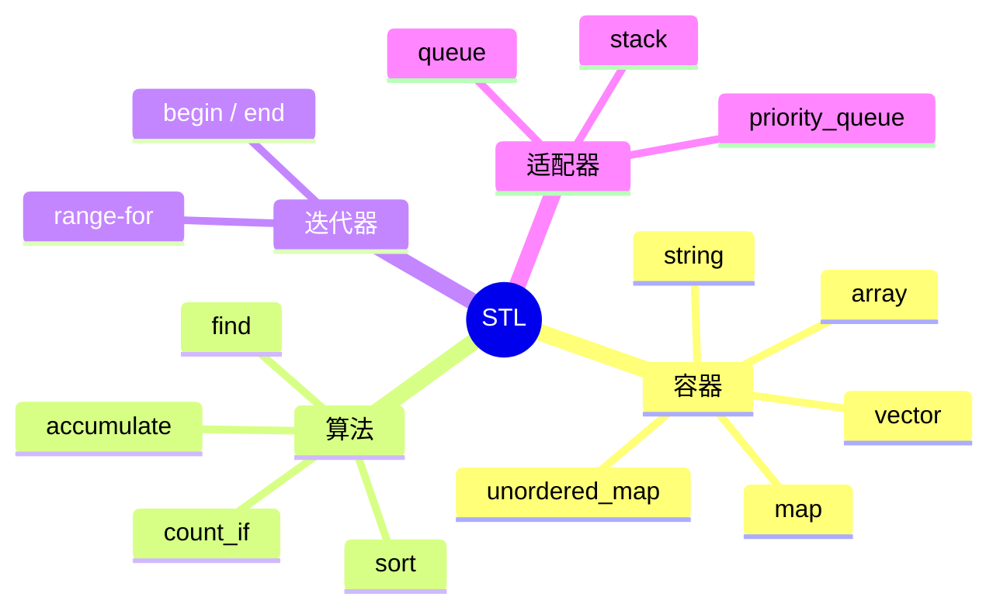

# C++ 基础语法：vector、string、map 与标准库入门

> 本文基于 C++23，编译器 Apple Clang 21.0.0（macOS arm64）。`std::array`、范围 for 从 C++11 开始；`std::string_view`、结构化绑定从 C++17 开始；`std::map::contains` 从 C++20 开始。

标准库像一套预制家具：你不需要从砍树开始做书架，直接拿 `std::vector` 装东西、用 `std::string` 处理文本、用 `std::map` 建索引、用 `std::sort` 排序。它们已经处理好了内存管理、边界情况和性能细节。

但预制家具也有说明书：`vector` 会扩容，扩容会让迭代器失效；`map` 的 `operator[]` 会悄悄插入元素；`sort` 只能用于随机访问容器。这篇从最常用的四类组件开始，把标准库的日常用法串起来。

## STL 的四个部分



- **容器**负责存数据：`vector` 动态数组、`string` 文本、`map` 有序键值对、`unordered_map` 哈希表。
- **迭代器**是容器和算法之间的桥梁：算法不关心数据存在哪，只要求能通过迭代器遍历。
- **算法**是现成的操作：排序、查找、计数、累加。
- **适配器**在已有容器上换一层接口，比如 `stack`、`queue`。

入门阶段先掌握 `vector`、`string`、`map` 和几个常用算法，足够写大多数业务代码。

## vector：会自动扩容的数组

```cpp
#include <vector>

std::vector<int> values{3, 1, 4, 1, 5};

values.push_back(9);          // 尾部插入
values[0] = 10;               // 下标访问，不检查越界
values.at(1) = 20;            // 带越界检查，越界抛 std::out_of_range

std::printf("size=%zu front=%d back=%d\n",
            values.size(), values.front(), values.back());

for (int value : values) {
    std::printf("%d ", value);
}
```

`vector` 的特点：

- 元素连续存储，随机访问 O(1)，缓存友好；
- 尾部插入/删除均摊 O(1)，中间插入/删除 O(n)；
- 容量不够时自动扩容：分配新缓冲区、搬移元素、释放旧缓冲区；
- 扩容后，指向旧缓冲区的迭代器、指针、引用全部失效。

`size()` 是当前元素个数，`capacity()` 是当前缓冲区能容纳的个数。已知要插入多少元素时，先 `reserve(n)` 可以避免多次扩容：

```cpp
std::vector<int> data;
data.reserve(1000);
for (int i = 0; i < 1000; ++i) {
    data.push_back(i);   // 不会触发扩容
}
```

`reserve` 只改容量，不改 `size`；`resize` 会真正创建/销毁元素。两者不要混用。

迭代器失效的详细规则见[STL 迭代器失效](stl-iterators.md)，那是 `vector` 最容易踩的坑。

## string：文本处理

```cpp
#include <string>

std::string text = "hello world";
text += "!";                       // 拼接
text[0] = 'H';                     // 修改字符

auto pos = text.find("world");     // 找不到返回 std::string::npos
if (pos != std::string::npos) {
    std::printf("found at %zu\n", pos);
}

std::string sub = text.substr(0, 5);   // "Hello"
std::printf("size=%zu sub=%s\n", text.size(), sub.c_str());
```

`std::string` 自动管理内存，支持拼接、查找、截取、比较。`c_str()` 返回以 `'\0'` 结尾的 C 字符串，用于传给 `printf` 或 C API；`data()` 返回底层字符数组，C++11 起也保证以 `'\0'` 结尾（C++17 增加了可写的非 const 重载），但通常只在需要原始指针时使用。

`std::string_view`（C++17）是只读、不拥有内存的视图，适合函数参数：

```cpp
#include <string_view>

void print(std::string_view text) {
    std::printf("%.*s\n", static_cast<int>(text.size()), text.data());
}
```

它不拷贝字符串，但不能保证底层字符串的生命周期。**不要返回局部 `std::string` 的 `string_view`。**

## map 与 unordered_map：键值对

```cpp
#include <map>
#include <string>

std::map<std::string, int> age;
age["Alice"] = 30;          // 插入或覆盖
age["Bob"] = 25;

for (const auto& [name, years] : age) {
    std::printf("%s=%d\n", name.c_str(), years);
}
```

`std::map` 的 key 有序（默认按 `<` 排序），底层通常是红黑树，查找/插入 O(log n)。`std::unordered_map` 用哈希表，平均 O(1)，但 key 无序。

| 操作 | `map` | `unordered_map` |
|------|-------|-----------------|
| 查找 | O(log n) | 平均 O(1) |
| 遍历顺序 | 按 key 排序 | 不确定 |
| 需要 key 可比较 | `<` | 哈希 + `==` |
| 典型场景 | 需要有序输出/范围查询 | 纯查找、计数 |

几个容易踩的点：

### 1. operator[] 会插入默认值

```cpp
std::map<std::string, int> freq;
int n = freq["missing"];   // key 不存在 → 插入 {"missing", 0}，返回 0
```

如果你只是想查询，不想插入，用 `find()` 或 `at()`：

```cpp
if (auto it = freq.find("missing"); it != freq.end()) {
    std::printf("%d\n", it->second);
} else {
    std::puts("not found");
}

try {
    int n = freq.at("missing");   // 不存在 → 抛 std::out_of_range
} catch (const std::out_of_range& e) {
    std::printf("missing: %s\n", e.what());
}
```

C++20 起可以用 `contains()` 判断 key 是否存在，语义更直接：

```cpp
if (freq.contains("missing")) {
    // ...
}
```

### 2. 结构化绑定

```cpp
for (const auto& [key, value] : freq) {
    std::printf("%s=%d\n", key.c_str(), value);
}
```

`[key, value]` 是 C++17 的结构化绑定，直接把 `std::pair<const std::string, int>` 拆成两个名字。`key` 的类型是 `const std::string`，不能修改；`value` 可以改（如果不用 `const auto&`）。

### 3. 不要边遍历边插入/删除

`map` 的插入不会让已有元素的迭代器失效，但删除当前元素会让当前迭代器失效。安全写法：

```cpp
for (auto it = freq.begin(); it != freq.end();) {
    if (it->second == 0) {
        it = freq.erase(it);
    } else {
        ++it;
    }
}
```

## 算法：不要手写循环

标准库算法通过迭代器工作，不关心容器类型：

```cpp
#include <algorithm>
#include <numeric>
#include <vector>

std::vector<int> nums{5, 1, 4, 2, 3};

std::sort(nums.begin(), nums.end());             // 1 2 3 4 5
int total = std::accumulate(nums.begin(), nums.end(), 0);   // 15
auto it = std::find(nums.begin(), nums.end(), 4);           // 找 4

auto even = std::count_if(nums.begin(), nums.end(),
                          [](int n) { return n % 2 == 0; }); // 2
```

`std::sort` 需要随机访问迭代器，所以 `std::list` 不能用，得用成员函数 `list::sort`；`std::find` 只需要输入迭代器，链表也能用。

Lambda 是 C++11 的匿名函数：

```cpp
[](int n) { return n % 2 == 0; }
```

`[]` 是捕获列表，`()` 是参数，`->` 后面可以写返回类型（通常自动推导）。需要访问外部变量时，用 `[&]`（引用捕获）或 `[=]`（值捕获），但要小心生命周期：引用捕获的变量必须活得比 lambda 久。

`std::accumulate` 在 `<numeric>`，不在 `<algorithm>`；初值类型决定累加结果的类型。比如 `std::accumulate(v.begin(), v.end(), 0)` 用 `int` 累加，`0.0` 则用 `double`。

## 一个完整的例子

```cpp
// stl.cpp
#include <algorithm>
#include <cstdio>
#include <map>
#include <numeric>
#include <string>
#include <vector>

int main() {
    std::vector<int> nums{5, 1, 4, 2, 3};
    std::sort(nums.begin(), nums.end());
    int total = std::accumulate(nums.begin(), nums.end(), 0);
    auto it = std::find(nums.begin(), nums.end(), 4);

    std::printf("sorted:");
    for (int n : nums) {
        std::printf(" %d", n);
    }
    std::printf("\ntotal=%d, found4=%s\n", total, it != nums.end() ? "yes" : "no");

    std::vector<std::string> words{"apple", "banana", "apple", "cherry", "banana", "apple"};
    std::map<std::string, int> freq;
    for (const auto& word : words) {
        ++freq[word];
    }
    for (const auto& [word, count] : freq) {
        std::printf("%s=%d\n", word.c_str(), count);
    }

    auto even = std::count_if(nums.begin(), nums.end(), [](int n) { return n % 2 == 0; });
    std::printf("even=%ld\n", static_cast<long>(even));

    std::string text = "hello world";
    auto pos = text.find("world");
    if (pos != std::string::npos) {
        std::printf("world at %zu\n", pos);
    }
}
```

```bash
$ clang++ -std=c++23 -Wall -Wextra -O2 stl.cpp -o stl
$ ./stl
sorted: 1 2 3 4 5
total=15, found4=yes
apple=3
banana=2
cherry=1
even=2
world at 6
```

`std::map` 的输出按 key 字典序排列：`apple`、`banana`、`cherry`。如果换成 `std::unordered_map`，输出顺序就不确定了，但计数结果一样。

## 容器怎么选

| 需求 | 推荐容器 |
|------|---------|
| 默认的动态数组 | `std::vector<T>` |
| 固定大小数组 | `std::array<T, N>` |
| 文本 | `std::string` |
| 有序键值对 | `std::map<K, V>` |
| 快速查找键值对 | `std::unordered_map<K, V>` |
| 去重且有序 | `std::set<T>` |
| 去重且快速查找 | `std::unordered_set<T>` |
| 先进先出 | `std::queue<T>` |
| 后进先出 | `std::stack<T>` |
| 优先队列 | `std::priority_queue<T>` |

默认选 `vector`；需要按 key 查找时再考虑 `map`/`unordered_map`。不要因为“链表插入快”就默认用 `list`——链表节点分散、缓存不友好，实际性能常常不如 `vector`，除非你确实需要稳定的迭代器或在中间频繁插入删除。

## 常见坑

| 坑 | 说明 |
|----|------|
| `vector` 扩容后继续用旧迭代器/引用 | 旧缓冲区已释放，见[迭代器失效](stl-iterators.md) |
| `map[key]` 意外插入 | 查询用 `find()`/`at()`/`contains()` |
| 在 range-for 里修改容器 | 迭代器可能失效 |
| 对 `list` 用 `std::sort` | 需要随机访问迭代器，用 `list::sort` |
| `std::accumulate` 初值类型不对 | `0` 和 `0.0` 的结果类型不同 |
| 捕获列表生命周期错误 | lambda 比被捕获的引用活得更久 → 悬空 |
| `using namespace std;` 放头文件 | 污染所有包含者，容易命名冲突 |
| 滥用 `std::endl` | 每次刷新缓冲区，性能敏感时用 `'\n'` |

## 收尾

标准库的学习顺序建议是：

1. 先用熟 `vector`、`string`、`map` 这三个容器；
2. 再掌握 `sort`、`find`、`count_if`、`accumulate` 这几个算法；
3. 然后理解迭代器和范围 for 的关系；
4. 最后再深入 `unordered_map` 的哈希、`vector` 的扩容、`map` 的红黑树。

标准库不是“黑盒”，但也不需要一开始就读完实现。先把它们当成可靠的工具用起来，遇到性能或失效问题时再往下挖——这也是[迭代器失效](stl-iterators.md)那篇存在的意义。

---

**相关文章**

- [C++ 基础语法：变量、类型与初始化](basics-types.md)
- [C++ 基础语法：条件、循环与函数](basics-control-flow.md)
- [C++ 基础语法：类与对象](basics-classes.md)
- [C++ STL 迭代器失效：书架扩容时，书签为什么会作废](stl-iterators.md)
- [C++ 并发：共享白板、原子操作与内存序](concurrency.md)
