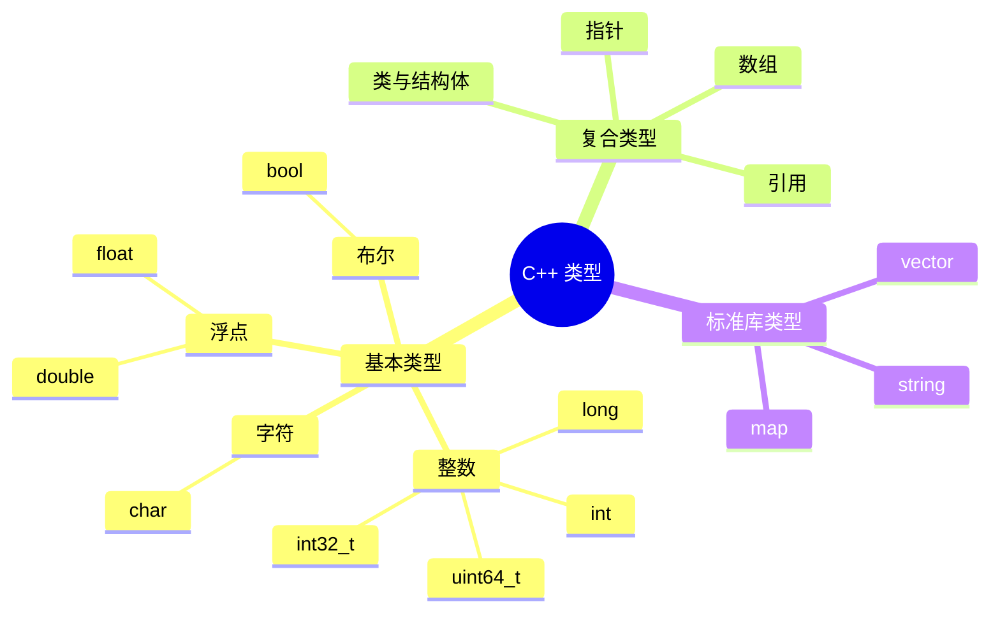
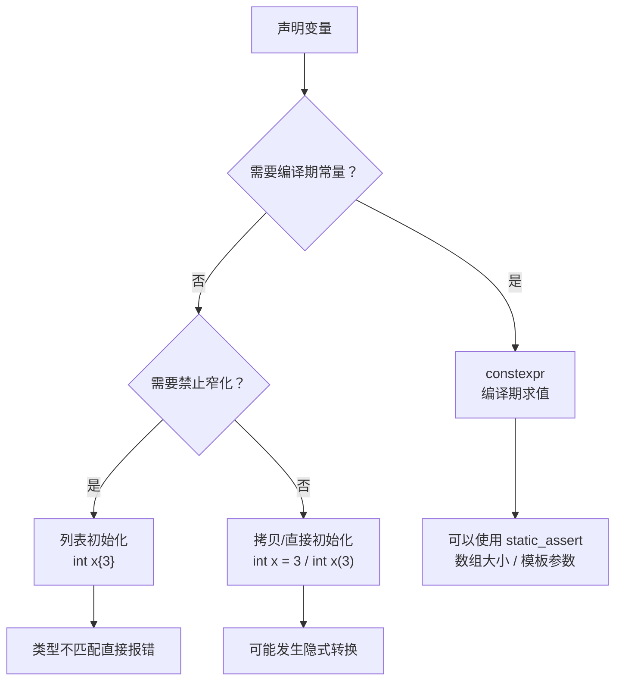

# C++ 基础语法：变量、类型与初始化，先把数据放进正确的盒子

> 本文基于 C++23，编译器 Apple Clang 21.0.0（macOS arm64）。`auto`、`constexpr`、列表初始化从 C++11 开始；`std::string_view` 从 C++17 开始。

搬家的时候，你会先看物品大小再选盒子。衣服放收纳箱，书放纸箱，易碎品放带泡沫的箱子——盒子选错了，东西要么装不下，要么被压坏。

C++ 是**静态类型语言**：每个变量在编译期就确定了类型，类型决定了它能装什么、占多少内存、能做哪些操作。编译器在代码运行之前就把盒子定好了，不会等到运行时才猜。

这篇文章从最小的程序开始，把变量、初始化、`auto`、`const`、整数和字符串这些地基打牢。后面的类、STL、移动语义，全都建在这些概念上。

## 从最小的程序开始

```cpp
// hello.cpp
#include <cstdio>

int main() {
    std::printf("hello, C++\n");
}
```

```bash
$ clang++ -std=c++23 -Wall -Wextra -O2 hello.cpp -o hello
$ ./hello
hello, C++
```

`#include` 是预处理指令，把标准库的声明复制进来；`main` 是程序入口，返回 `int`；`std::printf` 来自 `<cstdio>`。`-Wall -Wextra` 打开常用警告，学习阶段不要省。

## 类型就是盒子的规格

C++ 的基本类型可以粗略分成几类：



常见类型的大小（**不同平台可能不同**，下面是 macOS arm64 的实测）：

```cpp
#include <cstddef>
#include <cstdint>
#include <cstdio>

int main() {
    std::printf("int=%zu long=%zu double=%zu bool=%zu char=%zu\n",
                sizeof(int), sizeof(long), sizeof(double),
                sizeof(bool), sizeof(char));
    std::printf("size_t=%zu\n", sizeof(std::size_t));
}
```

```text
int=4 long=8 double=8 bool=1 char=1
size_t=8
```

这里有两个重要习惯：

1. **不要假设 `int` 一定是 4 字节**。标准只规定了最小范围，具体大小由平台和 ABI 决定。需要固定宽度时用 `<cstdint>` 里的 `std::int32_t`、`std::uint64_t`；需要表示“大小/下标”时用 `std::size_t`。
2. **`sizeof` 是编译期运算符**，不是函数。`sizeof(int)` 在编译时就能算出来，不会在运行时调用。

`char` 是 1 字节，但它到底是 signed 还是 unsigned，标准没有规定；需要明确时用 `signed char` / `unsigned char`，或者 `<cstdint>` 的 `std::int8_t`。

## 四种初始化方式

C++ 有四种常见的初始化写法：

```cpp
int a = 1;     // 拷贝初始化
int b(2);      // 直接初始化
int c{3};      // 列表初始化（C++11）
int d{};       // 值初始化：d == 0
```

对于 `int`，它们结果一样。但列表初始化有两个额外好处：

- **防止窄化转换**：`int x{3.14}` 直接编译错误，而不是悄悄截断成 3。
- **统一语法**：数组、结构体、容器都能用 `{}`。

试试窄化：

```cpp
int main() {
    int bad{3.14};
}
```

```text
error: type 'double' cannot be narrowed to 'int' in initializer list
note: insert an explicit cast to silence this issue
```

如果你确实想截断，必须明确写出来：

```cpp
int ok{static_cast<int>(3.14)};   // 3
```

这就是 C++ 的设计哲学：**隐式转换可以存在，但危险的地方要你亲手签字。**

`int d{};` 是值初始化，`d` 会变成 0。局部变量如果只写 `int d;`，它是**未初始化**的，读它是未定义行为——不会自动变成 0。这一点和 Java、C# 不同，别把其他语言的直觉带过来。

## auto：让编译器替你选盒子

`auto` 从 C++11 开始，让编译器根据初始化表达式推导类型：

```cpp
auto x = 1;       // int
auto y = 1.0;     // double
auto z = 1u;      // unsigned int
auto s = std::string{"C++"};   // std::string
```

它不是“运行时的动态类型”，而是**编译期的类型推导**。生成的机器码和手写类型完全一样，没有额外开销。

`auto` 有两个容易踩的细节：

### 1. auto 会丢掉顶层 const 和引用

```cpp
const int ci = 7;
auto copy = ci;       // copy 是 int，不是 const int
auto& ref = ci;       // ref 是 const int&
```

`auto` 的推导规则和模板参数推导类似：默认按值推导，顶层 `const` 被丢弃；想保留就写 `const auto` 或 `auto&`：

```cpp
const auto copy2 = ci;   // const int
auto& ref2 = ci;         // const int&
```

### 2. 不要用 auto 隐藏关键类型

```cpp
auto n = v.size();       // std::size_t，不是 int
auto result = compute(); // 如果 compute 返回的是引用，auto 可能拷贝一份
```

`auto` 适合“类型显而易见”或“类型名很长”的场景，比如迭代器：

```cpp
for (auto it = values.begin(); it != values.end(); ++it) { ... }
```

如果类型本身是接口的一部分（比如函数返回值），显式写出来往往更清楚。`auto` 是工具，不是风格信仰。

## const 与 constexpr：只读和编译期常量

`const` 表示“这个对象初始化后不能再改”：

```cpp
const int max_retries = 3;
// max_retries = 4;   // 编译错误
```

`constexpr` 更强：它要求表达式能在**编译期**求值：

```cpp
constexpr int square(int x) { return x * x; }

static_assert(square(5) == 25);   // 编译期检查
int buffer[square(3)];            // 编译期确定大小：9
```

两者的区别：

| | `const` | `constexpr` |
|---|---|---|
| 只读 | ✅ | ✅ |
| 编译期求值 | 不保证 | 要求（在常量表达式中） |
| 可用于数组大小/模板参数 | 不一定 | ✅ |
| 运行期初始化 | 可以 | 变量不可（必须常量初始化）；`constexpr` 函数可以在运行期调用 |

实践中：

- 运行期确定、之后不改的值用 `const`；
- 能在编译期算出来的常量用 `constexpr`；
- C++20 还有 `consteval`（强制编译期求值）和 `constinit`（强制静态初始化），入门阶段先掌握前两个即可。

`const` 还能修饰指针和引用，组合比较多，放在[指针与引用](basics-pointers-references.md)里专门讲。

## 整数、浮点与常见陷阱

### 整数除法

```cpp
std::printf("1/2=%d\n", 1 / 2);   // 0，不是 0.5
```

两个 `int` 相除，结果还是 `int`，小数部分直接丢掉。想要浮点结果，至少把一边转成 `double`：

```cpp
double half = 1.0 / 2;   // 0.5
```

### 浮点数不精确

```cpp
std::printf("0.1+0.2=%.17g\n", 0.1 + 0.2);
```

```text
0.1+0.2=0.30000000000000004
```

浮点数用二进制表示十进制小数，很多值无法精确表示。**不要用 `==` 直接比较浮点数**，而是判断差值是否小于一个容差：

```cpp
#include <cmath>

bool nearly_equal(double a, double b, double eps = 1e-9) {
    return std::fabs(a - b) < eps;
}
```

### 有符号和无符号混用

```cpp
unsigned int u = 1;
int i = -1;
if (i < u) {
    // 这里的比较会把 i 转成 unsigned，-1 变成一个很大的正数
}
```

这是 C++ 的经典坑。开 `-Wall -Wextra` 编译器通常会警告 `comparison of integers of different signs`。处理方式：

- 表示数量/下标用 `std::size_t`，并且不要和负数比较；
- 需要减法时，先确认结果不会为负，或者用有符号类型；
- 不要用 `unsigned` 来表达“这个数永远不为负”的执念，除非你确实需要它的模运算语义。

### 整数溢出

有符号整数溢出是未定义行为，不是“回绕成负数”这么简单。无符号整数溢出是模运算（回绕），但也不应该依赖它做业务逻辑。涉及金额、计数、时间戳时，先想清楚范围，再选类型。

## 字符串：从 char 数组到 std::string

C 风格的字符串是 `char` 数组，以 `'\0'` 结尾：

```cpp
char name[] = "C++";   // 4 个字符：'C', '+', '+', '\0'
```

C++ 标准库的 `std::string` 管理自己的内存，能自动扩容，支持拼接、查找、截取：

```cpp
#include <string>

std::string name = "C++";
name += "23";
std::printf("%s size=%zu\n", name.c_str(), name.size());
```

```text
C++23 size=5
```

`c_str()` 返回 C 风格字符串，用于传给 `printf` 或 C API；`size()` 返回长度（不含结尾的 `'\0'`）。`std::string` 的容量、迭代器失效等细节和 `vector` 类似，放在[STL 入门](basics-stl.md)和[迭代器失效](stl-iterators.md)里讲。

C++17 还有 `std::string_view`：只读、不拥有内存的字符串视图，适合函数参数，避免拷贝：

```cpp
#include <string_view>

void print(std::string_view text) {
    std::printf("%.*s\n", static_cast<int>(text.size()), text.data());
}
```

但它不保证底层字符串活得比你久，不能返回局部 `std::string` 的 `string_view`。

## 一张图总结初始化



## 入门检查清单

| 场景 | 建议 |
|------|------|
| 普通变量 | 优先用 `{}` 初始化，避免未初始化 |
| 需要固定宽度 | `std::int32_t`、`std::uint64_t` |
| 表示大小/下标 | `std::size_t` |
| 只读值 | `const` |
| 编译期常量 | `constexpr` |
| 类型显而易见/名字太长 | `auto`，但别隐藏接口类型 |
| 浮点比较 | 用容差，不要 `==` |
| 有符号/无符号 | 尽量不要混用 |
| 字符串 | 默认 `std::string`；只读参数可考虑 `std::string_view` |

类型不是仪式，而是约束：**你选的类型越准确，编译器能帮你抓到的错误就越多。** 入门阶段最重要的习惯不是背语法，而是看到每个变量时都能回答：它是什么类型、占多大、生命周期到哪、能不能被修改。

---

**相关文章**

- [C++ 基础语法：条件、循环与函数](basics-control-flow.md)
- [C++ 基础语法：指针与引用](basics-pointers-references.md)
- [C++ 基础语法：类与对象](basics-classes.md)
- [C++ 基础语法：vector、string、map 与标准库入门](basics-stl.md)
