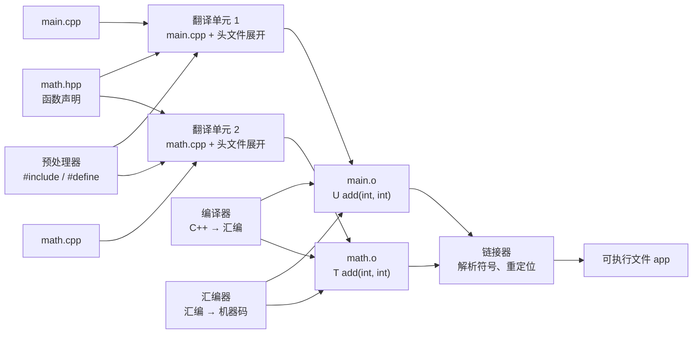
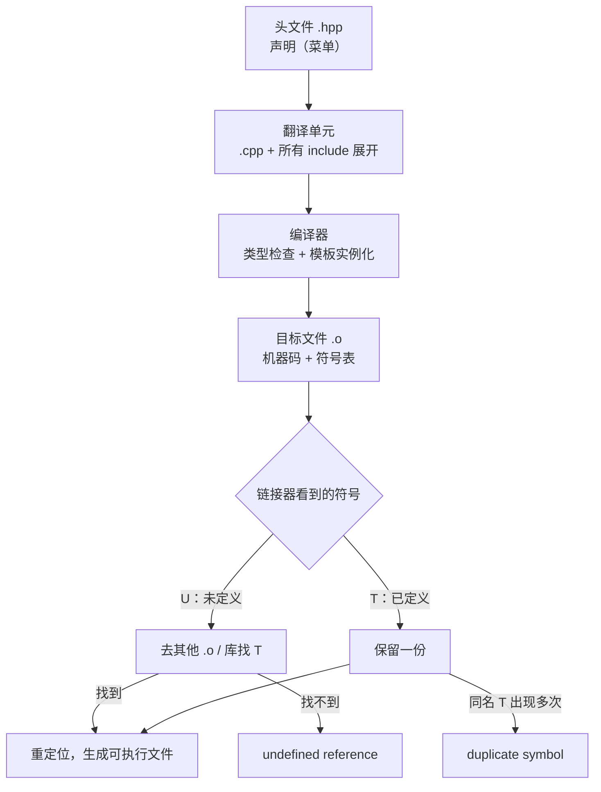

# C++ 编译与链接：菜单、厨房和分店

> 本文基于 C++23，编译器 Apple Clang 21.0.0（macOS arm64）。文中的 `nm` 输出来自 Mach-O 目标文件；Linux ELF 的符号字母含义类似，细节以各自平台的 `man nm` 为准。

一家连锁餐厅的菜单上写着“宫保鸡丁”，但菜单本身不会做菜。它只负责告诉客人：这道菜存在、叫什么、价格多少。真正做菜的是后厨；总店要确保每家分店的菜单上，每道菜都有对应的厨房能做出来。

C++ 的编译模型就是这套分工：

- **头文件（`.hpp`）是菜单**：声明“有什么”，通常不写实现；
- **源文件（`.cpp`）是后厨**：定义“怎么做”；
- **目标文件（`.o`）是半成品**：已经编译好，但还不知道别的分店（翻译单元）提供了什么；
- **链接器（linker）是总店**：把各分店的半成品接起来，确认菜单上的每道菜都有人做，最后拼成可执行文件。

理解这套分工，你才能看懂“未定义引用”“重复符号”这些链接错误，也才知道为什么头文件里写函数定义会出问题。

## 从 .cpp 到可执行文件



四个阶段：

1. **预处理**：处理 `#include`、`#define`、条件编译。`#include` 本质上是**文本复制**，把头文件内容原封不动粘进来。
2. **编译**：把预处理后的 C++ 翻译成汇编（或直接生成机器码），同时做类型检查、模板实例化、优化。
3. **汇编**：把汇编转成目标文件 `.o`，里面是机器码加一张符号表。
4. **链接**：把多个 `.o` 和库拼起来，解析“这个函数在哪”，修正地址，生成可执行文件。

一个 `.cpp` 加上它递归包含的所有头文件，构成一个**翻译单元（translation unit，TU）**。编译器一次只看一个 TU；它不知道另一个 `.cpp` 里有什么，只能依赖头文件里的声明。当前 TU 里只有声明、没有定义的函数，会被编译器记成未解析符号；等到链接阶段，才由链接器去其他目标文件的符号表里找对应定义。

这也是为什么头文件里的 `#include <cstdio>` 会让编译变慢：你写的 `main.cpp` 可能只有 6 行，但预处理后展开成几百行：

```bash
$ clang++ -std=c++23 -E main.cpp | wc -l
     720
```

这 720 行里，大部分是标准库头文件的内容，不是你的代码。

## 声明与定义：菜单和后厨

```cpp
// math.hpp
#pragma once

int add(int a, int b);          // 声明：告诉编译器“有这个函数”
```

```cpp
// math.cpp
#include "math.hpp"

int add(int a, int b) {          // 定义：真正实现
    return a + b;
}
```

```cpp
// main.cpp
#include <cstdio>
#include "math.hpp"

int main() {
    std::printf("add(2, 3) = %d\n", add(2, 3));
}
```

编译并链接：

```bash
$ clang++ -std=c++23 -Wall -Wextra -O2 -c math.cpp main.cpp
$ clang++ math.o main.o -o app
$ ./app
add(2, 3) = 5
```

`-c` 表示“只编译，不链接”，所以得到两个 `.o`。链接时没有报错，说明 `main.o` 里那个“未定义”的 `add` 在 `math.o` 里找到了定义。

用 `nm` 看目标文件的符号表：

```bash
$ nm -C math.o | grep ' add'
0000000000000000 T add(int, int)

$ nm -C main.o | grep ' add'
                 U add(int, int)
```

- `T`：在 text 段（代码段）中**定义**的全局符号；
- `U`：**未定义**（undefined），需要在别的目标文件或库里找。

链接器做的事很朴素：把每个 `.o` 的 `U` 和别人的 `T` 对上。对不上就是“未定义引用”，对上多个就是“重复符号”。

## 重复符号：为什么头文件里不能随便写函数定义

假设你为了省事，把函数定义直接写进头文件：

```cpp
// math.hpp
#pragma once

int add(int a, int b) {
    return a + b;
}
```

然后 `main.cpp` 和 `math.cpp` 都包含它。`#pragma once` 只能保证**同一个翻译单元内**不会重复展开，但 `main.cpp` 和 `math.cpp` 是两个独立的 TU，各自都会得到一份 `add` 的定义。链接时（省略路径）：

```text
duplicate symbol 'add(int, int)' in:
    header_add_b.o
    header_add_a.o
ld: 1 duplicate symbols
clang++: error: linker command failed with exit code 1 (use -v to see invocation)
```

这就是 **ODR（One Definition Rule，单一定义规则）** 被违反：整个程序里，一个非 inline 函数只能有一个定义。

用一个最小例子复现：

```cpp
// dup_a.cpp
int value() { return 1; }

// dup_b.cpp
int value() { return 2; }

// dup_main.cpp
int value();
int main() { return value(); }
```

```bash
$ clang++ -std=c++23 -c dup_a.cpp dup_b.cpp dup_main.cpp
$ clang++ dup_a.o dup_b.o dup_main.o -o dup_app
duplicate symbol 'value()' in:
    dup_b.o
    dup_a.o
ld: 1 duplicate symbols
```

注意：**这不是编译错误，是链接错误**。两个 `.cpp` 单独编译都能通过，因为它们各自只看到自己的一份定义；只有链接器同时看到两份时，才发现冲突。

## inline：允许多份定义的合法方式

如果确实想把函数定义放在头文件里（模板、小工具函数、header-only 库），就标 `inline`：

```cpp
// math.hpp
#pragma once

inline int add(int a, int b) {
    return a + b;
}
```

`inline` 在 C++ 里的核心语义不是“建议编译器内联”，而是**允许这个函数在多个翻译单元中出现相同的定义，链接器只保留一份**。编译器是否真的把函数展开，是另一回事——现代编译器基本不看你写不写 `inline`，它自己会决定。

C++17 起，变量也可以 `inline`：

```cpp
// config.hpp
#pragma once

inline int max_connections = 100;   // 整个程序只有一个实体
```

在此之前，头文件里的全局变量通常要用 `extern` 声明 + 一个 `.cpp` 定义，或者用函数包装（Meyers singleton）。`inline` 变量把这件事简化了。

哪些东西可以在头文件里重复定义而不违反 ODR：

| 实体 | 规则 |
|------|------|
| 类定义 | 允许多个 TU 出现，但内容必须完全一致 |
| `inline` 函数/变量 | 允许多个 TU 出现相同定义，链接器合并 |
| 模板 | 允许多个 TU 实例化，链接器合并相同实例 |
| 普通函数/全局变量 | 只能有一个定义 |

类定义能放在头文件里，是因为它属于 ODR 的例外：多个 TU 看到同一个类定义是正常的，否则每个类都得写两遍。但这也意味着，**如果你改了一个类的成员布局，所有包含这个头文件的 `.cpp` 都必须重新编译**——它们看到的是不同的“菜单”。

## static：每个翻译单元一份

`static` 在全局作用域表示**内部链接（internal linkage）**：这个符号只在本翻译单元可见，别的 TU 看不到，链接器也不会把它和别人的同名符号合并。

```cpp
// static_a.cpp
#include <cstdio>
static int counter = 0;

void bump_a() {
    ++counter;
    std::printf("a counter = %d\n", counter);
}
```

```cpp
// static_b.cpp
#include <cstdio>
static int counter = 0;

void bump_b() {
    ++counter;
    std::printf("b counter = %d\n", counter);
}
```

```cpp
// static_main.cpp
void bump_a();
void bump_b();

int main() {
    bump_a();
    bump_a();
    bump_b();
}
```

```bash
$ clang++ -std=c++23 -O2 -c static_a.cpp static_b.cpp static_main.cpp
$ clang++ static_a.o static_b.o static_main.o -o static_app
$ ./static_app
a counter = 1
a counter = 2
b counter = 1
```

两个文件各有一份 `counter`，互不影响。`nm` 也能看出来：

```bash
$ nm -C static_a.o | grep counter
0000000000000068 b counter
```

小写 `b` 表示**局部 BSS 符号**（local BSS），只在本目标文件可见；如果是全局 BSS，会显示大写 `B`。同理，局部代码符号是小写 `t`，全局代码符号是大写 `T`。

这解释了一个常见坑：在头文件里写 `static int counter = 0;`，每个包含它的 `.cpp` 都会得到独立的一份。你以为在共享一个计数器，实际上每个 TU 各玩各的。要共享，用 C++17 的 `inline` 变量；要各自独立，才用 `static`。

## include guard 与 #pragma once

头文件可能被同一个 TU 通过多条路径包含。没有保护时，类定义会重复，直接编译错误：

```cpp
// 没有保护
struct Config { int timeout; };
#include "config.hpp"
#include "config.hpp"   // 同一个 TU 内重复定义 struct Config
```

两种常见保护：

```cpp
// 方式一：#pragma once（非标准，但所有主流编译器支持）
#pragma once
```

```cpp
// 方式二：传统 include guard（标准做法）
#ifndef PROJECT_CONFIG_HPP
#define PROJECT_CONFIG_HPP

// ...

#endif
```

`#pragma once` 按文件路径识别，简单；但如果同一文件通过符号链接、不同相对路径被包含，某些编译器可能认不出来。传统 guard 按宏名识别，更可移植，但宏名要保证全局唯一（通常带项目/目录前缀）。

无论哪种，都只解决**同一个 TU 内重复包含**，不解决**跨 TU 重复定义**。后者要靠 ODR、`inline` 或“声明放头文件、定义放源文件”。

## 头文件里该放什么

一个好的头文件应该尽量只暴露“菜单”：

```cpp
// report.hpp
#pragma once

#include <string>
#include <vector>

class Report {
public:
    Report(std::string title, std::vector<double> values);
    double average() const;

private:
    std::string title_;
    std::vector<double> values_;
};
```

对应实现放在 `report.cpp`：

```cpp
#include "report.hpp"

Report::Report(std::string title, std::vector<double> values)
    : title_(std::move(title)), values_(std::move(values)) {}

double Report::average() const {
    // ...
}
```

几个实用原则：

- **include what you use**：头文件自己用到的类型，自己 include，不要依赖调用方先 include 某个头。
- **能前置声明就前置声明**：如果头文件只需要指针/引用，不需要完整类型，`class Foo;` 就够了，能减少编译依赖。但 `std::unique_ptr<Foo>` 的析构需要完整类型，前置声明不够，得看具体场景。
- **PImpl 降低编译耦合**：把私有实现放到 `.cpp`，头文件只留一个 `std::unique_ptr<Impl>`。代价是多一次间接访问和一次堆分配，收益是改实现不用重编所有包含者。
- **不要为了“省一次 include”把实现塞进头文件**：编译期省下的几毫秒，可能变成链接期几个小时的排查。

## 链接错误怎么读

链接错误看起来吓人，但常见就几类：

| 错误 | 含义 | 常见原因 |
|------|------|---------|
| `undefined reference to 'foo'` / `Undefined symbols: "_foo"` | 有人声明并调用了 `foo`，但链接时找不到定义 | 忘记编译某个 `.cpp`、忘记链接库、库顺序不对、函数签名不匹配 |
| `duplicate symbol 'foo'` / `multiple definition of 'foo'` | 同一个符号被定义了多次 | 头文件里写了非 inline 函数、同一个 `.cpp` 被链接两次 |
| `ld: library not found for -lfoo` | 找不到库文件 | 库路径没写、库名拼错、架构不匹配 |
| `Undefined symbols ... _main` | 没有入口函数 | 忘记写 `main`、`main` 签名不对、链接了错误的文件 |

一个容易踩的细节：**C++ 的符号名会被 name mangling**。`int add(int, int)` 编译出来的原始符号可能是 `__Z3addii`，所以：

```bash
$ nm math.o | grep add
0000000000000000 T __Z3addii

$ nm -C math.o | grep add
0000000000000000 T add(int, int)
```

`-C` 只是把名字还原成人能读的形式。链接器匹配的是 mangled name，所以**函数签名变了（哪怕只是参数类型从 `int` 变成 `long`），符号名就变了**，旧的目标文件会对不上。这也是为什么改了公共头文件里的函数签名后，依赖它的代码必须重新编译。

需要和 C 代码互操作时，用 `extern "C"` 关闭 name mangling：

```cpp
extern "C" int c_function(int x);
```

C++ 函数重载依赖 mangling 区分不同签名；C 没有重载，所以 C 符号名就是函数名。跨语言调用时如果不加 `extern "C"`，链接器会找不到 `c_function`。

## 一张图记住



## 收尾

C++ 的编译模型可以用三句话概括：

1. **编译器一次只处理一个翻译单元**。它相信头文件里的声明，不关心别的 `.cpp` 有没有实现。
2. **链接器负责把声明和定义对上**。对不上是未定义引用，对上多个是重复定义。
3. **ODR 决定了什么能放头文件**。普通函数/变量只能有一个定义；`inline`、模板、类定义是例外。

理解了这些，“为什么改了头文件要全量重编”“为什么函数加了个参数就链接失败”“为什么 header-only 库到处是 `inline`”都不再是玄学。菜单和后厨分清楚，链接错误就只是总店在告诉你：这道菜，没人会做。

---

**相关文章**

- [C++ 模板与 Concepts：给模具贴上规格说明](templates-concepts.md)
- [C++ RAII：让析构函数替你收拾房间](raii.md)
