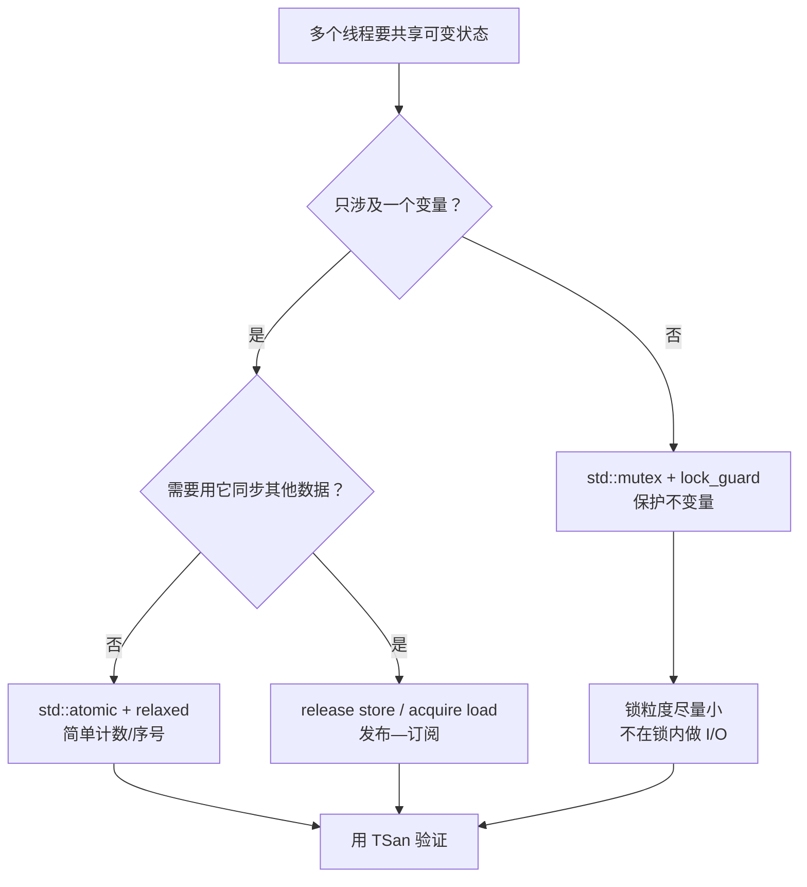

# C++ 并发：共享白板、原子操作与内存序

> 本文基于 C++23，编译器 Apple Clang 21.0.0（macOS arm64）。`std::thread`、`std::mutex`、`std::atomic` 从 C++11 开始；`std::scoped_lock` 从 C++17 开始；`std::barrier`、`std::jthread` 从 C++20 开始。文中竞态和 TSan 输出来自 macOS arm64。

会议室里有一块白板，上面写着数字 0。八个人轮流上去做一件事：看一眼数字，擦掉，写上“刚才看到的数字 + 1”。

如果两个人同时看到 0，都算出了 1，然后先后写上去，最后白板上还是 1——有一个人加的 1 消失了。这不是谁算错了，而是“读—改—写”这三个动作之间没有排他。

C++ 的并发问题几乎都源于此：**多个线程访问同一份可变状态，而语言没有规定它们谁先谁后**。解决方式有三种层次：

- `std::mutex`：一次只让一个人拿笔，最简单也最通用；
- `std::atomic`：把“读—改—写”变成一个不可分割的动作，适合单个变量；
- `std::memory_order`：规定一个线程的修改什么时候对另一个线程可见，适合追求极致性能的场景。

## 先启动一个线程

```cpp
#include <cstdio>
#include <thread>

void worker(int id) {
    std::printf("worker %d\n", id);
}

int main() {
    std::thread t(worker, 1);
    t.join();   // 等线程结束
    std::puts("main done");
}
```

`std::thread` 的构造函数启动线程，`join()` 等待它结束。如果既不 `join` 也不 `detach`，`std::thread` 析构时会调用 `std::terminate`——这是标准库在提醒你：**线程的生命周期必须有人负责**。

`detach()` 让线程在后台运行，但从此失去控制：你无法等待它结束，也无法保证它访问的对象还活着。除非你非常清楚生命周期，否则不要 `detach`。

C++20 的 `std::jthread` 把“析构时 join”做成了默认行为，还带了停止令牌：

```cpp
#include <stop_token>
#include <thread>

std::jthread worker([](std::stop_token st) {
    while (!st.stop_requested()) {
        // 做一点工作
    }
});
// 离开作用域时：request_stop() + join()
```

在需要“通知线程退出”的场景，`jthread` 比裸 `thread` 安全得多。

## 数据竞争：一个真实的丢更新

```cpp
// race_plain.cpp
#include <barrier>
#include <cstdio>
#include <thread>
#include <vector>

int main() {
    constexpr int workers = 8;
    constexpr int rounds = 5'000'000;
    int counter = 0;
    std::barrier start(workers);   // 让 8 个线程尽量同时起跑

    std::vector<std::thread> pool;
    for (int i = 0; i < workers; ++i) {
        pool.emplace_back([&] {
            start.arrive_and_wait();
            for (int j = 0; j < rounds; ++j) {
                ++counter;
            }
        });
    }
    for (auto& t : pool) t.join();
    std::printf("plain int: %d (expected %d)\n", counter, workers * rounds);
}
```

```bash
$ clang++ -std=c++23 -O0 -pthread race_plain.cpp -o race_plain
$ ./race_plain
plain int: 8096239 (expected 40000000)
$ ./race_plain
plain int: 11449781 (expected 40000000)
$ ./race_plain
plain int: 12249531 (expected 40000000)
```

每次结果都不一样，而且都远小于 4000 万。`counter++` 不是原子操作，它至少包含“读、加、写”三步；两个线程可能同时读到旧值，各自加一，再先后写回，其中一次更新就丢了。

更麻烦的是：**这是未定义行为（UB）**，不是“结果可能偏小”这么温和。C++ 标准规定，两个线程可能并发访问同一内存位置、至少一个是写、**至少一个访问不是 atomic**、且二者没有 happens-before 关系，就是**数据竞争（data race）**；有数据竞争的程序行为未定义——编译器可以假设它不存在，从而做出任何优化。两个 `std::atomic` 之间的并发读写不算数据竞争，但可能仍然存在逻辑上的顺序问题。

所以，即使某次运行得到了 40000000，也不能证明代码正确。它只是“这次运气好”。

### 用 ThreadSanitizer 抓现行

```bash
$ clang++ -std=c++23 -g -fsanitize=thread -pthread race_plain.cpp -o race_plain_tsan
$ ./race_plain_tsan
```

TSan 会在运行时监控内存访问，一旦发现没有 happens-before 关系的并发读写，就报告：

```text
WARNING: ThreadSanitizer: data race (pid=68504)
  Write of size 4 at 0x00016d6caa10 by thread T5:
    #0 main::$_0::operator()() const race_plain.cpp:18
    ...

  Previous write of size 4 at 0x00016d6caa10 by thread T8:
    #0 main::$_0::operator()() const race_plain.cpp:18
    ...

  Location is stack of main thread.
```

它明确指出：`race_plain.cpp:18` 的 `++counter` 在两个线程里发生了冲突，且没有同步。TSan 不能证明“没有 bug”（它只检查实际执行到的路径），但能抓住绝大多数数据竞争。并发代码的 CI 里，建议单独跑一遍 TSan。

## 方案一：mutex，一次只让一个人拿笔

```cpp
#include <mutex>

int counter = 0;
std::mutex gate;

void add_one() {
    std::lock_guard<std::mutex> lock(gate);
    ++counter;
}
```

`lock_guard` 在构造时加锁、析构时解锁，异常安全（这本身就是 [RAII](raii.md)）。完整版本：

```cpp
// race_fixed.cpp（mutex 部分）
int counter = 0;
std::mutex gate;
std::barrier start(workers);
std::vector<std::thread> pool;

for (int i = 0; i < workers; ++i) {
    pool.emplace_back([&] {
        start.arrive_and_wait();
        for (int j = 0; j < rounds; ++j) {
            std::lock_guard<std::mutex> lock(gate);
            ++counter;
        }
    });
}
for (auto& t : pool) t.join();
std::printf("mutex:  %d (expected %d)\n", counter, workers * rounds);
```

```text
mutex:  40000000 (expected 40000000)
```

锁把“读—改—写”包成了一个临界区，同一时刻只有一个线程能进入。代价是：其他线程要等待，锁竞争激烈时会有系统调用和上下文切换开销。

几个使用原则：

- **锁的粒度尽量小**：只保护共享状态，不要在锁内做 I/O、网络请求、`sleep`。
- **不要嵌套加锁**：如果必须同时持有多把锁，用 C++17 的 `std::scoped_lock` 一次性锁住多个互斥量，避免死锁：
  ```cpp
  std::scoped_lock lock(mutex_a, mutex_b);
  ```
- **`std::mutex` 不可重入**：同一线程重复加锁会死锁。需要递归锁时先怀疑设计，而不是直接换 `recursive_mutex`。
- **读多写少**可以考虑 `std::shared_mutex`（C++17），但它的实现和公平性因平台而异，先测量再换。

## 方案二：atomic，把操作变成不可分割

如果共享状态只是一个整数，用 `std::atomic` 更轻：

```cpp
#include <atomic>

std::atomic<int> counter{0};

void add_one() {
    counter.fetch_add(1, std::memory_order_relaxed);
}
```

完整运行结果：

```text
atomic: 40000000 (expected 40000000)
mutex:  40000000 (expected 40000000)
```

`std::atomic<int>` 保证 `fetch_add` 是一个原子操作：其他线程要么看到加之前的值，要么看到加之后的值，不会看到“加了一半”的中间状态。它不需要锁（在常见平台上），也不会阻塞其他线程。

但 atomic 不是万能的：

- 它只能保护**单个变量**。如果你有两个变量需要保持一致（比如 `size` 和 `capacity`），两个 atomic 操作之间仍然可能被打断，需要 mutex 或事务性设计。
- 它不保护**被指向的对象**。`std::atomic<T*>` 保证指针本身的读写原子，不保证 `*ptr` 的内容安全。
- 它的性能优势取决于内存序和硬件。默认的 `seq_cst` 最强也最贵；`relaxed` 最便宜，但只保证原子性，不保证顺序。
- 不是所有类型都无锁。`std::atomic<T>` 可能内部用锁实现，可以用 `is_lock_free()` 检查：
  ```cpp
  std::atomic<long long> value{};
  if (!value.is_lock_free()) {
      // 这个平台上可能退化为内部锁
  }
  ```

## 内存序：修改什么时候能被看见

这是 C++ 并发里最容易劝退的部分。先用一个比喻：

- **原子性**解决“别人会不会看到我写到一半”；
- **内存序**解决“我写完之后，别人什么时候能看到”。

考虑一个生产者/消费者场景：

```cpp
std::string payload;
std::atomic<bool> ready{false};

// 生产者线程
payload = "hello";
ready.store(true, std::memory_order_release);

// 消费者线程
while (!ready.load(std::memory_order_acquire)) {
    std::this_thread::yield();
}
assert(payload == "hello");   // 这里安全吗？
```

`payload` 是普通 `std::string`，不是 atomic。消费者读它，表面上看是数据竞争。但 `release` store 和 `acquire` load 建立了一条 **happens-before** 关系：

- 生产者在 `ready.store(release)` 之前的所有写入（包括 `payload = "hello"`），
- 对于读到 `true` 的消费者来说，都发生在 `ready.load(acquire)` 之后。

所以消费者看到 `ready == true` 时，`payload` 的写入也一定可见，读它不构成数据竞争。这就是“发布—订阅”模式。

如果把 `release`/`acquire` 换成 `relaxed`：

```cpp
ready.store(true, std::memory_order_relaxed);
// ...
while (!ready.load(std::memory_order_relaxed)) { }
assert(payload == "hello");   // 数据竞争！
```

`relaxed` 只保证 `ready` 本身的读写是原子的，不建立任何跨变量的顺序。消费者可能看到 `ready == true`，但 `payload` 还是空的——因为编译器/CPU 可以把 `payload` 的写入重排到 `ready` 的 store 之后。**这时候读 `payload` 就是数据竞争，行为未定义。**

C++ 提供的内存序：

| 内存序 | 保证 | 典型用途 |
|--------|------|---------|
| `memory_order_relaxed` | 只保证原子性，不保证顺序 | 统计计数、序号生成，不需要同步其他数据 |
| `memory_order_acquire` | 之后的读写不能重排到该 load 之前 | 消费者读取“发布”的数据 |
| `memory_order_release` | 之前的读写不能重排到该 store 之后 | 生产者发布数据 |
| `memory_order_acq_rel` | 同时具备 acquire + release | 读—改—写操作，如引用计数 |
| `memory_order_seq_cst` | 所有 seq_cst 操作有全局总顺序 | 默认值，最直观，也最保守 |

实践建议：

1. **默认用 `seq_cst`**。它是 `std::atomic` 的默认值，语义最强，推理最简单。性能敏感处再考虑放宽。
2. **只有明确需要“发布数据”时才用 release/acquire**。这是最常见的非默认用法。
3. **`relaxed` 只用于不参与同步的计数器**。比如统计请求数、生成唯一 ID，不需要保证其他变量的可见性。
4. **不要用 `volatile` 做同步**。`volatile` 只阻止编译器优化掉访问，不提供原子性，也不建立 happens-before；它不是 Java 的 `volatile`。
5. **`memory_order_consume` 基本不要用**。它的语义在实践中难以正确实现，标准委员会也承认这一点，主流实现直接把它当 acquire 处理。

## 伪共享：两个 atomic 也可能互相拖慢

即使没有数据竞争，性能也可能被缓存一致性拖垮。考虑：

```cpp
struct Counters {
    std::atomic<long> requests{0};
    std::atomic<long> errors{0};
};
```

`requests` 和 `errors` 很可能落在同一条缓存行。线程 A 频繁更新 `requests`，线程 B 频繁更新 `errors`，两个核心会不断争夺同一条缓存行的所有权——这叫**伪共享（false sharing）**。逻辑上没有共享，硬件上却共享了缓存行。

缓存行大小不是固定的：x86 常见 64 字节，Apple Silicon 的 cache line 是 128 字节（这台机器 `sysctl hw.cachelinesize` 输出 128），libc++ 的 `std::hardware_destructive_interference_size` 在这台机器上是 256。**`alignas(64)` 在 Apple Silicon 上不一定能把两个变量分到不同的缓存行。**

C++17 提供了 `std::hardware_destructive_interference_size`，但它的值是实现定义的，且并非所有标准库都定义。优先用它（若可用），否则按目标平台确认缓存行大小：

```cpp
// 仅当实现提供 std::hardware_destructive_interference_size 时可用
struct Counters {
    alignas(std::hardware_destructive_interference_size) std::atomic<long> requests{0};
    alignas(std::hardware_destructive_interference_size) std::atomic<long> errors{0};
};
```

只有当 profiling 显示热点时才需要处理伪共享，不要提前给所有变量加对齐。

## 条件变量：别用 sleep 等状态

用 `while (!ready) sleep(1);` 等待另一个线程，既浪费 CPU，又可能睡过头。标准做法是条件变量：

```cpp
#include <condition_variable>
#include <mutex>

std::mutex m;
std::condition_variable cv;
bool ready = false;

// 消费者
{
    std::unique_lock<std::mutex> lock(m);
    cv.wait(lock, [&] { return ready; });   // 谓词：处理虚假唤醒
    // 这里 ready 为 true，且持有锁
}

// 生产者
{
    std::lock_guard<std::mutex> lock(m);
    ready = true;
}
cv.notify_one();
```

关键点：

- `wait` 必须配合谓词使用，防止虚假唤醒（spurious wakeup）；
- 状态变量 `ready` 必须在锁内修改；
- `notify_one`/`notify_all` 可以在锁内或锁外调用，但通常放在锁外，避免唤醒的线程立刻又阻塞在锁上。

## 更高层的工具

大多数业务代码不该直接拼 `thread` + `mutex`。优先考虑：

- **`std::async` / `std::future`**：提交任务、获取结果，适合一次性异步计算；
- **线程池**：避免频繁创建/销毁线程，控制并发度；
- **`std::condition_variable` + 队列**：实现生产者/消费者；
- **并行算法**（C++17）：`std::execution::par`，适合数据并行；
- **第三方库**：oneTBB、Taskflow、Folly 等，提供更成熟的任务调度。

并发不是“多加几个线程就更快”。线程数超过硬件并发度，上下文切换和缓存竞争会让性能倒退。先确定瓶颈是 CPU、I/O 还是锁，再决定并发模型。

## 怎么选



## 一份并发检查清单

| 检查项 | 说明 |
|--------|------|
| 线程是否 join/detach | 优先用 `std::jthread`，避免 `std::terminate` |
| 共享可变状态 | 要么加锁，要么用 atomic，要么改成线程私有 |
| 数据竞争 | 用 TSan 跑测试；不要靠“结果看起来对”判断 |
| 锁的顺序 | 多把锁用 `std::scoped_lock`，避免死锁 |
| 锁内操作 | 不做 I/O、网络、长时间计算 |
| 条件变量 | 必须带谓词，状态在锁内修改 |
| 内存序 | 默认 `seq_cst`；放宽要有明确理由和注释 |
| `volatile` | 不用作同步原语 |
| 伪共享 | 热点计数器考虑 `alignas`，先 profile |
| 线程数量 | 不超过硬件并发度太多，避免过度切换 |

## 收尾

并发编程难，不是因为 API 多，而是因为**错误往往不可复现**。一个数据竞争可能在一百万次运行中只丢失一次更新；一次错误的 `relaxed` 可能只在特定 CPU 和编译器优化下暴露。所以：

- 用类型和工具把问题暴露在编译期/测试期（`std::atomic`、TSan、锁）；
- 默认选择最简单的同步方式（mutex + `seq_cst`），只有在测量证明有瓶颈时才放宽；
- 记住“原子性”和“可见性”是两件事：atomic 解决前者，memory_order 解决后者。

白板上写数字，最稳妥的办法是让一个人拿笔。如果非要多人同时写，就得规定好：谁先写、写完什么时候算数。C++ 把这套规则交给你，代价是你必须自己想清楚。

---

**相关文章**

- [C++ RAII：让析构函数替你收拾房间](raii.md)
- [C++ 智能指针：所有权账本](smart-pointers.md)
- [C++ STL 迭代器失效：书架扩容时，书签为什么会作废](stl-iterators.md)
