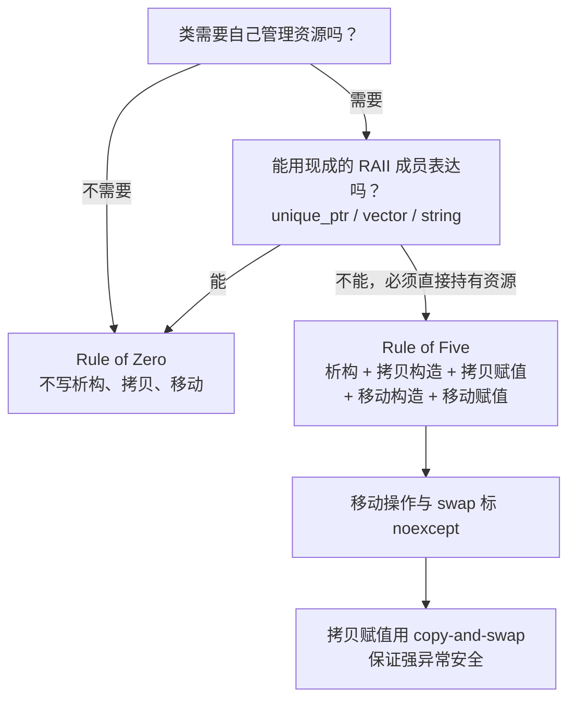

# C++ 拷贝控制：Rule of 0/3/5 与被省掉的拷贝

> 本文基于 C++23，编译器 Apple Clang 21.0.0（macOS arm64）。移动语义从 C++11 引入；C++17 起部分拷贝消除（copy elision）成为强制要求；`std::exchange` 最低 C++14，`std::is_*_v` 系列最低 C++17。

复印机默认会把每一页原样复印一遍。对只装着整数和字符串的类来说，这很完美；但如果某一页是房产证，复印件上的地址和原件一模一样，房子却只有一套——两个对象都以为房子归自己，最后就是 double free。

C++ 默认的拷贝构造和拷贝赋值做的就是这种「逐成员复印」：每个成员各自复制一份。对值语义的类型没问题；对管理资源的类型，必须先回答一个问题：**复制出来的对象，资源到底归谁？** Rule of Three、Rule of Five、Rule of Zero 是针对这个问题的三种规模的答案。

## 先数一数：一次赋值到底调用了几次特殊成员

```cpp
// copy_counter.cpp
#include <cstdio>
#include <utility>
#include <vector>

struct Tracked {
    int id;
    static inline int ctors = 0;
    static inline int copies = 0;
    static inline int moves = 0;
    static inline int dtors = 0;

    explicit Tracked(int i) : id(i) { ++ctors; std::printf("  ctor %d\n", id); }
    Tracked(const Tracked& o) : id(o.id) { ++copies; std::printf("  copy %d\n", id); }
    Tracked(Tracked&& o) noexcept : id(o.id) { ++moves; std::printf("  move %d\n", id); }
    ~Tracked() { ++dtors; }
};

void take_by_value(Tracked t) { (void)t; }

Tracked return_local() {
    Tracked t{7};
    return t;  // NRVO
}

Tracked return_temp() {
    return Tracked{8};  // C++17 起保证拷贝消除
}

int main() {
    {
        std::puts("1. 按值传参");
        Tracked a{1};
        take_by_value(a);

        std::puts("2. 返回局部变量（NRVO）");
        Tracked b = return_local();

        std::puts("3. 返回临时对象（C++17 保证消除）");
        Tracked c = return_temp();

        std::puts("4. vector 扩容");
        std::vector<Tracked> v;
        v.reserve(1);
        v.emplace_back(4);
        v.emplace_back(5);
    }

    std::printf("ctors=%d copies=%d moves=%d dtors=%d\n",
                Tracked::ctors, Tracked::copies, Tracked::moves, Tracked::dtors);
}
```

```bash
$ clang++ -std=c++23 -Wall -Wextra -O2 copy_counter.cpp -o copy_counter
$ ./copy_counter
1. 按值传参
  ctor 1
  copy 1
2. 返回局部变量（NRVO）
  ctor 7
3. 返回临时对象（C++17 保证消除）
  ctor 8
4. vector 扩容
  ctor 4
  ctor 5
  move 4
ctors=5 copies=1 moves=1 dtors=7
```

有意思的是，四次操作里只有两次真正调用了拷贝/移动：

**第 1 段：按值传参复制了一次。** 形参 `t` 是 `a` 的一份副本，函数返回时副本析构。这是拷贝语义最直观的形态：值传递意味着「给出去一份」。

**第 2 段：返回局部变量，一次拷贝都没有。** 编译器做了 NRVO（named return value optimization）：`return_local` 的 `t` 直接构造在 `b` 的存储里，函数里没有第二个对象。注意这只是「允许的优化」，标准并不强制，但主流编译器都会做。

**第 3 段：返回临时对象，连移动都没有。** C++17 起，用纯右值（prvalue）初始化对象是**保证的拷贝消除**：`Tracked{8}` 直接构造在 `c` 的存储里，不是「先构造临时对象再移动」，而是标准规定根本没有临时对象。

**第 4 段：`vector` 扩容移动了旧元素。** `reserve(1)` 后插入第二个元素触发重新分配，缓冲区从容量 1 扩到 2，原来的元素 4 被移动构造函数搬到新缓冲区（`move 4`）。为什么是移动不是拷贝？因为 `Tracked` 的移动构造标了 `noexcept`。

最后的计数能对上：直接构造 5 次（`a`、`t(7)`、临时 `8`、`4`、`5`），拷贝 1 次（按值传参），移动 1 次（扩容搬旧元素）——一共构造出 7 个对象，最终析构 7 次（按值传参的副本和扩容前的旧元素在过程中就销毁了，其余对象在作用域结束时销毁）。

拷贝和移动可能在这些时机发生：

| 场景 | 调用 |
|---|---|
| 按值传参 | 拷贝构造或移动构造 |
| 按值返回局部变量 | NRVO 可能消除；否则移动构造 |
| 返回临时对象 | C++17 起保证消除 |
| 用同类型对象初始化 | 拷贝构造或移动构造 |
| 赋值 | 拷贝赋值或移动赋值 |
| 容器插入、扩容 | 元素的拷贝构造或移动构造 |
| 抛出异常 | 异常对象的拷贝或移动（可能被消除） |
| 从函数返回按值持有的成员 | 移动，或 NRVO/消除 |

## 编译器默认生成了什么

一个类有六个特殊成员函数，编译器会在满足条件时自动生成：

| 特殊成员 | 默认行为 | 什么时候不生成或被删除 |
|---|---|---|
| 默认构造函数 | 逐成员默认构造 | 用户声明了任意构造函数；或某个成员不可默认构造 |
| 拷贝构造函数 | 逐成员拷贝构造 | 用户声明了移动构造或移动赋值 → 定义为 `delete` |
| 拷贝赋值运算符 | 逐成员拷贝赋值 | 用户声明了移动构造或移动赋值 → 定义为 `delete` |
| 移动构造函数 | 逐成员移动构造 | 用户声明了拷贝构造、拷贝赋值、移动构造、移动赋值或析构函数 → 不声明 |
| 移动赋值运算符 | 逐成员移动赋值 | 同上 |
| 析构函数 | 逐成员析构 | 用户声明了析构函数则使用用户的 |

几条容易记混的规则：

- **声明析构函数会「关掉」移动操作。** 只要写了 `~T()`，编译器就不会再生成移动构造和移动赋值。之后用右值初始化对象时，编译器会退而求其次调用拷贝构造——**不报错，只是悄悄变慢**。
- **声明移动操作会「删除」拷贝操作。** 写了移动构造或移动赋值，拷贝构造和拷贝赋值会被定义为 `delete`，这个类型就变成 move-only 的。
- **拷贝操作和析构函数是「老三位」**：声明拷贝构造、拷贝赋值或析构中的任意一个，不会删除另外两个，但会抑制移动操作。这正是 Rule of Three 存在的原因。

用一个只声明了析构函数的类型验证第一条：

```cpp
// suppressed_move.cpp
#include <cstdio>
#include <vector>

struct Counter {
    static inline int copies = 0;
    static inline int moves = 0;

    Counter() = default;
    Counter(const Counter&) { ++copies; std::puts("member copy"); }
    Counter(Counter&&) noexcept { ++moves; std::puts("member move"); }
};

struct Legacy {
    Counter c;
    ~Legacy() {}  // 用户声明析构函数：Legacy 的隐式移动构造不会生成
};

struct Modern {
    Counter c;
    // 不声明任何特殊成员：隐式移动构造正常生成
};

template <typename T>
void grow(const char* label) {
    Counter::copies = 0;
    Counter::moves = 0;
    std::vector<T> v;
    v.reserve(1);
    v.emplace_back();
    v.emplace_back();  // 触发扩容
    std::printf("%s: member copies=%d moves=%d\n",
                label, Counter::copies, Counter::moves);
}

int main() {
    grow<Legacy>("Legacy (有析构)");
    grow<Modern>("Modern (无析构)");
}
```

```bash
$ clang++ -std=c++23 -Wall -Wextra -O2 suppressed_move.cpp -o suppressed_move
$ ./suppressed_move
member copy
Legacy (有析构): member copies=1 moves=0
member move
Modern (无析构): member copies=0 moves=1
```

`Legacy` 只声明了析构函数，编译器就不再为它生成移动构造；`vector` 扩容时只能拷贝成员 `c`，输出 `member copy`。`Modern` 什么都没声明，隐式移动构造存在，扩容时移动成员，输出 `member move`。同样的成员、同样的扩容，只差一个析构函数，性能就从移动退化成了拷贝。**这就是「三法则」和「五法则」要解决的问题：特殊成员是一组，不能只挑一个写。**

## Rule of Three：资源所有权的手工账

C++98 时代没有移动语义，管理资源的类靠三个函数维持正确性：析构函数、拷贝构造函数、拷贝赋值运算符。

看一个只有析构函数的资源类：

```cpp
// rule_of_three.cpp
#include <cstdio>
#include <cstring>

class Buffer {
public:
    explicit Buffer(const char* s)
        : data_(new char[std::strlen(s) + 1]) {
        std::memcpy(data_, s, std::strlen(s) + 1);
    }

    ~Buffer() { delete[] data_; }

    // 没有写拷贝构造和拷贝赋值：编译器生成逐成员复制的版本
    const char* c_str() const { return data_; }

private:
    char* data_;
};

int main() {
    Buffer a("hello");
    Buffer b = a;  // 浅拷贝：两个对象指向同一块堆内存
    std::printf("a=%s b=%s\n", a.c_str(), b.c_str());
}
```

```bash
$ clang++ -std=c++23 -Wall -Wextra -g -fsanitize=address rule_of_three.cpp -o rule_of_three
$ ./rule_of_three
=================================================================
==20512==ERROR: AddressSanitizer: attempting double-free on 0x6020000000f0 in thread T0
    #0 0x000102918444 in _ZdaPv+0x74 ...
    #1 0x000102390dac in Buffer::~Buffer() rule_of_three.cpp:11
    #2 0x000102390c5c in Buffer::~Buffer() rule_of_three.cpp:11
    #3 0x000102390a44 in main rule_of_three.cpp:24

0x6020000000f0 is located 0 bytes inside of 6-byte region [0x6020000000f0,0x6020000000f6)
freed by thread T0 here:
    #0 0x000102918444 in _ZdaPv+0x74 ...
    #1 0x000102390dac in Buffer::~Buffer() rule_of_three.cpp:11
    ...

SUMMARY: AddressSanitizer: double-free rule_of_three.cpp:11 in Buffer::~Buffer()
==20512==ABORTING
```

`Buffer b = a` 调用编译器生成的拷贝构造函数，它逐成员复制：`data_` 是一个指针，复制的是地址。于是 `a` 和 `b` 指向同一块堆内存，作用域结束时两个析构函数各 `delete[]` 一次，第二次就是 double free。

正确做法是把「复制」定义为深拷贝：

```cpp
class Buffer {
public:
    explicit Buffer(const char* s)
        : data_(new char[std::strlen(s) + 1]) {
        std::memcpy(data_, s, std::strlen(s) + 1);
    }

    Buffer(const Buffer& other)                       // 1. 拷贝构造
        : data_(new char[std::strlen(other.data_) + 1]) {
        std::memcpy(data_, other.data_, std::strlen(other.data_) + 1);
    }

    Buffer& operator=(const Buffer& other) {          // 2. 拷贝赋值
        if (this != &other) {
            Buffer tmp(other);
            std::swap(data_, tmp.data_);
        }
        return *this;
    }

    ~Buffer() { delete[] data_; }                     // 3. 析构

private:
    char* data_;
};
```

**Rule of Three 的内容：如果析构函数、拷贝构造函数、拷贝赋值运算符中有一个需要你手写，另外两个通常也需要。** 只写析构不写拷贝，就是上面的 double free；只写拷贝不写赋值，赋值时会浅拷贝，同样泄漏或 double free。

## Rule of Five：把移动也写进账本

C++11 引入移动语义后，资源类多了两个特殊成员：移动构造和移动赋值。合起来就是 Rule of Five。

```cpp
// rule_of_five.cpp
#include <cstdio>
#include <cstring>
#include <utility>

class Buffer {
public:
    explicit Buffer(const char* s)
        : data_(new char[std::strlen(s) + 1]) {
        std::memcpy(data_, s, std::strlen(s) + 1);
    }

    Buffer(const Buffer& other)
        : data_(new char[std::strlen(other.data_) + 1]) {
        std::memcpy(data_, other.data_, std::strlen(other.data_) + 1);
        std::puts("copy ctor");
    }

    Buffer& operator=(const Buffer& other) {
        if (this != &other) {
            Buffer tmp(other);           // 先复制，失败时原对象不受影响
            std::swap(data_, tmp.data_);
        }
        return *this;
    }

    Buffer(Buffer&& other) noexcept
        : data_(std::exchange(other.data_, nullptr)) {}

    Buffer& operator=(Buffer&& other) noexcept {
        if (this != &other) {
            delete[] data_;
            data_ = std::exchange(other.data_, nullptr);
        }
        return *this;
    }

    ~Buffer() { delete[] data_; }

    const char* c_str() const { return data_ ? data_ : "(null)"; }

private:
    char* data_;
};

int main() {
    Buffer a("hello");
    Buffer b = a;              // 拷贝构造
    Buffer c("world");
    c = a;                     // 拷贝赋值
    Buffer d = std::move(c);   // 移动构造

    std::printf("a=%s b=%s c=%s d=%s\n",
                a.c_str(), b.c_str(), c.c_str(), d.c_str());
}
```

```bash
$ clang++ -std=c++23 -Wall -Wextra -O2 rule_of_five.cpp -o rule_of_five
$ ./rule_of_five
copy ctor
copy ctor
a=hello b=hello c=(null) d=hello
```

三件事值得注意：

**两次 `copy ctor`：** 第一次来自 `Buffer b = a`，第二次来自 `c = a` 里 copy-and-swap 的临时对象 `tmp(other)`。拷贝赋值本身不打印，但它先复制了一份。

**`c` 变成了 `(null)`：** 移动构造把 `c` 的指针偷走了，并把源指针置成 `nullptr`。这是「有效但未指定」状态的一个具体实现——我们的代码显式 `std::exchange` 成空指针，所以能确定打印 `(null)`。标准只要求 moved-from 对象可以被析构和重新赋值，不要求它为空；换一个实现，它可能保留原指针。

**移动操作都标了 `noexcept`：** 这样 `std::vector` 扩容时才会选择移动而不是拷贝。原因在[异常安全](exception-safety.md)里详细讲过：移动可能抛异常时，标准库为了强保证会退回拷贝。

移动构造和移动赋值的实现套路是：

1. 移动构造：把源对象的资源「接」过来，把源对象置成可析构的状态；
2. 移动赋值：先释放自己原有的资源，再接管源对象的资源；
3. 两者都处理自赋值/自移动（`if (this != &other)`）；
4. 两者都标 `noexcept`。

**Rule of Five 的内容：如果需要手写析构、拷贝构造、拷贝赋值、移动构造、移动赋值中的任意一个，通常五个都要写。** 只写四个（比如漏了移动赋值）不会报错，但类型会悄悄退化：移动操作不全时，编译器可能不生成你需要的那个，容器和返回值优化都会受影响。

## 演进路径：从 Rule of Three 到 Rule of Zero

上面两个例子代表了两种不同的设计选择：

| 版本 | 做法 | 代价 | 适用场景 |
|---|---|---|---|
| Rule of Three | 手写深拷贝，C++98 风格 | 每次拷贝都重新分配 | 只需要拷贝语义的旧代码 |
| Rule of Five | 手写五个特殊成员，加入移动 | 代码量大，容易漏 | 必须直接管理裸资源的底层封装 |
| Rule of Zero | 用 `unique_ptr`/`vector`/`string` 成员，什么都不写 | 几乎没有 | 绝大多数业务类 |

Rule of Zero 的思路是：**把资源交给会自己管理资源的成员，让编译器生成正确的特殊成员。**

```cpp
// rule_of_zero.cpp
#include <cstdio>
#include <cstring>
#include <memory>
#include <type_traits>
#include <utility>
#include <vector>

class Buffer {
public:
    explicit Buffer(const char* s)
        : size_(std::strlen(s)),
          data_(std::make_unique<char[]>(size_ + 1)) {
        std::memcpy(data_.get(), s, size_ + 1);
    }

    // 不写析构、拷贝、移动：unique_ptr 成员让编译器生成移动、删除拷贝
    const char* c_str() const { return data_.get(); }
    std::size_t size() const { return size_; }

private:
    std::size_t size_;
    std::unique_ptr<char[]> data_;
};

static_assert(!std::is_copy_constructible_v<Buffer>);
static_assert(std::is_move_constructible_v<Buffer>);
static_assert(!std::is_copy_assignable_v<Buffer>);
static_assert(std::is_move_assignable_v<Buffer>);

int main() {
    Buffer a("hello");
    Buffer b = std::move(a);  // 移动构造

    std::vector<Buffer> v;
    v.push_back(std::move(b));
    v.emplace_back("world");
    v.emplace_back("again");  // 触发扩容，移动旧元素

    std::printf("v[0]=%s (%zu) v[1]=%s (%zu) v[2]=%s (%zu)\n",
                v[0].c_str(), v[0].size(),
                v[1].c_str(), v[1].size(),
                v[2].c_str(), v[2].size());
}
```

```bash
$ clang++ -std=c++23 -Wall -Wextra -O2 rule_of_zero.cpp -o rule_of_zero
$ ./rule_of_zero
v[0]=hello (5) v[1]=world (5) v[2]=again (5)
```

`Buffer` 里只有两个成员：一个 `size_t` 和一个 `unique_ptr<char[]>`。没有析构函数、没有拷贝构造、没有移动构造，但：

- `unique_ptr` 不可拷贝，所以编译器隐式生成的拷贝构造和拷贝赋值被定义为 `delete`——`static_assert` 验证了这一点；
- `unique_ptr` 可以移动，所以移动构造和移动赋值自动生成；
- `vector<Buffer>` 能正常扩容、正常析构，因为每个元素都能安全移动；
- 不需要手写任何清理代码，`unique_ptr` 的析构函数负责释放。

这就是 Rule of Zero：**最理想的拷贝控制是不写拷贝控制。** 用 `std::string`、`std::vector`、`std::unique_ptr`、`std::shared_ptr` 这些自带所有权语义的成员，编译器生成的五件套就是对的。

什么时候不能 Rule of Zero？当你必须直接持有裸资源时：封装 C 库的 `FILE*`、socket fd、`malloc` 出来的缓冲区、第三方库的句柄。这时的正确做法是**先把裸资源封装进一个小而专的 RAII 类型**（Rule of Five），然后让业务代码使用这个类型（Rule of Zero）。不要在每个业务类里重复手写 `delete`/`close`。

## 拷贝消除：编译器什么时候连移动都省了

C++ 的拷贝消除（copy elision）允许编译器直接在目标位置构造对象，跳过拷贝和移动。C++17 起，其中一部分从「允许」变成了「必须」：

| 场景 | C++17 之前 | C++17 起 |
|---|---|---|
| `T x = T();` | 可能拷贝/移动 | 强制消除 |
| `return T();` | 可能拷贝/移动 | 强制消除 |
| `f(T())` 传纯右值 | 可能拷贝/移动 | 强制消除 |
| `return local;`（NRVO） | 允许消除 | 允许消除，不强制 |

强制消除意味着：**即使拷贝构造函数有副作用，它也不会被调用。** 这不是编译器「优化掉了你的代码」，而是标准规定这里根本没有临时对象。

用编译开关观察 NRVO 的差别：

```cpp
// elision.cpp
#include <cstdio>
#include <utility>

struct T {
    int v;
    explicit T(int x) : v(x) { std::printf("ctor %d\n", v); }
    T(const T& o) : v(o.v) { std::printf("copy %d\n", v); }
    T(T&& o) noexcept : v(o.v) { std::printf("move %d\n", v); }
    ~T() { std::printf("dtor %d\n", v); }
};

T make() {
    T t(42);
    return t;  // NRVO
}

T make_forced() {
    T t(7);
    return std::move(t);  // 显式 move 阻止 NRVO
}

int main() {
    std::puts("--- make() ---");
    T a = make();
    std::puts("--- make_forced() ---");
    T b = make_forced();
    std::puts("--- end ---");
    (void)a;
    (void)b;
}
```

默认编译：

```bash
$ clang++ -std=c++23 -Wall -Wextra -O2 elision.cpp -o elision
$ ./elision
--- make() ---
ctor 42
--- make_forced() ---
ctor 7
move 7
dtor 7
--- end ---
dtor 7
dtor 42
```

加上 `-fno-elide-constructors`：

```bash
$ clang++ -std=c++23 -Wall -Wextra -O2 -fno-elide-constructors elision.cpp -o elision_no
$ ./elision_no
--- make() ---
ctor 42
move 42
dtor 42
--- make_forced() ---
ctor 7
move 7
dtor 7
--- end ---
dtor 7
dtor 42
```

对比很清楚：

- `make()` 在默认编译下只有一次 `ctor 42`，`t` 直接构造在 `a` 里，NRVO 消除了全部拷贝和移动；关掉消除后多了一次 `move 42` 和临时对象的 `dtor 42`。
- `make_forced()` 在两种编译下都多了一次 `move 7` 和 `dtor 7`，因为 `return std::move(t)` **主动阻止了 NRVO**：`std::move(t)` 是一个右值表达式，编译器必须把它移动到一个新对象里，不能再把 `t` 直接构造在返回值位置。

`return std::move(t)` 是典型的反模式，编译器甚至会警告：

```text
warning: moving a local object in a return statement prevents copy elision [-Wpessimizing-move]
    return std::move(t);  // 显式 move 阻止 NRVO
           ^~~~~~~~~~
note: remove std::move call here
```

**返回局部变量时直接 `return t;`，不要 `return std::move(t);`。** 编译器知道该移动的时候移动，而且 NRVO 比移动更快——它连移动都省了。

还要注意：`-fno-elide-constructors` 只能关掉 NRVO 这类「允许的消除」，关不掉 C++17 强制的 prvalue 消除。`return T(42);` 在任何编译选项下都只构造一次。

## 特殊成员生成规则速查

| 你声明了…… | 拷贝构造 | 拷贝赋值 | 移动构造 | 移动赋值 | 析构 |
|---|---|---|---|---|---|
| 无（Rule of Zero） | 生成 | 生成 | 生成 | 生成 | 生成 |
| 任意构造函数 | 生成 | 生成 | 生成 | 生成 | 生成 |
| 析构函数 | 生成（不推荐） | 生成（不推荐） | **不生成** | **不生成** | 你的版本 |
| 拷贝构造 | 你的版本 | 生成 | **不生成** | **不生成** | 生成 |
| 拷贝赋值 | 生成 | 你的版本 | **不生成** | **不生成** | 生成 |
| 移动构造 | **删除** | **删除** | 你的版本 | 不生成 | 生成 |
| 移动赋值 | **删除** | **删除** | 不生成 | 你的版本 | 生成 |

`= default` 和 `= delete` 也算「用户声明」，同样会触发上面的规则。比如 `T(T&&) = default;` 会让拷贝操作变成 `delete`，`~T() = default;` 会让移动操作不再生成——想保留移动，就必须把五个都显式写全。

记住三句话就够了：

1. **写了析构或拷贝，移动就消失**（不报错，只是右值操作退化成拷贝）；
2. **写了移动，拷贝就删除**（类型变成 move-only）；
3. **要么五个都写，要么一个都别写**——后者是 Rule of Zero，用自带所有权的成员。



## 常见坑速查

| 坑 | 后果 | 正确做法 |
|---|---|---|
| 只写析构，不写拷贝/赋值 | 默认浅拷贝 → double free | Rule of Three 或 Rule of Zero |
| 写了拷贝构造，忘了拷贝赋值 | 赋值时浅拷贝，泄漏或 double free | 两个都写，或用 copy-and-swap |
| 声明了析构函数还指望移动 | 隐式移动不生成，容器里全变成拷贝 | 显式 `= default` 移动，或 Rule of Zero |
| 移动构造没标 `noexcept` | `vector` 扩容退化成拷贝 | 移动构造/赋值标 `noexcept` |
| `return std::move(local);` | 阻止 NRVO，多一次移动 | 直接 `return local;` |
| 使用 moved-from 对象的值 | 有效但未指定，结果不可依赖 | 只析构或重新赋值 |
| 自赋值不做保护 | 先释放旧资源再读源对象 → UAF | 自赋值检查 + copy-and-swap |
| 拷贝赋值先释放旧资源 | 复制失败后对象半残 | 先复制到临时对象再交换 |
| 业务类里手写 `delete`/`close` | 特殊成员五件套容易漏 | 先封装成 RAII 类型，再 Rule of Zero |
| 用裸指针表达所有权 | 编译器无法帮你生成正确的拷贝/移动 | `unique_ptr` / `shared_ptr` |

## 收尾

拷贝控制看起来是「记住五个函数」，本质上是**所有权设计**：

- 默认拷贝是逐成员复印，指针复印出来的是地址，不是资源；
- Rule of Three 是 C++98 的答案：析构、拷贝构造、拷贝赋值要成套出现；
- Rule of Five 把移动加入账本，`noexcept` 决定容器是否愿意用移动；
- Rule of Zero 是首选的答案：把资源交给 RAII 成员，让编译器生成正确的五件套；
- 拷贝消除是编译器在「不改变可观察行为」的前提下省掉的拷贝，C++17 起一部分成为强制要求；不要用 `std::move` 主动破坏 NRVO。

写一个资源类之前先问：**我用得着自己管理这个资源吗？** 能用 `unique_ptr`、`vector`、`string` 表达的所有权，就不要手写析构。必须手写时，把范围缩小到一个小的 RAII 封装里，其他地方继续 Rule of Zero。

相关阅读：

- [C++ 移动语义：std::move 到底搬走了什么](move-semantics.md)——移动构造如何窃取资源，moved-from 对象为什么不能依赖
- [C++ RAII：让析构函数替你收拾房间](raii.md)——Rule of Zero 的成员为什么能自动清理
- [C++ 异常安全：栈展开时谁来收拾残局](exception-safety.md)——copy-and-swap 与三档异常安全保证
- [C++ 智能指针：unique_ptr、shared_ptr、weak_ptr 的所有权账本](smart-pointers.md)——用类型表达所有权
