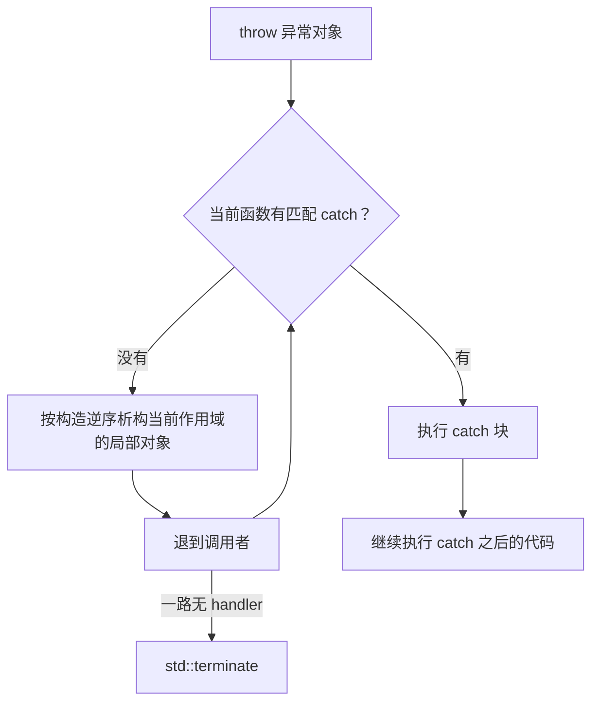

# C++ 异常处理与异常安全：栈展开时谁来收拾残局

> 本文基于 C++23，编译器 Apple Clang 21.0.0（macOS arm64）。异常从 C++98 就存在；`noexcept` 从 C++11 引入，C++17 起成为函数类型的一部分；`std::expected` 最低 C++23。

火警响起时，大楼不会让每个房间自己决定怎么处理——广播一响，所有人按顺序撤离，每层楼的设备自动断电，最后在楼下集合点由消防员接管。如果有人趁乱把消防通道堵死，整栋楼就完了。

C++ 的异常也是非局部跳转：`throw` 之后，当前函数剩下的代码不再执行，局部对象按构造的逆序析构，控制权一路交到能处理它的 `catch`。**析构函数就是那套自动断电系统**——它保证撤离时资源不会留在原地。如果析构函数自己再抛异常，相当于撤离途中又拉了一次警报，程序只能 `std::terminate`。

## 一次真实的栈展开

```cpp
// unwind_order.cpp
#include <cstdio>
#include <stdexcept>

struct Probe {
    const char* name;
    explicit Probe(const char* n) : name(n) {
        std::printf("构造 %s\n", name);
    }
    ~Probe() {
        std::printf("析构 %s\n", name);
    }
};

void inner(bool fail) {
    Probe a{"inner-a"};
    Probe b{"inner-b"};
    if (fail) throw std::runtime_error("inner failed");
    std::printf("inner 正常结束\n");
}

void outer() {
    Probe c{"outer-c"};
    inner(true);
    std::printf("outer 不会走到这里\n");
}

int main() {
    try {
        outer();
    } catch (const std::exception& e) {
        std::printf("catch: %s\n", e.what());
    }
    std::puts("main 继续");
}
```

```bash
$ clang++ -std=c++23 -Wall -Wextra -O2 unwind_order.cpp -o unwind_order
$ ./unwind_order
构造 outer-c
构造 inner-a
构造 inner-b
析构 inner-b
析构 inner-a
析构 outer-c
catch: inner failed
main 继续
```

这段输出把栈展开的过程完整记录了下来：

1. 构造顺序是 `outer-c` → `inner-a` → `inner-b`；
2. `throw` 之后，`inner` 剩余的代码和 `outer` 剩余的代码都没有执行；
3. 局部对象按构造的**逆序**析构：`inner-b` → `inner-a` → `outer-c`；
4. 控制权跳到 `main` 里匹配的 `catch`，`catch` 执行完后程序继续运行。

注意：析构不是「每个函数自己清理」，而是**编译器和运行时协作完成的栈展开**。`inner` 和 `outer` 里都没有 `try`/`catch`，但清理照样发生了。这就是为什么 RAII 能和异常天然配合——资源管理代码写在析构函数里，展开路径会自动调用它。

如果一路都找不到匹配的 `catch`，程序会调用 `std::terminate`。此时**是否先展开栈由实现决定**，不能依赖析构函数做最后的保存工作。异常要么被接住，要么进程结束。



## 栈展开的三条规则

**第一条：析构顺序和构造顺序相反，同一作用域内后构造的先析构。** 这条规则和正常返回时完全一样，异常只是提前触发它。多个作用域嵌套时，先销毁内层，再销毁外层。

**第二条：只析构「已经构造完成」的对象。** 如果构造函数抛异常，这个对象本身从来没有完整存在过，它的析构函数不会执行；但它的基类和已经构造完成的成员会被析构。这一点在构造函数里手工申请资源时是致命的，后面单独说。

**第三条：析构函数不能抛异常。** C++11 起，析构函数默认是 `noexcept(true)`（除非某个基类或成员的析构函数可能抛异常）。如果异常在栈展开过程中从析构函数逃出来，运行时直接调用 `std::terminate`——因为同时有两个异常在飞，语言没有定义该保留哪一个。

```cpp
// dtor_throw.cpp
#include <cstdio>
#include <stdexcept>

struct Bad {
    ~Bad() noexcept(false) {
        std::puts("~Bad 开始抛异常");
        std::fflush(stdout);
        throw std::runtime_error("dtor failed");
    }
};

int main() {
    try {
        Bad b;
        throw std::runtime_error("body failed");
    } catch (const std::exception& e) {
        std::printf("catch: %s\n", e.what());
    }
}
```

```bash
$ clang++ -std=c++23 -Wall -Wextra -O2 dtor_throw.cpp -o dtor_throw
$ ./dtor_throw
~Bad 开始抛异常
libc++abi: terminating due to uncaught exception of type std::runtime_error: dtor failed
$ echo $?
134
```

即使把析构函数显式标成 `noexcept(false)`，在栈展开期间再抛异常仍然是 `std::terminate`。**析构函数里唯一安全的做法是吞掉异常并记录日志**；如果清理动作可能失败，把它挪到一个显式的 `close()` 里，让调用者决定怎么处理。

## noexcept：一句承诺，两种后果

`noexcept` 是给编译器和标准库看的承诺：这个函数不会让异常逃出去。

```cpp
void may_throw();                 // 可能抛
void never_throws() noexcept;     // 承诺不抛
void conditional() noexcept(std::is_nothrow_copy_constructible_v<T>);
```

它的后果分两层。

**第一层是语义：承诺了就不能反悔。** 在 `noexcept` 函数里抛出的异常不会被传播，而是直接调用 `std::terminate`。所以 `noexcept` 不是「优化提示」，而是接口契约的一部分。给一个可能失败的函数乱标 `noexcept`，等于把可恢复错误变成进程崩溃。

**第二层是重载决议和标准库行为。** C++17 起，`noexcept` 成为函数类型的一部分：

```cpp
void (*p1)() = may_throw;
void (*p2)() noexcept = never_throws;
// p1 = never_throws;  // OK：noexcept 函数可以赋给普通函数指针
// p2 = may_throw;     // 错误：不能丢掉 noexcept 承诺
```

更重要的是，标准容器会根据移动构造函数是否 `noexcept` 来决定扩容时「移动还是拷贝」。`std::vector` 扩容需要把旧元素搬到新缓冲区；如果移动可能抛异常，搬到一半失败就无法回滚，强异常安全保证会被破坏。于是标准库用 `std::move_if_noexcept` 做选择：

- 移动构造是 `noexcept`，或者类型不可拷贝 → 移动；
- 移动构造可能抛，但类型可拷贝 → **退回拷贝**，用性能换强保证。

```cpp
// noexcept_vector.cpp
#include <cstdio>
#include <vector>

struct NoThrowMove {
    int value;
    static inline int copies = 0;
    static inline int moves = 0;

    explicit NoThrowMove(int v) : value(v) {}
    NoThrowMove(const NoThrowMove& o) : value(o.value) { ++copies; }
    NoThrowMove(NoThrowMove&& o) noexcept : value(o.value) { ++moves; }
};

struct ThrowingMove {
    int value;
    static inline int copies = 0;
    static inline int moves = 0;

    explicit ThrowingMove(int v) : value(v) {}
    ThrowingMove(const ThrowingMove& o) : value(o.value) { ++copies; }
    ThrowingMove(ThrowingMove&& o) : value(o.value) { ++moves; }  // 没有 noexcept
};

int main() {
    {
        std::vector<NoThrowMove> v;
        v.reserve(1);
        v.emplace_back(1);
        v.emplace_back(2);  // 触发扩容
        std::printf("noexcept move: copies=%d moves=%d\n",
                    NoThrowMove::copies, NoThrowMove::moves);
    }
    {
        std::vector<ThrowingMove> v;
        v.reserve(1);
        v.emplace_back(1);
        v.emplace_back(2);
        std::printf("throwing move: copies=%d moves=%d\n",
                    ThrowingMove::copies, ThrowingMove::moves);
    }
}
```

```bash
$ clang++ -std=c++23 -Wall -Wextra -O2 noexcept_vector.cpp -o noexcept_vector
$ ./noexcept_vector
noexcept move: copies=0 moves=1
throwing move: copies=1 moves=0
```

两个类型的数据完全一样，唯一区别是移动构造有没有标 `noexcept`。结果：

- `NoThrowMove` 扩容时移动了旧元素，`moves=1`；
- `ThrowingMove` 扩容时**拷贝**了旧元素，`moves=0`、`copies=1`——因为标准库不敢用可能抛异常的移动来冒破坏强保证的风险。

这条规则值得记住：**自定义类型的移动构造函数、移动赋值、`swap`、析构函数，能标 `noexcept` 就标。** 不标不会编译错误，只会让容器在关键时刻悄悄退化成拷贝。反过来说，如果移动构造真的可能失败（比如内部要分配内存），就不该为了性能硬标 `noexcept`，否则失败时程序直接终止。

## 异常安全的三个等级

「异常安全」不是「不抛异常」，而是「抛了异常之后，对象和程序仍然处于什么状态」。业界通常分三档：

| 等级 | 保证 | 失败后的状态 | 典型例子 |
|---|---|---|---|
| Nothrow（不抛） | 操作一定能完成，异常不会逃出 | 操作完成 | `swap`、析构函数、`noexcept` 移动构造 |
| Strong（强保证） | 提交或回滚：要么成功，要么回到操作前 | 和操作前完全一样 | `std::vector::push_back`（移动不抛时）、copy-and-swap |
| Basic（基本保证） | 不泄漏资源，对象不变式仍然成立 | 有效但未指定 | 移动可能抛的 `vector` 扩容 |
| No guarantee | 什么都不保证 | 可能泄漏、可能半残 | 手写裸资源管理 |

大多数代码应该做到**基本保证**：异常发生后，对象仍然可以安全析构、可以重新赋值，程序不会泄漏。**强保证**通常用在单个操作上，比如「插入一个元素要么成功要么不影响原容器」。**不抛保证**留给析构、`swap`、移动这些基础设施。

强保证不是免费的。它往往需要「先复制一份，修改副本，成功后再替换」——多一次分配和拷贝。是否值得，要看操作的失败代价和使用频率。

## 构造函数抛异常：析构函数不会兜底

这是异常安全里最反直觉的一条：**构造函数没有完成，对象的析构函数就不会被调用。**

```cpp
// ctor_throw.cpp
#include <cstdio>
#include <memory>
#include <stdexcept>

struct Resource {
    static inline int live = 0;
    Resource() { ++live; }
    ~Resource() { --live; }
};

struct Leaky {
    Resource* res;
    Leaky() : res(new Resource) {
        throw std::runtime_error("构造失败");
    }
    ~Leaky() { delete res; }
};

struct Safe {
    std::unique_ptr<Resource> res;
    Safe() : res(std::make_unique<Resource>()) {
        throw std::runtime_error("构造失败");
    }
    ~Safe() = default;
};

int main() {
    int before = Resource::live;
    try {
        Leaky l;
    } catch (const std::exception& e) {
        std::printf("Leaky: %s\n", e.what());
    }
    std::printf("Leaky 新增存活资源: %d\n", Resource::live - before);

    before = Resource::live;
    try {
        Safe s;
    } catch (const std::exception& e) {
        std::printf("Safe: %s\n", e.what());
    }
    std::printf("Safe 新增存活资源: %d\n", Resource::live - before);
}
```

```bash
$ clang++ -std=c++23 -Wall -Wextra -O2 ctor_throw.cpp -o ctor_throw
$ ./ctor_throw
Leaky: 构造失败
Leaky 新增存活资源: 1
Safe: 构造失败
Safe 新增存活资源: 0
```

`Leaky` 的构造函数在 `new Resource` 之后抛异常。此时 `Leaky` 对象还没有构造完成，`~Leaky()` 不会执行，`res` 这个裸指针也没有任何东西负责释放——资源泄漏 1 个。

`Safe` 把 `res` 从裸指针换成了 `std::unique_ptr`。构造函数抛异常时，`res` 这个**已经构造完成的成员**会被析构，`unique_ptr` 释放资源——没有泄漏。

结论很简单：**构造函数体里不要先拿裸资源再做事，而是让资源在成员初始化列表里直接交给 RAII 成员管理。** 这样即使构造函数半路失败，已构造的成员也会按逆序清理。

## copy-and-swap：强保证的模板

拷贝赋值是最容易做坏异常安全的操作：先释放旧资源，再复制新资源；如果复制到一半失败，对象既没有旧资源也没有新资源，处于半残状态。

copy-and-swap 把顺序倒过来：**先复制到临时对象，成功后再交换**。

```cpp
Buffer& operator=(const Buffer& other) {
    if (this != &other) {
        Buffer tmp(other);           // 复制可能失败，但原对象还没被修改
        std::swap(data_, tmp.data_); // swap 不抛
    }
    return *this;                    // tmp 析构，释放原来的旧资源
}
```

只要 `swap` 不抛异常，这个赋值就提供强保证：

1. `Buffer tmp(other)` 复制失败 → 抛出，原对象完全没动；
2. 复制成功 → `swap` 交换指针，不会失败；
3. `tmp` 离开作用域，析构释放原对象之前的资源。

代价是多一次堆分配和拷贝。对赋值不频繁、但要求强保证的资源类，这个交换很划算；对高频赋值的热路径，可能宁可采用「先构造再替换」的变体，或者干脆用 Rule of Zero 让标准容器管理资源。

## catch 的正确姿势

**按 `const` 引用捕获，不要按值。** 按值捕获会发生对象切片（object slicing）：派生类异常被当成基类拷贝，派生部分丢失，虚函数也退化成基类版本。

```cpp
// 错误：按值捕获，发生对象切片
try {
    risky();
} catch (std::exception e) {
    ...
}

// 正确：按 const 引用捕获
try {
    risky();
} catch (const std::exception& e) {
    ...
}
```

**派生类在前，基类在后。** `catch` 按书写顺序匹配，`catch (const std::exception&)` 写在前面会拦掉所有派生异常。

```cpp
try {
    ...
} catch (const std::runtime_error& e) {  // 先接具体的
    ...
} catch (const std::exception& e) {      // 再接通用的
    ...
} catch (...) {                          // 最后兜底
    throw;                               // 不处理就原样重抛
}
```

**`throw;` 和 `throw e;` 不是一回事。** `throw;` 重抛当前异常对象，保留原始类型和上下文；`throw e;` 会把 `e` 复制一份再抛，可能切片，也丢失了「正在处理哪个异常」的状态。

**异常不能跨线程传播。** 线程函数里逃出的异常会直接 `std::terminate`。跨线程传递错误有两种方式：

- 在线程内部 `catch`，把结果写进共享状态（`std::promise`、队列、原子变量）；
- 用 `std::exception_ptr` 保存异常，交给另一个线程 `std::rethrow_exception`。

```cpp
std::exception_ptr ep;

std::thread t{[&] {
    try {
        do_work();
    } catch (...) {
        ep = std::current_exception();
    }
}};
t.join();

if (ep) std::rethrow_exception(ep);
```

**只捕获你能处理的异常。** 捕获后既不处理也不重抛，等于把故障藏起来；在库的边界上，把异常翻译成错误码或 `std::expected` 是合理的，但要在文档里说清楚。

## 异常与性能：零成本模型

主流 C++ 实现（Itanium ABI，macOS/Linux 上的 Clang、GCC）采用**表驱动展开**：编译器生成异常表（unwind tables），正常执行路径上没有「检查是否发生异常」的分支，也不需要在每个 `try` 入口注册回调。不抛异常时，异常的运行时成本接近于零；代价主要落在二进制体积和异常表上。

但**抛出路径很贵**：要查表找到 `catch`、构造异常对象、展开栈、执行析构。下面这个程序对比错误码和 `throw`/`catch` 的成本：

```cpp
// throw_cost.cpp
#include <chrono>
#include <cstdio>
#include <stdexcept>

[[gnu::noinline]] int error_code_path(int x) {
    if (x < 0) return -1;
    return x * 2;
}

[[gnu::noinline]] int exception_path(int x) {
    if (x < 0) throw std::runtime_error("negative");
    return x * 2;
}

template <typename F>
double bench(F&& f, int iterations) {
    auto start = std::chrono::steady_clock::now();
    f(iterations);
    auto end = std::chrono::steady_clock::now();
    return std::chrono::duration<double, std::nano>(end - start).count() / iterations;
}

int main() {
    constexpr int N = 1'000'000;

    double ec = bench([](int n) {
        volatile int sink = 0;
        for (int i = 0; i < n; ++i) {
            sink = sink + error_code_path(i % 2 ? -1 : 3);
        }
        (void)sink;
    }, N);

    double ex = bench([](int n) {
        volatile int sink = 0;
        for (int i = 0; i < n; ++i) {
            try {
                sink = sink + exception_path(i % 2 ? -1 : 3);
            } catch (const std::runtime_error&) {
                sink = sink - 1;
            }
        }
        (void)sink;
    }, N);

    std::printf("error code: %.2f ns/op\n", ec);
    std::printf("throw/catch: %.2f ns/op\n", ex);
}
```

```bash
$ clang++ -std=c++23 -Wall -Wextra -O2 throw_cost.cpp -o throw_cost
$ ./throw_cost
error code: 2.97 ns/op
throw/catch: 1293.11 ns/op
```

这个测试里每次迭代交替走成功和失败路径，抛出路径大约慢了三个数量级。具体数字依赖平台、编译器和异常对象的构造成本（异常对象由运行时分配，`std::runtime_error` 里还带一个字符串），但量级关系是稳定的：**异常适合处理「真正异常」的情况，不适合当正常控制流。**

实践建议：

- 正常路径不做 `throw`/`catch`；错误分支用返回值、`std::optional` 或 C++23 的 `std::expected`。
- 资源管理、移动、`swap`、析构这些基础设施保持 `noexcept`。
- 如果项目编译时用了 `-fno-exceptions`，标准库的分配失败等行为会退化为终止；此时错误处理只能靠返回值/`expected`，别写 `try`/`catch`。

## 常见坑速查

| 坑 | 后果 | 正确做法 |
|---|---|---|
| 析构函数抛异常 | 栈展开期间 `std::terminate` | 析构里吞掉并记录，清理失败交给显式 `close()` |
| 给可能抛的函数标 `noexcept` | 异常直接终止进程 | 只给确实不抛的函数标 |
| `catch` 按值捕获 | 对象切片，派生信息丢失 | `catch (const std::exception&)` |
| 基类 `catch` 写在派生类前面 | 派生异常永远接不到 | 从具体到通用排列 |
| 异常逃出线程函数 | `std::terminate` | 线程内捕获，用 `exception_ptr` 传给主线程 |
| 构造函数里先拿裸资源再抛 | 对象析构不执行，资源泄漏 | 资源立即交给 RAII 成员 |
| 移动构造没标 `noexcept` | `vector` 扩容退化成拷贝 | 移动/`swap`/析构标 `noexcept` |
| 拷贝赋值先释放旧资源 | 复制失败后对象半残 | copy-and-swap，先复制后交换 |
| 捕获异常后静默吞掉 | 故障被隐藏，难以定位 | 处理、转换或重抛 |
| 用异常做正常控制流 | 抛出路径慢几个数量级 | 用返回值、`optional`、`expected` |

## 收尾

异常处理的核心不是 `try`/`catch` 的语法，而是**栈展开期间谁来保证清理**。答案只有 RAII：把资源交给对象的生命周期，让析构函数在展开路径上自动执行。异常安全则是进一步的问题——清理之外，失败后对象处于什么状态：

- **不抛保证**：析构、`swap`、移动构造，基础设施的底线；
- **强保证**：要么成功要么回滚，copy-and-swap 是标准实现；
- **基本保证**：不泄漏、不变式成立，大多数业务代码的及格线。

`noexcept` 不是装饰，而是接口契约的一部分；它会影响容器在扩容时选择移动还是拷贝。理解了这些，异常就不再是「try 一下」，而是对象生命周期设计的一部分。

相关阅读：

- [C++ RAII：让析构函数替你收拾房间](raii.md)——栈展开能自动清理，前提是资源由对象管理
- [C++ 移动语义：std::move 到底搬走了什么](move-semantics.md)——移动构造为什么应该标 `noexcept`
- [C++ 拷贝控制：Rule of 0/3/5 与被省掉的拷贝](copy-control.md)——copy-and-swap 和特殊成员函数的关系
