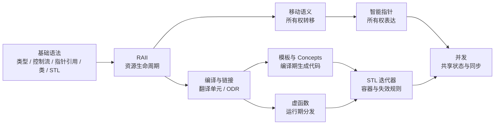

# C++

现代 C++ 笔记，基于 C++23。基础语法部分把类型、控制流、指针引用、类和 STL 讲清楚；核心机制部分解释每个特性背后的设计取舍：资源归谁管、对象什么时候销毁、代码在编译期还是运行期决定。

## 基础语法

- [C++ 基础语法：变量、类型与初始化，先把数据放进正确的盒子](basics-types.md) — 2026-10-27
- [C++ 基础语法：条件、循环与函数，把执行路径写清楚](basics-control-flow.md) — 2026-10-27
- [C++ 基础语法：指针与引用，地址、别名和空指针](basics-pointers-references.md) — 2026-10-27
- [C++ 基础语法：类与对象，把状态和行为装进同一个盒子](basics-classes.md) — 2026-10-27
- [C++ 基础语法：vector、string、map 与标准库入门](basics-stl.md) — 2026-10-27

## 核心机制

- [C++ RAII：让析构函数替你收拾房间](raii.md) — 2026-10-27
- [C++ 移动语义：std::move 到底搬走了什么](move-semantics.md) — 2026-10-27
- [C++ 智能指针：unique_ptr、shared_ptr、weak_ptr 的所有权账本](smart-pointers.md) — 2026-10-27
- [C++ 编译与链接：菜单、厨房和分店](compile-and-link.md) — 2026-10-27
- [C++ 模板与 Concepts：给模具贴上规格说明](templates-concepts.md) — 2026-10-27
- [C++ 虚函数：一张 vtable 背后的点菜流程](virtual-functions.md) — 2026-10-27
- [C++ STL 迭代器失效：书架扩容时，书签为什么会作废](stl-iterators.md) — 2026-10-27
- [C++ 并发：共享白板、原子操作与内存序](concurrency.md) — 2026-10-27

## 建议阅读顺序

如果刚入门，先读「基础语法」：类型、控制流、指针与引用、类、STL。有基础之后，再用「核心机制」深入 RAII 和移动语义，看智能指针如何把所有权写进类型；接着理解编译/链接，知道代码为什么会被拆成翻译单元；最后看模板、虚函数、STL 和并发这些建立在上述基础上的机制。

