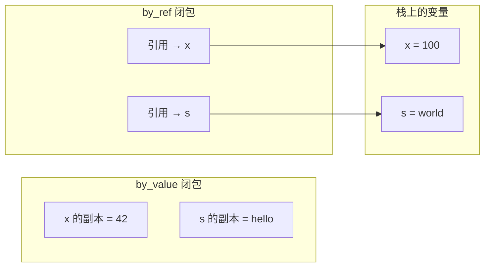

# C++ Lambda 表达式：闭包捕获的不只是变量

> 本文基于 C++23，编译器 Apple Clang 21.0.0（macOS arm64）。Lambda 从 C++11 引入；泛型 lambda 和初始化捕获最低 C++14，`[*this]` 最低 C++17，模板参数列表、结构化绑定捕获、`[=]` 隐式捕获 `this` 的弃用最低 C++20。

出门带饭时，你不是把整个厨房搬走，而是把今天要吃的菜夹一份放进便当盒。之后冰箱里的菜怎么变，便当盒里的那份不会变。按引用捕获则像在饭盒里放一张便签：「去冰箱第三层拿」。冰箱还在，便签一直有效；冰箱没了，便签就指向空气。

Lambda 也是这样：**它把一小段代码和它需要的上下文打包成一个对象**。捕获列表决定这个对象里装的是「菜的副本」还是「指向冰箱的便签」——这也是 lambda 最容易出事的地方。语法十分钟就能学会，难的是判断每个捕获在回调执行时还活不活着。

## 先看一个真实的闭包

```cpp
// lambda_closure.cpp
#include <cstdio>
#include <string>

int main() {
    int x = 42;
    std::string s = "hello";

    auto by_value = [x, s] { std::printf("by_value: x=%d s=%s\n", x, s.c_str()); };
    auto by_ref   = [&x, &s] { std::printf("by_ref:   x=%d s=%s\n", x, s.c_str()); };

    x = 100;
    s = "world";

    by_value();
    by_ref();

    std::printf("sizeof(by_value)=%zu sizeof(by_ref)=%zu\n", sizeof(by_value), sizeof(by_ref));

    int counter = 0;
    auto inc = [counter]() mutable { return ++counter; };
    auto copy = inc;
    std::printf("inc:  %d %d %d\n", inc(), inc(), inc());
    std::printf("copy: %d\n", copy());
    std::printf("counter: %d\n", counter);
}
```

```bash
$ clang++ -std=c++23 -Wall -Wextra -O2 lambda_closure.cpp -o lambda_closure
$ ./lambda_closure
by_value: x=42 s=hello
by_ref:   x=100 s=world
sizeof(by_value)=32 sizeof(by_ref)=16
inc:  1 2 3
copy: 1
counter: 0
```

逐段看：

**按值捕获的参数在闭包创建时就复制了。** `by_value` 定义在 `x = 100` 之前，所以它看到的是旧值 42 和 `"hello"`；`by_ref` 保存的是引用，调用时再去看原变量，所以看到 `"world"`。

**`sizeof` 说明捕获物真的被存进了对象。** `by_value` 有 32 字节：`std::string` 占 24 字节，`int` 占 4 字节，加上对齐填充；`by_ref` 只有两个指针，16 字节。具体数值是 libc++ 的实现细节，不能写进依赖——但它证明了一件事：**闭包不是一个函数指针，而是一个带数据成员的对象**。

**每个闭包副本有自己的一份状态。** `inc` 是 `mutable` 的，三次调用依次返回 1、2、3；`copy` 从 `inc` 复制而来，但它有自己的计数器，所以第一次调用返回 1；原来的 `counter` 从头到尾都是 0。



## 编译器把 lambda 变成了什么

Lambda 表达式是语法糖。编译器会为每个 lambda 生成一个**唯一的、没有名字的类**（closure type），捕获列表变成这个类的数据成员，函数体变成 `operator()`。上面那个 `by_value` 大致等价于：

```cpp
class __Lambda_by_value {
public:
    __Lambda_by_value(int x_, std::string s_)
        : x(x_), s(std::move(s_)) {}

    void operator()() const {
        std::printf("by_value: x=%d s=%s\n", x, s.c_str());
    }

private:
    int x;
    std::string s;
};
```

理解了这层转换，很多行为就顺理成章了：

| 现象 | 原因 |
|---|---|
| 每个 lambda 的类型都不一样，不能手写 | 类名是编译器生成的，只能用 `auto` 或类型擦除 |
| 默认不能修改按值捕获的变量 | `operator()` 默认是 `const` 的，成员在 const 函数里只读 |
| 加 `mutable` 就能改 | `mutable` 去掉了 `operator()` 的 const |
| 闭包可以拷贝、可以放进容器 | 它就是一个普通的类对象 |
| 无捕获的 lambda 能转成函数指针 | 编译器提供了转换运算符（C++11 起） |
| 无捕获的 lambda 可以默认构造 | C++20 起支持 |
| 空 lambda 的 `sizeof` 是 1 | 和空类一样，对象必须有唯一地址 |

按引用捕获时，数据成员类型是引用（实现上通常是指针）；按值捕获时，数据成员是值的一份副本。**捕获列表写的不是「函数参数」，而是「闭包这个对象的数据成员怎么初始化」**。

## 捕获列表：五种写法，一张所有权声明

| 写法 | 含义 | 适用场景 |
|---|---|---|
| `[]` | 不捕获任何东西 | 只依赖参数、全局变量或静态变量 |
| `[x]` | 按值复制 `x` | 回调异步执行，生命周期需要独立 |
| `[&x]` | 按引用捕获 `x` | 同步调用，闭包不会活过 `x` |
| `[=]` | 按值捕获用到的所有自动变量 | 少用；容易隐式捕获 `this` |
| `[&]` | 按引用捕获用到的所有自动变量 | 短生命周期的同步算法 |
| `[this]` | 捕获 `this` 指针 | 成员函数里注册回调 |
| `[*this]` | 复制整个对象（C++17） | 异步任务需要对象副本 |
| `[y = expr]` | 初始化捕获，创建新变量（C++14） | 计算结果、转移 `unique_ptr` |
| `[p = std::move(ptr)]` | 移动捕获 | move-only 资源进入闭包 |
| `[a, b]`（结构化绑定） | 捕获结构化绑定（C++20） | 从 `map` 的 `[key, value]` 里取数据 |

几个容易踩的点：

- **默认捕获只作用于自动变量。** 全局变量、静态变量、`thread_local` 变量不会被捕获，闭包里直接引用它们；显式写 `[x]` 去捕获一个静态变量反而是非法的。
- **`[=]` 捕获 `this` 的方式是指针，不是对象副本。** C++20 起这种隐式捕获被标记为弃用（P0806），应该显式写 `[this]`；如果异步任务需要对象副本，写 `[*this]`。
- **初始化捕获的表达式在闭包创建时求值。** `[y = x + 1]` 拿到的是当时的值，不是每次调用时重新计算。
- **按值捕获一个裸指针，不会延长指向对象的生命周期。** 复制的是地址，对象该销毁还是销毁。要表达所有权，用 `std::shared_ptr`；要观察而不延长寿命，用 `std::weak_ptr`。
- **捕获引用变量时，按值捕获复制的是被引用的对象，不是引用本身。** 这条规则不常用，但面试和模板库里会碰到。

## 生命周期：便签什么时候失效

先看一个「看起来能跑」的反例：

```cpp
// lambda_dangling.cpp
#include <cstdio>
#include <functional>

std::function<int()> make_bad() {
    int local = 42;
    return [&local] { return local; };  // 捕获的是引用，local 随函数返回销毁
}

int main() {
    auto f = make_bad();
    std::printf("value=%d\n", f());
}
```

用 AddressSanitizer 编译运行：

```bash
$ clang++ -std=c++23 -Wall -Wextra -g -fsanitize=address lambda_dangling.cpp -o lambda_dangling
$ ASAN_OPTIONS=detect_stack_use_after_return=1 ./lambda_dangling
==20251==ERROR: AddressSanitizer: stack-use-after-return on address 0x000106fad020 ...
READ of size 4 at 0x000106fad020 thread T0
    #0 0x000104e19668 in make_bad()::$_0::operator()() const lambda_dangling.cpp:6
    #1 0x000104e195c4 in std::__1::__invoke[abi:nqe210106]<make_bad()::$_0&> ...
    ...
    #7 0x000104e18c1c in main lambda_dangling.cpp:11

Address 0x000106fad020 is located in stack of thread T0 at offset 32 in frame
    #0 0x000104e188c4 in make_bad() lambda_dangling.cpp:4

  This frame has 1 object(s):
    [32, 36) 'local' (line 5) <== Memory access at offset 32 is inside this variable

SUMMARY: AddressSanitizer: stack-use-after-return lambda_dangling.cpp:6 in make_bad()::$_0::operator()() const
```

`make_bad` 返回后，`local` 所在的栈帧已经失效，闭包里保存的引用指向一块被回收的栈内存。最危险的是：**不开 ASan 时，这个程序很可能正常打印 42**——栈内存还没被覆盖，读到的仍是旧值。未定义行为不保证崩溃，它只保证「不可依赖」。

同样的形状在真实代码里有很多变体：

```cpp
// 变体一：线程比局部变量活得久
void start() {
    int state = 0;
    std::thread t{[&state] { use(state); }};  // state 可能先销毁
    t.detach();
}

// 变体二：回调注册到长生命周期的对象上
registry.on_event([&local] { handle(local); });  // local 离开作用域后回调仍可能触发

// 变体三：成员函数里的 this
void Widget::start_async() {
    worker_.post([this] { update_ui(); });  // Widget 先销毁就是 use-after-free
}
```

修法取决于「闭包和被捕获对象谁活得更久」：

| 场景 | 捕获方式 |
|---|---|
| 闭包和对象同生命周期 | `[&]` 可以，但要能证明同步完成 |
| 闭包活得更久，需要一份数据 | 按值捕获 `[x]` |
| 多个闭包共享状态 | `[state = std::make_shared<State>()]` |
| 观察者不能延长被观察者寿命 | `[weak = std::weak_ptr<T>(shared)]`，调用前 `lock()` |
| 成员函数异步回调，需要对象副本 | `[*this]`（C++17），前提是对象可拷贝 |
| move-only 资源转交闭包 | `[p = std::move(ptr)]` |

```cpp
// 修法示例：线程按值拿走一份状态
void start_safe() {
    int state = 0;
    std::thread t{[state]() mutable { use(state); }};
    t.join();  // 同步等待，局部变量在 join 之后才销毁
}
```

注意 `join()` 和捕获方式是两件事：即使按值捕获，如果线程里再通过指针访问外部对象，生命周期问题依然存在。**捕获列表管的是「闭包拥有什么」，不管「被指向的东西活多久」。**

## mutable：为什么按值捕获的变量改不了

`operator()` 默认是 `const` 的，所以按值捕获的成员在函数体里是只读的：

```cpp
int n = 0;
auto bad = [n] { ++n; };        // 编译错误：n 是只读的
auto ok  = [n]() mutable { return ++n; };
```

`mutable` 只影响闭包自己持有的成员，不会改变外部变量。上面的 `inc` 和 `copy` 是两个独立的闭包对象，各自从 0 开始计数。

按引用捕获没有这个问题——`operator()` 的 const 不会穿透引用去 const 引用指向的对象：

```cpp
int n = 0;
auto inc_ref = [&n] { return ++n; };  // 不需要 mutable
inc_ref();                            // n 变成 1
```

还有一个容易被忽略的细节：**算法按值接收可调用对象**。`std::for_each`、`std::transform` 收到的都是闭包的一份副本，函数返回后副本销毁：

```cpp
auto counter = [count = 0](int) mutable { ++count; };
std::for_each(v.begin(), v.end(), counter);
// counter 里的 count 仍然是 0：算法改的是它自己的副本
```

`std::for_each` 会把用完的函数对象返回，需要最终状态时可以接住返回值：

```cpp
auto final_fn = std::for_each(v.begin(), v.end(), counter);
// final_fn 里的 count 才是遍历后的值
```

## 泛型 lambda 与模板参数

C++14 起，参数可以写 `auto`，编译器把 `operator()` 变成模板：

```cpp
auto twice = [](auto x) { return x + x; };
twice(21);        // int
twice(1.5);       // double
twice(std::string("ab"));  // std::string
```

需要完美转发时，用转发引用：

```cpp
auto forward_to = [](auto&&... args) {
    target(std::forward<decltype(args)>(args)...);
};
```

C++20 允许给 lambda 写显式的模板参数列表，需要命名类型或加 concept 约束时很有用：

```cpp
auto print = []<typename T>(const T& value) {
    std::cout << value;
};

auto add = []<std::integral T>(T a, T b) {
    return a + b;
};
```

C++20 也可以直接用缩写函数模板的写法：

```cpp
auto add = [](std::integral auto a, std::integral auto b) {
    return a + b;
};
```

泛型 lambda 本身不是模板，它的 `operator()` 才是模板。这解释了为什么它不能直接特化、也不能显式指定模板参数——需要这些能力时，写一个普通的函数模板或函数对象更合适。

## std::function：类型擦除的账单

每个 lambda 的类型都独一无二，没法写进函数签名。要把不同的可调用对象放进同一个容器，标准库提供 `std::function<R(Args...)>`——它通过类型擦除保存任意满足签名的可调用对象。

类型擦除不是免费的。下面这个程序统计全局 `operator new` 的调用次数，看看不同大小的捕获会不会触发堆分配：

```cpp
// lambda_function.cpp
#include <array>
#include <cstdio>
#include <cstdlib>
#include <functional>
#include <new>

static std::size_t g_allocs = 0;

void* operator new(std::size_t n) {
    ++g_allocs;
    if (void* p = std::malloc(n)) return p;
    throw std::bad_alloc();
}

void operator delete(void* p) noexcept { std::free(p); }
void operator delete(void* p, std::size_t) noexcept { std::free(p); }

int main() {
    int a = 1;

    g_allocs = 0;
    std::function<int()> small = [a] { return a; };
    std::printf("small capture: sizeof(std::function)=%zu allocs=%zu\n",
                sizeof(small), g_allocs);

    g_allocs = 0;
    std::array<long, 8> big{};
    std::function<int()> large = [big] { return static_cast<int>(big[0]); };
    std::printf("large capture: sizeof(std::function)=%zu allocs=%zu\n",
                sizeof(large), g_allocs);

    auto raw = [a] { return a; };
    std::printf("raw lambda: sizeof=%zu\n", sizeof(raw));
}
```

```bash
$ clang++ -std=c++23 -Wall -Wextra -O2 lambda_function.cpp -o lambda_function
$ ./lambda_function
small capture: sizeof(std::function)=32 allocs=0
large capture: sizeof(std::function)=32 allocs=1
raw lambda: sizeof=4
```

这台机器的 libc++ 里，`std::function` 固定占 32 字节，内部有一块小缓冲区（small buffer optimization，SBO）：

- 捕获一个 `int`（4 字节）放得进缓冲区，**不发生堆分配**；
- 捕获一个 64 字节的 `std::array` 放不下，闭包被搬到堆上，**发生一次分配**；
- 裸 lambda 只有 4 字节，没有任何类型擦除成本。

SBO 的阈值是标准库实现细节，换编译器或换标准库就会变。但成本结构是稳定的：

| 成本 | 来源 |
|---|---|
| 一次可能的堆分配 | 闭包大于 SBO 缓冲区时 |
| 一次间接调用 | 通过虚函数表或函数指针分发 |
| 拷贝闭包 | `std::function` 复制时复制整个闭包（包括捕获的 `std::string`、`std::vector`） |
| 不能内联 | 调用点看不到具体类型，优化器难以内联 |

选择建议：

- **能在模板里解决，就不要用 `std::function`**：把可调用对象作为模板参数（`auto` 或 `F&&`）传递，零分配、可内联。
- **需要异构容器或跨 ABI 边界**：`std::function` 是标准答案。
- **只需要同步、非拥有地引用一个可调用对象**：可以自己写一个 `function_ref` 视图（C++26 计划引入 `std::function_ref`），避免拷贝和分配。
- **闭包是 move-only 的**（比如捕获了 `std::unique_ptr`）：`std::function` 要求可拷贝，用 C++23 的 `std::move_only_function`。

还要记住：**`std::function` 拥有闭包的副本，但不拥有引用捕获指向的对象。** 把引用捕获的 lambda 存进 `std::function`，不会延长被引用对象的寿命。

## 常见坑速查

| 坑 | 后果 | 正确做法 |
|---|---|---|
| 返回捕获局部变量引用的 lambda | 悬垂引用，未定义行为 | 按值捕获，或转移所有权 |
| 线程/异步任务里用 `[&]` | 局部变量先销毁 | 显式按值捕获，或用 `shared_ptr`，并保证同步点 |
| `[=]` 以为复制了 `this` | 实际捕获的是 `this` 指针 | 写 `[this]`；需要副本用 `[*this]` |
| 按值捕获裸指针 | 不延长指向对象的寿命 | 用 `shared_ptr` 表达所有权，`weak_ptr` 观察 |
| 算法里改 lambda 状态 | 算法按值接收副本 | 用算法返回值，或引用捕获外部状态 |
| 把引用捕获的 lambda 存进长生命周期容器 | 回调触发时对象已销毁 | 按值捕获，或 `weak_ptr` + `lock()` |
| 递归 lambda 想捕获自己 | 无法直接自捕获 | 用 `std::function`，把自身作为参数传入 |
| 显式捕获静态/全局变量 | 编译错误 | 直接在函数体里引用 |
| 热路径使用 `std::function` | 分配 + 间接调用 | 模板化可调用参数，或用 `function_ref` |
| 对象销毁后触发捕获 `this` 的回调 | use-after-free | 生命周期管理，或 `[*this]` 副本 |

## 收尾

Lambda 的语法只占一页纸，真正需要设计的是**捕获列表**。把它当成一张所有权声明：

- `[x]`：我拥有一份副本；
- `[&x]`：我借用，闭包不能活过 `x`；
- `[this]`：我借用调用者；
- `[*this]`：我拥有一份对象副本；
- `[p = std::move(ptr)]`：所有权转移给我。

写 lambda 时先问一句：**这个闭包会比它捕获的东西活得更久吗？** 如果会，就不能借用，必须拥有。闭包的本质是「代码 + 上下文」，生命周期问题不会因为语法短就消失。

相关阅读：

- [C++ RAII：让析构函数替你收拾房间](raii.md)——闭包对象本身也遵循 RAII，析构时销毁捕获的成员
- [C++ 移动语义：std::move 到底搬走了什么](move-semantics.md)——`[p = std::move(ptr)]` 背后的所有权转移
- [C++ 智能指针：unique_ptr、shared_ptr、weak_ptr 的所有权账本](smart-pointers.md)——用 `shared_ptr`/`weak_ptr` 管理回调的生命周期
