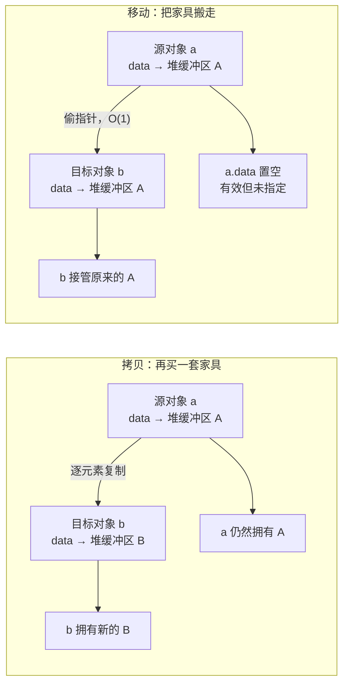
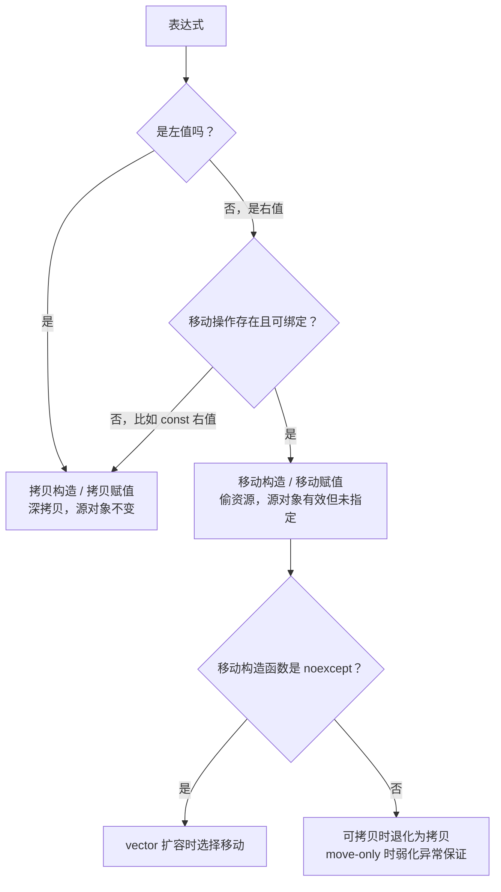

# C++ 移动语义：std::move 到底搬走了什么

> 本文基于 C++23，编译器 Apple Clang 21.0.0（macOS arm64）。移动语义从 C++11 开始引入；文中涉及的 `std::exchange` 最低要求 C++14。

搬家的时候，你不会把旧房子里的家具再买一套放到新家——你会把家具搬过去。旧房子还在，但里面已经空了。

C++ 的拷贝语义是“再买一套”：`Buffer b = a` 会重新分配内存，把 `a` 里的每个字节复制到 `b`，两个对象各自拥有一份完整的数据。对于一百万个整数，这个“再买一套”很贵。

移动语义是“搬家具”：`Buffer b = std::move(a)` 不复制堆上的数据，而是把 `a` 内部的指针接过来，再把 `a` 的指针置空。数据还是那份数据，只是换了个主人。**移动的本质是转移资源的所有权，不是移动字节。**

## 一次真实的搬家

```cpp
// move.cpp
#include <cstdio>
#include <string>
#include <utility>
#include <vector>

struct Buffer {
    std::string name;
    std::vector<int> data;

    explicit Buffer(std::string n, std::size_t size)
        : name(std::move(n)), data(size, 7) {
        std::printf("构造 %s (size=%zu)\n", name.c_str(), data.size());
    }

    Buffer(const Buffer& other)
        : name(other.name + "-copy"), data(other.data) {
        std::printf("拷贝 %s\n", name.c_str());
    }

    Buffer(Buffer&& other) noexcept
        : name(std::move(other.name)), data(std::move(other.data)) {
        std::printf("移动 %s (源 size=%zu)\n", name.c_str(), other.data.size());
    }
};

Buffer make_buffer() {
    return Buffer{"临时", 1'000'000};
}

int main() {
    std::puts("--- 1. 返回临时对象 ---");
    Buffer a = make_buffer();

    std::puts("--- 2. 显式 move ---");
    Buffer b = std::move(a);
    std::printf("a.name='%s', a.data.size=%zu\n", a.name.c_str(), a.data.size());

    std::puts("--- 3. move 一个 const 对象 ---");
    const Buffer c{"只读", 3};
    Buffer d = std::move(c);

    std::puts("--- 4. vector 扩容 ---");
    std::vector<Buffer> boxes;
    boxes.reserve(1);
    boxes.push_back(Buffer{"盒子1", 10});
    boxes.push_back(Buffer{"盒子2", 10});

    std::puts("--- main 结束 ---");
}
```

```bash
$ clang++ -std=c++23 -Wall -Wextra -O2 move.cpp -o move
$ ./move
--- 1. 返回临时对象 ---
构造 临时 (size=1000000)
--- 2. 显式 move ---
移动 临时 (源 size=0)
a.name='', a.data.size=0
--- 3. move 一个 const 对象 ---
构造 只读 (size=3)
拷贝 只读-copy
--- 4. vector 扩容 ---
构造 盒子1 (size=10)
移动 盒子1 (源 size=0)
构造 盒子2 (size=10)
移动 盒子2 (源 size=0)
移动 盒子1 (源 size=0)
--- main 结束 ---
```

逐段看：

**第 1 段：返回临时对象，一次拷贝都没有。** C++17 起，返回纯右值（prvalue）是保证的拷贝消除（copy elision）：`Buffer{"临时", ...}` 直接在 `a` 的存储上构造，既不拷贝也不移动。不是编译器“优化得好”，是标准要求它这么做。

**第 2 段：`std::move(a)` 之后，`a` 的 `data.size()` 变成 0。** 因为 `std::vector` 的移动构造函数把内部指针偷走了，源对象变成“有效但未指定”（valid but unspecified）的状态。注意：这里显示 0 是 libc++ 的实现行为，标准只保证 `a` 处于“有效但未指定”的状态，不保证它一定为空。**不要依赖 moved-from 对象的具体值。**

**第 3 段：`std::move` 一个 const 对象，调用的却是拷贝构造。** 因为 `std::move(c)` 的类型是 `const Buffer&&`，而移动构造函数接受的是 `Buffer&&`，不能绑定到 const。编译器只能退而求其次调用 `const Buffer&` 的拷贝构造。这是 `std::move` 最常见的误解之一：**它不保证移动，只是把表达式转成右值引用。**

**第 4 段：`vector` 扩容时，原来的元素被移动而不是拷贝。** 第一次 `push_back` 把临时对象移动进 vector，第二次 `push_back` 触发扩容，又把已有的“盒子1”移动到了新缓冲区。整个过程没有一次深拷贝。

## std::move 本身不搬任何东西

`std::move` 的实现简单到令人失望：

```cpp
template <typename T>
constexpr std::remove_reference_t<T>&& move(T&& t) noexcept {
    return static_cast<std::remove_reference_t<T>&&>(t);
}
```

它就是一个 `static_cast`：把左值转成右值引用（更准确地说，产生一个 xvalue）。真正“搬家具”的是**移动构造函数**或**移动赋值运算符**——也就是接受 `T&&` 的那个重载。

所以下面这段代码什么也没移动：

```cpp
std::string s = "hello";
std::move(s);            // 返回值被丢弃，s 原封不动
std::cout << s << '\n';  // hello
```

`std::move(s)` 只是产生了一个右值引用表达式，没有人用它去构造新对象，也没有人调用移动赋值。

## 拷贝、移动，内存里发生了什么



拷贝的代价和元素数量成正比；移动的代价通常和元素数量无关，只是几个指针的赋值。这也是为什么 `std::vector` 扩容、函数返回大对象、容器存放大对象时，移动语义能把性能差距拉开一个数量级。

## 为什么移动构造函数要标 noexcept

标准库的 `vector` 在扩容时尽量提供强异常保证：如果扩容过程中抛异常，原 vector 保持不变。为了做到这一点，它不能随便移动旧元素——万一移动到一半抛了，旧元素已经被改坏，没法回滚。

于是 `vector` 在扩容时使用 `std::move_if_noexcept`：

- 移动构造是 `noexcept`，或者类型不可拷贝 → 用移动；
- 否则 → 用拷贝，因为拷贝失败时源对象不受影响。

这里有一个前提：如果类型是 move-only 且移动可能抛异常，`vector` 没有拷贝可用，只能移动，此时强异常保证会弱化（标准允许 effects unspecified）。所以“移动构造不抛”是让 `vector` 能选择移动的关键，但不是所有容器操作都无条件提供强保证。

把上面 `Buffer` 的移动构造函数去掉 `noexcept`，再跑第 4 段：

```cpp
Buffer(Buffer&& other)   // 没有 noexcept
    : name(std::move(other.name)), data(std::move(other.data)) { ... }
```

输出会从“移动 盒子1”变成：

```text
移动 盒子2 (源 size=0)
拷贝 盒子1-copy
```

**一个漏写的 `noexcept`，让扩容从 O(1) 的指针搬运退化成了 O(n) 的深拷贝。** 这不是微优化，在大容器里是实打实的性能悬崖。

规则：只要移动构造函数/移动赋值运算符不会抛异常（绝大多数情况下都不会），就标 `noexcept`。这样 `vector` 扩容等需要强异常保证的操作才会选择移动；`std::sort`、`std::swap` 之类的算法通常直接使用移动，`noexcept` 主要影响异常规格和异常安全，不会让它们改走拷贝。

## 移动之后，源对象还能用吗？

对标准库类型，标准的规定是：moved-from 对象处于“有效但未指定”的状态。翻译成人话：

- 它可以被析构；
- 它可以被重新赋值；
- 它可以调用不依赖具体值的成员函数（比如 `clear()`、`empty()`）；
- **不能假设它的值是什么**。

不同标准库类型还有更具体的规定：

| 类型 | 移动后的状态 |
|------|-------------|
| `std::unique_ptr` | 保证为 `nullptr` |
| `std::shared_ptr` | 保证为 `nullptr` |
| `std::vector` | 有效，通常为空，但标准未指定 |
| `std::string` | 有效，通常为空，但标准未指定 |
| `int`、指针等平凡类型 | 值通常不变（移动就是拷贝） |

所以“移动后打印出来是空”只能作为调试观察，不能写进业务逻辑。对标准库类型，moved-from 对象仍然是有效对象，可以析构、重新赋值，也可以调用没有前置条件的成员函数（比如 `clear()`、`empty()`），但**不要依赖它当前的值**。对自定义类型，moved-from 状态由你的移动构造函数决定，标准不提供统一保证；最安全的做法仍然是移动后只做重新赋值或销毁。

## 返回值优化：不要画蛇添足

很多教程会说“返回局部对象时要写 `return std::move(x)`”，这是错的：

```cpp
Buffer make() {
    Buffer tmp{"临时", 100};
    return std::move(tmp);   // 阻止 NRVO，强制调用移动构造
}
```

C++17 对纯右值保证拷贝消除；对于具名局部变量，编译器通常会做 NRVO（Named Return Value Optimization），直接在调用方的存储上构造 `tmp`，连移动都省了。加上 `std::move` 反而把 `tmp` 变成右值，阻止了 NRVO，只能退化为一次移动。

正确写法就是：

```cpp
Buffer make() {
    Buffer tmp{"临时", 100};
    return tmp;   // 编译器优先 NRVO，否则自动 move
}
```

C++11 起，返回局部变量时编译器会先尝试把 `tmp` 当作右值（隐式 move），所以即使 NRVO 没发生，也不会退化成拷贝。

## 完美转发：移动语义的孪生兄弟

移动语义解决“把资源交出去”，完美转发解决“把参数的 value category 原样传下去”。

```cpp
template <typename T>
void wrapper(T&& arg) {
    consume(std::forward<T>(arg));
}
```

这里的 `T&&` 不是右值引用，而是**转发引用**（forwarding reference）：当实参是左值时，`T` 推导为 `T&`，`arg` 是左值引用；当实参是右值时，`T` 推导为 `T`，`arg` 是右值引用。`std::forward<T>` 负责在转发时保留这个属性。

对比一下：

```cpp
template <typename T>
void bad(T&& arg) {
    consume(arg);   // arg 本身是左值，永远传给 consume 的左值重载
}

template <typename T>
void good(T&& arg) {
    consume(std::forward<T>(arg));   // 左值仍是左值，右值仍是右值
}
```

判断口诀：**`T&&` 出现在模板参数推导中才是转发引用；`std::vector<T>&&`、`const T&&` 都不是。** 后者只是普通的右值引用。

## 什么时候该用移动

| 场景 | 写法 | 说明 |
|------|------|------|
| 函数返回局部对象 | `return local;` | 不要 `std::move(local)` |
| 接收要保存的参数 | `void set(std::string s) { name_ = std::move(s); }` | 传右值时移动进来，传左值时拷贝一份再移动 |
| 容器插入不再使用的对象 | `v.push_back(std::move(x));` | 之后不要再读 `x` |
| 转移独占所有权 | `auto p2 = std::move(p1);` | `unique_ptr` 的标准用法 |
| 交换两个大对象 | `std::swap(a, b);` | 标准库内部用移动实现 |
| 小的平凡类型 | 直接拷贝 | `int`、裸指针的“移动”就是拷贝，没有收益 |

反过来，以下操作通常没有意义：

- 对 `const` 对象 `std::move`——只会触发拷贝；
- 对即将继续使用的对象 `std::move`——源对象进入未指定状态；
- 对函数返回的局部变量 `std::move`——阻止 NRVO；
- 对小类型 `std::move`——多了一层类型转换，没有性能收益。

## 自己实现移动操作时要注意什么

如果你确实要写移动构造函数/移动赋值（而不是用 Rule of Zero），至少检查四件事：

1. **标 `noexcept`**：否则 `vector` 扩容时不会选择移动——可拷贝类型会退化为拷贝，move-only 类型则会弱化异常保证。
2. **把源对象置为可析构状态**：偷走指针后，把源指针设为 `nullptr`，否则源对象析构时会重复释放。
3. **移动赋值要处理自赋值**：`a = std::move(a)` 虽然少见，但自己实现的类型应加 `if (this != &other)`，或者用 copy-and-swap。
4. **移动后源对象仍然有效**：不要留下悬空指针、非法 size，至少要能安全析构和重新赋值。

用 `std::exchange` 可以让“偷值 + 置空”一步完成：

```cpp
Buffer(Buffer&& other) noexcept
    : data_(std::exchange(other.data_, nullptr)),
      size_(std::exchange(other.size_, 0)) {}
```

## 一张图总结



记住三句话：

1. **`std::move` 是类型转换，不是动作。** 真正干活的是移动构造/赋值。
2. **移动是所有权转移，不是内存搬家。** 它把堆上的资源指针接过来，源对象被掏空。
3. **标准库的 moved-from 对象有效但未指定。** 不要依赖它的值；自定义类型的 moved-from 状态取决于你的移动实现。

移动语义让 C++ 在保持值语义的同时，避免了大量不必要的深拷贝。但它不是“免费加速器”：用错地方（const、小类型、返回值、还要继续用的对象）不会更快，只会让代码更难懂。

---

**相关文章**

- [C++ RAII：让析构函数替你收拾房间](raii.md)
- [C++ 智能指针：所有权账本](smart-pointers.md)
- [C++ 模板与 Concepts：给模具贴上规格说明](templates-concepts.md)
