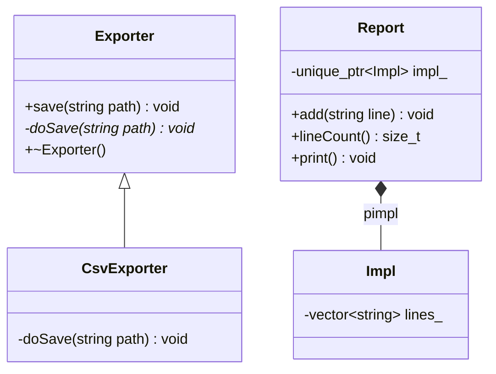

# C++ 面向对象（二）：封装与接口，把“能做什么”和“怎么做”分开

> 本文基于 C++23，编译器 Apple Clang 21.0.0（macOS arm64）。pimpl 和 NVI 在 C++98 就能写；`std::unique_ptr` 从 C++11 开始；`std::make_unique` 从 C++14 开始。

去餐厅吃饭，你拿到的是菜单，不是后厨钥匙。菜单告诉你“有什么菜、多少钱”，后厨怎么切菜、用哪口锅，你不需要知道，也不应该能改。

封装的本质就是这道墙：**调用方只依赖“能做什么”，实现方保留“怎么做”的自由。** 但 C++ 的封装经常被简化成“成员加 private、再配一堆 getter/setter”——那不叫封装，那只是把公开字段换成了公开方法，墙还是漏的。

这一篇讲三件事：怎么让封装真正守住不变量、接口应该暴露多少、以及怎么用 pimpl 和 NVI 把实现藏到调用方看不见的地方。

## 封装的对象是“不变量”，不是成员

一个类之所以需要封装，是因为它维护某个**不变量（invariant）**：余额不能为负、连接必须处于 open/closed 之一、缓存的大小不能超过容量。

```cpp
#include <cstddef>
#include <memory>

class Buffer {
public:
    explicit Buffer(std::size_t capacity) : capacity_(capacity) {}

    bool push(int value) {
        if (size_ == capacity_) return false;
        data_[size_++] = value;
        return true;
    }

    std::size_t size() const { return size_; }

private:
    std::size_t capacity_;
    std::size_t size_ = 0;
    std::unique_ptr<int[]> data_ = std::make_unique<int[]>(capacity_);
};
```

`size_ <= capacity_` 是这个类的不变量。只要外部拿不到 `size_` 的写权限，就不可能把它改成 `capacity_ + 1`。这比“提供 `setSize()` 再在里面检查”可靠得多——每多一个写入口，就多一处可能忘记检查的地方。

访问控制的分工：

| 访问级别 | 谁能碰 | 什么时候用 |
|:---------|:-------|:-----------|
| `private` | 本类（以及 friend） | 默认选择，状态和不变量放这里 |
| `protected` | 本类 + 派生类 | 只在确实要给派生类扩展点时用，而且优先暴露函数而不是数据 |
| `public` | 所有人 | 接口，承诺给外部使用的东西 |

`protected` 数据是一个常见陷阱。它看起来“比 public 安全”，但派生类可以直接改基类状态，基类根本不知道不变量什么时候被破坏。**优先 `private` 数据 + `protected` 虚函数/钩子**，把修改路径收回到基类。

`friend` 则是明确的破例：它不是“更宽松的 private”，而是“我承认这个外部函数/类是实现的一部分”。用的时候要窄：只 friend 真正需要的那个函数或类，不要把一大片代码都放进来。

还有一点要说清楚：C++ 的访问控制是**编译期检查**，不是安全边界。宏替换、`reinterpret_cast`、直接算偏移都能绕过。它的目的是让正确代码容易写、错误代码编译不过，不是防攻击。

## 接口：只承诺调用方真正需要的东西

接口是调用方和实现方之间的合同。合同越薄，实现越自由。

C++ 里表达“接口”的常用方式是**纯虚基类**：

```cpp
struct Exporter {
    virtual ~Exporter() = default;                 // 多态删除必须虚析构
    virtual void save(const std::string& path) const = 0;
};
```

几条原则：

- **接口类尽量没有数据成员。** 没有状态，就没有不变量要维护，也没有切片和布局问题。
- **接口尽量小。** 一个类实现五个不相关的方法，不如拆成三个接口。调用方只依赖它用到的那一个。
- **虚析构不能忘。** 只要可能通过基类指针 `delete`，析构函数就必须是 `virtual`，否则是未定义行为（详见[虚函数](04-virtual-functions.md)）。
- **`const` 是接口的一部分。** `save(...) const` 告诉调用方“这次操作不改变对象的可见状态”，比在文档里写一句“不会修改”可靠。

接口的返回值也在表达所有权：

| 返回形式 | 含义 |
|:---------|:-----|
| `T` | 调用方拿到一个独立的值 |
| `const T&` | 借用，生命周期跟着对象走，不能保存超过对象 |
| `T&` | 可修改的借用 |
| `std::unique_ptr<T>` | 所有权转移给调用方 |
| `std::shared_ptr<T>` | 共享所有权，谨慎使用 |

接口设计得好不好，很多时候不看方法名，而看返回值有没有把“谁负责释放、能活多久”说清楚。

## pimpl：把实现从 header 里拿走

先看一个很现实的问题。下面这个类把实现细节写在了 header 里：

```cpp
// report_full.h
#pragma once
#include <string>
#include <vector>

class ReportFull {
public:
    void add(const std::string& line) { lines_.push_back(line); }
    std::size_t lineCount() const { return lines_.size(); }

private:
    std::vector<std::string> lines_;
};
```

任何包含这个 header 的源文件，都会被迫看到 `<vector>` 和 `<string>`。改一下 `lines_` 的类型，所有包含它的翻译单元都要重新编译；如果这是一个动态库，类的布局变了，ABI 也就断了。

pimpl（pointer to implementation）把实现推到 `.cpp` 里：

```cpp
// report.h
#pragma once
#include <memory>
#include <string>

class Report {
public:
    Report();
    ~Report();
    Report(const Report&);
    Report& operator=(const Report&);
    Report(Report&&) noexcept;
    Report& operator=(Report&&) noexcept;

    void add(const std::string& line);
    std::size_t lineCount() const;
    void print() const;

private:
    struct Impl;
    std::unique_ptr<Impl> impl_;
};
```

```cpp
// report.cpp
#include "report.h"
#include <cstdio>
#include <vector>

struct Report::Impl {
    std::vector<std::string> lines;
};

Report::Report() : impl_(std::make_unique<Impl>()) {}
Report::~Report() = default;                       // Impl 在这里才完整
Report::Report(const Report& other)
    : impl_(std::make_unique<Impl>(*other.impl_)) {}
Report& Report::operator=(const Report& other) {
    if (this != &other) *impl_ = *other.impl_;
    return *this;
}
Report::Report(Report&&) noexcept = default;
Report& Report::operator=(Report&&) noexcept = default;

void Report::add(const std::string& line) { impl_->lines.push_back(line); }
std::size_t Report::lineCount() const { return impl_->lines.size(); }
void Report::print() const {
    for (const auto& line : impl_->lines) std::printf("%s\n", line.c_str());
}
```

```cpp
// main.cpp
#include "report.h"
#include <cstdio>

int main() {
    Report r;
    r.add("first");
    r.add("second");
    Report copy = r;
    std::printf("sizeof(Report)=%zu lines=%zu copy=%zu\n",
                sizeof(Report), r.lineCount(), copy.lineCount());
}
```

```bash
$ clang++ -std=c++23 -Wall -Wextra -O2 main.cpp report.cpp -o report
$ ./report
sizeof(Report)=8 lines=2 copy=2
```

`Report` 的大小只有一个指针。`std::vector` 和 `Impl` 的布局全部留在了 `report.cpp`；`std::string` 仍出现在接口签名里，所以 header 还需要它，但调用方不必知道 `Impl` 里装了什么。

编译防火墙的效果可以直接量出来。`main_full.cpp` 是只包含 `report_full.h` 的最小 main，`main_pimpl_min.cpp` 则只包含 `report.h`：

```bash
$ clang++ -std=c++23 -H -fsyntax-only main.cpp 2>&1 | grep -c '/vector'
0

$ clang++ -std=c++23 -H -fsyntax-only main_full.cpp 2>&1 | grep -c '/vector'
5

$ clang++ -std=c++23 -E -P main_pimpl_min.cpp | wc -l
   18372
$ clang++ -std=c++23 -E -P main_full.cpp | wc -l
   27589
```

pimpl 版本的最小 main 预处理后约 1.8 万行，直接包含 `<vector>` 的版本约 2.7 万行。绝对数字取决于标准库实现，但方向是稳定的：**header 里的依赖越少，调用方的编译成本越低。**

### pimpl 的几个实现细节

**析构函数必须写在 `.cpp` 里。** 如果像下面这样在 header 里 `= default`：

```cpp
class ReportBad {
public:
    ~ReportBad() = default;   // Impl 还不完整
private:
    struct Impl;
    std::unique_ptr<Impl> impl_;
};
```

编译器会报：

```text
error: invalid application of 'sizeof' to an incomplete type 'ReportBad::Impl'
    static_assert(sizeof(_Tp) >= 0, "cannot delete an incomplete type");
```

因为 `unique_ptr` 的析构需要知道 `Impl` 的完整定义，而 header 里只有前置声明。把 `~ReportBad();` 声明在 header、定义在 `.cpp`，问题就消失了。

**拷贝要自己写。** `unique_ptr` 不可拷贝，所以 `Report` 默认也不可拷贝。如果你希望它可拷贝，就得像上面那样深拷贝 `Impl`。反过来，如果你不想要拷贝，直接 `= delete`，别让编译器替你猜。

**移动后的对象要明确语义。** 默认移动会把 `impl_` 置空。移动后的 `Report` 可以析构、可以重新赋值，但调用 `add()` 会解引用空指针。如果接口要求移动后仍可调用，就在移动构造里补一个空的 `Impl`——这是额外的分配，要不要付这个成本，取决于你的接口承诺。

**const 不会自动传播。** 在 `const Report&` 上调用 `print()` 时，`impl_` 是 `const std::unique_ptr<Impl>`，但 `operator->` 返回的是 `Impl*`，不是 `const Impl*`。也就是说，`print()` 仍然可以修改 `Impl` 的内容。pimpl 类要自己保证 const 成员函数不改变逻辑状态，编译器帮不了你。

**它不是免费的。** 每个对象多一次堆分配，每次访问实现多一次指针跳转，对象和实现可能不在同一块缓存里。pimpl 适合公开库的 header、需要稳定 ABI 的边界、或者 header 依赖特别重的地方；一个内部小 struct 用它，纯属给自己找麻烦。

## NVI：public 非虚，private 虚

NVI（Non-Virtual Interface）是另一个把“做什么”和“怎么做”分开的手法：

```cpp
#include <cstdio>
#include <string>

struct Exporter {
    void save(const std::string& path) const {   // 非虚，固定流程
        std::printf("validate: %s\n", path.c_str());
        doSave(path);                           // 虚，具体实现
        std::printf("finalize\n");
    }
    virtual ~Exporter() = default;

private:
    virtual void doSave(const std::string& path) const = 0;
};

struct CsvExporter : Exporter {
private:
    void doSave(const std::string& path) const override {
        std::printf("write csv: %s\n", path.c_str());
    }
};

int main() {
    CsvExporter e;
    e.save("out.csv");
}
```

```text
validate: out.csv
write csv: out.csv
finalize
```

`save()` 是 public 非虚函数，负责“保存”这件事的固定流程；`doSave()` 是 private 纯虚函数，负责变化的部分。派生类只能换实现，不能跳过校验和收尾。

这种结构的好处：

- **不变量检查只写一遍**，派生类忘不了；
- **虚函数可以是 private**，外部根本看不到扩展点；
- **基类可以换流程**，只要 `doSave` 的合同不变，调用方不受影响。

它就是设计模式里的 **Template Method**。代价是多一层函数调用，而且 NVI 对模板方法不友好——虚函数不能是模板。不要为了“设计感”把所有虚函数都改成 NVI；当一个虚函数的调用前后确实有固定逻辑时，它才值得。

## 一张图看两种隐藏方式



左边隐藏的是“算法步骤”：调用方只知道 `save`，不知道中间会校验、会收尾。右边隐藏的是“数据布局”：调用方只知道 `Report` 有一个指针，不知道里面是 `vector<string>` 还是别的什么。

两种隐藏解决的是不同问题，但目标一致：**让变化被关在一个小盒子里。**

## 接口设计清单

写一个类之前，先回答这几个问题：

1. **这个类的不变量是什么？** 哪些操作会破坏它？谁能改？
2. **调用方真正需要知道什么？** 这个方法能删吗？这个 getter 是必要的，还是只是“习惯了”？
3. **返回值表达的所有权清楚吗？** 借用、转移、共享，三者不能混着来。
4. **实现细节能不能从 header 里拿掉？** 尤其是第三方库的 include。
5. **派生类需要什么扩展点？** 是虚函数、钩子，还是根本不需要继承？
6. **`const` 说清楚了吗？** 这个函数会不会改对象的可见状态？

## 常见坑

| 坑 | 说明 |
|----|------|
| 用 getter/setter 代替封装 | 公开字段变成公开方法，不变量仍然没人守 |
| `protected` 数据 | 派生类可以绕开基类的检查，不变量失守 |
| 接口类忘记虚析构 | 通过基类指针删除派生类对象是 UB |
| pimpl 在 header 里 `= default` 析构 | `Impl` 不完整，编译失败 |
| pimpl 的 const 假象 | `const unique_ptr<Impl>` 不阻止修改 `Impl` |
| 返回成员的引用给临时对象 | 引用悬空，且很难查 |
| `friend` 开得太大 | 整个类或一大批函数都能碰私有状态，封装名存实亡 |
| 接口太大 | 实现类被迫实现用不到的方法，调用方被迫依赖不相关的能力 |
| 把访问控制当安全边界 | 它只是编译期约束，不是权限系统 |

## 收尾

封装的目标不是“让成员变成 private”，而是**让不变量只有一个维护者**。接口的目标不是“把所有方法都暴露出去”，而是**只承诺调用方真正需要的那部分**。

pimpl 和 NVI 是两个具体工具：

- pimpl 把实现从 header 里拿走，换来编译防火墙和 ABI 稳定，代价是一次间接和一次分配；
- NVI 把流程和步骤分开，换来不变量只写一遍，代价是一层调用和一点设计复杂度。

餐厅不需要让客人进后厨，后厨也不需要把菜谱贴在门口。**墙修在哪里，取决于你希望哪部分可以自由变化。**

---

**相关文章**

- [C++ 基础语法：类与对象](01-basics-classes.md)
- [C++ 虚函数：一张 vtable 背后的点菜流程](04-virtual-functions.md)
- [C++ RAII：让析构函数替你收拾房间](../raii.md)
- [C++ 智能指针：所有权账本](../smart-pointers.md)
- [（三）继承的边界](03-inheritance.md)
- [（六）运算符重载](06-operator-overloading.md)
