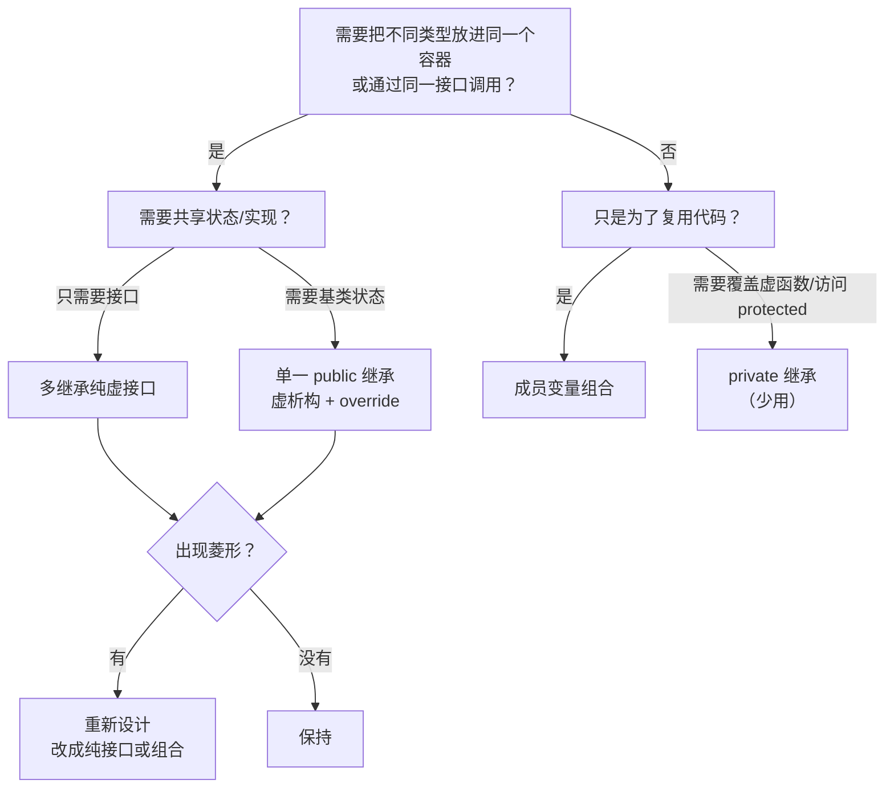

# C++ 面向对象（三）：继承的边界，is-a 不是万能钥匙

> 本文基于 C++23，编译器 Apple Clang 21.0.0（macOS arm64）。三种继承方式、虚继承、名字隐藏在 C++98 就存在；`override`/`final` 从 C++11 开始。

继承像继承家业：你得到的不只是财产，还有债务、规矩和一堆你未必想要的亲戚。

很多 C++ 代码把继承当成“代码复用的快捷方式”：基类有一半逻辑和我一样，那就继承它。结果就是派生类被迫接受基类的全部接口、全部状态、全部不变量，最后发现改一个基类方法会牵动十几个派生类。

这一篇讲清楚继承到底声明了什么、它有哪些边界，以及什么时候应该改用组合。

## public 继承声明的是 is-a

```cpp
#include <cstdio>

struct Shape {
    virtual ~Shape() = default;
    virtual double area() const = 0;
};

struct Circle : public Shape {
    double r;
    explicit Circle(double radius) : r(radius) {}
    double area() const override { return 3.14159 * r * r; }
};

void printArea(const Shape& s) {
    std::printf("%.2f\n", s.area());
}
```

`Circle : public Shape` 是在说：**每一个 Circle 都是一个 Shape**。凡是接受 `Shape&` 的地方，都可以传 `Circle`；凡是 `Shape` 承诺的合同，`Circle` 都必须遵守。

这就是 Liskov 替换原则（LSP）在 C++ 里的具体含义：派生类不能比基类要求更多、承诺更少。如果 `Circle` 的 `area()` 在某些半径下抛异常，而 `Shape` 的合同说“不会抛”，那这个继承关系就是错的——哪怕语法上完全合法。

继承的三种访问方式，声明的关系并不一样：

| 写法 | 含义 | 能否隐式转成基类 |
|:-----|:-----|:-----------------|
| `struct D : public B` | is-a，完整的接口继承 | 能 |
| `struct D : protected B` | 只有 D 和它的派生类知道这层关系 | D 及其派生类的成员/friend 能转 |
| `struct D : private B` | implemented-in-terms-of，纯实现复用 | 只有 D 的成员/friend 能转 |

```cpp
#include <cstdio>
#include <type_traits>

struct Engine { void start() { std::puts("engine start"); } };
struct PublicCar : Engine { void drive() { start(); } };
struct PrivateCar : private Engine {
    void drive() { start(); }               // 内部可以用
};

int main() {
    PublicCar pub;
    PrivateCar priv;
    pub.drive();
    priv.drive();

    std::printf("PublicCar* -> Engine*: %s\n",
                std::is_convertible_v<PublicCar*, Engine*> ? "yes" : "no");
    std::printf("PrivateCar* -> Engine*: %s\n",
                std::is_convertible_v<PrivateCar*, Engine*> ? "yes" : "no");
}
```

```text
engine start
engine start
PublicCar* -> Engine*: yes
PrivateCar* -> Engine*: no
```

`private` 继承经常被误解成“把基类成员变成 private”。它真正表达的是：**我用 B 的实现来实现 D，但 D 不是一个 B。** 大多数情况下，这种关系用成员变量表达更清楚：

```cpp
class Car {
public:
    void drive() { engine_.start(); }
private:
    Engine engine_;
};
```

只有当派生类需要覆盖基类的虚函数、或者需要访问 `protected` 成员时，`private` 继承才有一点存在感。它还有一个历史用途是空基类优化（EBO），但 C++20 之后更推荐用 `[[no_unique_address]]` 成员来表达。即便如此，它也是“很少用”的工具，不是默认选项。

## 构造和析构的顺序

继承体系里，对象的构造顺序是固定的：

1. 虚基类（如果有）；
2. 直接基类（按声明顺序）；
3. 成员变量（按声明顺序）；
4. 构造函数体。

析构顺序完全相反。

```cpp
#include <cstdio>

struct Base {
    Base() { std::puts("Base()"); }
    ~Base() { std::puts("~Base()"); }
};

struct Member {
    Member() { std::puts("Member()"); }
    ~Member() { std::puts("~Member()"); }
};

struct Derived : Base {
    Member m;
    Derived() { std::puts("Derived()"); }
    ~Derived() { std::puts("~Derived()"); }
};

int main() {
    Derived d;
    std::puts("--- scope end ---");
}
```

```text
Base()
Member()
Derived()
--- scope end ---
~Derived()
~Member()
~Base()
```

这个顺序解释了两个常见现象：

- 在基类构造函数里调用虚函数，调到的是基类版本，因为派生类部分还没构造（详见[虚函数](04-virtual-functions.md)）；
- 如果构造函数抛异常，已经构造完成的基类和成员会按逆序析构，但对象自己的析构函数不会执行（详见[异常安全](../exception-safety.md)）。

顺序本身不复杂，复杂的是**依赖顺序**：基类构造函数里不能依赖派生类成员（那时还不存在），派生类成员的初始化也不要去碰尚未初始化的其他成员。不要跨层依赖构造顺序，接口该传的参数就显式传。

## 名字隐藏：派生类会遮住基类的重载

```cpp
#include <cstdio>

struct Base {
    void log(int x) { std::printf("int %d\n", x); }
};

struct Derived : Base {
    void log(const char* s) { std::printf("str %s\n", s); }
};

int main() {
    Derived d;
    d.log(42);
}
```

这段代码编译失败：

```text
error: cannot initialize a parameter of type 'const char *' with an rvalue of type 'int'
note: passing argument to parameter 's' here
```

原因不是重载失败，而是**名字隐藏**：派生类里声明了 `log`，就把基类作用域里的所有 `log` 都遮住了。编译器在 `Derived` 的作用域里找到了 `log(const char*)`，后面就不再往基类看。

修复方式是显式把基类的名字引入派生类作用域：

```cpp
struct Derived : Base {
    using Base::log;
    void log(const char* s) { std::printf("str %s\n", s); }
};

int main() {
    Derived d;
    d.log(42);
    d.log("hi");
}
```

```text
int 42
str hi
```

要区分三个概念：

| 概念 | 条件 | 效果 |
|:-----|:-----|:-----|
| 重载（overload） | 同一作用域，参数不同 | 编译期选一个 |
| 重写（override） | 派生类重写基类虚函数，签名兼容 | 运行期动态绑定 |
| 隐藏（hide） | 派生类同名，但不在同一作用域 | 基类名字不可见 |

`override` 只能检查重写，不能防止隐藏。如果基类函数本身是虚函数，Clang 的 `-Woverloaded-virtual` 可以提示“派生类函数隐藏了基类虚函数”，建议打开；但它管不到普通函数之间的隐藏。

## 多重继承与菱形

C++ 允许多重继承，这既是能力也是陷阱。先看一个经典的菱形：

```cpp
#include <cstdio>

struct A { int value = 7; };
struct B : A {};
struct C : A {};
struct D : B, C {};

int main() {
    D d;
    std::printf("%d\n", d.value);
}
```

```text
error: non-static member 'value' found in multiple base-class subobjects of type 'A':
    struct D -> B -> A
    struct D -> C -> A
note: member found by ambiguous name lookup
```

`D` 里有两份 `A` 子对象：一份来自 `B`，一份来自 `C`。访问 `d.value` 时，编译器不知道你要哪一份。

C++ 的解法是**虚继承**：让 `B` 和 `C` 共享同一份 `A`。

```cpp
#include <cstdio>

struct A { int value = 7; };
struct B : virtual A {};
struct C : virtual A {};
struct D : B, C {};

int main() {
    D d;
    std::printf("sizeof(A)=%zu sizeof(D)=%zu value=%d\n",
                sizeof(A), sizeof(D), d.value);
}
```

```text
sizeof(A)=4 sizeof(D)=24 value=7
```

对比一下非虚继承的版本：

```text
non-virtual: sizeof(D)=8
virtual:     sizeof(VD)=24
```

虚继承不是免费的：每个虚继承的对象要保存额外的偏移信息（常见实现是一个 vptr 或类似结构），访问虚基类还要多一次间接寻址。`sizeof` 从 8 涨到 24，就是这笔账。

更麻烦的是构造规则：**虚基类由最派生类负责初始化**，`B` 和 `C` 构造函数里对 `A` 的初始化会被忽略。这会让构造逻辑变得难以推理。

所以实践建议很直接：

- **多重继承只用于“纯接口”**：多个没有数据成员的抽象类，用来表达能力组合（比如 `Serializable` + `Comparable`），不会产生菱形状态；
- **有状态的菱形继承，优先重新设计**：用组合、用单继承 + 接口，别用虚继承硬解；
- 如果你已经需要画一张继承图才能说清楚，这个设计大概率有问题。

## 继承不是复用工具

看一个很常见的错误：

```cpp
#include <cstdio>
#include <vector>

struct IntStack : std::vector<int> {
    void push(int x) { push_back(x); }
};
```

```cpp
int main() {
    IntStack s;
    s.push(1);
    s.insert(s.begin(), 42);   // 栈不允许的操作，但 public 继承全部暴露
    s.resize(4);
    std::printf("size=%zu front=%d\n", s.size(), s.front());
}
```

```text
size=4 front=42
```

`IntStack` 声称自己是一个栈，但它同时是一个 `vector`：外部可以 `insert`、`resize`、`erase`，可以拿到迭代器随便改。栈的不变量（只能从一端进出）完全失效。

用组合就没有这个问题：

```cpp
class IntStack {
public:
    void push(int x) { data_.push_back(x); }
    void pop() { data_.pop_back(); }
    int top() const { return data_.back(); }
    bool empty() const { return data_.empty(); }
    std::size_t size() const { return data_.size(); }

private:
    std::vector<int> data_;
};
```

外部只能看到五个方法，`vector` 的其他能力被关在盒子里。想改底层容器（比如换成 `deque`），调用方完全不用动。

还有一个额外的好处：`std::vector` 的析构函数不是虚函数。如果有人通过 `std::vector<int>*` 删除你的 `IntStack`，行为是未定义的。组合从根上避免了这个问题。

**继承表达的是“是一种”，组合表达的是“有一个”和“用这个实现”。** 当你不确定该用哪个时，先选组合；等到确实需要运行期多态、需要被统一接口处理时，再引入继承。

## LSP：派生类不能拆基类的台

LSP 不是“派生类要像基类”，而是**调用方只依赖基类合同时，换成任何派生类都不能出问题**。

经典的 `Square` 继承 `Rectangle` 就是反例：

```cpp
class Rectangle {
public:
    virtual void setWidth(int w) { width_ = w; }
    virtual void setHeight(int h) { height_ = h; }
    virtual int area() const { return width_ * height_; }
protected:
    int width_ = 0, height_ = 0;
};

class Square : public Rectangle {
public:
    void setWidth(int w) override { width_ = height_ = w; }
    void setHeight(int h) override { width_ = height_ = h; }
};
```

从数学上说“正方形是矩形”没错，但从**可变对象的合同**上看，`Rectangle` 承诺“设宽不影响高”，`Square` 做不到。一个只接受 `Rectangle&` 的函数，先 `setWidth(4)` 再 `setHeight(5)`，期望面积是 20，传进 `Square` 却得到 25。合同被破坏了。

问题不在于“正方形不是矩形”，而在于**你把可变性放进了基类合同**。如果对象不可变，`Square` 和 `Rectangle` 都可以是 `Shape`，各自返回面积，问题就消失了。

设计继承体系时，先写清楚基类的合同：

- 前置条件：调用方必须满足什么？
- 后置条件：函数返回时保证什么？
- 不变量：对象在整个生命周期里必须满足什么？
- 异常：允许抛什么？

派生类只能**减弱前置条件、增强后置条件**，不能反过来。做不到，就不要继承。

## 什么时候该用继承



一句话版本：**为了“被统一处理”而继承，为了“复用实现”而组合。**

## 常见坑

| 坑 | 说明 |
|----|------|
| 基类析构不是 virtual | 通过基类指针删除派生类对象是 UB |
| 派生类同名函数隐藏基类重载 | 加 `using Base::name;` 或改名字 |
| 忘记 `override` | 签名差一点就变成新函数，多态静默失效 |
| 菱形继承 | 两份基类状态，访问歧义；虚继承又有布局和构造成本 |
| 对象切片 | 按值传递多态类型，派生部分被切掉（见[虚函数](04-virtual-functions.md)） |
| 继承标准容器 | 接口全暴露，且标准容器没有虚析构 |
| `protected` 数据 | 派生类可以绕过基类不变量 |
| 构造函数里调用虚函数 | 派生类部分还没构造，调到基类版本 |
| 用继承做代码复用 | 派生类被迫接受不需要的接口和状态 |
| `dynamic_cast` 不检查空指针 | 转换失败返回 `nullptr`，解引用就是 UB |

## 收尾

继承是 C++ 里最强的耦合关系之一：派生类依赖基类的布局、接口、不变量和生命周期。它能换来运行期多态和统一处理，但代价是**基类一旦变化，所有派生类都要跟着变**。

所以判断标准不是“像不像”，而是三条：

1. **是不是 is-a？** 派生类能不能在基类出现的所有地方替换基类，而不破坏合同？
2. **需不需要多态？** 如果只是复用代码，组合更便宜。
3. **继承层次会不会长成菱形？** 会的话，先重新设计，别急着上虚继承。

家业可以继承，工具最好还是雇。**能用一个成员变量解决的问题，不要认一个基类当爹。**

---

**相关文章**

- [（二）封装与接口](02-encapsulation.md)
- [（六）运算符重载](06-operator-overloading.md)
- [C++ 基础语法：类与对象](01-basics-classes.md)
- [C++ 虚函数：一张 vtable 背后的点菜流程](04-virtual-functions.md)
- [C++ 拷贝控制：Rule of 0/3/5](05-copy-control.md)
- [C++ 异常安全：栈展开时谁来收拾残局](../exception-safety.md)
