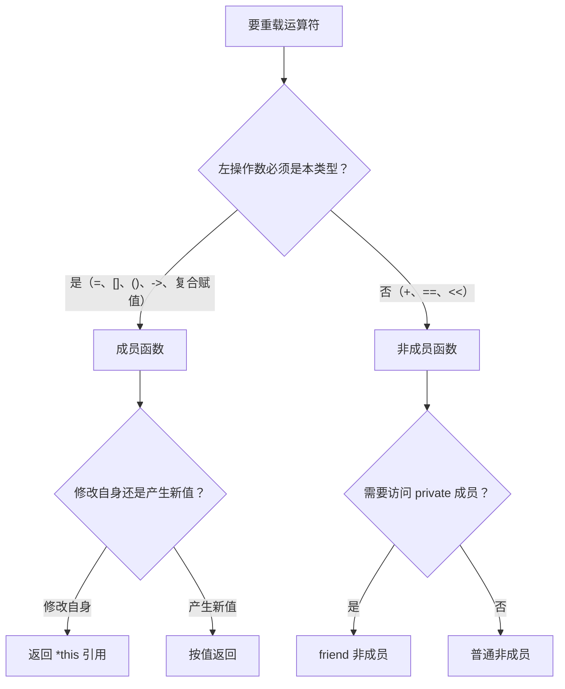

# C++ 面向对象（六）：运算符重载，让自定义类型说人话

> 本文基于 C++23，编译器 Apple Clang 21.0.0（macOS arm64）。运算符重载从 C++98 就有；`explicit` 转换运算符从 C++11 开始；三路比较 `<=>` 和默认比较从 C++20 开始。

运算符是 C++ 给内置类型准备的一套“语法糖”：`a + b` 比 `add(a, b)` 短，`v[i]` 比 `v.at(i)` 自然，`std::cout << x` 比 `print(cout, x)` 顺手。

重载运算符，就是给自定义类型也装一套同样的遥控器。但遥控器只能映射到你已经有的功能，不能改变电器本身的物理规律：**你不能发明新按钮，不能改按钮的优先级，也不能让 `&&` 突然失去短路。**

这一篇讲清楚哪些运算符该重载、该写成成员还是非成员、以及那些“能编译但最好别写”的坑。

## 先记住四条规则

1. **普通运算符重载至少有一个操作数是用户定义类型。** 你不能重载 `int + int`，也不能重载 `double * double`。`operator new`/`operator delete` 是特殊家族，规则不同。
2. **不能发明新运算符。** 没有 `**`、没有 `<>`、没有 `:=`。
3. **不能改变内置运算符的优先级、结合性和固定操作数个数。** `a + b * c` 永远先算 `b * c`；`a = b = c` 永远右结合。`operator()` 例外，它本来就可以接受任意个参数（C++23 的 `operator[]` 也支持多维下标）。
4. **有些运算符不能重载**：`::`、`.`、`.*`、`?:`、`sizeof`、`typeid`、`alignof` 等。

还有一类“能重载但最好别重载”的：`&&`、`||`、`,`。一旦写成函数调用，短路求值和求值顺序的保证就没了：

```cpp
struct AlwaysTrue {
    bool value = true;
    bool operator&&(const AlwaysTrue&) const { return true; }
};

// p && q 不再保证 q 只在 p 为 true 时求值
```

内置的 `&&` 会先算左边，左边为假就不算右边；重载后它就是一个普通函数调用，两个参数都会先求值。除非你在写 DSL 或代理对象，否则不要碰这三个。

`operator=` 必须是成员函数；`[]`、`()`、`->` 和转换运算符通常也写成成员。其他的可以成员、可以非成员，取决于哪边更自然。

## 成员还是非成员：看左操作数

先看一个真实的不对称：

```cpp
#include <cstdio>

struct Money {
    long long cents;
    Money(long long c = 0) : cents(c) {}

    Money operator+(const Money& rhs) const {
        return Money{cents + rhs.cents};
    }
};

int main() {
    Money m{100};
    Money x = m + 50;        // 能编译：50 隐式转成 Money
    Money y = 50 + m;        // 不能编译
    std::printf("%lld %lld\n", x.cents, y.cents);
}
```

第一行能过，因为成员函数的 `this` 是 `m`，右边的 `50` 可以隐式转换成 `Money`；第二行不行，因为成员运算符要求左操作数已经是 `Money`：

```text
error: invalid operands to binary expression ('int' and 'Money')
    Money y = 50 + m;
              ~~ ^ ~
```

如果这个类型需要支持“数字在左边”的写法，就必须用非成员函数：

```cpp
Money operator+(long long lhs, const Money& rhs) {
    return rhs + lhs;
}
```

判断规则很简单：

| 运算符 | 推荐写法 | 原因 |
|:-------|:---------|:-----|
| `=`, `+=`, `-=`, `[]`, `()`, `->` | 成员 | 需要修改/访问左操作数，或者语法要求 |
| `+`, `-`, `*`, `/`, `==`, `<` | 非成员（必要时 friend） | 左右对称，允许隐式转换 |
| `<<`, `>>`（流） | 非成员 | 左操作数是 `std::ostream`/`std::istream`，不是你自己的类型 |
| `++`, `--` | 成员 | 修改自身 |
| 转换运算符 | 成员 | 语法要求 |

非成员函数不一定需要 `friend`。如果公开接口已经够用，就用公开接口；只有必须访问 private 状态时，才把它声明成 `friend`。`friend` 是封装墙上开的一扇门，门越少越好。

## 算术运算符：以 `+=` 为核心

一个惯用的写法是：先实现 `+=`，再让 `+` 复用它。

```cpp
#include <compare>
#include <iomanip>
#include <iostream>

struct Money {
    long long cents = 0;

    Money& operator+=(const Money& rhs) {
        cents += rhs.cents;
        return *this;
    }

    friend Money operator+(Money lhs, const Money& rhs) {
        lhs += rhs;
        return lhs;
    }

    friend Money operator+(Money lhs, long long extra_cents) {
        lhs.cents += extra_cents;
        return lhs;
    }

    friend Money operator+(long long extra_cents, Money rhs) {
        return rhs + extra_cents;
    }

    friend bool operator==(const Money&, const Money&) = default;
    friend auto operator<=>(const Money&, const Money&) = default;

    friend std::ostream& operator<<(std::ostream& os, const Money& m) {
        const char fill = os.fill('0');
        os << (m.cents / 100) << '.'
           << std::setw(2) << (m.cents % 100);
        os.fill(fill);                 // 恢复流状态，别影响后续输出
        return os;
    }
};

int main() {
    Money a{1250}, b{375};
    Money sum = a + b;
    Money mixed = 100 + a;   // 非成员版本才能让整数在左边

    std::cout << "a+b = " << sum << '\n';
    std::cout << "100+a = " << mixed << '\n';
    std::cout << "a<b = " << std::boolalpha << (a < b) << '\n';
    std::cout << "a==a = " << (a == a) << '\n';
    std::cout << "print: " << a << " + " << b << " = " << (a + b) << '\n';
}
```

```text
a+b = 16.25
100+a = 13.50
a<b = false
a==a = true
print: 12.50 + 3.75 = 16.25
```

几个设计点：

- **`+=` 返回 `Money&`**，因为 `(a += b) = c` 应该作用于 `a`，而且链式调用不产生临时对象；
- **`+` 返回 `Money`**，因为它产生新值，不能返回局部变量的引用；
- **`+` 的左操作数按值传递**，这样 `a + b` 可以直接修改 `lhs` 并返回，必要时还能利用移动；右操作数按 `const&`，避免多余拷贝；
- **`100 + a` 需要单独的非成员重载**。这里的 `100` 是 100 分（1.00 元），不是 100 元；单位一旦定了，就要在接口名或类型里说清楚。

不要写这种：

```cpp
Money& operator+(const Money& a, const Money& b);   // 返回引用到临时对象，悬空
```

也不要返回 `const Money`（`const Money operator+`）。这是 C++11 之前防止 `a + b = c` 的习惯；在需要移动的场景里，`const` 返回值绑不到 `T&&`，反而会退回拷贝。现代 C++ 没有理由这么写。

## 比较运算符：C++20 之后只写两个

C++20 之前，要支持六个比较运算符，得手写六个函数，而且很容易写得不一致：`==` 说相等，`<` 却说不小于也不大于。

C++20 的三路比较把这件事收敛成两个：

```cpp
friend bool operator==(const Money&, const Money&) = default;
friend auto operator<=>(const Money&, const Money&) = default;
```

`<=>` 会生成 `<`、`<=`、`>`、`>=`；`operator==` 负责 `==`，`!=` 则由它重写得到。注意：**`<=>` 不会自动生成 `==`**，两者要分别声明。只写 `<=>` 而漏掉 `==`，`a == b` 会编译失败。

`auto` 让编译器选择比较类别：

| 返回类型 | 含义 | 例子 |
|:---------|:-----|:-----|
| `std::strong_ordering` | 可替换相等：`a == b` 意味着两者不可区分 | 整数、金额 |
| `std::weak_ordering` | 等价但可区分 | 忽略大小写的字符串 |
| `std::partial_ordering` | 存在不可比较的值 | 浮点数（NaN） |

如果你的类型有“相等但不完全相同”的概念（比如 `CaseInsensitiveString`），就不能用 `strong_ordering`，否则会误导调用方。

C++20 之前，不要用 `std::rel_ops` 凑六个运算符——它从 C++20 起已经废弃，而且会把 `!=` 的定义变得很隐蔽。老老实实写全六个，或者升级到 C++20。

比较运算符还应该和 `operator==` 保持一致。默认版本天然一致；手写版本要自己保证：**如果 `a == b`，那么 `a < b`、`a > b` 都必须是 false。**

## 流运算符：必须是非成员

```cpp
std::cout << money;
```

左边是 `std::ostream`，不是 `Money`，所以 `operator<<` 不能写成 `Money` 的成员函数。标准写法是：

```cpp
friend std::ostream& operator<<(std::ostream& os, const Money& m) {
    return os << (m.cents / 100) << '.' << ...;
}
```

要点：

- 第一个参数和返回类型都是 `std::ostream&`，这样才能链式写 `os << a << b`；
- 如果需要访问 private 成员，声明成 `friend`；否则普通非成员函数就够；
- 不要修改流的状态后不恢复（比如改了 `std::setfill` 就影响后续输出）；
- 输入运算符 `>>` 同理，第一个参数是 `std::istream&`。

顺带一提：`operator<<` 的语义是“格式化输出”，不是“左移”。同一个符号在不同类型上有不同含义，这是运算符重载的常态，也是它容易让人困惑的原因。

## 转换运算符：默认加 explicit

隐式转换是很多“莫名其妙编译通过”的源头。看这个例子：

```cpp
#include <cstdio>

struct BadHandle {
    bool valid = true;
    operator bool() const { return valid; }   // 隐式转换
};

struct GoodHandle {
    bool valid = true;
    explicit operator bool() const { return valid; }
};

int main() {
    BadHandle bad;
    int x = bad;                 // 隐式 bool 再转 int，居然能编译
    std::printf("int x = bad -> %d\n", x);

    GoodHandle good;
    if (good) std::puts("good is open");
    bool b = static_cast<bool>(good);
    std::printf("static_cast<bool> -> %d\n", b);
}
```

```text
int x = bad -> 1
good is open
static_cast<bool> -> 1
```

`BadHandle` 的 `operator bool` 没有 `explicit`，于是 `int x = bad` 走了“用户定义转换到 bool，再标准转换到 int”的路径。这种隐式链式转换很难在代码审查里发现。

`GoodHandle` 加了 `explicit` 之后，`int x = h;` 就编译失败了：

```text
error: no viable conversion from 'GoodHandle' to 'int'
    int x = h;
        ^   ~
```

但 `explicit operator bool` 仍然允许**条件上下文**里的转换：

```cpp
if (good) { ... }          // ok
while (good) { ... }       // ok
bool b = good;             // 错误：不是条件上下文
bool b = static_cast<bool>(good);   // ok
```

这正是智能指针、文件句柄、锁这类“可检测是否有效”的类型需要的语义：`if (ptr)` 自然，`int x = ptr` 危险。所以 **`operator bool` 几乎总是应该显式**。

其他转换运算符（`operator int`、`operator std::string`）要更谨慎：它们会参与重载决议，容易造成歧义。能用命名函数（`toInt()`、`toString()`）就用命名函数。C++20 还支持 `explicit(bool)`，可以根据条件决定是否显式，通常用于模板库，业务代码很少需要。

## 下标、调用、自增

这几个运算符有固定的写法，记住骨架就行。

**`operator[]` 要成对提供 const 和非 const 版本：**

```cpp
T& operator[](std::size_t i) { return data_[i]; }
const T& operator[](std::size_t i) const { return data_[i]; }
```

只提供非 const 版本，const 对象就没法读；只提供 const 版本，又没法写。两个都写，语义才完整。

**`operator()` 让对象变成函数对象：**

```cpp
struct Adder {
    int base;
    int operator()(int x) const { return base + x; }
};
```

Lambda 的闭包类型本质上就是编译器生成的、带 `operator()` 的类（见[Lambda 表达式](../lambda-expressions.md)）。

**`++` 区分前缀和后缀：**

```cpp
T& operator++() { ...; return *this; }        // 前缀：先加，返回自身引用
T operator++(int) { T old = *this; ++*this; return old; }  // 后缀：返回旧值
```

后缀的 `int` 参数只是用来区分重载，不会被使用。后缀返回 `T` 而不是 `T&`，因为它返回的是修改前的副本。

**`operator->` 和 `operator*`** 是智能指针的核心（见[智能指针](../smart-pointers.md)），普通业务类型很少需要重载。

## 一张图决定成员还是非成员



## 常见坑

| 坑 | 说明 |
|----|------|
| 重载 `&&`、`||`、`,` | 变成普通函数调用，失去短路和求值顺序保证 |
| `operator+` 返回引用 | 引用到临时对象，悬空 |
| `operator+` 返回 `const T` | 阻止移动，现代 C++ 里没有好处 |
| `==` 和 `<` 语义不一致 | 排序和查找会出现矛盾结果 |
| 只写 `<=>` 不写 `==` | `a == b` 编译失败 |
| 隐式 `operator bool` | 会悄悄参与算术和重载决议，默认加 `explicit` |
| `operator<<` 写成成员 | 左操作数是 `ostream`，成员函数不匹配 |
| 后缀 `++` 返回引用 | 返回的是修改后的值，语义错误 |
| 只提供非 const `operator[]` | const 对象无法读取 |
| 重载 `operator&` | 除非在写代理/智能指针，否则会破坏取地址语义 |
| 全局重载 `operator new/delete` | 影响整个程序，调试和性能都难控 |
| 运算符语义反直觉 | 比如 `+` 做删除、`==` 做赋值；语法糖不是乱用的理由 |

## 收尾

运算符重载的目标不是“让代码看起来像数学”，而是**让自定义类型的用法和内置类型保持一致，降低调用方的认知负担**。

记住三条：

1. **先问语义。** `+` 应该是合并、相加还是拼接？如果说不清楚，说明这个运算符不适合你，用命名函数。
2. **再看对称性。** 左右操作数应该平等参与的类型，用非成员；需要修改自身或语法要求的，用成员。
3. **最后看返回值。** 修改自身的返回引用，产生新值的返回值；转换运算符默认 `explicit`。

运算符是语法糖，糖吃多了会腻。**好的重载让代码更短、更清楚；坏的重载让代码更短、更看不懂。**

---

**相关文章**

- [（二）封装与接口](02-encapsulation.md)
- [（三）继承的边界](03-inheritance.md)
- [C++ 拷贝控制：Rule of 0/3/5](05-copy-control.md)
- [C++ 移动语义：std::move 到底搬走了什么](../move-semantics.md)
- [C++ 智能指针：所有权账本](../smart-pointers.md)
- [C++ Lambda 表达式：闭包捕获的不只是变量](../lambda-expressions.md)
