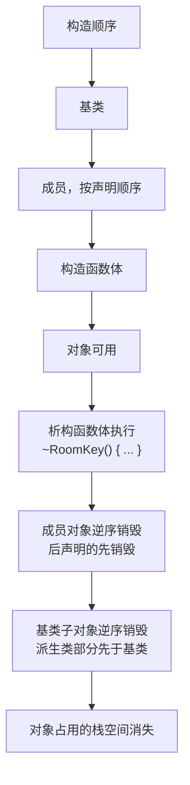
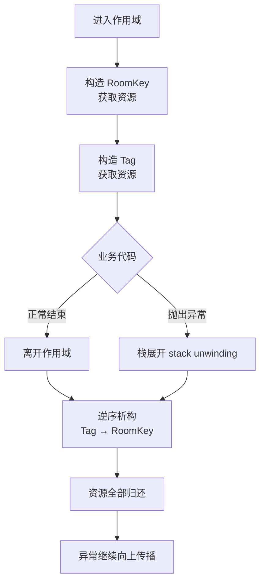

# C++ RAII：让析构函数替你收拾房间

> 本文基于 C++23，编译器 Apple Clang 21.0.0（macOS arm64）。RAII 从 C++98 就存在，文中涉及的新特性会单独标注最低标准。

住酒店时，房卡不只是开门用的。你拿卡的那一刻，酒店就默认你会退房；不管你住三天、提前走，还是半夜被火警赶出来，卡最后都得回到前台。酒店不需要在每份入住协议里写“如果客人中途离开，请记得还卡”——**拿卡和还卡这两个动作，被绑定在了“住店”这件事上**。

C++ 的 RAII 就是这个思路：**构造函数拿资源，析构函数还资源，对象的生命周期就是资源的使用期限**。你不需要在每个 `return`、每个 `throw`、每个提前退出的分支上手写清理代码；只要对象离开作用域，析构函数就会执行。

RAII 的全称是 Resource Acquisition Is Initialization（资源获取即初始化），这个名字其实有点误导——重点不是“初始化”，而是“**资源的生命周期由对象的作用域决定**”。

## 先看一次真实的退房

```cpp
// raii.cpp
#include <cstdio>
#include <stdexcept>

struct RoomKey {
    const char* room;
    explicit RoomKey(const char* r) : room(r) {
        std::printf("拿到房卡 %s\n", room);
    }
    ~RoomKey() {
        std::printf("归还房卡 %s\n", room);
    }
};

struct Tag {
    const char* name;
    ~Tag() { std::printf("释放 %s\n", name); }
};

void checkout(bool cancelled) {
    RoomKey key{"1208"};
    Tag wifi{"WiFi 设备"};
    if (cancelled) {
        throw std::runtime_error("行程取消");
    }
    std::printf("正常退房\n");
}

int main() {
    try {
        checkout(true);
    } catch (const std::exception& e) {
        std::printf("捕获异常: %s\n", e.what());
    }
}
```

编译运行：

```bash
$ clang++ -std=c++23 -Wall -Wextra -O2 raii.cpp -o raii
$ ./raii
拿到房卡 1208
释放 WiFi 设备
归还房卡 1208
捕获异常: 行程取消
```

这段输出里有三个信息：

1. `RoomKey` 构造时打印“拿到房卡”，即使后面抛出了异常，析构仍然打印“归还房卡”。
2. `Tag wifi` 比 `RoomKey key` 后构造，却先析构——**析构顺序和构造顺序相反**，像叠盘子，后放的先拿走。
3. `checkout` 里没有一句 `try`/`catch` 做清理。清理是编译器在栈展开（stack unwinding）时自动完成的。

把 `cancelled` 改成 `false`，输出会变成“正常退房”→“释放 WiFi 设备”→“归还房卡”。不管是正常路径还是异常路径，退房这件事都不会漏。

## 为什么不用 try/finally

C++ 没有 Java 的 `finally`，但这并不是缺陷。手写清理的代码通常长这样：

```cpp
void bad() {
    std::FILE* f = std::fopen("data.bin", "rb");
    if (f == nullptr) return;

    if (read_header(f) != 0) {
        std::fclose(f);          // 分支一
        return;
    }
    if (read_body(f) != 0) {
        std::fclose(f);          // 分支二
        return;
    }

    std::fclose(f);              // 正常路径
}
```

每多一个提前返回，就多一次忘记 `fclose` 的机会；如果中途抛出异常，`fclose` 根本不会执行。RAII 把这些分散的清理点收拢到析构函数里：

```cpp
// 需要 <cstdio>、<memory>
void good() {
    auto file = std::unique_ptr<std::FILE, decltype(&std::fclose)>(
        std::fopen("data.bin", "rb"), &std::fclose);
    if (!file) return;

    read_header(file.get());
    read_body(file.get());
}
```

无论是 `return`、异常，还是函数正常结束，`file` 离开作用域时都会调用 `fclose`。**清理逻辑只写一次，而且不可能被某个分支绕过**。

这也是 C++ 在没有 GC 的情况下仍然能写出安全代码的关键：它不是“忘记释放”，而是“根本没有手动释放这个动作”。

## 析构顺序：后进先出

一个对象的销毁过程是严格分层的：



这条规则解释了很多现象：

- 成员按**声明顺序**构造，不是按初始化列表的书写顺序构造。初始化列表里写反顺序，编译器可能警告。
- 成员按**声明顺序的逆序**销毁。
- 派生类析构函数体先执行，然后派生类成员销毁，再调用基类析构函数。

所以如果 `Logger` 依赖 `File`，要让 `File` 在 `Logger` 之后销毁，就把 `File` 声明在 `Logger` 前面：

```cpp
class Service {
    File file_;       // 先构造，后销毁
    Logger logger_;   // 后构造，先销毁
};
```

如果反过来声明，`Logger` 析构时 `File` 已经没了，日志写不出去——这是一个非常隐蔽的 bug，因为构造和析构都“成功”了，只是顺序错了。

## 标准库里的 RAII

C++ 标准库几乎每个资源管理工具都是 RAII：

| 工具 | 管理的资源 | 最低标准 |
|------|-----------|---------|
| `std::lock_guard` | `mutex` 的锁 | C++11 |
| `std::unique_lock` | 可延迟/可转移的锁 | C++11 |
| `std::unique_ptr` | 堆对象 / 数组 / 自定义句柄 | C++11 |
| `std::shared_ptr` | 共享所有权的堆对象 | C++11 |
| `std::fstream` | 文件句柄 | C++98 |
| `std::vector` | 动态数组缓冲区 | C++98 |
| `std::jthread` | 线程 join + 停止信号 | C++20 |

最常用的是 `std::lock_guard`：

```cpp
std::mutex gate;
std::vector<int> shared;

void add(int value) {
    std::lock_guard<std::mutex> lock(gate);
    shared.push_back(value);   // 这里即使抛异常，锁也会释放
}
```

`lock_guard` 的构造函数加锁，析构函数解锁。它没有 `unlock()` 接口，也不能拷贝或移动——**锁的生命周期被刻意限制在作用域内**。想提前解锁才用 `unique_lock`，因为那属于“我确实需要手动控制”的少数场景。

## Rule of Zero / Rule of Five

RAII 最大的坑不是“忘记写析构函数”，而是“写了析构函数，却忘了拷贝”。

如果一个类直接用裸指针持有资源，编译器生成的拷贝构造函数只会做浅拷贝：

```cpp
class Buffer {
public:
    explicit Buffer(std::size_t n) : data_(new int[n]), size_(n) {}
    ~Buffer() { delete[] data_; }
private:
    int* data_;
    std::size_t size_;
};
```

`Buffer a(10); Buffer b = a;` 之后，`a.data_` 和 `b.data_` 指向同一块内存。两个对象析构时，同一块内存被 `delete[]` 两次——未定义行为。即使没崩，修改 `b` 也会影响 `a`。

**Rule of Five** 说：如果你需要自己写析构函数、拷贝构造、拷贝赋值、移动构造、移动赋值中的任何一个，通常五个都要考虑：

```cpp
// 需要 <algorithm>、<cstddef>、<utility>
class Buffer {
public:
    explicit Buffer(std::size_t n) : data_(new int[n]), size_(n) {}
    ~Buffer() { delete[] data_; }

    Buffer(const Buffer& other)                 // 1. 拷贝构造：深拷贝
        : data_(new int[other.size_]), size_(other.size_) {
        std::copy_n(other.data_, size_, data_);
    }

    Buffer& operator=(const Buffer& other) {    // 2. 拷贝赋值：先复制再释放
        if (this != &other) {
            Buffer tmp(other);
            swap(tmp);
        }
        return *this;
    }

    Buffer(Buffer&& other) noexcept             // 3. 移动构造：偷指针
        : data_(std::exchange(other.data_, nullptr)),
          size_(std::exchange(other.size_, 0)) {}

    Buffer& operator=(Buffer&& other) noexcept { // 4. 移动赋值
        if (this != &other) {
            delete[] data_;
            data_ = std::exchange(other.data_, nullptr);
            size_ = std::exchange(other.size_, 0);
        }
        return *this;
    }

    void swap(Buffer& other) noexcept {
        std::swap(data_, other.data_);
        std::swap(size_, other.size_);
    }

private:
    int* data_;
    std::size_t size_;
};
```

但更推荐的是 **Rule of Zero**：不要自己持有裸资源，把资源交给标准库类型，让编译器生成的特殊成员函数自动做对：

```cpp
class Report {
public:
    Report(std::string title, std::vector<double> values)
        : title_(std::move(title)), values_(std::move(values)) {}

private:
    std::string title_;
    std::vector<double> values_;
};
```

没有析构函数、没有拷贝/移动函数，`Report` 依然可以安全地拷贝和移动，因为 `std::string` 和 `std::vector` 已经处理好了。**最好的资源管理代码，是你根本没写的那些。**

两个例外值得记住：

- 声明了析构函数会让编译器**不生成移动操作**，但拷贝操作仍然生成（C++11 起被弃用）。于是 `Report` 里一旦手写 `~Report()`，原本的移动就可能悄悄退化成拷贝。
- 用 `std::unique_ptr` 持有资源通常也能回到 Rule of Zero：`unique_ptr` 本身不可拷贝、可移动，析构自动释放，比手写五个函数安全得多。

## 析构函数的三条纪律

RAII 把清理放进析构函数，所以析构函数必须可靠。

### 1. 不要让析构函数抛异常

C++11 起，析构函数默认带 `noexcept(true)` 的异常规格，但有一个前提：所有基类和成员的析构函数都不抛。如果某个成员的析构函数可能抛，隐式生成的异常规格会变成 `noexcept(false)`。不过实践中仍然应该保证析构不抛：如果析构函数在栈展开期间抛出异常，程序会直接 `std::terminate`——因为你已经在一个异常处理过程中，再来一个异常没人接得住。

```cpp
~Connection() {
    if (close(socket_) != 0) {
        // 不要 throw
        std::fprintf(stderr, "close failed: %d\n", errno);
    }
}
```

如果关闭操作真的需要报告失败，提供显式的 `close()` 让调用方处理，析构函数只做“尽力而为”的兜底。**析构是最后一道防线，不是错误处理入口。**

### 2. 通过基类指针删除时，基类析构函数必须是虚函数

```cpp
Base* p = new Derived;
delete p;   // 如果 ~Base 不是 virtual，~Derived 不会被调用
```

这不是“可能泄漏一点内存”的问题，而是未定义行为。`Derived` 的成员不会析构，它持有的资源全部泄漏。规则很简单：**只要一个类打算被继承并通过基类指针删除，析构函数就写成 `virtual`**。现代写法是：

```cpp
class Base {
public:
    virtual ~Base() = default;
    virtual void run() = 0;
};
```

具体机制在[虚函数与 vtable](virtual-functions.md)里展开。

### 3. 构造/析构函数里不要调用虚函数

在基类构造期间，派生类部分还没构造好，对象的动态类型仍是基类；此时调用虚函数只会调到基类版本，而不是派生类重写版本。析构期间同理，派生类部分已经销毁。更糟的是，纯虚函数在构造/析构中调用可能直接 `std::terminate`。

需要“构造完成后执行”的逻辑，用两段式初始化或工厂函数，而不是在构造函数里玩虚函数。

## RAII 覆盖不到的地方

RAII 很强，但不是万能的。以下情况析构函数可能不会执行：

- `std::exit()`、`std::quick_exit()`、`std::abort()`：进程直接结束，栈不会展开。
- 信号处理函数里非正常退出。
- `longjmp` 跳过了作用域。
- 程序被 `SIGKILL` 杀死、操作系统崩溃、断电。

另外，RAII 只解决“对象生命周期内的资源释放”，不解决“对象已经销毁，但异步回调还在用它”。后者是并发生命周期问题，需要 `weak_ptr`、取消令牌或明确的所有权协议，不是析构函数能单独搞定的。

还有一种常见误区：构造函数里手动获取多个资源，却在第二个获取失败时忘了释放第一个。因为对象还没构造完成，它自己的析构函数不会被调用：

```cpp
// 不要这样
Widget::Widget() {
    a_ = acquire_a();
    b_ = acquire_b();   // 如果这里抛异常，a_ 泄漏
}
```

正确做法是让每个资源都由一个成员对象管理，成员构造失败时，已构造的成员会自动析构；或者把资源获取按依赖顺序拆成多个 RAII 成员。

## 一张图记住 RAII



RAII 的本质不是某个语法，而是一条契约：**谁构造，谁析构；资源跟着对象走**。你写业务代码时只需要关心“这个对象什么时候离开作用域”，不需要在每个出口重复“记得释放”。

## 一份检查清单

| 场景 | 推荐做法 |
|------|---------|
| 持有堆对象 | `std::unique_ptr`；需要共享才用 `shared_ptr` |
| 持有文件/句柄 | 自定义 deleter 的 `unique_ptr`，或封装成 RAII 类 |
| 加锁 | `std::lock_guard` / `std::scoped_lock` |
| 管理线程 | `std::jthread`（C++20），避免忘记 `join` |
| 类里有多个资源成员 | 按依赖顺序声明，让析构逆序释放 |
| 需要自定义析构 | 同时考虑拷贝/移动（Rule of Five），或改用组合（Rule of Zero） |
| 析构可能失败 | 析构里只记录，不抛；提供显式 `close()` |

如果你发现自己在一个函数里写了三次 `delete`、两次 `fclose`，或者在每个 `return` 前复制粘贴清理代码，那基本可以确定：这里缺一个析构函数。

---

**相关文章**

- [C++ 移动语义：std::move 到底搬走了什么](move-semantics.md)
- [C++ 智能指针：所有权账本](smart-pointers.md)
- [C++ 虚函数：vtable 与动态分发](virtual-functions.md)
