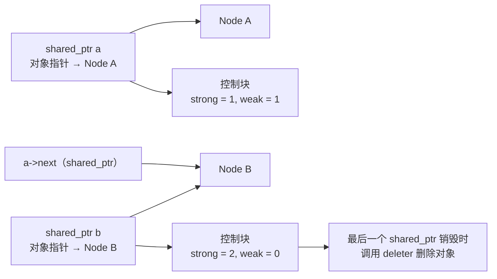
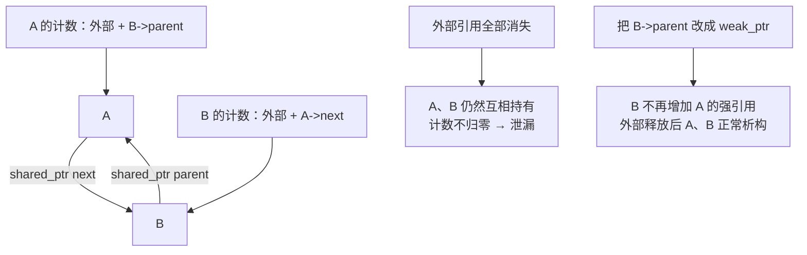
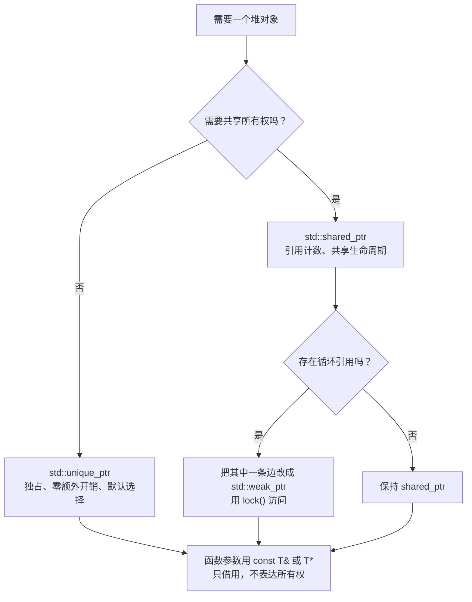

# C++ 智能指针：unique_ptr、shared_ptr、weak_ptr 的所有权账本

> 本文基于 C++23，编译器 Apple Clang 21.0.0（macOS arm64）。`unique_ptr`、`shared_ptr` 从 C++11 开始提供；`make_unique` 从 C++14 开始；`shared_ptr<T[]>` 的数组支持从 C++17 开始。

一张写着我名字的房产证，和一张只写了地址的便签，看起来都是“指向一套房子”。但前者说明房子归我，我有权卖、有权拆；后者只能说明“那里有套房子”，我既不能卖也不能拆。

C++ 的裸指针 `T*` 就是那张便签：它只告诉你地址，不告诉你**谁负责释放**。智能指针则是房产证——它把“所有权”这件事编码进了类型系统：

- `std::unique_ptr<T>`：独占产权，不能复印，只能过户；
- `std::shared_ptr<T>`：合租产权，最后一个人搬走时关灯；
- `std::weak_ptr<T>`：装个猫眼，能看不能住，也不影响房子什么时候拆。

## 裸指针到底缺了什么

```cpp
Task* task = new Task();
run(task);
delete task;   // 谁来 delete？run 里抛异常怎么办？run 会不会也 delete？
```

这段代码有三个问题，而且都没法从类型上看出来：

1. **所有权不明确**：`run` 只是借用，还是接管了 `task`？调用方只能看文档或读源码。
2. **异常不安全**：`run` 抛异常，`delete` 不会执行。
3. **悬空风险**：如果 `run` 内部保存了指针，调用方 `delete` 之后，那个保存的指针就悬空了。

智能指针的核心价值不是“自动 delete”，而是**把所有权关系写进类型，让编译器帮你检查**。

## unique_ptr：独占所有权

`unique_ptr` 表达的是“同一时刻只有一个所有者”。它不能被拷贝，只能被移动：

```cpp
#include <cstdio>
#include <memory>

struct Task {};

int main() {
    auto p = std::make_unique<Task>();
    auto q = std::move(p);
    std::printf("p %s, q %s\n", p ? "有对象" : "已交出所有权", q ? "有对象" : "空");
}
```

```text
p 已交出所有权, q 有对象
```

如果你试图拷贝：

```cpp
auto p = std::make_unique<Task>();
auto q = p;
```

编译器会直接拒绝：

```text
error: call to implicitly-deleted copy constructor of 'unique_ptr<Task>'
note: copy constructor is implicitly deleted because 'unique_ptr<Task>'
      has a user-declared move constructor
```

这条错误信息就是 `unique_ptr` 的价值：**所有权不能凭空复制，只能显式转移**。

### 零额外开销

在常见实现里，默认 deleter 是无状态的空类，会触发空基类优化（EBO），所以：

```cpp
// GCC/Clang 的 libstdc++/libc++ 上通常成立；标准不强制这个大小
static_assert(sizeof(std::unique_ptr<Task>) == sizeof(Task*));
```

`unique_ptr` 通常和一个裸指针一样大，析构时的 `delete` 是编译期确定的，没有虚函数、没有引用计数、没有额外分配。它是“零开销抽象”的典型代表：**你写的是更安全的代码，生成的机器码和手写 `new`/`delete` 几乎一样**。

### make_unique 与自定义 deleter

优先用 `std::make_unique<T>(args...)`，而不是 `std::unique_ptr<T>(new T(args...))`：

- 少写一次类型名；
- 不会出现 `new` 成功但 `unique_ptr` 构造前抛异常的泄漏窗口；
- 代码更短，意图更清楚。

`unique_ptr` 的第二个模板参数是 deleter，默认是 `std::default_delete<T>`。管理 C 风格句柄时，自定义 deleter 非常有用：

```cpp
#include <cstdio>
#include <memory>

struct FileCloser {
    void operator()(std::FILE* f) const noexcept {
        if (f != nullptr) {
            std::fclose(f);
        }
    }
};

using FilePtr = std::unique_ptr<std::FILE, FileCloser>;

FilePtr open_file(const char* path) {
    return FilePtr{std::fopen(path, "rb")};
}
```

这样 `FilePtr` 就是一个完整的 RAII 类型：拷贝被禁止，移动自动转移，离开作用域自动 `fclose`。自定义 deleter 会参与 `unique_ptr` 的类型，所以不同 deleter 的 `unique_ptr` 是不同类型，不能互相赋值——这反而是好事，避免把“用 `fclose` 释放的句柄”和“用 `delete` 释放的对象”混在一起。

### 数组

`unique_ptr<T[]>` 会对数组调用 `delete[]`：

```cpp
auto buffer = std::make_unique<int[]>(1024);
buffer[0] = 42;
```

但大多数场景下，`std::vector<int>` 比 `unique_ptr<int[]>` 更合适：vector 知道自己的长度，能迭代、能扩容、能拷贝。只有对接需要裸数组的 C API 时，才考虑 `unique_ptr<T[]>`。

## shared_ptr：共享所有权

`shared_ptr` 允许复制。每复制一次，引用计数加一；每销毁一个 `shared_ptr`，引用计数减一；减到零时，对象被删除。

```cpp
#include <cstdio>
#include <memory>
#include <string>

struct Node {
    std::string name;
    std::shared_ptr<Node> next;
    std::weak_ptr<Node> parent;

    explicit Node(std::string n) : name(std::move(n)) {
        std::printf("+ %s\n", name.c_str());
    }
    ~Node() { std::printf("- %s\n", name.c_str()); }
};

int main() {
    auto a = std::make_shared<Node>("A");
    auto b = std::make_shared<Node>("B");

    a->next = b;
    b->parent = a;

    std::printf("a=%ld, b=%ld\n", a.use_count(), b.use_count());

    auto locked = b->parent.lock();
    std::printf("lock 后 a=%ld\n", a.use_count());
    locked.reset();

    std::puts("--- main 结束 ---");
}
```

```text
+ A
+ B
a=1, b=2
lock 后 a=2
--- main 结束 ---
- A
- B
```

解释一下计数：

- `a` 初始只有局部变量 `a` 一个强引用，计数为 1。
- `b` 有局部变量 `b` 和 `a->next` 两个强引用，计数为 2。
- `b->parent` 是 `weak_ptr`，**不计入强引用**，所以不改变 `a` 的强引用计数；但它会计入 `a` 控制块的弱引用计数，所以 A 的控制块是 `strong=1, weak=1`。
- `lock()` 临时产生一个强引用，`a` 的计数变成 2；`locked.reset()` 后回到 1。

程序结束时，`b` 先离开作用域，但 `a->next` 还持有它，所以 `b` 不析构；随后 `a` 析构，`~A` 先执行，成员 `next` 销毁，`b` 的计数归零，`~B` 才执行。输出顺序 `- A`、`- B` 正是这个过程的体现。

### 控制块

`shared_ptr` 通常包含两个指针：一个指向对象，一个指向控制块（control block）。控制块里保存强引用计数、弱引用计数、deleter、allocator 等信息。



主流实现通常会把对象和控制块合并到一次分配里（标准用 “should” 要求实现尽量不超过一次分配，但不是强制），所以 `std::make_shared<T>` 通常比 `shared_ptr<T>(new T)` 少一次分配；后者通常需要分别分配对象和控制块。优先用 `make_shared`，但不要把“只分配一次”当成可移植保证。

在采用合并分配的实现上，`make_shared` 还有一个不太直观的副作用：对象和控制块在同一块内存里，只要还有 `weak_ptr` 活着，控制块就不能释放，**对象占用的那块内存也会跟着保留**。如果对象很大、`weak_ptr` 生命周期又很长，可以考虑用 `shared_ptr<T>(new T)` 分开分配，让对象能更早释放；如果实现本来就分开分配，这个差异就不存在。

### shared_ptr 的线程安全边界

这是面试常考、实战常错的一点：

- **引用计数是线程安全的**：多个线程可以各自拷贝、销毁不同的 `shared_ptr` 实例，控制块的计数用原子操作维护。
- **被指向的对象不是线程安全的**：`shared_ptr` 只保证对象的生命周期，不保证对象内部数据的并发访问安全。多个线程同时写 `*p` 依然需要锁或原子操作。
- **同一个 `shared_ptr` 对象被多个线程同时读写，不是线程安全的**：比如一个线程执行 `sp = other`，另一个线程执行 `sp.use_count()`，这本身就是数据竞争，需要外部同步。
- **`use_count()` 在多线程下只是一个近似值**：标准明确说它不保证精确，不要用它做同步判断。

一句话：`shared_ptr` 保证“对象不会被提前删掉”，不保证“对象可以随便并发访问”。

## weak_ptr：只看不拥有

`weak_ptr` 是 `shared_ptr` 的观察者。它不增加强引用计数，因此不会延长对象的生命周期。

```cpp
auto sp = std::make_shared<int>(42);
std::weak_ptr<int> wp = sp;

if (auto locked = wp.lock()) {
    std::printf("%d\n", *locked);   // 对象还活着
} else {
    std::puts("对象已经销毁");
}
```

`lock()` 是原子的：如果对象还活着，返回一个有效的 `shared_ptr`；如果对象已经销毁，返回空。**判断弱引用是否有效要用 `lock()`，不要用 `expired()` 然后再 `lock()`**——这两步之间对象可能刚好被销毁，形成检查后使用（TOCTOU）的竞态。

### 用 weak_ptr 打断循环引用

如果父节点和子节点都用 `shared_ptr` 互相指向：

```cpp
struct Node {
    std::shared_ptr<Node> next;
    std::shared_ptr<Node> parent;   // 循环引用
};
```

`A->next = B; B->parent = A;` 之后，A 和 B 的引用计数都至少是 2。即使外部所有 `shared_ptr` 都销毁，A 和 B 仍然互相持有，计数永远不归零，析构函数永远不会执行——这就是 `shared_ptr` 版的“内存泄漏”。

修法是让其中一方改用 `weak_ptr`：

```cpp
struct Node {
    std::shared_ptr<Node> next;   // 拥有下一个节点
    std::weak_ptr<Node> parent;   // 只观察父节点，不拥有
};
```

选择哪一边用 `weak_ptr`，取决于业务上的所有权关系：**谁的生命周期应该由谁决定**。树结构里父节点拥有子节点，子节点回指父节点用 `weak_ptr`；观察者模式里被观察者不应该拥有观察者，观察者用 `weak_ptr` 持有被观察者（或反过来，取决于谁是长生命周期的一方）。



### weak_ptr 的常见用途

| 场景 | 为什么用 weak_ptr |
|------|------------------|
| 打断循环引用 | 不增加强引用，避免互相保活 |
| 缓存 | 缓存项被外部释放后自动失效，不需要手动清理 |
| 观察者 | 观察者不应阻止被观察者销毁 |
| 异步回调 | 回调执行时对象可能已经没了，`lock()` 判空 |

一个简单的缓存骨架：

```cpp
class Cache {
public:
    std::shared_ptr<const Config> get() {
        if (auto sp = weak_.lock()) {
            return sp;                    // 还活着，直接复用
        }
        auto sp = std::make_shared<const Config>(load_config());
        weak_ = sp;                       // 只观察，不阻止释放
        return sp;
    }

private:
    std::weak_ptr<const Config> weak_;
};
```

缓存本身不拥有 `Config`，调用方用完最后一个 `shared_ptr` 后，对象正常销毁，缓存自动失效。

## 所有权应该怎么表达

智能指针不是“所有指针都换成 shared_ptr”。选错类型，比用裸指针更糟。推荐的 API 设计：

| 函数签名 | 表达的含义 |
|----------|-----------|
| `void use(const T&)` | 借用，不涉及所有权，不负责生命周期 |
| `void use(T*)` | 借用，可能为空；同样不负责释放 |
| `void take(std::unique_ptr<T>)` | 接管独占所有权，调用方必须移动进来 |
| `void share(std::shared_ptr<T>)` | 参与共享所有权，函数可能保存它 |
| `std::unique_ptr<T> make()` | 工厂返回独占所有权，调用方决定怎么用 |
| `std::shared_ptr<T> load()` | 返回共享对象，调用方之间共享生命周期 |

原则：

- **默认用 `unique_ptr`**。独占所有权最简单、最便宜、最容易推理。
- **只有确实需要共享生命周期时才用 `shared_ptr`**。共享所有权意味着“谁最后走谁关灯”，这会增加计数开销，也会让对象销毁时机变得难以预测。
- **借用永远不要用智能指针**。函数只是用一下对象，用 `const T&` 或 `T*` 就够了；传 `shared_ptr` 会无谓地增加引用计数，还会让调用方误以为函数要保存它。
- **`weak_ptr` 只用于观察**，不要把它当作“可空的 shared_ptr”到处传。

## 几个必须知道的坑

### 1. 同一块内存构造两个 shared_ptr

```cpp
Task* raw = new Task();
std::shared_ptr<Task> a(raw);
std::shared_ptr<Task> b(raw);   // 两个独立的控制块！
```

`a` 和 `b` 各自认为自己是唯一的所有者，最后会 `delete` 两次。正确做法是复制已有的 `shared_ptr`：

```cpp
std::shared_ptr<Task> b = a;   // 共享同一个控制块
```

或者从一开始就用 `make_shared` / `unique_ptr` 管理，永远不要同时保留裸指针和智能指针的所有权。

### 2. 不要用 shared_ptr 包裹 this

```cpp
class Session {
public:
    std::shared_ptr<Session> self() {
        return std::shared_ptr<Session>(this);   // 错误：新控制块，double delete
    }
};
```

如果对象已经由 `shared_ptr` 管理，需要从 `this` 得到 `shared_ptr`，继承 `std::enable_shared_from_this<Session>`，然后调用 `shared_from_this()`：

```cpp
class Session : public std::enable_shared_from_this<Session> {
public:
    std::shared_ptr<Session> self() {
        return shared_from_this();
    }
};
```

前提是对象本身已经由 `shared_ptr` 持有；在构造函数里调用 `shared_from_this()` 会抛 `std::bad_weak_ptr`。

### 3. shared_ptr 不是万能的线程安全

前面说过：控制块安全，对象本身不安全。一个常见的错误是用 `shared_ptr` 保护一个可变对象，然后多个线程直接修改它：

```cpp
auto config = std::make_shared<Config>();
// 线程 A
config->timeout = 3;
// 线程 B
config->timeout = 5;   // 数据竞争，shared_ptr 管不了
```

`shared_ptr` 只保证 `Config` 不会被提前销毁，不保证 `Config::timeout` 的并发读写安全。

### 4. shared_ptr 的引用计数有成本

每次拷贝/销毁 `shared_ptr` 都要原子地增减引用计数。在高频路径上（比如每秒百万次的回调），这个成本不可忽略。如果只是函数内部使用，传 `const T&`；如果确实需要共享，考虑传 `const std::shared_ptr<T>&` 以避免无谓的计数操作（但要注意这并不转移所有权，函数不能保存它）。

### 5. 数组和自定义 deleter 要匹配

`std::shared_ptr<T>` 默认用 `delete` 释放；如果对象是 `new T[n]` 分配的，必须传 `std::default_delete<T[]>` 或自定义 deleter：

```cpp
std::shared_ptr<int> p(new int[10], std::default_delete<int[]>());
```

C++17 起可以直接用 `std::shared_ptr<int[]>`，但大多数情况下 `std::vector<int>` 更合适。

## 选择流程图



## 收尾

智能指针解决的是**所有权表达**问题，不是“再也不用手动管理内存”的魔法。真正要记住的是：

- `unique_ptr` 是默认答案：独占、轻量、移动语义清晰。
- `shared_ptr` 是共享生命周期的工具，不是“更安全的指针”；一旦用上，就要接受引用计数成本和生命周期不确定性。
- `weak_ptr` 用来观察和打断环，不拥有对象。
- 裸指针仍然有用——当它只表示“借用”时，`T*` 或 `const T&` 比智能指针更诚实。

如果你在代码里看到 `shared_ptr` 满天飞，通常不是“内存管理做得好”，而是**所有权没有想清楚**。

---

**相关文章**

- [C++ RAII：让析构函数替你收拾房间](raii.md)
- [C++ 移动语义：std::move 到底搬走了什么](move-semantics.md)
- [C++ 并发：共享白板、原子操作与内存序](concurrency.md)
