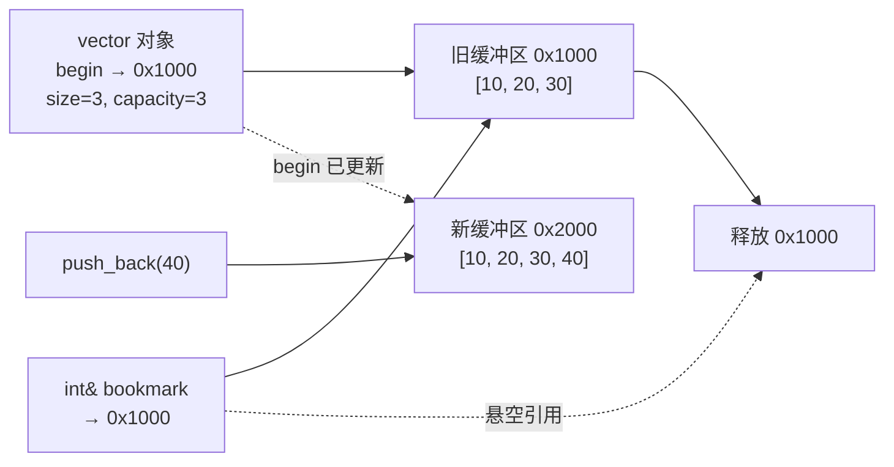

# C++ STL 迭代器失效：书架扩容时，书签为什么会作废

> 本文基于 C++23，编译器 Apple Clang 21.0.0（macOS arm64）。迭代器失效规则来自 C++ 标准；具体扩容策略（比如 vector 容量翻倍）由标准库实现决定。文中 ASan 输出来自 macOS arm64 + libc++。

图书馆只有一排书架，编号从 0 到 2。你在第 0 本书里夹了一张书签，然后图书馆决定扩建——它把三本书全部搬到新馆更大的书架上，旧馆拆掉。你的书签还写着“旧馆 0 号位”，但旧馆已经不存在了。

`std::vector` 的迭代器和引用就是这张书签。它们指向元素在内存里的位置，不拥有元素。当 vector 扩容时，旧缓冲区被释放，所有指向旧缓冲区的迭代器、指针、引用都会**悬空**。继续使用它们不是“读到旧数据”，而是未定义行为。

## 一次真实的 use-after-free

```cpp
// iterator.cpp
#include <cstdio>
#include <vector>

int main() {
    std::vector<int> shelf{10, 20, 30};
    int& bookmark = shelf[0];   // 书签：指向旧缓冲区第 0 个元素

    shelf.push_back(40);        // 容量不够，扩容：分配新缓冲区，搬走元素，释放旧缓冲区

    std::printf("旧书签: %d\n", bookmark);   // 悬空引用
}
```

用 AddressSanitizer 编译运行：

```bash
$ clang++ -std=c++23 -g -fsanitize=address -fno-omit-frame-pointer iterator.cpp -o iterator_asan
$ ./iterator_asan
=================================================================
==98117==ERROR: AddressSanitizer: heap-use-after-free on address 0x6020000000f0 ...
READ of size 4 at 0x6020000000f0 thread T0
    #0 ... in main iterator.cpp:11
    ...

0x6020000000f0 is located 0 bytes inside of 12-byte region [0x6020000000f0,0x6020000000fc)
freed by thread T0 here:
    ...
    #9 ... in main iterator.cpp:9

previously allocated by thread T0 here:
    ...
```

关键信息：

- `heap-use-after-free`：访问了已经释放的堆内存；
- `READ of size 4`：读一个 `int`；
- `freed by ... iterator.cpp:9`：释放发生在 `push_back`；
- 旧区域只有 12 字节（3 个 `int`），新缓冲区已经换到别处。

如果不加 ASan，这段代码可能照样打印 `10`——因为旧内存还没被复用，看起来“没问题”。**未定义行为最危险的地方，就是它经常在测试环境里表现正常。**

修复方式不是“别用引用”，而是**在扩容前把书签换成位置，或者提前预留容量**：

```cpp
#include <cstdio>
#include <vector>

int main() {
    std::vector<int> shelf{10, 20, 30};
    shelf.reserve(4);           // 先订好足够大的书架

    int& bookmark = shelf[0];   // 现在拿书签
    shelf.push_back(40);        // 不会扩容，引用仍然有效

    std::printf("旧书签: %d, 新元素: %d\n", bookmark, shelf.back());
}
```

```text
旧书签: 10, 新元素: 40
```

注意顺序：`reserve` 本身也可能触发扩容，所以必须在**取书签之前**调用。先取引用再 `reserve`，一样会悬空。

## 各容器的失效规则

不同容器的内存布局不同，失效规则也不同。下面是最常用的几类：

| 容器 | 插入操作 | 删除操作 | 备注 |
|------|---------|---------|------|
| `std::vector` | 扩容：所有迭代器/指针/引用失效；不扩容：插入点及之后的失效 | 删除点及之后的失效 | 连续存储；`reserve` 可避免扩容 |
| `std::deque` | 两端插入：所有迭代器失效，但已有元素的引用/指针仍有效；中间插入：全部失效 | 两端删除：只失效被删元素（删除末尾也会使 `end()` 失效）；中间删除：全部失效 | 分段连续存储 |
| `std::list` / `forward_list` | 插入不失效 | 只失效被删元素 | 节点独立分配 |
| `std::map` / `std::set` | 插入不失效 | 只失效被删元素 | 红黑树，节点稳定 |
| `std::unordered_map` / `unordered_set` | 插入可能触发 rehash：迭代器失效，但引用/指针仍有效 | 只失效被删元素 | rehash 改变桶结构，不移动元素本身 |
| `std::string` | 类似 vector：扩容时全部失效；否则插入点及之后失效 | 删除点及之后失效 | C++11 起连续存储 |
| `std::array` | 不支持插入/删除 | 不支持 | 固定大小，迭代器稳定 |

两个容易记混的点：

1. **“迭代器失效”不等于“引用失效”**。`deque` 两端插入、`unordered_map` rehash 都可能只失效迭代器，而已有元素的引用仍然有效。因为元素本身没搬家，只是索引结构变了。
2. **`vector` 不扩容时，插入点之前的引用仍然有效**。比如 `v.insert(v.begin() + 5, x)` 不会让前 5 个元素的引用失效（前提是没有扩容）。但标准对“插入点及之后”的迭代器/引用失效有明确规定，不要依赖实现细节去赌。

## 常见的迭代器失效写法

### 1. 遍历时删除元素

错误写法：

```cpp
for (auto it = v.begin(); it != v.end(); ++it) {
    if (*it % 2 == 0) {
        v.erase(it);   // erase 后 it 失效，下一轮 ++it 是 UB
    }
}
```

正确写法（C++98 起）：

```cpp
for (auto it = v.begin(); it != v.end();) {
    if (*it % 2 == 0) {
        it = v.erase(it);   // erase 返回下一个有效迭代器
    } else {
        ++it;
    }
}
```

C++20 起更简单：

```cpp
std::erase_if(v, [](int x) { return x % 2 == 0; });
```

`erase_if` 是标准库针对容器的统一接口，内部处理了迭代器失效，优先用它。

### 2. range-for 里修改容器

```cpp
for (int x : v) {
    if (x == 3) {
        v.push_back(4);   // 可能扩容，range-for 的迭代器失效
    }
}
```

range-for 展开后大致是：

```cpp
auto&& range = v;
auto begin = std::begin(range);
auto end = std::end(range);   // end 只取一次
for (; begin != end; ++begin) { ... }
```

`push_back` 可能让 `begin`/`end` 都失效，而 `end` 已经被缓存，循环继续就是 UB。**不要在 range-for 里对容器做可能改变容量或删除元素的操作。** 要修改就先收集索引/值，循环结束后再改。

### 3. 保存迭代器跨操作使用

```cpp
auto it = v.begin() + 2;
v.insert(v.begin(), 0);   // 插入点之前的元素后移，it 可能失效
*it;                      // 不要这样
```

`vector` 的插入会导致插入点及之后的元素移动；即使没有扩容，`it` 指向的位置也可能已经不是原来的元素。跨插入/删除保存迭代器，必须重新获取。

### 4. 用 `shrink_to_fit` 之后继续用旧迭代器

`shrink_to_fit` 是非强制请求，可能重新分配并搬移元素。调用之后，所有迭代器/引用都可能失效。除非你确定实现没有动内存，否则按“全部失效”处理。

## reserve、size、capacity

`vector` 的三个概念经常被混淆：

- `size()`：当前有多少个元素；
- `capacity()`：当前缓冲区能容纳多少个元素而不重新分配；
- `reserve(n)`：请求容量至少为 `n`，可能重新分配。

```cpp
std::vector<int> v;
v.reserve(100);          // capacity >= 100, size == 0
for (int i = 0; i < 100; ++i) {
    v.push_back(i);      // 不会扩容
}
```

什么时候用 `reserve`：

- 已知要插入多少元素；
- 需要保存指向元素的引用/指针/迭代器；
- 性能敏感，想避免多次扩容和搬移。

不要滥用：`reserve` 一个过大的值会浪费内存；`reserve` 之后 `size` 仍然是 0，不能直接下标访问。

`shrink_to_fit()` 请求把容量降到 size 附近，但标准不保证一定生效，而且可能触发重新分配。它通常用于“峰值已过，想释放多余内存”的场景，不要把它当成日常操作。

## 迭代器类别与算法

迭代器不只是“能 `++` 的东西”，标准按能力分了类：

| 类别 | 能力 | 典型容器/算法 |
|------|------|--------------|
| input iterator | 只读、单遍 | `istream_iterator` |
| forward iterator | 可多遍、单向 | `forward_list`、`unordered_*` |
| bidirectional iterator | 可前进/后退 | `list`、`map`、`set` |
| random access iterator | 支持 `+ n`、下标、比较 | `vector`、`deque`、`array` |
| contiguous iterator（C++20） | 元素在内存中连续 | `vector`、`array`、`string`、`span` |

算法对迭代器类别有要求：

- `std::sort` 需要随机访问迭代器，所以 `std::list` 不能用，得用成员函数 `list::sort`；
- `std::find` 只需要 input iterator，所以链表、流都能用；
- `std::advance` 对随机访问迭代器是 O(1)，对链表是 O(n)。

C++20 的 Ranges 把这些约束写进了 concept，比如 `std::ranges::sort` 要求 `random_access_range`，错误信息比传统 STL 清楚得多。

## 非拥有视图：span、string_view

C++20 的 `std::span<T>` 和 C++17 的 `std::string_view` 是“非拥有视图”：它们不管理内存，只保存指针和长度。

```cpp
// 需要 <span>
void process(std::span<const int> xs) {
    for (int x : xs) {
        // ...
    }
}

std::vector<int> data{1, 2, 3};
process(data);            // 隐式转换为 span
```

优点是传参不需要拷贝，也不需要模板；缺点是**视图不能比底层容器活得久**：

```cpp
std::span<const int> bad() {
    std::vector<int> local{1, 2, 3};
    return local;          // 返回悬空视图
}
```

`string_view` 同理。它们适合“函数内部临时查看”，不适合“保存起来以后再用”，除非你能保证底层对象的生命周期。

## 怎么发现迭代器失效

靠眼睛看很难，尤其是跨函数传递迭代器时。几个工具：

1. **AddressSanitizer**：捕获堆上的 use-after-free，像上面的例子。对“迭代器仍指向有效缓冲区、但逻辑位置错了”的失效无能为力。
2. **libstdc++ 的 debug 模式**：`-D_GLIBCXX_DEBUG` 会把迭代器替换成带检查的类型，能捕获部分越界和失效。它与 release ABI 不兼容，只用于调试构建。
3. **libc++ 的 hardening 模式**：Clang 新版本提供运行时检查，能在部分场景下提前终止而不是静默 UB。具体宏名随版本变化，使用时查对应 libc++ 文档。
4. **代码规范**：不跨插入/删除保存迭代器；修改容器时用索引或重新获取迭代器；range-for 里不改容器。

工具能帮你发现“已经踩中的坑”，但避免坑还是靠规则。

## 一张图



## 收尾

迭代器失效的本质，是**容器对“元素地址”的所有权**：

- `vector`、`string` 把元素放在一整块连续内存里，扩容就要搬家，所有旧地址作废；
- `list`、`map` 的节点独立分配，插入不搬家，只有被删节点作废；
- `deque`、`unordered_*` 介于两者之间，元素不一定搬家，但索引结构可能变。

记住三句话：

1. **迭代器/引用是借来的地址，不是元素本身。** 容器一搬家，借条就作废。
2. **修改容器后，重新获取迭代器。** 尤其是 `insert`、`erase`、`push_back`、`reserve`、`shrink_to_fit`。
3. **能用 `std::erase_if` 就不要手写 erase 循环。** 标准库已经把失效规则处理好了。

书签本身没有错，错的是把书签夹在了一个会搬家的书架上。

---

**相关文章**

- [C++ RAII：让析构函数替你收拾房间](raii.md)
- [C++ 移动语义：std::move 到底搬走了什么](move-semantics.md)
- [C++ 并发：共享白板、原子操作与内存序](concurrency.md)
