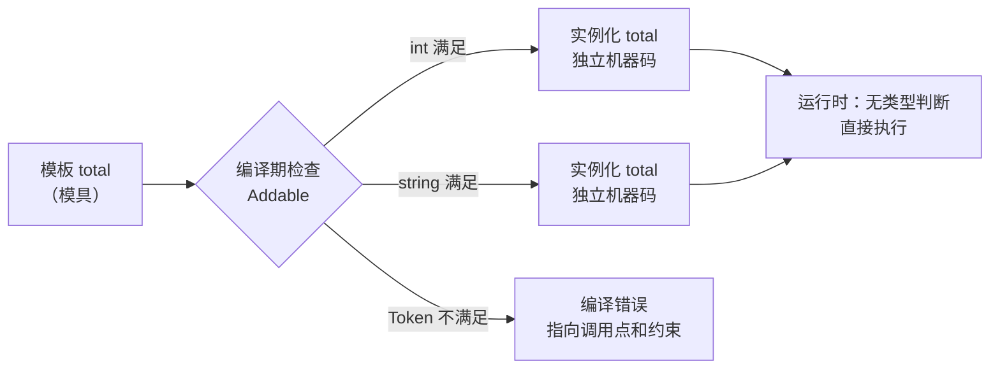

# C++ 模板与 Concepts：给模具贴上规格说明

> 本文基于 C++23，编译器 Apple Clang 21.0.0（macOS arm64）。模板从 C++98 就有；`if constexpr` 从 C++17 开始；Concepts 从 C++20 开始。

做饼干需要模具。同一个模具，倒进不同的面团，出来的是同样形状、不同口味的饼干。模具本身不会“在运行时判断”面团是什么——它只是在压制的这一刻，按照面团的性质成型。

C++ 的模板就是模具。`total<T>` 不是一份能在运行时处理任意类型的代码，而是**编译器在编译期根据 `T` 现场压出来的多份代码**：`total<int>` 一份，`total<std::string>` 一份，各自独立优化、独立生成机器码。这叫**单态化（monomorphization）**，也是 C++ 模板“零开销”的来源。

Concepts 则是贴在模具上的规格说明：**这个模具只接受能滚动的面团**。不满足规格的面团，在压制之前就会被拦下来，而不是等饼干烤到一半才发现裂了。

## 一个函数模板

```cpp
#include <concepts>
#include <cstdio>
#include <string>
#include <type_traits>
#include <vector>

template <typename T>
concept Addable = requires(const T& a, const T& b) {
    { a + b } -> std::convertible_to<T>;
};

template <Addable T>
T total(const std::vector<T>& xs) {
    T sum{};
    for (const auto& x : xs) {
        sum = sum + x;
    }
    return sum;
}

template <typename T>
std::string kind(const T&) {
    if constexpr (std::integral<T>) {
        return "整数";
    } else if constexpr (std::floating_point<T>) {
        return "浮点";
    } else {
        return "其他";
    }
}

int main() {
    std::vector<int> ints{1, 2, 3};
    std::vector<std::string> words{"C", "++", "23"};

    std::printf("total(ints) = %d\n", total(ints));
    std::printf("total(words) = %s\n", total(words).c_str());
    std::printf("kind(42) = %s\n", kind(42).c_str());
    std::printf("kind(3.14) = %s\n", kind(3.14).c_str());
    std::printf("kind(\"hi\") = %s\n", kind("hi").c_str());

    static_assert(Addable<int>);
    static_assert(!Addable<std::vector<int>>);
}
```

```bash
$ clang++ -std=c++23 -Wall -Wextra -O2 templates.cpp -o templates
$ ./templates
total(ints) = 6
total(words) = C++23
kind(42) = 整数
kind(3.14) = 浮点
kind("hi") = 其他
```

这里有三个关键点：

1. `total` 的 `T` 在编译期被推导为 `int` 和 `std::string`，生成两份独立的函数。运行时的 `total` 没有“类型判断”这一步。
2. `Addable` 是一个 concept，它在**编译期**检查 `T` 是否支持 `a + b` 且结果能转回 `T`。`static_assert(Addable<int>)` 通过，`Addable<std::vector<int>>` 不通过。
3. `kind` 用 `if constexpr` 在编译期分支：对于 `int`，只有第一个分支会被实例化；对于 `const char*`，前两个分支被丢弃，直接落到 `else`。

`kind("hi")` 返回“其他”可能有点反直觉——字符串字面量的类型是 `const char[3]`，绑定到 `const T&` 时**不会**发生数组到指针的退化，`T` 推导为 `char[3]`。它既不是整数也不是浮点，所以落到 `else`。如果想看指针分支，先写 `const char* p = "hi"; kind(p);`。这不是 bug，是类型在说话。

## 模板不是运行期泛型

很多人把 C++ 模板和 Java 泛型当成同一类东西，其实它们的实现策略完全不同：

| | C++ 模板 | Java 泛型 |
|---|---|---|
| 实现方式 | 每个类型生成一份代码（单态化） | 类型擦除，运行时只有一份 |
| 运行时类型信息 | 不需要，`vector<int>` 和 `vector<string>` 是不同类型 | 擦除后都是 `List` |
| 基本类型支持 | `vector<int>` 直接存 `int` | 需要装箱成 `Integer` |
| 代码体积 | 可能膨胀 | 只有一份 |
| 编译时间 | 模板实例化多，编译慢 | 编译快 |

C++ 的选择换来了：**没有装箱、没有虚调用、可以在编译期内联和优化**。代价是代码膨胀和编译时间。一个 `std::vector<int>`、`std::vector<double>`、`std::vector<std::string>` 会生成三套完全独立的方法代码；模板用得越多，目标文件越大、编译越久。

这不是“实现缺陷”，而是零开销抽象的必然代价。C++ 把选择权交给了你：热路径用模板换性能，需要运行时多态时用虚函数或 `std::variant`。

## Concepts：把约束写在脸上

没有 concept 的模板，错误通常发生在模板体内部：

```cpp
template <typename T>
T total(const std::vector<T>& xs) {
    T sum{};
    for (const auto& x : xs) {
        sum = sum + x;   // 只有实例化时才知道 T 能不能 +
    }
    return sum;
}

struct Token {};

int main() {
    std::vector<Token> tokens(2);
    total(tokens);
}
```

Apple Clang 21 的报错：

```text
templates_unconstrained.cpp:7:19: error: invalid operands to binary expression
    ('Token' and 'const Token')
    7 |         sum = sum + x;
      |               ~~~ ^ ~
templates_unconstrained.cpp:16:5: note: in instantiation of function template
    specialization 'total<Token>' requested here
   16 |     total(tokens);
      |     ^
```

错误指向 `sum = sum + x`，但真正的问题在调用方：`Token` 不支持加法。编译器只是把“实例化失败”的现场报告给你。

加上 concept 之后：

```cpp
template <typename T>
concept Addable = requires(const T& a, const T& b) {
    { a + b } -> std::convertible_to<T>;
};

template <Addable T>
T total(const std::vector<T>& xs) { /* ... */ }
```

再编译同样的调用：

```text
templates_error.cpp:22:5: error: no matching function for call to 'total'
   22 |     total(tokens);
      |     ^~~~~
templates_error.cpp:10:3: note: candidate template ignored:
    constraints not satisfied [with T = Token]
   10 | T total(const std::vector<T>& xs) {
      |   ^
templates_error.cpp:9:11: note: because 'Token' does not satisfy 'Addable'
    9 | template <Addable T>
      |           ^
templates_error.cpp:6:9: note: because 'a + b' would be invalid:
    invalid operands to binary expression ('const Token' and 'const Token')
    6 |     { a + b } -> std::convertible_to<T>;
      |         ^
```

差别很大：错误现在指向**调用点**，并明确告诉你“`Token` 不满足 `Addable`”，以及不满足的具体原因。对于库作者来说，这相当于把 API 契约写进了编译器能读的地方；对于调用者来说，这是一份比模板体内部报错好读得多的诊断。

### requires 表达式在检查什么

```cpp
template <typename T>
concept Addable = requires(const T& a, const T& b) {
    { a + b } -> std::convertible_to<T>;
};
```

`requires` 后面的块叫**要求表达式（requirement）**。它不是在运行代码，而是在问编译器：“如果我把这些表达式写出来，能通过编译吗？”

- `a + b` 必须合法；
- `{ a + b } -> std::convertible_to<T>` 还要求结果能转换成 `T`。

常见的约束写法还有：

```cpp
template <typename T>
concept Numeric = std::integral<T> || std::floating_point<T>;

template <typename T>
    requires Numeric<T>
T twice(T x) { return x + x; }

// 或者简写
template <Numeric T>
T twice(T x) { return x + x; }
```

`requires` 子句还可以组合多个条件：

```cpp
template <typename T>
    requires std::copyable<T> && Addable<T>
T sum(const std::vector<T>& xs);
```

Concepts 参与重载决议：如果多个候选都满足，编译器会选择约束更强、更特化的那个。这也是它们比 `enable_if` 更好的地方——错误信息可读，重载规则也更自然。

### concept 没写全，错误还是会漏回去

上面的 `Addable` 只检查了 `a + b`，但 `total` 里还有一句 `T sum{}`，要求 `T` 可默认构造。如果某个类型支持加法但没有默认构造函数，错误会再次退回到模板体内部：

```cpp
struct Weird {
    explicit Weird(int) {}
};

Weird operator+(const Weird&, const Weird&);
```

`Addable<Weird>` 会通过（加法合法），但 `T sum{}` 编译失败。修复方式是让 concept 覆盖模板体真正需要的所有能力：

```cpp
template <typename T>
concept Addable = std::default_initializable<T> && std::copyable<T> &&
    requires(const T& a, const T& b) {
        { a + b } -> std::convertible_to<T>;
    };
```

**Concepts 不是装饰，而是契约。** 契约写得越完整，错误就越早、越靠近调用方暴露。写完 concept 后，回头检查模板体里用到的每一个操作，确认它们都被约束覆盖了。

## if constexpr：编译期的分支

`if constexpr` 从 C++17 开始，条件必须是编译期常量。它的特殊之处在于：**没有被选中的分支不会被实例化**。

```cpp
template <typename T>
std::string kind(const T&) {
    if constexpr (std::integral<T>) {
        return "整数";
    } else if constexpr (std::floating_point<T>) {
        return "浮点";
    } else {
        return "其他";
    }
}
```

这解决了模板里一个老问题：普通 `if` 的两个分支都会被编译，即使条件在编译期已知为假。比如：

```cpp
// 需要 <cstdio>、<iostream>、<type_traits>
template <typename T>
void print(const T& value) {
    if constexpr (std::is_pointer_v<T>) {
        std::printf("%p\n", static_cast<const void*>(value));
    } else {
        std::cout << value << '\n';   // T 是指针时，这个分支不会被实例化
    }
}
```

如果这里用普通 `if`，当 `T` 是某个不支持 `<<` 的类型时，即使走不到 `else`，编译器也会尝试编译它，导致莫名其妙的错误。`if constexpr` 让“只编译适用的分支”成为可能。

注意它和运行时 `if` 的区别：`if constexpr` 的条件必须在编译期可求值，且分支在编译期就被裁剪；运行时 `if` 的条件可以是任意表达式，两个分支都会生成代码。

## 模板的定义为什么通常放在头文件

模板不是“一份可以直接链接的代码”，而是“生成代码的图纸”。编译器在**实例化** `total<int>` 的那一刻，必须看到 `total` 的完整定义，否则无法生成机器码。

所以：

```cpp
// math.hpp
template <typename T>
T twice(T x) { return x + x; }   // 定义必须在头文件里

// main.cpp
#include "math.hpp"
int main() { return twice(21); } // 编译器在这里实例化 twice<int>
```

如果把定义放在 `math.cpp`，`main.cpp` 只看到声明，编译器无法实例化，链接时就会找不到 `twice<int>` 的定义。

例外是**显式实例化**：

```cpp
// math.cpp
#include "math.hpp"

template <typename T>
T twice(T x) { return x + x; }   // 定义必须在这里可见

template int twice<int>(int);    // 只生成 int 版本
```

```cpp
// math.hpp
template <typename T>
T twice(T x);

extern template int twice<int>(int);   // 告诉其他 TU：别自己实例化，去 math.cpp 找
```

`extern template`（C++11）可以抑制隐式实例化，减少重复代码和编译时间，但需要你提前枚举所有用到的类型。上面的写法只导出 `int` 版本；如果 `main.cpp` 调用 `twice<double>`，而 `math.cpp` 没有显式实例化 `double`，链接时就会失败。对于类型集合固定的库（比如只支持 `int`、`double`），这是一个有效的优化；对于开放的类型集合，通常得不偿失。

## 模板代码膨胀与编译时间

每实例化一次，编译器就生成一份代码：

```cpp
std::vector<int> a;
std::vector<double> b;
std::vector<std::string> c;
```

三份 `vector` 的成员函数代码、三份析构逻辑、三份迭代器实现。链接器可能会合并一些相同的实例（COMDAT），但并不能保证全部合并，尤其是带不同优化上下文时。

控制膨胀的常见手段：

- **减少不必要的模板参数**：能用运行时参数就不用类型参数。
- **把与类型无关的逻辑抽到非模板基类/函数**：比如 `std::vector` 的很多操作依赖元素类型，但内存分配策略可以部分复用。
- **显式实例化 + `extern template`**：适合类型集合固定的库。
- **用类型擦除替代模板**：`std::function`、`std::any`、虚接口，牺牲一点运行时开销换编译速度和二进制体积。
- **控制头文件依赖**：模板头文件包含太多东西，会让每个包含者都付出编译成本。

## 模板报错为什么难读

模板的错误信息长、嵌套深，原因在于**实例化栈**：`main` 调用 `total<Token>`，`total` 内部调用 `operator+`，`operator+` 又可能触发别的模板……编译器会把整条链打印出来。

Concepts 的最大贡献不是“让模板更强”，而是**把错误从实例化栈的深处提前到约束检查的入口**。再加上 `static_assert` 和清晰的命名，模板库的可用性会提升一个档次。

几个实用技巧：

- 用 concept 给模板参数命名，而不是写一长串 `enable_if`。
- 在模板体里用 `static_assert` 检查关键假设，并写清楚人话。
- 错误信息里出现 `std::__1::__...` 时，先找第一个用户代码帧，不要从标准库内部开始读。
- 用 [Compiler Explorer](https://godbolt.org/) 看实例化后的代码和报错，比在终端里猜快。

## 什么时候不该用模板

模板很强，但不是所有“泛型”都该用模板：

| 场景 | 更合适的选择 |
|------|-------------|
| 类型集合在运行时才确定 | 虚函数 / `std::variant` + `std::visit` |
| 需要稳定的 ABI（插件、动态库边界） | 非模板接口 + 类型擦除 |
| 二进制体积敏感（嵌入式、移动端） | 少用模板，或显式实例化 |
| 只是想让函数接受多种数值类型 | 重载或 `std::variant`，不一定要模板 |
| 逻辑复杂、类型无关 | 普通函数 + 运行时参数 |

模板的零开销是有条件的：**你确实需要为每种类型生成专门代码，并且这些代码在热路径上**。如果只是“看起来更通用”，模板带来的编译时间和错误信息成本，往往超过收益。

## 一张图



## 收尾

模板和 Concepts 的关系，可以这样理解：

- **模板是代码生成器**：它不运行，它在编译期替你写代码。
- **Concepts 是代码生成器的输入规格**：它约束“什么样的类型可以进来”，并把违反规格的错误提前。
- **`if constexpr` 是编译期的裁剪**：让不适用的分支根本不参与编译。

学模板最容易掉进的坑，是把它当成“运行时的泛型”来用。一旦你记住“每个 `T` 都会生成一份独立代码”，很多现象——代码膨胀、编译变慢、错误信息长、定义必须放头文件——就都能解释通了。

---

**相关文章**

- [C++ 编译与链接：菜单、厨房和分店](compile-and-link.md)
- [C++ 虚函数：一张 vtable 背后的点菜流程](virtual-functions.md)
- [C++ 移动语义：std::move 到底搬走了什么](move-semantics.md)
