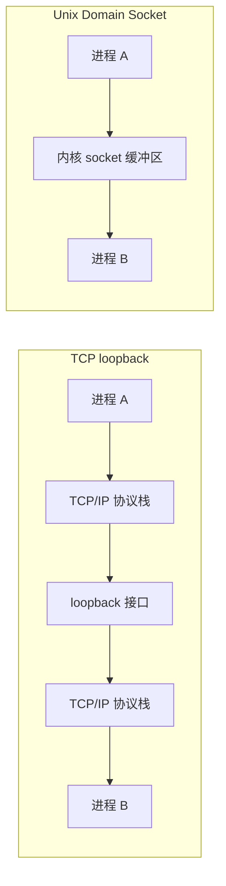
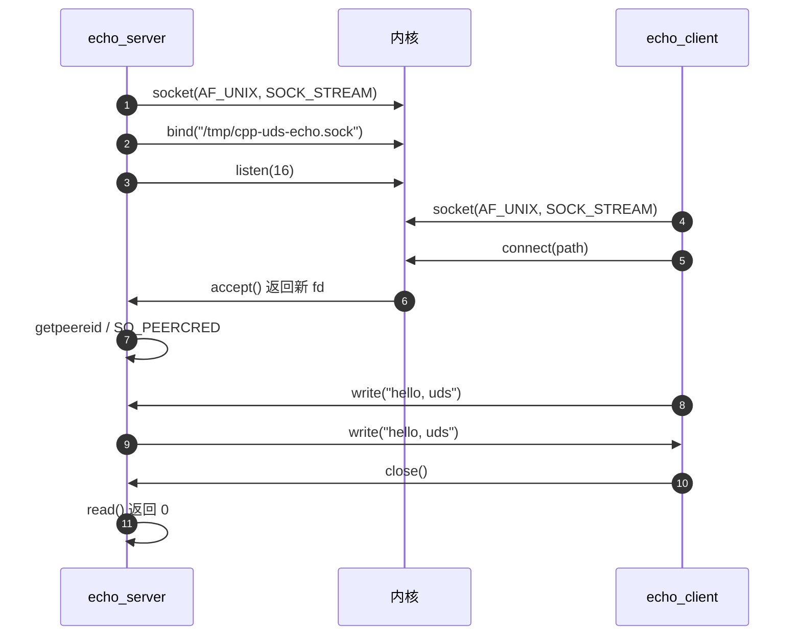
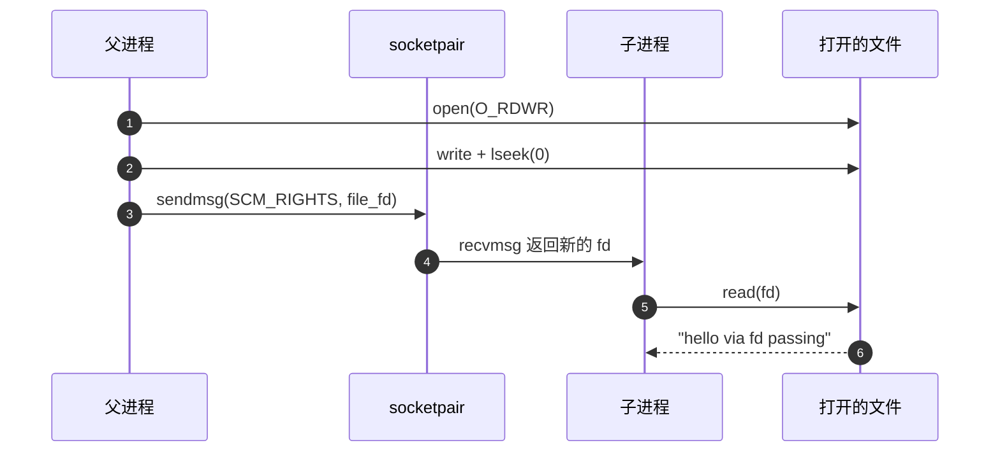

# C++ Unix Domain Socket：把本机 IPC 做成一条文件路径

> 本文基于 C++23，编译器 Apple Clang 21.0.0（macOS 26.4.1 arm64）。代码在 macOS 实测；Linux 差异会单独标注。
>
> Unix Domain Socket 是 POSIX API，不是 C++ 标准库的一部分。本文用 C++ 的 RAII、`std::string`、`std::system_error` 去包装它，但底层仍然是 `<sys/socket.h>`、`<sys/un.h>`、`<unistd.h>` 这些系统头。

## 一句话概括

同一台机器上的两个进程要通信，最常见的选择是 TCP loopback（`127.0.0.1`）或 Unix Domain Socket（UDS）。TCP 像打电话：你要知道对方的分机号（端口），电话要经过交换机和线路；UDS 像同一栋楼里的内部信箱：不用拨号，不用出楼，门牌号就是文件系统里的一条路径。

这条路径不是比喻——`bind()` 之后，`/tmp/my-service.sock` 真的会出现在文件系统里，`ls -l` 能看到它的类型是 `s`（socket），权限位和普通文件一样受 `umask`、`chmod` 控制。

## UDS 省掉了什么



| 维度 | TCP loopback | Unix Domain Socket |
|------|-------------|--------------------|
| 寻址 | IP + 端口 | 文件系统路径（或 Linux 抽象命名空间） |
| 网络栈 | 走完整 TCP/IP 栈 | 不经过网络协议栈，直接走内核缓冲区 |
| 权限 | 基本没有，谁都能连 | 文件权限、目录权限、peer credentials |
| 端口冲突 | 需要管理端口 | 路径冲突，`unlink` 即可清理 |
| 传递文件描述符 | 不支持 | `SCM_RIGHTS` 支持 |
| 跨机器 | loopback 不支持；需绑定非 loopback 地址 | 不支持，只限本机 |
| 消息边界 | 字节流 | `SOCK_STREAM` 字节流；`SOCK_DGRAM`/`SOCK_SEQPACKET` 有边界 |

一句话选型：**本机 IPC 优先 UDS；要跨机器才用 TCP。**

## 地址结构：一条路径就是一个 socket

UDS 的地址结构是 `sockaddr_un`：

```cpp
#include <sys/un.h>

struct sockaddr_un {
    sa_family_t sun_family;   // AF_UNIX
    char        sun_path[104]; // macOS；Linux 通常是 108
};
```

macOS 上还多一个 `sun_len` 字段，用来告诉内核地址结构的实际长度。不同平台的差异：

| 平台 | `sizeof(sockaddr_un)` | `sun_path` | `sun_len` | 抽象命名空间 | `SOCK_SEQPACKET` |
|------|----------------------|------------|-----------|--------------|------------------|
| macOS | 106 | 104 | 有 | 不支持 | 不支持 |
| Linux | 110 | 108 | 无 | 支持 | 支持 |

macOS 实测：

```text
$ ./probe
sizeof(sockaddr_un)=106 sizeof(sun_path)=104 has_sun_len=1
SOCK_SEQPACKET fd=-1 errno=43 (Protocol not supported)
```

### 构造地址

```cpp
sockaddr_un make_addr(const std::string& path, socklen_t& len) {
    sockaddr_un addr{};
    addr.sun_family = AF_UNIX;

    if (path.size() + 1 > sizeof(addr.sun_path)) {
        throw std::invalid_argument("socket path too long for sun_path");
    }
    std::memcpy(addr.sun_path, path.c_str(), path.size() + 1);

#ifdef __APPLE__
    addr.sun_len = static_cast<unsigned char>(sizeof(addr));
    len = static_cast<socklen_t>(sizeof(addr));
#else
    len = static_cast<socklen_t>(
        offsetof(sockaddr_un, sun_path) + path.size() + 1);
#endif
    return addr;
}
```

三个细节：

1. **路径长度包含结尾的 `'\0'`**。`sun_path` 是 104 字节；以 NUL 结尾时最多 103 个字符 + `'\0'`。macOS 内核也能接受 104 字节的非 NUL 路径，但可移植代码按 103 处理。
2. **长度不要直接写 `sizeof(addr)`**。Linux 上 `offsetof(sockaddr_un, sun_path) + path.size() + 1` 才是有效长度；macOS 则要设置 `sun_len`。
3. **路径太长会抛异常**，不要让 `strncpy` 静默截断。截断后的路径可能指向另一个 socket，这是很难查的 bug。

### Linux 抽象命名空间

Linux 还有一个“抽象命名空间”：`sun_path[0] == '\0'`，后面的字节是名字，不落在文件系统里。

```cpp
sockaddr_un addr{};
addr.sun_family = AF_UNIX;
if (name.size() > sizeof(addr.sun_path) - 1) {
    throw std::invalid_argument("abstract socket name too long");
}
addr.sun_path[0] = '\0';
std::memcpy(addr.sun_path + 1, name.data(), name.size());

socklen_t len = static_cast<socklen_t>(
    offsetof(sockaddr_un, sun_path) + 1 + name.size());
```

它不需要 `unlink`，也不会在磁盘上留下文件；代价是没有文件权限，同一网络命名空间里的进程都可能连进来。**抽象命名空间是 Linux 专属，macOS 不支持，跨平台代码不要默认使用。**

## 实战一：一个能跑的 echo 服务

先看服务端。它做了五件事：创建 socket、绑定路径、监听、接受连接、把收到的内容原样写回。

```cpp
// echo_server.cpp
#include <sys/socket.h>
#include <sys/types.h>
#include <sys/un.h>
#include <unistd.h>

#include <cerrno>
#include <csignal>
#include <cstddef>
#include <cstdio>
#include <cstring>
#include <stdexcept>
#include <string>
#include <system_error>
#include <utility>

class UniqueFd {
public:
    explicit UniqueFd(int fd = -1) noexcept : fd_(fd) {}
    ~UniqueFd() { reset(); }

    UniqueFd(const UniqueFd&) = delete;
    UniqueFd& operator=(const UniqueFd&) = delete;

    UniqueFd(UniqueFd&& other) noexcept : fd_(std::exchange(other.fd_, -1)) {}

    UniqueFd& operator=(UniqueFd&& other) noexcept {
        if (this != &other) {
            reset();
            fd_ = std::exchange(other.fd_, -1);
        }
        return *this;
    }

    int get() const noexcept { return fd_; }
    void reset(int fd = -1) noexcept {
        if (fd_ >= 0) ::close(fd_);
        fd_ = fd;
    }
    explicit operator bool() const noexcept { return fd_ >= 0; }

private:
    int fd_;
};

[[noreturn]] void fail(const char* what) {
    throw std::system_error(errno, std::generic_category(), what);
}

sockaddr_un make_addr(const std::string& path, socklen_t& len) {
    sockaddr_un addr{};
    addr.sun_family = AF_UNIX;
    if (path.size() + 1 > sizeof(addr.sun_path)) {
        throw std::invalid_argument("socket path too long for sun_path");
    }
    std::memcpy(addr.sun_path, path.c_str(), path.size() + 1);
#ifdef __APPLE__
    addr.sun_len = static_cast<unsigned char>(sizeof(addr));
    len = static_cast<socklen_t>(sizeof(addr));
#else
    len = static_cast<socklen_t>(
        offsetof(sockaddr_un, sun_path) + path.size() + 1);
#endif
    return addr;
}

void write_all(int fd, const char* data, std::size_t size) {
    while (size > 0) {
        ssize_t n = ::write(fd, data, size);
        if (n < 0) {
            if (errno == EINTR) continue;
            fail("write");
        }
        data += n;
        size -= static_cast<std::size_t>(n);
    }
}

int main(int argc, char** argv) {
    std::signal(SIGPIPE, SIG_IGN);

    const std::string path = argc > 1 ? argv[1] : "/tmp/cpp-uds-echo.sock";
    socklen_t addr_len = 0;
    sockaddr_un addr = make_addr(path, addr_len);

    ::unlink(path.c_str());

    UniqueFd server(::socket(AF_UNIX, SOCK_STREAM, 0));
    if (!server) fail("socket");
    if (::bind(server.get(), reinterpret_cast<sockaddr*>(&addr), addr_len) < 0) {
        fail("bind");
    }
    if (::listen(server.get(), 16) < 0) fail("listen");

    std::printf("listening on %s\n", path.c_str());
    std::fflush(stdout);

    while (true) {
        UniqueFd client(::accept(server.get(), nullptr, nullptr));
        if (!client) {
            if (errno == EINTR) continue;
            fail("accept");
        }

#ifdef __APPLE__
        uid_t uid = 0;
        gid_t gid = 0;
        if (::getpeereid(client.get(), &uid, &gid) == 0) {
            std::printf("peer uid=%u gid=%u\n", uid, gid);
            std::fflush(stdout);
        }
#elif defined(__linux__)
        struct ucred cred {};
        socklen_t cred_len = sizeof(cred);
        if (::getsockopt(client.get(), SOL_SOCKET, SO_PEERCRED,
                         &cred, &cred_len) == 0) {
            std::printf("peer pid=%d uid=%u gid=%u\n",
                        cred.pid, cred.uid, cred.gid);
        }
#endif

        char buf[4096];
        while (true) {
            ssize_t n = ::read(client.get(), buf, sizeof(buf));
            if (n == 0) break;
            if (n < 0) {
                if (errno == EINTR) continue;
                std::perror("read");
                break;
            }
            write_all(client.get(), buf, static_cast<std::size_t>(n));
        }
    }
}
```

### 编译与运行

```bash
$ clang++ -std=c++23 -Wall -Wextra -O2 echo_server.cpp -o echo_server
$ ./echo_server /tmp/cpp-uds-echo.sock
listening on /tmp/cpp-uds-echo.sock
peer uid=501 gid=20
```

另一个终端运行客户端：

```bash
$ clang++ -std=c++23 -Wall -Wextra -O2 echo_client.cpp -o echo_client
$ ./echo_client /tmp/cpp-uds-echo.sock "hello, uds"
sent: hello, uds
echo: hello, uds
```

服务端和客户端都跑起来之后，看一眼 socket 文件：

```bash
$ stat -f '%Sp %Su %Sg %z %N' /tmp/cpp-uds-echo.sock
srwxr-xr-x mac wheel 0 /tmp/cpp-uds-echo.sock
```

`S` 表示 socket 文件，`0` 是大小——它没有内容，只是一个内核对象的入口。权限位 `srwxr-xr-x` 由 `umask` 决定；如果只想让当前用户连接，应该把目录设为 `0700`、socket 设为 `0600`。

### 客户端长什么样

客户端复用同样的 `UniqueFd`、`make_addr`、`write_all`，核心只有连接和收发。客户端同样可能触发 SIGPIPE，所以也在 `main` 开头忽略它（完整代码包含 `<csignal>`）：

```cpp
int main(int argc, char** argv) {
    std::signal(SIGPIPE, SIG_IGN);

    const std::string path = argc > 1 ? argv[1] : "/tmp/cpp-uds-echo.sock";
    const std::string message = argc > 2 ? argv[2] : "hello, uds";

    socklen_t addr_len = 0;
    sockaddr_un addr = make_addr(path, addr_len);

    UniqueFd sock(::socket(AF_UNIX, SOCK_STREAM, 0));
    if (!sock) fail("socket");
    if (::connect(sock.get(), reinterpret_cast<sockaddr*>(&addr), addr_len) < 0) {
        fail("connect");
    }

    write_all(sock.get(), message.data(), message.size());
    std::printf("sent: %s\n", message.c_str());

    std::string reply;
    char buf[4096];
    while (reply.size() < message.size()) {
        ssize_t n = ::read(sock.get(), buf, sizeof(buf));
        if (n == 0) break;
        if (n < 0) {
            if (errno == EINTR) continue;
            fail("read");
        }
        reply.append(buf, static_cast<std::size_t>(n));
    }
    std::printf("echo: %s\n", reply.c_str());
}
```

一次完整的连接过程：



## 五个必须处理的细节

### 1. 陈旧 socket 文件

UDS 的 socket 文件不会因为进程退出自动删除。服务端崩溃后，`/tmp/my.sock` 还在，下一次 `bind()` 会返回 `EADDRINUSE`。

常见做法是启动时先 `unlink`：

```cpp
::unlink(path.c_str());
```

但这把双刃剑：如果另一个服务已经在这个路径上监听，`unlink` 会把它的门牌摘掉，老客户端还能通过已打开的 fd 通信，新客户端却连不上。更稳妥的做法是：

- 路径放在私有目录（`0700`）里，避免别人抢占；
- 启动前用锁文件或 `flock` 保证单实例；
- 退出时在析构或信号处理里 `unlink`，但不要把它当成唯一保障。

### 2. 部分读写、EINTR 与 EOF

`socket` 的 `read`/`write` 不是“要么全做，要么全不做”：

- `read` 可能只返回一部分数据；
- `write` 可能只写进去一部分（缓冲区满、信号打断）；
- 返回 `-1` 且 `errno == EINTR` 表示被信号打断，通常应该重试；
- `SOCK_STREAM` 的 `read` 返回 `0` 表示对端关闭（EOF），不是错误；`SOCK_DGRAM` 的 0 表示零长度数据报，语义不同。

所以不要写：

```cpp
ssize_t n = ::read(fd, buf, sizeof(buf)); // 可能只读到半条消息
```

要写循环，直到读满你要的字节数或遇到 EOF。服务端的 `write_all` 就是最小版本：

```cpp
void write_all(int fd, const char* data, std::size_t size) {
    while (size > 0) {
        ssize_t n = ::write(fd, data, size);
        if (n < 0) {
            if (errno == EINTR) continue;
            fail("write");
        }
        data += n;
        size -= static_cast<std::size_t>(n);
    }
}
```

### 3. SIGPIPE

如果对端已经关闭，继续 `write` 会触发 `SIGPIPE`，默认行为是**直接杀死进程**。服务端在启动时忽略它：

```cpp
std::signal(SIGPIPE, SIG_IGN);
```

之后 `write` 会返回 `-1`、`errno == EPIPE`，你可以正常处理。

平台差异：

- Linux 可以用 `send(fd, buf, len, MSG_NOSIGNAL)` 只对单次调用关闭 SIGPIPE；
- macOS 26.4 的 SDK 也定义了 `MSG_NOSIGNAL`，实测可用；但老系统或文档可能不完整，跨版本更稳的是 `setsockopt(fd, SOL_SOCKET, SO_NOSIGPIPE, ...)`，或者像本文一样全局忽略 `SIGPIPE`。

### 4. `SOCK_STREAM` 没有消息边界

UDS 的 `SOCK_STREAM` 和 TCP 一样是字节流：你写了两次 100 字节，对端可能一次读到 200 字节，也可能分三次读到 30、70、100 字节。

如果协议需要“一条一条消息”，必须自己加边界。最常见的是长度前缀：

```cpp
#include <arpa/inet.h>
#include <cstdint>
#include <cstring>
#include <string>
#include <string_view>

std::string frame(std::string_view payload) {
    std::uint32_t be = htonl(static_cast<std::uint32_t>(payload.size()));
    std::string out(reinterpret_cast<const char*>(&be), sizeof(be));
    out.append(payload);
    return out;
}
```

接收端先读 4 字节长度，再读 `length` 字节；并且一定要限制最大长度，防止对端声明一个 4GB 的包把你打爆。

如果不需要跨平台，Linux 的 `SOCK_SEQPACKET` 可以保留消息边界，省掉自己分帧；macOS 不支持（前面实测返回 `EPROTONOSUPPORT`），所以跨平台代码还是老老实实做长度前缀。

### 5. 阻塞 accept 与并发

上面的服务端是单线程阻塞模型：`accept` 阻塞、`read` 阻塞，一个客户端没处理完，其他客户端只能排队。

小工具这样写没问题；一旦要同时服务多个客户端，有三条路：

- **thread-per-connection**：每个连接一个线程，代码最简单，连接数上去后线程和栈内存吃不消；
- **事件循环**：`poll` / `epoll`（Linux）/ `kqueue`（macOS），一个线程管理多个 fd；
- **线程池 + 非阻塞 IO**：事件循环负责收发，业务逻辑丢给线程池。

事件循环的最小骨架：

```cpp
pollfd fds[2] = {
    {listen_fd, POLLIN, 0},
    {client_fd, POLLIN, 0},
};

int n = ::poll(fds, 2, -1);
if (n < 0) {
    if (errno == EINTR) continue;
    fail("poll");
}
if (fds[0].revents & POLLIN) { /* accept 新连接 */ }
if (fds[1].revents & POLLIN) { /* 读客户端数据 */ }
```

非阻塞 fd 上，`read`/`write` 返回 `-1` 且 `errno == EAGAIN`/`EWOULDBLOCK` 不是错误，表示“现在没数据/缓冲区满”，等下一次可读/可写事件再试。

Linux 的 `accept4` 可以一次设置 `SOCK_CLOEXEC` / `SOCK_NONBLOCK`；macOS 没有这个调用，用 `fcntl` 补上。`socket()` 的 `SOCK_CLOEXEC` 也是 Linux 扩展，跨平台时不要直接依赖。

## 权限与身份：文件系统就是 ACL

UDS 最实用的安全能力是：**连接权限可以交给文件系统**。

```bash
$ SOCKET_DIR="$(mktemp -d)"
$ chmod 700 "$SOCKET_DIR"
$ ./echo_server "$SOCKET_DIR/echo.sock"
$ chmod 600 "$SOCKET_DIR/echo.sock"
```

这样只有当前用户能进入目录、能连接 socket。比起 TCP 端口“谁都能连，再在应用层做认证”，这是内核层的门禁。

但要注意：

- **目录的 execute 权限**是进入路径的前提；目录不可进入，socket 文件权限再对也连不上。
- **socket 文件权限受 `umask` 影响**；需要精确控制时显式 `chmod`。
- **不同内核在 connect 时对 socket 文件读写位的检查略有差异**；最稳妥的做法是目录 `0700`、socket `0600`。
- **不要把 socket 放在 `/tmp` 根目录**。`/tmp` 通常带 sticky bit，但其他用户仍然可以创建同名文件、抢跑或做 symlink 攻击。用 `mkdtemp` 或私有子目录。

### 确认对端是谁

文件权限只能控制“能不能连”，不能告诉你“连进来的是谁”。UDS 提供 peer credentials：

macOS：

```cpp
uid_t uid = 0;
gid_t gid = 0;
if (::getpeereid(client_fd, &uid, &gid) == 0) {
    std::printf("peer uid=%u gid=%u\n", uid, gid);
}
```

Linux：

```cpp
struct ucred cred {};
socklen_t len = sizeof(cred);
if (::getsockopt(client_fd, SOL_SOCKET, SO_PEERCRED, &cred, &len) == 0) {
    std::printf("peer pid=%d uid=%u gid=%u\n",
                cred.pid, cred.uid, cred.gid);
}
```

Linux 下 `struct ucred` 在部分 libc 中需要 `_GNU_SOURCE` 才可见；如果编译报 incomplete type，加 `-D_GNU_SOURCE`（或文件首 `#define _GNU_SOURCE`）。

`SO_PEERCRED` 返回的是**连接建立时**的凭证；如果进程之后 `setuid`，它不会自动更新。Linux 还有 `SO_PASSCRED` + `SCM_CREDENTIALS`，可以按消息携带凭证，适合更细粒度的审计。

## 实战二：用 `SCM_RIGHTS` 传文件描述符

这是 UDS 最容易被低估的能力：**它可以在进程之间传递一个已经打开的文件描述符**。TCP 做不到，管道也做不到。

传递 fd 的意义不是“传一个整数”，而是让接收方获得同一个内核对象的引用。比如：

- 父进程打开一个文件，把 fd 传给子进程，子进程直接读，不需要知道路径；
- 服务端打开一个设备或 socket，把 fd 交给 worker 进程，worker 不需要重新打开；
- 用 `memfd_create`（Linux）创建匿名内存文件，把 fd 传给另一个进程，实现共享内存。

### 发送与接收

核心是 `sendmsg` / `recvmsg` 加一个 `SCM_RIGHTS` 控制消息：

```cpp
#include <sys/socket.h>
#include <cerrno>
#include <cstring>
#include <stdexcept>
#include <system_error>

void send_fd(int socket_fd, int fd) {
    char marker = 'F';
    iovec iov{&marker, 1};

    alignas(cmsghdr) char control[CMSG_SPACE(sizeof(int))] {};
    msghdr msg{};
    msg.msg_iov = &iov;
    msg.msg_iovlen = 1;
    msg.msg_control = control;
    msg.msg_controllen = sizeof(control);

    cmsghdr* cmsg = CMSG_FIRSTHDR(&msg);
    cmsg->cmsg_level = SOL_SOCKET;
    cmsg->cmsg_type = SCM_RIGHTS;
    cmsg->cmsg_len = CMSG_LEN(sizeof(int));
    std::memcpy(CMSG_DATA(cmsg), &fd, sizeof(fd));

    if (::sendmsg(socket_fd, &msg, 0) < 0) {
        throw std::system_error(errno, std::generic_category(), "sendmsg");
    }
}

int recv_fd(int socket_fd) {
    char marker = 0;
    iovec iov{&marker, 1};

    alignas(cmsghdr) char control[CMSG_SPACE(sizeof(int))] {};
    msghdr msg{};
    msg.msg_iov = &iov;
    msg.msg_iovlen = 1;
    msg.msg_control = control;
    msg.msg_controllen = sizeof(control);

    if (::recvmsg(socket_fd, &msg, 0) < 0) {
        throw std::system_error(errno, std::generic_category(), "recvmsg");
    }

    cmsghdr* cmsg = CMSG_FIRSTHDR(&msg);
    if (cmsg == nullptr || cmsg->cmsg_level != SOL_SOCKET
        || cmsg->cmsg_type != SCM_RIGHTS) {
        throw std::runtime_error("recvmsg did not deliver SCM_RIGHTS");
    }

    int fd = -1;
    std::memcpy(&fd, CMSG_DATA(cmsg), sizeof(fd));
    return fd;
}
```

### 一个完整例子：父进程把文件 fd 交给子进程

这段示例还包含 `<fcntl.h>`、`<sys/wait.h>`、`<unistd.h>`，并复用前面的 `UniqueFd` 和 `fail`。

```cpp
int main() {
    int sv[2] = {-1, -1};
    if (::socketpair(AF_UNIX, SOCK_STREAM, 0, sv) < 0) fail("socketpair");

    pid_t pid = ::fork();
    if (pid < 0) fail("fork");

    if (pid == 0) {                    // 子进程
        ::close(sv[0]);
        UniqueFd received(recv_fd(sv[1]));
        ::close(sv[1]);

        char buf[128] {};
        ssize_t n = ::read(received.get(), buf, sizeof(buf) - 1);
        if (n < 0) fail("read received fd");
        std::printf("child received fd, content: %.*s",
                    static_cast<int>(n), buf);
        _exit(0);
    }

    ::close(sv[1]);                    // 父进程
    UniqueFd file(::open("/tmp/cpp-uds-fd.txt",
                         O_CREAT | O_TRUNC | O_RDWR, 0600));
    if (!file) fail("open");

    const char text[] = "hello via fd passing\n";
    if (::write(file.get(), text, sizeof(text) - 1) < 0) fail("write file");
    if (::lseek(file.get(), 0, SEEK_SET) < 0) fail("lseek");

    send_fd(sv[0], file.get());
    std::printf("parent sent fd\n");

    ::close(sv[0]);
    ::waitpid(pid, nullptr, 0);
}
```

```text
$ clang++ -std=c++23 -Wall -Wextra -O2 fd_pass.cpp -o fd_pass
$ ./fd_pass
parent sent fd
child received fd, content: hello via fd passing
```



### FD passing 的三个坑

1. **文件偏移是共享的。** 传过去的是同一个 open file description，父子进程共享 offset。父进程 `lseek(0)` 之后子进程才能从头读；如果父进程继续写，子进程读到的位置也会跟着变。
2. **接收到的 fd 也要 `close`。** 它是内核给你的一份新引用，不关就泄漏。示例里用 `UniqueFd` 包住。
3. **不要给不可信对端传 fd。** 传过去的 fd 拥有原进程的访问权限；这相当于把钥匙递出去。传之前先 `getpeereid` / `SO_PEERCRED` 确认身份。

另外，`SCM_RIGHTS` 需要 `sendmsg`/`recvmsg`，普通 `send`/`recv` 带不了控制消息；控制消息的缓冲区要用 `CMSG_SPACE` 算大小，`cmsg_len` 要用 `CMSG_LEN`，不能手写常数。

## 性能与选型

UDS 通常比 TCP loopback 快，主要因为省掉了 TCP/IP 协议栈、校验和、端口管理和路由查找；但它仍然要经过内核缓冲区，**不是零拷贝**。

| 场景 | 推荐 |
|------|------|
| 本机进程间控制面、请求-响应 | UDS `SOCK_STREAM` |
| 本机高频小消息、需要消息边界 | Linux `SOCK_SEQPACKET`，或自己做长度前缀 |
| 本机数据报 | UDS `SOCK_DGRAM`（无广播，需逐目标 `sendto`；有边界、不面向连接） |
| 跨机器 | TCP / QUIC |
| 大块共享数据 | 共享内存 + UDS 传控制消息 |
| 父子进程简单 IPC | `pipe` / `socketpair` |

几个性能建议：

- 批量写比逐条写更划算；`sendmsg` 的 scatter/gather 可以一次传多个 buffer。
- 不要为了“省一次拷贝”把协议设计得过于复杂；先测量，再优化。
- 需要传大量数据时，考虑 `memfd_create`（Linux）+ `SCM_RIGHTS`，让多个进程映射同一块内存，UDS 只负责传 fd。
- `SOCK_SEQPACKET` 在 Linux 上能保留消息边界，但跨平台不可用；不要把它当成可移植方案。

## 常见坑

| 坑 | 说明 |
|----|------|
| 路径超过 `sun_path` 长度 | macOS 最多 103 字符 + `'\0'`，Linux 107 + `'\0'`；超长要换短路径或抽象命名空间 |
| 忘记 `unlink` 旧 socket | 进程崩溃后文件残留，`bind` 返回 `EADDRINUSE` |
| 运行中 `unlink` 别人的 socket | 新客户端连不上，老客户端还活着，表现为“服务时好时坏” |
| 把 socket 放在 `/tmp` 根目录 | 其他用户可抢占路径或做 symlink 攻击；用私有目录 |
| 忽略 `SIGPIPE` | 对端关闭后写数据，进程被默认信号杀死 |
| 假设一次 `read` 读到完整消息 | `SOCK_STREAM` 是字节流，必须循环读 + 分帧 |
| 假设一次 `write` 写完 | 可能部分写；用 `write_all` 循环 |
| 不处理 `EINTR` | 被信号打断时误判为错误 |
| `accept` 阻塞导致单客户端 | 需要并发时用线程或事件循环 |
| macOS 忘记 `sun_len` | `bind`/`connect` 可能失败或行为异常 |
| 把抽象命名空间当跨平台 | 只有 Linux 支持；macOS 没有 |
| 忘记关闭接收到的 fd | `SCM_RIGHTS` 接收方泄漏 fd |
| fork/exec 后 socket fd 泄漏 | `accept` 返回的新 fd 不继承 listening fd 的 CLOEXEC；用 `accept4(..., SOCK_CLOEXEC)`（Linux）或对每个 accepted fd 调 `fcntl(fd, F_SETFD, FD_CLOEXEC)` |
| 以为 UDS 能跨机器 | 它只在本机内核内通信 |

## 收尾

Unix Domain Socket 的核心不是“另一个 socket API”，而是三个能力：

1. **用文件系统寻址**：路径就是门牌，权限就是门禁；
2. **用内核缓冲区通信**：不经过网络栈，本机 IPC 更直接；
3. **用 `SCM_RIGHTS` 传 fd**：让进程之间共享已经打开的内核对象，而不只是复制数据。

写 UDS 代码时，先问三个问题：

- 这是本机通信吗？是，才考虑 UDS。
- 需要消息边界吗？需要，就做长度前缀，或用 Linux `SOCK_SEQPACKET`。
- 对端可信吗？不可信，就先查 peer credentials，再决定要不要传 fd。

把这三件事想清楚，剩下的就是 `bind`、`listen`、`accept`、`read`、`write` 这些老朋友的组合。

---

**相关文章**

- [C++ RAII：让析构函数替你收拾房间](raii.md)
- [C++ 并发：共享白板、原子操作与内存序](concurrency.md)
- [C++ 编译与链接：菜单、厨房和分店](compile-and-link.md)
