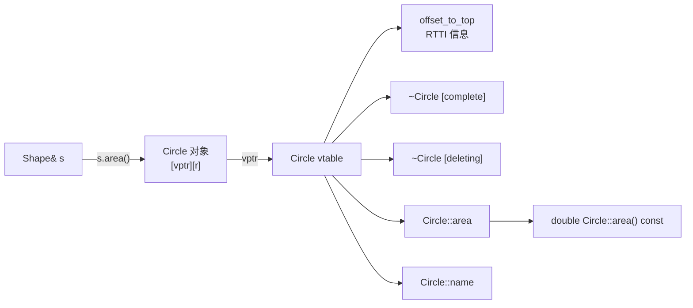
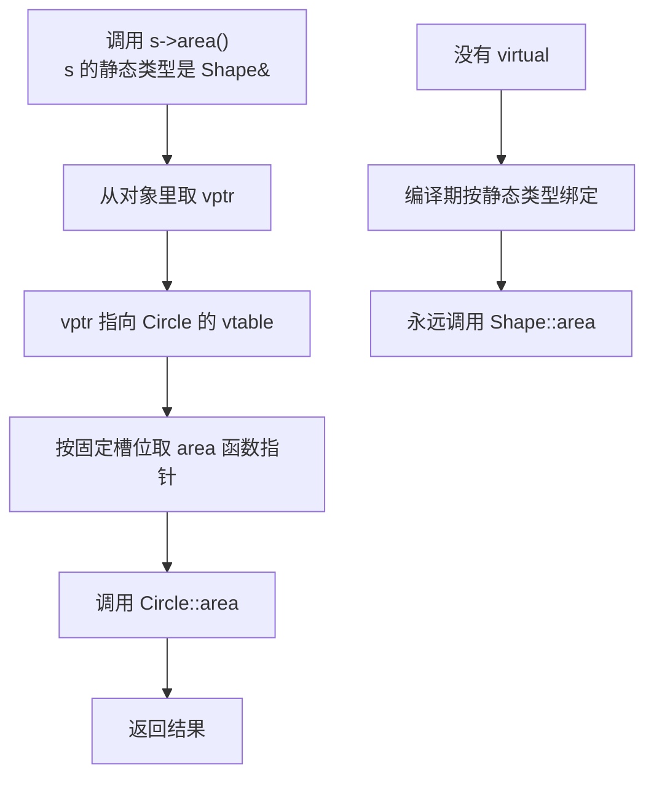

# C++ 虚函数：一张 vtable 背后的点菜流程

> 本文基于 C++23，编译器 Apple Clang 21.0.0（macOS arm64）。虚函数从 C++98 就有；`override` 和 `final` 从 C++11 开始；`std::variant` 从 C++17 开始。vtable 是主流编译器的实现方式，不是 C++ 标准强制规定的对象布局。

在餐厅点菜时，你对着菜单说“来一份招牌菜”。服务员不需要知道今天掌勺的是哪位厨师，也不需要知道这道菜具体怎么做——他只需要按菜单上的编号把单子递到后厨窗口。

C++ 的虚函数就是这张菜单。调用方通过基类接口说“执行 `area()`”，运行时才根据对象的真实类型，找到对应那份实现。**调用方只依赖菜单，不依赖后厨。**

```cpp
// 需要 <cstdio>、<memory>、<vector>
struct Shape {
    virtual ~Shape() = default;
    virtual double area() const = 0;
    virtual const char* name() const = 0;
};

struct Circle : Shape {
    double r;
    explicit Circle(double r) : r(r) {}
    double area() const override { return 3.14159 * r * r; }
    const char* name() const override { return "Circle"; }
};

struct Square : Shape {
    double side;
    explicit Square(double s) : side(s) {}
    double area() const override { return side * side; }
    const char* name() const override { return "Square"; }
};

void report(const Shape& s) {
    std::printf("%s: %.2f\n", s.name(), s.area());
}

int main() {
    std::vector<std::unique_ptr<Shape>> shapes;
    shapes.push_back(std::make_unique<Circle>(2));
    shapes.push_back(std::make_unique<Square>(3));
    for (const auto& s : shapes) {
        report(*s);
    }
}
```

```text
Circle: 12.57
Square: 9.00
```

`report` 只认识 `Shape&`，但它能正确调用 `Circle::area` 和 `Square::area`。这不是编译期决定的——`report` 在编译时不知道 `s` 指向哪种形状，它只知道“`Shape` 的 vtable 第几个槽位是 `area`”。真正的函数地址，要等运行时从对象的 vtable 里取。

## 没有 virtual 会发生什么

把 `virtual` 去掉：

```cpp
struct Shape {
    double area() const { return 0; }
};

struct Circle : Shape {
    double area() const { return 1; }
};

void report(const Shape& s) {
    std::printf("%.1f\n", s.area());
}

int main() {
    Circle c;
    report(c);
}
```

```text
0.0
```

输出不是 `1.0`。因为 `s` 的静态类型是 `Shape`，`Shape::area` 不是虚函数，编译器在编译期就决定了调用 `Shape::area`。`Circle` 里那个同名的 `area` 只是**隐藏（hiding）**了基类版本，不是重写（override）。

这就是为什么需要虚函数：**编译期决定调用哪份代码，叫静态绑定；运行期根据对象真实类型决定，叫动态绑定。**

## override 和 final

```cpp
struct Circle : Shape {
    double area() const override { ... }
};
```

`override` 不改变语义，它只是让编译器检查：这个函数是否真的重写了基类的虚函数。如果基类签名改了，而派生类忘了同步，编译器会直接报错：

```text
error: 'area' marked 'override' but does not override any member functions
```

没有 `override` 时，签名差一个 `const`、参数类型差一点，都会变成“定义了一个新函数”，而不是“重写失败”。这类 bug 运行时才暴露，而且看起来一切正常——直到你发现多态没生效。

`final` 表示“到此为止，不允许再重写”：

```cpp
struct Circle : Shape {
    double area() const override final { ... }
};
```

它有两个作用：一是语义约束，二是给编译器优化机会——编译器知道 `Circle::area` 不会再被覆盖，可以做去虚化（devirtualization）。

## vtable 到底长什么样

主流编译器（GCC、Clang、MSVC）对虚函数的实现思路类似：

- 每个**有虚函数的类**有一张 **vtable**（虚函数表），里面是按固定顺序排列的函数指针；
- 每个**该类的对象**里有一个隐藏的 **vptr**，指向这张表（通常放在对象起始位置）；
- 调用虚函数时，先通过 `vptr` 找到 vtable，再按槽位取出函数指针，最后间接调用。



用 Clang 可以把 vtable 布局打印出来：

```bash
$ clang++ -std=c++23 -Xclang -fdump-vtable-layouts -c virtual.cpp -o /dev/null
```

输出里与 `Shape`、`Circle` 相关的部分（节选）：

```text
Vtable for 'Shape' (6 entries).
   0 | offset_to_top (0)
   1 | Shape RTTI
       -- (Shape, 0) vtable address --
   2 | Shape::~Shape() [complete]
   3 | Shape::~Shape() [deleting]
   4 | double Shape::area() const [pure]
   5 | const char *Shape::name() const [pure]

Vtable for 'Circle' (6 entries).
   0 | offset_to_top (0)
   1 | Circle RTTI
       -- (Circle, 0) vtable address --
       -- (Shape, 0) vtable address --
   2 | Circle::~Circle() [complete]
   3 | Circle::~Circle() [deleting]
   4 | double Circle::area() const
   5 | const char *Circle::name() const
```

几个容易忽略的细节：

- **第 0 项 `offset_to_top`**：用于多重继承/虚继承时调整 `this` 指针，把当前子对象的地址换算成完整对象的地址。
- **第 1 项 RTTI**：指向 `type_info`，`dynamic_cast` 和 `typeid` 靠它工作。开 `-fno-rtti` 会禁用 `dynamic_cast`/`typeid`，实现可能不再生成 `type_info` 对象；但 vtable 的这个槽位通常仍按 ABI 保留，可能是一个空指针。
- **两个析构函数条目**：`complete` 是完整对象析构，`deleting` 是“析构 + `operator delete`”。删除一个多态对象时，编译器需要根据最派生类型选择正确的析构和释放方式，所以需要两个入口。
- **`[pure]`**：纯虚函数在基类 vtable 里占位，通常指向一个 `__cxa_pure_virtual` 之类的函数。如果通过基类指针调用到它（比如在基类构造函数里），通常直接终止程序。

这也解释了为什么**对象里会多一个指针**：`Circle` 对象不仅有 `double r`，还有一个隐藏的 `vptr`。在 64 位平台上，一个空的但有虚函数的类通常是 8 字节；没有虚函数时通常是 1 字节（空类占位）。

## 虚调用的成本

虚函数不是“免费多态”，但也没有传说中那么慢。成本主要来自三处：

1. **间接调用**：编译器不能像普通函数那样直接跳到固定地址，需要先从 vtable 读函数指针。这通常意味着一次额外的内存访问。
2. **难以内联**：编译器不知道运行时到底调用哪个函数，无法把函数体内联到调用点；除非它能证明动态类型（比如对象是局部变量、类型是 `final`，或者 LTO 做了去虚化）。
3. **对象变大**：每个对象多一个 `vptr`。对象数量大时，内存占用和缓存压力都会增加。

但在现代 CPU 上，间接调用的分支预测通常很准（同一个调用点反复调用同一种类型时），真正的性能问题往往出现在“虚调用阻止了内联和后续优化”，而不是间接跳转本身。

几个实践建议：

- 热路径上，如果类型集合固定，考虑 `std::variant` + `std::visit` 或 CRTP，把运行期分发变成编译期分发。
- 给不会再被继承的类/函数加 `final`，帮助编译器去虚化。
- 不要把虚函数当成“默认设计”。只有确实需要“通过基类接口操作未知派生类型”时才用。
- 虚函数调用本身通常不是瓶颈，先 profile 再优化。

## 虚析构函数：删除基类指针时必须 virtual

```cpp
struct Base {
    virtual ~Base() { std::puts("~Base"); }
};

struct Derived : Base {
    ~Derived() override { std::puts("~Derived"); }
};

int main() {
    Base* p = new Derived;
    delete p;
}
```

```text
~Derived
~Base
```

如果基类析构函数不是虚函数：

```cpp
struct Base {
    ~Base() { std::puts("~Base"); }   // 没有 virtual
};
```

同样的 `delete p`，在 Apple Clang 21 上的输出是：

```text
~Base
```

`~Derived` 没有被调用。标准上这是**未定义行为**：通过基类指针删除派生类对象，而基类析构函数非虚，行为未定义。实际表现可能是“只调用基类析构”，也可能是崩溃、内存破坏，取决于对象布局和分配器。

更隐蔽的是资源泄漏：`Derived` 持有的 `std::string`、`std::vector`、文件句柄都不会被释放，因为 `~Derived` 根本没执行。这不会立刻崩，但会在长时间运行的服务里慢慢吃光内存。

规则很简单：**只要一个类可能被继承，并且可能通过基类指针删除，基类析构函数就必须是虚函数。** 现代写法：

```cpp
class Base {
public:
    virtual ~Base() = default;
    virtual void run() = 0;
};
```

代价是每个对象多一个 `vptr`，以及一次间接的析构调用。和“删除时行为未定义”相比，这个代价几乎可以忽略。

## 对象切片：多态被“切掉”了

```cpp
struct Named {
    virtual ~Named() = default;
    virtual const char* who() const { return "Named"; }
};

struct Person : Named {
    const char* who() const override { return "Person"; }
};

void greet(Named n) {          // 按值传参：拷贝的是 Named 部分
    std::printf("%s\n", n.who());
}

int main() {
    Person p;
    greet(p);
}
```

```text
Named
```

`greet` 的参数是 `Named` 值类型。传入 `Person` 时，编译器只拷贝 `Named` 子对象，`Person` 那部分被“切掉”了。于是 `n` 的真实类型就是 `Named`，虚调用自然调到 `Named::who`。

这就是**对象切片（object slicing）**。它不会报错，看起来也合理，但多态完全失效。避免方法：

```cpp
void greet(const Named& n);   // 引用：保留动态类型
void greet(const Named* n);   // 指针：保留动态类型
```

只要多态参与，基类就尽量不要按值传递。按值传递不仅切片，还会产生一次拷贝，对多态类型几乎没有好处。

## 构造/析构期间的虚函数

在基类构造函数里调用虚函数，不会调到派生类的重写版本：

```cpp
struct Base {
    Base() { who(); }             // 这里调用的是 Base::who
    virtual void who() const { std::puts("Base"); }
};

struct Derived : Base {
    void who() const override { std::puts("Derived"); }
};
```

创建 `Derived` 时，先执行 `Base` 构造函数。此时派生类部分还没构造，对象的动态类型是 `Base`，所以 `who()` 调到 `Base::who`。析构时同理：派生类部分已经销毁，动态类型退回 `Base`。

如果在构造函数/析构函数里调用**纯虚函数**，标准上是未定义行为。常见实现会把基类 vtable 里那一项指向 `__cxa_pure_virtual` 之类的兜底函数，运行时打印错误并终止（libc++abi 常见的是 “Pure virtual function called!” 后 abort，libstdc++ 可能走 `std::terminate`），但这只是实现行为，不是语言保证。

这不是编译器 bug，而是构造/析构期间动态类型受限的结果：**不要在对象还没完整构造或已经开始销毁时，假设派生类部分可用。** 需要“构造完成后执行”的逻辑，用工厂函数、两段式初始化，或者把初始化逻辑放到派生类构造函数体里。

## 运行期多态的替代方案

虚函数不是实现多态的唯一方式。根据场景，还有几种选择：

### 1. std::variant + std::visit（封闭类型集合）

```cpp
// 需要 <variant>
struct ValueCircle {
    double r;
    double area() const { return 3.14159 * r * r; }
};

struct ValueSquare {
    double side;
    double area() const { return side * side; }
};

using AnyShape = std::variant<ValueCircle, ValueSquare>;

double area(const AnyShape& s) {
    return std::visit([](const auto& x) { return x.area(); }, s);
}
```

这里的 `ValueCircle`/`ValueSquare` 故意不继承 `Shape`，所以 alternative 本身没有 vptr。优点是值语义清晰、编译期可以穷举检查；缺点是类型集合必须提前确定，开放扩展（插件式新增类型）不方便。如果 alternative 本身带虚函数，`std::variant` 仍然会带着它们的 vptr 和虚调用，只是 `visit` 这一层的分发不走 vtable。

### 2. CRTP（静态多态）

```cpp
template <typename Derived>
struct StaticShape {
    double area() const {
        return static_cast<const Derived*>(this)->area_impl();
    }
};

struct StaticCircle : StaticShape<StaticCircle> {
    double area_impl() const { return 3.14; }
};
```

没有虚函数、没有 vptr，调用在编译期内联；缺点是基类不能作为统一的运行时类型，不能放进 `vector<Shape*>`，代码也会因为每个派生类实例化一份而膨胀。

### 3. 类型擦除（std::function、std::any、自定义接口）

`std::function` 是典型的类型擦除：调用方只看到统一的函数签名，内部用虚函数/函数指针保存具体可调用对象。它把多态隐藏在库的实现里，适合回调、任务队列等场景。

| 方案 | 分发时机 | 扩展性 | 开销 | 适用场景 |
|------|---------|--------|------|---------|
| 虚函数 | 运行期 | 开放（新增派生类） | vptr + 间接调用 | 插件、异构对象集合 |
| `std::variant` | 运行期（visit） | 封闭（类型集合固定） | 无额外 vptr（前提是 alternative 不带虚函数），可能有分支 | 协议消息、有限状态 |
| CRTP | 编译期 | 开放（新增派生类） | 零运行时开销 | 热路径、数学库 |
| 类型擦除 | 运行期 | 开放 | 间接调用/分配 | 回调、跨模块接口 |

## 一张图总结



## 收尾

虚函数解决的是“**调用方只知道基类接口，运行时才确定具体类型**”这个问题。它的实现依赖 vtable/vptr，但这是编译器的实现细节，不是语言规范的一部分。你需要记住的是行为，而不是布局：

- 通过基类指针/引用调用虚函数，才会发生动态绑定；按值传递会切片。
- 基类析构函数必须是虚函数，否则通过基类指针删除派生类对象是未定义行为。
- `override` 让编译器帮你检查重写，`final` 帮助去虚化。
- 构造/析构期间，动态类型是当前构造/析构的类，不要依赖派生类部分。
- 封闭类型集合优先考虑 `std::variant`，热路径考虑 CRTP，虚函数适合开放扩展。

菜单和后厨分开，餐厅才能换厨师而不改菜单；接口和实现分开，代码才能换实现而不改调用方。虚函数就是 C++ 里实现这件事的标准工具——只是要记住，菜单背后的那张电话簿，也是有成本的。

---

**相关文章**

- [C++ RAII：让析构函数替你收拾房间](raii.md)
- [C++ 模板与 Concepts：给模具贴上规格说明](templates-concepts.md)
- [C++ 智能指针：所有权账本](smart-pointers.md)
