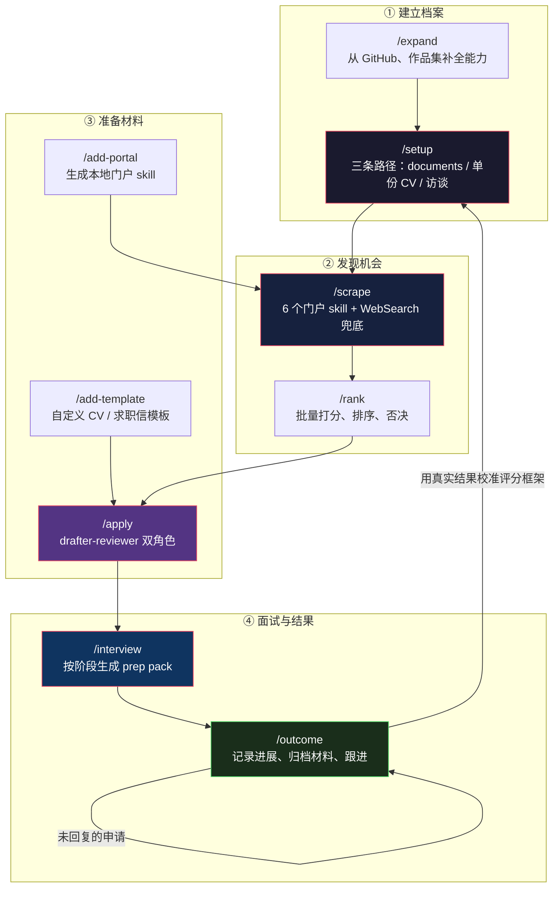
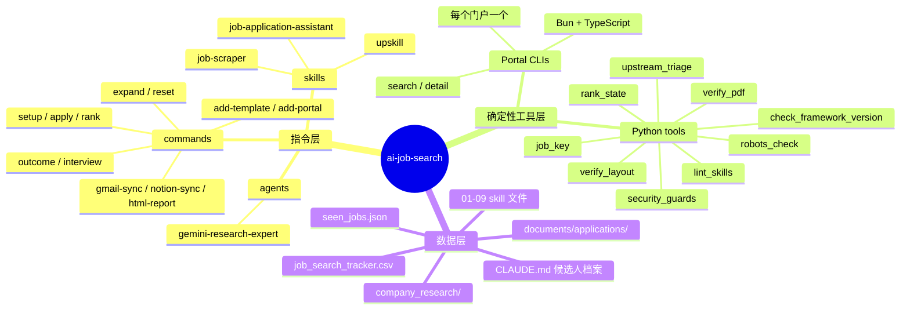

# （一）架构全景——把 Claude Code 当应用框架

> 本文基于 `MadsLorentzen/ai-job-search` 的 `master` 分支，commit `0f6480d`（2026-10-18，v1.7.2 之后）。
> 该仓库以 Claude Code 为参考运行时；文中不涉及具体 Claude Code 版本。

## 先说结论

第一次打开这个仓库，很容易把它当成"一堆 prompt 模板"。但它其实更像一个**应用**：

- 有**数据库**：`job_search_tracker.csv`、`job_scraper/seen_jobs.json`
- 有**业务逻辑**：`/apply` 的评分、筛选、裁剪规则
- 有**结果校验**：PDF 页数、文本层、版面空洞
- 有**安全边界**：权限白名单、`.gitignore` 不变量、`robots.txt` 门禁
- 有**发布管理**：`framework_version`、CHANGELOG、上游同步
- 有**迁移路径**：fork 后运行 `/setup` 把占位符换成人

区别只在于：**它的"运行时"是 LLM，"代码"是 Markdown。**

作者 Mads Lorentzen 是地球物理出身，2025 年底被裁后写了这套东西跑自己的求职——69 份定制申请、20 个一面、最后拿到 offer。README 里写得很直白："It got me hired. Now it's yours."

## 一、它不是 SaaS，是一个 fork 模板

这一点决定了整个架构。`CONTRIBUTING.md` 开篇只有一条规则：

> **This repo is a universal template.** People fork it and adapt it to their own market, language, and profile. Upstream stays market-agnostic, person-agnostic, and Claude Code-native.

于是所有设计都从这条规则推出来：

| 决策 | 因为要当模板 |
|------|-------------|
| `CLAUDE.md` 里全是 `[YOUR_NAME]` 之类的占位符 | 个人信息不能进 upstream |
| CI 有 `placeholder-integrity` job | 防止有人把真实信息 PR 回来 |
| 丹麦的四个招聘门户默认 `enabled: false` | 别让别的国家的人一上来就跑丹麦站点 |
| 市场专属的 portal skill 只进 fork，不进 upstream | "one country's portal opens the door to every country's portal" |
| `/add-portal` 是通用功能，生成的 skill 是你自己的 | 生成器通用，产物市场专属 |
| `/setup` 先检查 `origin` 是不是公开 fork | 别把简历 push 到人人可见的地方 |

这里有个反直觉的点：**模板越通用，越要主动拒绝需求。** 仓库用 `.out-of-scope/`、`CONTRIBUTING.md` 的"什么会被拒"、以及 `upstream_triage.py` 的 skip 分类，把"不做"写成了可执行的边界。第 9 篇会专门讲这套治理。

## 二、完整生命周期

12 个 slash command 不是平铺的功能列表，而是一个**带反馈回路的生命周期**：



注意右下角那条回边：`/outcome` 记录的真实结果，会被 `/setup` Path A 读回去校准 `04-job-evaluation.md`。`CONTRIBUTING.md` 把这条链路称为 "feature-complete"：

> The core lifecycle is **feature-complete**: `/setup` → `/scrape` → `/rank` → `/apply` → `/interview` → `/outcome` → calibration back into `/setup`

这个回边是个很强的设计：求职框架最怕的是**用错误的评分标准筛掉本该投的岗位**。让真实面试结果反向修正权重，比任何静态 rubric 都更接近现实。

## 三、三层结构

从"谁在干活"的角度看，仓库分成三层：



三层的边界很清晰：

| 层 | 负责 | 不负责 |
|----|------|--------|
| 指令层（Markdown） | 判断、撰写、研究、协商 | 精确计算、状态读写、外部校验 |
| 工具层（Python/TS） | 状态选择与写回、去重键、版面测量、robots 判定、权限审计 | 评分、写文案、做取舍 |
| 数据层 | 唯一事实来源 | 逻辑 |

最值得学的是**工具层替指令层挡掉了什么**。后面会看到几个例子：

- `rank_state.py` 让 `/rank` 永远不用把几千条 `seen_jobs.json` 读进上下文
- `job_key.py` 让去重键变成一个纯函数，而不是每次运行各自 slugify
- `verify_layout.py` 把"看起来没问题"变成可测量的版面断言
- `robots_check.py` 把"这个站点允许吗"变成一个退出码

`CONTRIBUTING.md` 对新命令的要求，几乎就是这条边界的定义：

> **does it operationalize something error-prone that already exists in the framework** (documented machinery nothing executes, data something writes but nothing reads)?

翻译：新命令要么让"写在文档里但没人执行"的规则变成可执行检查，要么让"有人写、没人读"的数据被消费掉。**"有用"和"能做"都不够。**

## 四、状态存在哪里

这套框架有四个持久化位置，各有明确的所有者：

| 位置 | 内容 | 谁写 | 谁读 |
|------|------|------|------|
| `CLAUDE.md` + `.claude/skills/job-application-assistant/01-*.md` 等 | 候选人事实 | `/setup`、`/apply` 的 standing rule | 所有命令 |
| `job_search_tracker.csv` | 每份申请的进度 | `/apply` Step 6b、`/outcome` | `/scrape`、`/rank`、`/upskill`、`/html-report`、`/notion-sync` |
| `job_scraper/seen_jobs.json` | 见过的所有职位（只追加） | `/scrape`、`/rank`（通过工具） | `/rank`、`/upskill` |
| `documents/applications/<company>_<role>/` | 投出去的原始材料 | `/apply`、`/outcome` | `/interview`、`/setup` Path A |

两条纪律贯穿始终：

1. **`seen_jobs.json` 只通过 `rank_state.py` 读写，从不进对话。** `/rank` 的规则第 5 条写得很清楚："State moves through the tool, not the context."
2. **归档的版本就是投出去的版本。** `/outcome` 归档已存在的文件时永远不覆盖——"the archived version is what was actually submitted"。

## 五、为什么 Markdown 就是实现

`CONTRIBUTING.md` 拒绝"替代运行时移植"时给的理由，我认为是整个仓库最重要的架构判断：

> The markdown specs ARE the implementation; a second copy (another agent CLI, an orchestration layer, a wrapper command) drifts from the first the moment either changes.

如果把指令再包一层（比如写个 Python 编排器去调用各个 prompt），就出现了两份"实现"。两份实现一定会漂移，而漂移后的 bug 比原来难查得多——这正是 README 批评 GSD / BMAD / Spec-Kit 的地方：

> 它们在接管流程的同时，也拿走了你的控制权，并让流程里的 bug 更难解决。

所以这个仓库的选择是：**用最少的中间层，让 LLM 直接读规则。** 代价是 token 成本高、行为不完全确定；收益是改一条规则只需要改一个 Markdown 文件，而且改动能被一个普通开发者读懂。

这不是"prompt engineering"，更像**把业务规则写成可执行文档**。

## 六、优秀代码：一条为"沉默丢失"设计的规则

按本系列惯例，每篇拆一段值得复用的源码。第 1 篇选一段**不是代码的代码**——`apply.md` 开头那条 standing rule（`.claude/commands/apply.md:7-11`）：

```markdown
**Standing rule — write new facts back to the profile.** If the user confirms, corrects or supplies a fact that is not already in `01-candidate-profile.md` — a metric, a project detail, a skill, a scope correction — update that file in the same turn. Do not leave it living only in the conversation or in a draft.

This is not bookkeeping. A fact that exists only in chat **will be treated as unsupported by a later session and stripped from drafts as a fabrication.** Anything absent from the sources does not exist as far as future drafting is concerned, and the loss is silent — a real achievement quietly disappears from every subsequent CV.
```

### 好在哪里

大部分 prompt 会写"请记住用户的偏好"。这条规则写的是**失败模式**：

- 事实只存在于对话里 → 下一次会话的 grounding audit 会把它当成编造 → 从草稿中删除
- 删除是**静默**的，用户不会收到任何报错

于是规则给出了动作：**在同一轮里写回 `01-candidate-profile.md`**。而且解释了为什么是那个文件——它是 audit 的三个事实来源之一，写进去就"grounded"了。

这是把"LLM 的记忆不可靠"这个模糊问题，转化成了一个可检查的文件写入动作。

### 模式

**Compensating write / write-through cache**：对话是易失缓存，profile 文件是持久存储；缓存里产生的新值必须立刻写穿到持久层，否则下一次读取会 miss，而 miss 的表现不是报错，是"当成不存在"。

### 骨架代码

```markdown
**Standing rule — persist new facts.** If the user confirms or corrects a fact
that is not already in <SOURCE_OF_TRUTH>, write it there in the same turn.

Why: a fact that lives only in chat is indistinguishable, in a later session,
from a fabrication — and it will be silently dropped. Absence from the source
is treated as "does not exist".
```

任何"LLM 会话 + 持久化事实源"的系统都能直接用：客服知识库、代码库约定、医疗记录摘要……凡是有 grounding audit 的地方，都需要这条写穿规则。

## 七、优缺点

| 维度 | 评价 |
|------|------|
| **可读性** | 极好。规则是 Markdown，产品经理也能改 |
| **可测试性** | 分层做得好。确定性部分（Python/TS）有 52 个测试文件；LLM 行为靠 checklist 和 golden 文档约束 |
| **可移植性** | 门户 skill 用通用 Agent Skills 格式，Codex / Antigravity 能直接发现；但命令树绑定 Claude Code |
| **成本** | 每次 `/apply` 要读多份 skill 文件 + 编译 PDF + 视觉检查，token 和 wall-clock 都不低 |
| **确定性** | 评分、排序、日期、去重都有工具兜底；文案质量仍然取决于模型和 profile 深度 |
| **fork 维护** | upstream 快速演进，fork 会漂移。仓库用 `framework_version` 和 triage 工具缓解，但最终仍要人手合并 |

最大的风险其实不在技术，而在**数据**：这套东西会把你的完整履历、投递记录、面试反馈集中在一个目录里。仓库对此的处理（`.gitignore` 不变量、`/setup` 的公开 fork 警告、`/notion-sync` 只同步文件名）会在第 8 篇展开。

## 总结

| 问题 | 这个仓库的答案 |
|------|---------------|
| 应用框架的"代码"是什么 | Markdown 指令 + 确定性工具 |
| 状态放哪 | 四个明确所有者的持久化位置 |
| LLM 的自由裁量权怎么收窄 | 把易错逻辑移进 Python/TS，把判断留给模型 |
| 怎么防止规则腐烂 | CI 把不变量变成检查（版本、权限、placeholder） |
| 怎么当模板又不失控 | 主动定义"不做什么"，market-specific 留在 fork |
| 怎么让框架越用越准 | `/outcome` 的真实结果回流校准 `/setup` |

下一篇从最外层开始：12 个 slash command 是怎么分工的，以及为什么 `/scrape` 和 `/upskill` 是 skill 而不是 command。
