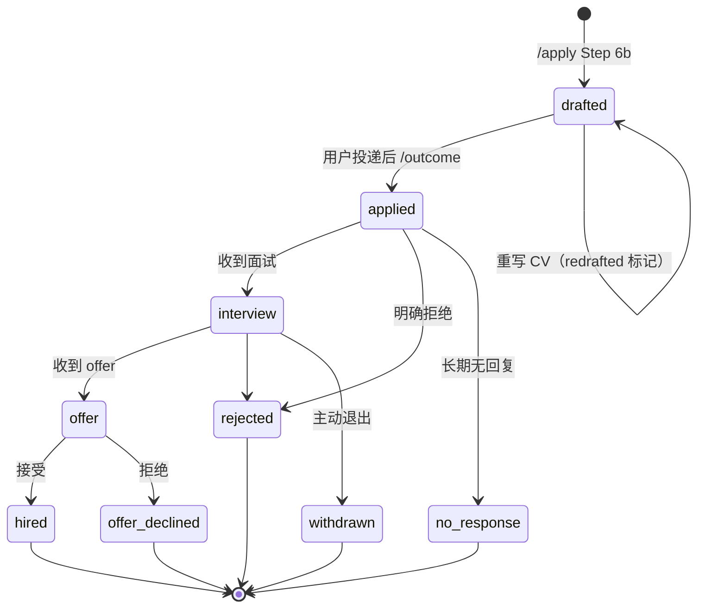

# （二）命令的设计学——12 个 slash command 如何覆盖一条求职链路

> 本文基于 commit `0f6480d`。所有行号以该 commit 为准。

## 先看清单

仓库里有 12 个 command 文件、3 个 skill、1 个 agent。加起来 2,812 行 command + 2,102 行 skill —— 这就是"应用逻辑"的全部。

| Command | 行数 | 角色 | 关键产出 |
|---------|-----:|------|---------|
| `/setup` | 441 | 入职 | 把占位符换成人 |
| `/apply` | 418 | 核心 | 一份定制 CV + 求职信 |
| `/reset` | 308 | 维护 | 清空个人信息 |
| `/outcome` | 243 | 闭环 | 进度与结果归档 |
| `/expand` | 230 | 补全 | 从公开来源补能力 |
| `/rank` | 209 | 分诊 | 批量评分排序 |
| `/add-template` | 203 | 扩展 | 注册自定义模板 |
| `/gmail-sync` | 194 | 自动化 | 从邮件推断状态 |
| `/add-portal` | 160 | 扩展 | 生成本地门户 skill |
| `/notion-sync` | 149 | 发布 | 单向同步到 Notion |
| `/html-report` | 146 | 可视化 | 离线 dashboard |
| `/interview` | 111 | 准备 | 分阶段 prep pack |

另外两个"像命令的 skill"：

- **`/scrape`**（`job-scraper/SKILL.md`，294 行）—— 门户搜索编排
- **`/upskill`**（`upskill/SKILL.md`，256 行）—— 技能差距分析

## 一、为什么有的叫 command，有的叫 skill

这不是随意分类，而是**调用方式**的差别：

| | Command | Skill |
|---|---|---|
| 触发 | 用户输入 `/name` | 用户或模型都可以触发 |
| 形态 | `.claude/commands/*.md` | `.claude/skills/*/SKILL.md` |
| 元数据 | 无 frontmatter | 有 `name` / `description` / `allowed-tools` |
| 典型 | 有明确入口的动作 | 需要在对话中被"想到"的能力 |

`/scrape` 的 description 里塞满了触发短语：

```yaml
description: >
  Finds new job postings matching your profile via installed portal-search CLIs
  (LinkedIn, local job boards, and any skills added with /add-portal). Deduplicates
  across runs. Triggers on: job scrape, find jobs, search jobs, new jobs, job search,
  scrape jobs, /scrape
```

用户说"帮我找找工作"，模型就能主动触发它。而 `/apply` 这种会写文件、编译 PDF、调用外部工具的重动作，必须由用户显式输入——`disable-model-invocation` 的另一种等价设计。

`lint_skills.py` 把 command 的结构约束变成了检查（`tools/lint_skills.py:73-78`）：

```python
def check_command(path: Path) -> None:
    lines = path.read_text(encoding="utf-8").lstrip().splitlines()
    first = lines[0] if lines else ""
    if not first.startswith("# /"):
        errors.append(f"{rel(path)}: command file must start with a '# /<name>' title (found: {first[:50]!r})")
```

看起来只是标题格式，实际是在保证**命令集合可被发现、可被索引**。CI 里这个检查挂了，说明有人加了一个模型和人都找不到入口的文件。

## 二、每个命令都是一份"带前置条件的状态机"

求职不是一条直线，而是一组状态迁移。仓库把它写进了一个 CSV 的 `status` 列，并给每个状态值下了严格定义（`.claude/commands/outcome.md:48-57`）：

```markdown
## Tracker status vocabulary

Canonical spellings for the tracker CSV `status` column (underscores, never spaces):

`drafted` | `applied` | `interview` | `offer` | `hired` | `rejected` | `no_response` | `offer_declined` | `withdrawn`

- **Final** (application closed): `hired`, `rejected`, `no_response`, `offer_declined`, `withdrawn`
- **Open**: everything else, `drafted` included — a row is active until its status is one of the **Final** values.
- **`drafted`** is open but distinct — nothing was sent, so no follow-up is ever due.
- Readers must also accept the legacy space spellings `no response` and `offer declined` on read...
```

这段定义解决了三类很容易出 bug 的问题：

1. **"最终状态"没有歧义**——`/apply` Append 新行时，如果公司+岗位已存在且是 final，就追加而不是覆盖（"a closed application never gets its row overwritten"）。
2. **`drafted` 不算静默期**——没投出去，就没人欠你回复。所以 `/outcome` 的跟进分支永远不会追 `drafted`。
3. **旧数据可读**——历史上用过空格拼写，读的时候兼容，写的时候永远写新拼写。

状态图：



注意 `drafted` 的自环：`/apply` 对一条仍开放的记录重新起草时，只刷新文件路径和评分，**状态不动**，只在 `notes` 里追加一个无日期的 `redrafted` 标记。为什么无日期？因为 `/outcome` 把"最新带日期的 note"当作最后一次联系雇主的时间，重写 CV 不算联系。

## 三、命令之间的三条隔离带

### 隔离带 1：scrape / rank / apply 的深度不同

| 命令 | 做什么 | 明确不做 |
|------|--------|---------|
| `/scrape` | 找职位、去重、快速 fit 判断 | 不做完整评估、不研究公司 |
| `/rank` | 批量打分、排序、否决 | 不做公司研究、不查薪资、不用 reviewer |
| `/apply` | 单岗深评、起草、审稿、编译 | 不从标题猜测职位内容 |

原因写在 `/rank` 开头：

> `/rank` produces **triage scores**, not final evaluations. It scores from the posting text and the candidate profile only - no company research, no reviewer agent. `/apply`'s Step 1 evaluation (which adds company research) remains authoritative and always re-runs when the user applies.

这是一个很实用的成本设计：**分诊要便宜到能每批都跑，深评才值得花 token。**

### 隔离带 2：状态文件不进上下文

`/rank` 的第一条执行规则不是"读状态"，而是"别读状态"（`.claude/commands/rank.md:27`）：

> Never read `job_scraper/seen_jobs.json` into the conversation. It holds every job the workspace has ever seen - most of it `skipped` - while a run only ever touches the handful of entries being scored, so a manual read costs the whole backlog on every run and grows for the life of the workspace. Selecting candidates is a query, so run the query:

```bash
python3 tools/rank_state.py candidates --limit 10
```

这个决定直接催生了 `rank_state.py`（第 6 篇细讲）。它把"筛选候选"从模型的眼里移走，只投影出 `key/title/company/url/portal/deadline/posted_date` 七个字段。

### 隔离带 3：命令只写自己拥有的数据

`/outcome` 的规则第 1 条：

> **Write data, don't interpret it.** The archive and tracker are the outputs; calibration belongs to `/setup`. This command never edits profile or framework files.

于是职责非常清楚：

- `/outcome` 写 tracker 和 archive
- `/setup` 读 archive，校准 `04-job-evaluation.md`
- `/apply` 写 CV/求职信，写 tracker 的一行
- `/scrape` 写 `seen_jobs.json`
- `/rank` 通过工具改 `seen_jobs.json`，**不碰 tracker**

每份数据只有一个写者，读的人可以有很多。这避免了"两个命令都想更新同一行"的竞态。

## 四、Token 预算被写成了硬规则

`/apply` 开头有一组 token 效率规则（`.claude/commands/apply.md:13-17`）：

```markdown
**Token-efficiency rules for this workflow:**
- Never re-Read a file whose contents are already in your context from an earlier step. If you read it in Step 1, it is still available in Step 2.
- When dispatching the reviewer agent, pass draft content **inline in the agent prompt** rather than asking the agent to Read files you already have in memory.
- Run the full verification checklist exactly once, at the end (Step 6). The reviewer focuses on content critique, not verification.
- Step 5 (compile and inspect PDFs) is mandatory and non-skippable...
```

这四条对应四种常见的浪费：

| 规则 | 防止的浪费 |
|------|-----------|
| 不重读已读文件 | 同一份 profile 在一次运行里被读 3 遍 |
| 草稿内联传给 reviewer | reviewer 重新 Read 两个文件（而且可能读到过期版本） |
| checklist 只跑一次 | drafter 和 reviewer 各跑一遍完整校验 |
| 编译步骤不可跳过 | 省 token 省出坏 PDF，返工更贵 |

最后一条很有意思：它**主动承认**了 token 成本与正确性的权衡。

> Note: the new compile-and-inspect step in Step 5 spends some of those savings on PDF rendering and layout iteration — the workflow trades some end-to-end token cost for a real reduction in broken PDFs reaching the user.

翻译：省下来的 token 拿去换"不发出坏 PDF"了。这不是矛盾，是明确的价值排序。

## 五、优秀代码：命令契约与工具契约的交叉校验

这里选一个不显眼但很值得学的设计：**spec 和 tool 之间的防漂移测试**。

`tools/rank_state.py:62-65`：

```python
# The statuses a /rank scoring agent may return (rank.md Step 2). This module
# owns the set; tests/test_rank_command.py asserts rank.md's JSON contract
# names exactly these, so the spec and the tool cannot drift apart.
AGENT_STATUSES = ("scored", "expired", "unreachable")
```

注释说得很清楚：`rank_state.py` 拥有这个集合，测试负责断言 `rank.md` 里的 JSON 契约与它**完全一致**。

### 好在哪里

LLM 应用里最常见的腐烂方式是：**prompt 里说可以返回 A/B/C，解析器只认 A/B。** 模型返回 C 时，解析器要么报错，要么静默丢弃，要么把它当默认值——三种都很难查。

这里把"谁拥有枚举"和"谁验证一致性"分开了：

- 运行时：`AGENT_STATUSES` 是唯一权威
- 测试时：解析 Markdown 里的契约，逐字比对
- 失败时：CI 挂，而不是线上静默

### 模式

**Contract test across representation boundaries**（跨表示层契约测试）。同一份语义有两种表示（Python 元组 / Markdown 代码块），用测试把两份表示钉在一起。

### 骨架代码

```python
# tool.py —— 运行时唯一权威
AGENT_STATUSES = ("scored", "expired", "unreachable")

# test_contract.py —— 断言文档里的契约与代码一致
def test_prompt_contract_matches_tool():
    prompt = Path("command.md").read_text()
    documented = extract_json_contract(prompt)["status"]
    assert set(documented) == set(AGENT_STATUSES)
```

只要是"LLM 按文档返回结构化数据"的系统，都该有这一层。否则你永远不知道是模型不听话，还是文档和代码早就分家了。

## 六、命令模板

把上面这些共性抽出来，一个新命令大致长这样：

```markdown
# /<name> - <一句话说明>

You are <角色>. `$ARGUMENTS` may contain <输入形态>.

Follow these steps **in order**.

## Step 0: Parse Input
- <每种输入形态的处理>
- <无法识别时怎么办：停止，而不是猜>

## Step 1: Load State
- 只读这一步需要的文件
- 大文件用工具查，不要读进上下文

## Step 2..N: Do the work
- 每步有明确的输入、输出、停止条件
- 危险动作前要求用户确认

## Important Rules
1. Never fabricate <本领域最危险的编造>.
2. <状态只由谁写>
3. <不可跳过的校验>
```

四条隐性约束，12 个命令都遵守了：

1. **有停止点**——`/apply` 在评估后停下来问"要不要继续"；`/scrape` 找不到就停止并提示先跑前置命令。
2. **有确认点**——`/reset` 要求输入 `RESET`；`/setup` Path A 的冲突逐条确认；`/outcome stale` 必须选 all/select/skip。
3. **有幂等性**——重复运行不会重复建行、重复建目录、重复追加历史。
4. **有"绝不"清单**——绝不编造职位、绝不编造经历、绝不自动发送跟进邮件。

## 总结

| 设计 | 解决什么 |
|------|---------|
| command vs skill 的区分 | 重动作要人触发，轻能力可被模型想到 |
| 状态词汇表 + 迁移规则 | 多命令读写同一状态时不打架 |
| 三条隔离带 | 成本、上下文、写权限各自独立 |
| token 规则写进 prompt | 让"省"和"对"的权衡显式化 |
| 契约测试 | 防止文档与解析器悄悄漂移 |
| 停止点 / 确认点 / 幂等 | 让自动化停在人该接手的地方 |

下一篇进入核心：`/apply` 到底是怎么把"写 CV"拆成一条 drafter-reviewer 流水线的。
