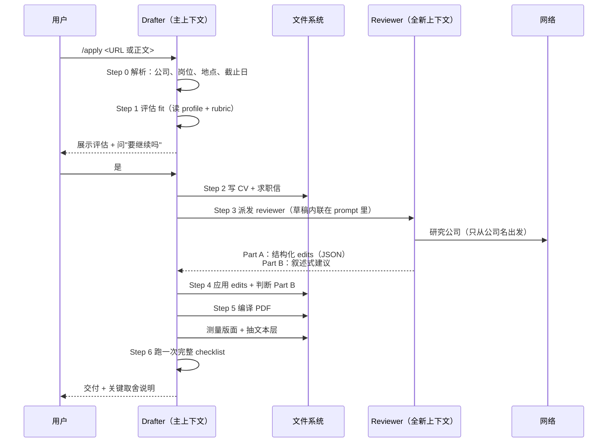
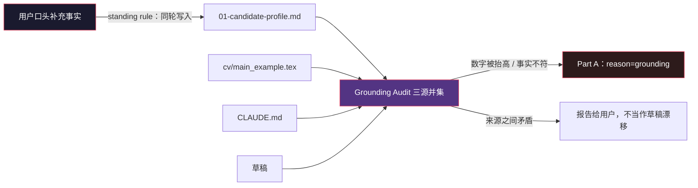

# （三）/apply 的 drafter-reviewer 流水线——为什么写 CV 要两个 Agent

> 本文基于 commit `0f6480d`，核心文件是 `.claude/commands/apply.md`（418 行）。

## 问题：一次成稿为什么不行

让一个模型读完 JD、简历和模板，直接写一份定制 CV，结果通常是"正确但平庸"：

- 关键词漏了一半
- 每段都在说"我擅长 X"，但没有具体证据
- 求职信开头永远是"我写这封信是为了申请……"
- 公司名一换，全文照样成立

原因不复杂：**写作和审稿是两种不同的注意力。** 写的时候关注"把事实组织成通顺的段落"，很难同时用挑剔的眼光看"这段到底有没有说服力"。

人类求职顾问的做法是分工：一个人写，另一个人挑刺，然后作者改。这个仓库把这条流水线显式化成了两个 Agent。

## 一、流水线全貌



三个关键点：

1. **Reviewer 是全新上下文**，所以它不会继承 drafter 的"我已经写得很好了"的先入为主。
2. **草稿内联传递**，而不是让 reviewer 去读文件——省 token，也避免读到半路被改过的版本。
3. **Verification 只在最后跑一次**，由 drafter 负责。reviewer 只做内容批评。

## 二、两个 Agent 的分工边界

`apply.md:131` 把 reviewer 的职责写得很窄：

```markdown
Use the **Agent tool** to spawn a `general-purpose` reviewer agent. The reviewer gets a fresh context, so pass the drafts **inline in the prompt** below (do not make the reviewer Read them). Scope the reviewer's file reads to content-critique essentials only — the reviewer does not need the template structure files (`05`, `06`) to critique content, since those govern structural/toolchain concerns the drafter already applied.
```

它明确**不让** reviewer 读模板文件。为什么？

因为模板文件（`05-cv-templates.md` / `06-cover-letter-templates.md`）讲的是 LaTeX 结构、字体、页数、`\needspace` 怎么用。这些是 drafter 已经执行过的**工具链细节**。让 reviewer 再读一遍，只会把它的注意力从"内容好不好"拉到"括号配平没有"——而后者有编译器和 `verify_pdf.py` 负责。

这就是边界：**reviewer 管内容，工具管形式，drafter 管整合。**

reviewer 读什么也有精确列表（`apply.md:154-163`）：

| 读 | 用途 |
|---|------|
| `01-candidate-profile.md` | 核对事实 |
| `02-behavioral-profile.md` | 检查求职信的语气是否像这个人 |
| `03-writing-style.md` | 检查文风 |
| `04-job-evaluation.md` | 检查是否回应了评分维度 |
| `cv/main_example.tex` | 事实基线 |
| `CLAUDE.md` | 事实基线 |
| **不读** `05` / `06` | 结构与工具链不属于内容批评 |

`02-behavioral-profile.md` 那一条特别值得注意：

> A "Collaborator" PI profile, for example, should not be given a combative, solo-hero tone; a "Persuader" profile should not be given over-hedged, apologetic phrasing.

它在防止一种很隐蔽的问题：**求职信写得很好，但不像本人。** 如果面试官读到的语气和候选人本人差太远，反而会减分。

## 三、反馈格式：机械修改 vs 判断性建议

Reviewer 的输出被强制分成两部分（`apply.md:186-206`）：

**Part A —— 结构化 edits**：

```json
{
  "file": "cv/main_<COMPANY>_<ROLE><CV_EXT>" | "cover_letters/cover_<COMPANY>_<ROLE><COVER_EXT>",
  "old_string": "<exact text currently in the draft>",
  "new_string": "<replacement text>",
  "reason": "<one-line rationale: keyword match / company angle / reframing / style / grounding>"
}
```

要求 `old_string` **逐字引用草稿**，并且唯一匹配。drafter 拿到后直接调用 `Edit`，不用重新读文件。

**Part B —— 叙述式建议**，固定四类：

- Missed keywords/requirements
- Company/department-specific angles
- Action-oriented reframing
- Tone and style issues

并且有一条反"静默跳过"的规则：

> Produce each category even if your finding is "no issues" — silence on a category can be mistaken for skipping it.

翻译：**没意见也要写"没意见"。** 否则 drafter 无法区分"reviewer 检查过且没问题"和"reviewer 忘了这一项"。

这个设计解决的是 LLM 协作里的一个经典问题：**空输出有歧义。** 人类同事说"没别的了"是一个明确信号；模型不输出某一节，你不知道它是判断为通过，还是根本没检查。

## 四、为什么有的建议必须是 JSON，有的必须是人话

这个拆分不是格式洁癖，而是**可机械应用性**的判断：

| 类型 | 适合的格式 | 例子 |
|------|-----------|------|
| 单句替换 | JSON edit | 把 "passionate about data" 换成 "built three production data pipelines" |
| 整段重构 | 叙述 | "开头段整段是被动的，围绕你最强的那条匹配重写" |
| 需要判断的取舍 | 叙述 | "这条经历是 stretch，保留、弱化还是删掉？" |

Drafter 的修订规则也对应两种处理（`apply.md:216-229`）：

1. **Part A 直接应用。** 因为 reviewer 引用的 `old_string` 和 drafter 手里的文本是同一份，不需要重读。
2. **Part B 逐类处理。** 需要理解、判断、甚至和用户确认。

这里有个很细的工程考虑：**Part A 的编辑是幂等、可验证的字符串操作；Part B 是语义操作。** 混在一起让模型自由发挥，就会出现"它说改好了，但其实改错了位置"。

## 五、Grounding Audit：三个事实来源

Reviewer 的第三项任务是事实核查（`apply.md:165-166`）：

```markdown
### 3. Factual Grounding Audit
Compare every date, employer, job title, and quantitative metric in both drafts against the union of three sources: `.claude/skills/job-application-assistant/01-candidate-profile.md` + the master CV baseline template (`cv/main_example.tex`) + `CLAUDE.md`'s Candidate Profile section. A claim is grounded if ANY of these sources supports it. Mismatches between these three sources themselves must be reported to the user as a profile-consistency warning rather than treated as draft drift. Draft mismatches must be flagged as Part A edits with `"reason": "grounding"` so they can be distinguished from style changes. Keep the tolerance honest: reframed emphasis is fine; changed facts and escalated numbers are not.
```

三个来源取**并集**，只要任一来源支持就算 grounded。这很重要：

- 如果三个来源本身互相矛盾（比如 CV 说 2020-2023，LinkedIn 说 2020-2024），那不是草稿的问题，要报告给用户
- 如果草稿里的数字**高于**三个来源中的任何一个，那是编造，必须改回
- 如果只是换了说法、调整了强调顺序，允许

`"reason": "grounding"` 这个字段让 drafter 能区分"风格建议"和"事实错误"。前者可以商量，后者必须无条件修。

再配合第 1 篇提到的那条 standing rule（用户口头提供的新事实要在同一轮写回 profile），整个链条就闭合了：



否则会出现一个很荒谬的循环：用户上周口头说过一个真实成就 → 没写进 profile → 这周 audit 判定为编造 → 从 CV 里删掉 → 用户发现成就消失了。第 1 篇那条规则就是为了堵这个洞。

## 六、优秀代码：Part A 的 `old_string` 契约

选一段 prompt 里的"接口设计"（`apply.md:188-198`）：

```markdown
**Part A — Structured edits (preferred format whenever possible):**
A JSON array of concrete edits the drafter can apply directly without re-reading the files. Each edit is an object:
```json
{
  "file": "...",
  "old_string": "<exact text currently in the draft>",
  "new_string": "<replacement text>",
  "reason": "<one-line rationale: keyword match / company angle / reframing / style / grounding>"
}
```
Only use this format when you can quote the exact `old_string` from the drafts above. Make `old_string` unique — include enough surrounding context so it matches exactly once per file.
```

### 好在哪里

它把"修改"变成了一个**可验证的操作**：

- `old_string` 必须来自 reviewer 看到的草稿 → 不能凭空定位
- 必须唯一匹配 → 不会改错地方
- `reason` 必须分类 → 下游能区分"必须改"和"建议改"
- 不能精确引用时**退回 Part B** → 不允许猜一个近似字符串

这四条合起来，让 reviewer 的输出可以被 drafter **机械执行而不重读文件**。省掉一次文件读取是次要的，主要收益是**确定性**：执行时看到的文本，就是评审时看到的文本。

### 模式

**Patch contract / reviewable diff**。和 code review 里的 `suggestion` 块、Git 的 patch、数据库 migration 的 up/down 是同一个思路：修改以"可定位、可审计、可回滚"的形式表达，而不是"你看着改吧"。

### 骨架代码

```markdown
Return edits as JSON. Each edit MUST:
1. quote `old_string` verbatim from the text above,
2. be unique in the target file (include surrounding context),
3. carry a `reason` from: <fixed enum>.

If you cannot quote the exact text, do NOT approximate — put the suggestion in
the narrative section instead.
```

任何"LLM 审稿 → 另一个 LLM 执行"的系统都适用：代码 review agent、文档润色、翻译校对、合同条款修订。

## 七、还有一个容易被忽略的决定：什么时候**不**用 reviewer

`/rank` 明确不用 reviewer：

> No company research, no salary lookup, no web searches - that depth belongs to `/apply`.

`/apply` 的 reviewer 只做**单岗深度批评**。批量分诊用并行 agent，每个 agent 只拿 rubric 和 URL，不派 reviewer。原因很直白：

- reviewer 的价值在于深读和交叉验证
- 深读的成本不可能摊到 100 个岗位上
- 分诊只需要回答"值不值得深评"，不需要回答"这封信写得好不好"

这就是成本分层：**便宜的判断做宽，贵的判断做深。**

## 总结

| 设计 | 解决什么 |
|------|---------|
| 两个 Agent、两个上下文 | 写作和审稿的注意力分开 |
| 草稿内联、不重读 | 确定性 + token 成本 |
| Part A / Part B | 机械修改与判断性建议分开 |
| 每类都输出"无意见" | 空输出不再有歧义 |
| 三源并集 + grounding reason | 防止编造，也防止真实成就被误删 |
| reviewer 不读模板文件 | 职责边界：内容 vs 形式 |
| 最后只跑一次 checklist | 校验不重复、不遗漏 |
| `/rank` 不用 reviewer | 成本分层 |

下一篇讲这条流水线里最不"AI"的部分：**信任边界**。招聘启事是第三方写的、可能带隐藏指令的不可信输入，而这个框架做了相当认真的防御。
