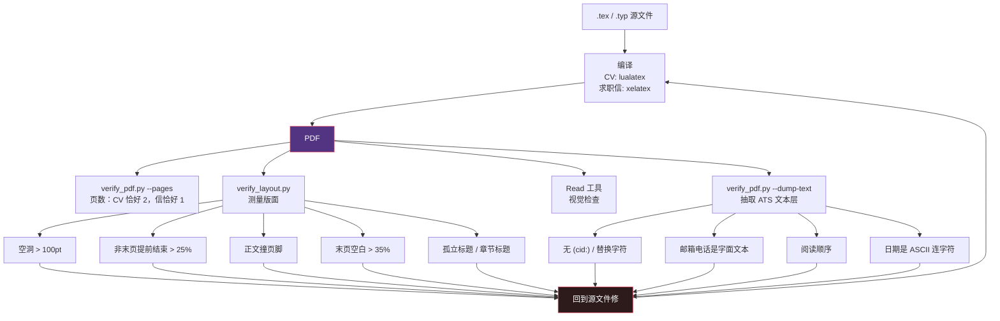
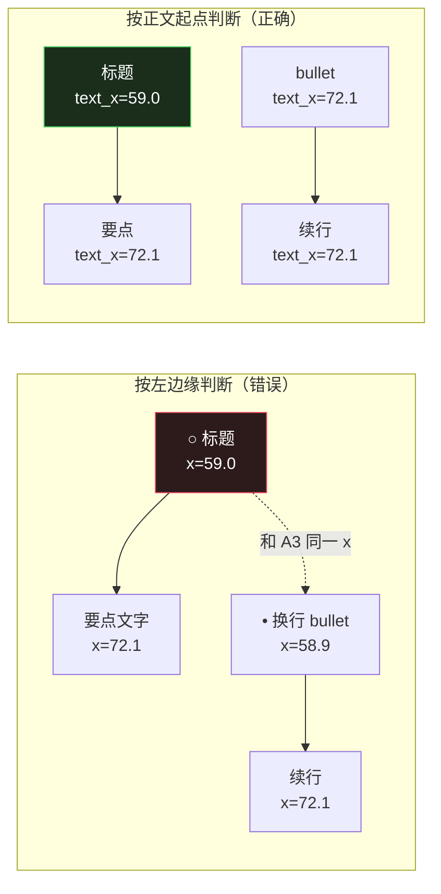

# （五）验证闭环——从 .tex 到 PDF 到 ATS 文本层

> 本文基于 commit `0f6480d`。主要文件：`tools/verify_pdf.py`（340 行）、`tools/verify_layout.py`（428 行）、`CLAUDE.md`、`.github/workflows/ci.yml`。

## "看起来没问题"是最贵的 bug

用 LaTeX 写简历的人大概都遇到过：

- 源码里排版完美，编译出来第 2 页只多了一行
- 某个 `\cventry` 的标题孤零零留在页底，要点全跑到下一页
- 求职信第 1 页正文看着刚好，签名被挤到第 2 页
- PDF 人眼看着正常，丢进 ATS 解析出来一串 `(cid:123)` 和乱码

这些问题的共同点是：**编译成功、页数正确、肉眼粗看也正常。** 传统 CI 抓不到，人眼也容易漏。

这个仓库的做法是：**把每一条"看起来"都换成可测量的断言。**

`apply.md:254` 只有四个字：

> **Measure first, then look.**

## 一、验证流水线



四路检查覆盖四种不同的失败：

| 检查 | 看什么 | 谁执行 |
|------|--------|--------|
| 页数 | 精确页数 | `verify_pdf.py --pages` |
| 版面 | 空洞、提前结束、页脚碰撞、孤立标题 | `verify_layout.py` |
| 视觉 | 字体、签名、整体观感 | 模型 Read PDF |
| ATS | 文本层是否可解析、关键词覆盖 | `verify_pdf.py --dump-text` |

关键设计是**四者互不替代**。`apply.md:263` 特意写了：

> Nothing else runs this check - `verify_layout.py` deliberately leaves page count to it, and Step 5d's extraction call passes no `--pages` - so if these lines are skipped, the page budget is enforced by nothing but the visual read below.

`verify_layout.py` 的 docstring 也解释了为什么：

> Page count is deliberately NOT checked here: `tools/verify_pdf.py --pages` already does that, and CI runs it. Two implementations of one rule drift.

**一条规则只实现一次。** 两个地方都检查页数，改阈值时就会有一个忘改。

## 二、版面检查：把"空洞"变成数字

`verify_layout.py` 的开头把要防的失败列成了一张表（`verify_layout.py:10-21`）：

```text
orphaned entry      A moderncv \\cventry renders as a tabular, so a job entry is one
                    unbreakable block. When it does not fit, the whole entry moves to
                    the next page - or its header lands at the bottom of one page with
                    the bullets resuming on the next. CLAUDE.md calls this "the most
                    common failure".
internal hole       The space an ejected entry leaves behind. Observed in the wild at
                    273pt, roughly 19 blank lines, mid-page, on a document whose page
                    count was correct and whose visual read looked fine.
page ends early     A non-final page that stops well short of the bottom.
final page thin     A last page mostly empty, which reads as an unfinished document.
footer collision    Body text pushed into the page-number band, the usual result of
                    rescuing a page with \\enlargethispage or a negative \\vspace.
```

注意 "Observed in the wild at 273pt" ——这不是理论值，是真实踩过的坑：**页数正确、肉眼看着也正常，中间有 19 行空白**。

### 阈值从哪来

代码里每个常量都带解释（`verify_layout.py:69-107`）：

| 常量 | 值 | 依据 |
|------|----|------|
| `GAP_LIMIT_PT` | 100 | 模板正常段间距约 45pt，100pt ≈ 7 行 |
| `BOTTOM_LIMIT_FRACTION` | 0.25 | 正常版面底部留白约 85pt |
| `LAST_PAGE_THIN_FRACTION` | 0.35 | 末页空太多像没写完 |
| `FOOTER_BAND_PT` | 90 | 页脚文字的底边带 |
| `INDENT_PT` | 8 | 超过这个缩进就是 bullet / 续行，不是标题 |
| `SAME_PRINTED_LINE_PT` | 3 | bbox 把同一行拆开的容差 |

这些数字不是拍脑袋，是**针对 stock moderncv 和 cover.cls 的几何校准的**。docstring 也诚实说明：自定义模板可能要重新调阈值。

### 最长间隔为什么按 top-to-top 算

```python
def largest_gap(self) -> tuple[float, float]:
    """Largest top-to-top distance between body lines, and where it starts.

    Measured top-to-top rather than bottom-to-top, so a tall line inflates the gap
    by its own height (a 160pt void under a heading reads as ~174pt). That errs
    toward over-detection, which is the right direction for a check whose job is
    to stop a hole from shipping.
    """
    tops = sorted({round(l.top, 1) for l in self.body})
    if len(tops) < 2:
        return (0.0, 0.0)
    return max((tops[i + 1] - tops[i], tops[i]) for i in range(len(tops) - 1))
```

**宁可误报，不可漏报。** 一个检查版面空洞的工具，误报只是让人多看一眼，漏报会让坏简历发出去。

## 三、孤立标题：最难的那条规则

"页底是标题、下一页是要点"听起来很好检测，实际非常刁钻。`find_orphans` 的 docstring（`verify_layout.py:253-277`）记录了一个真实的误判案例：

> The second compares where the TEXT starts, not where the line starts. A template may merge a list marker into the line it labels, which moves the line's left edge but not its text: in the #481 repro a bullet's first line starts at x58.9 (the marker), level with the entry headers at x59.5, while its text and its continuation start at x72.1. Read by left edge, a bullet wrapping across the break looked like a header followed by indented text, and a real header followed by such a bullet looked level.

翻译成图：



于是一个很聪明的折中出现了：`Line` 同时记录 `left`（行首）和 `text_left`（去掉列表标记后的正文起点）。

```python
@dataclass
class Line:
    top: float
    bottom: float
    left: float
    height: float
    text: str
    # Where the text starts once leading LIST_MARKERS words are set aside; None when the
    # line has no such marker, so a Line built from `left` alone behaves as before.
    text_left: float | None = None

    @property
    def text_x(self) -> float:
        return self.left if self.text_left is None else self.text_left
```

这个 `text_left` 字段是**向后兼容的默认值设计**：没有列表标记时，行为和旧逻辑完全一致；有标记时才切换判断基准。改一个检测器而不破坏既有行为，这是教科书式的做法。

### 缩进基准也要全局化

还有一个细节：判断"是否缩进"不能拿**每页自己的最左边缘**当基准。否则一个"整页都以缩进 bullet 开头"的页面，会把 bullet 的缩进当成页边距，什么都检测不出来。

```python
body_lines = [l for p in pages for l in p.body]
if not body_lines:
    return problems
doc_left = min(l.left for l in body_lines)

def indented(line: Line) -> bool:
    return line.left > doc_left + INDENT_PT
```

基准是**整个文档**的左边距，不是单页的。

## 四、ATS 检查：PDF 的另一张脸

人眼看到的是渲染后的页面；ATS 看到的是**嵌入的文本层**。这两者可以完全不一样：

- 联系方式用图标字体渲染 → 文本层是 `MOBILE-ALT`、`Envelope`
- 多栏布局 → 文本层按栏交错
- 字体子集化失败 → `(cid:123)`
- LaTeX 的 `--` 变成 en-dash → 日期解析器拆不开

`verify_pdf.py` 的提取顺序是 **pypdf 优先，pdftotext 兜底**：

```python
def extract_text_layer(pdf_path):
    """Extract ATS-readable text. Returns (text, pages, extractor_name)."""
    pypdf_result = _extract_pypdf(pdf_path)
    if pypdf_result is not None:
        text, pages = pypdf_result
        return text, pages, "pypdf"
    text, pages = _extract_pdftotext(pdf_path)
    return text, pages, "pdftotext"
```

并且打印出用的是哪个 extractor——因为两个解析器对空格和标点的处理不同，报告里必须能区分。

### `--contains` 的折叠：比较时宽松，导出的永远是原文

LaTeX 会把 `'` 变成弯引号、`--` 变成 en-dash。所以 `--contains "Master's degree"` 直接比会失败。

```python
TYPOGRAPHIC_FOLDS = str.maketrans(
    {
        "\u2018": "'",  # ` -> quoteleft
        "\u2019": "'",  # ' -> quoteright (the possessive apostrophe)
        "\u201c": '"',  # `` -> quotedblleft
        "\u201d": '"',  # '' -> quotedblright
        "\u2013": "-",  # -- -> endash (the \cventry date-range case)
        "\u2014": "-",  # --- -> emdash
        "\u00a0": " ",  # ~ -> no-break space
    }
)
```

关键注释在函数的 docstring 里：

> The fold applies to what is compared, never to what is dumped: the date-range rule in `05-cv-templates.md` still needs the raw en-dash visible in `--dump-text`.

**折叠只发生在比较时，不发生在导出时。** 因为后面还有一个检查专门要抓 en-dash。

### `--ascii-dates`：一个真实的 ATS 事故

如果日期范围写成 `2016--2024`（LaTeX 源码），编译后文本层是 `2016–2024`（U+2013）。文档说，Workday 的导入把整段日期丢了：

> `--ascii-dates` is the one check that deliberately does NOT fold: it scans the raw layer for a year joined to a Unicode dash - the en-dash LaTeX makes from `--`, which a Workday import dropped along with the date.

检查逻辑要区分**日期范围**和**数量范围**：

```python
def _quantity_range(line, dash_index):
    """True when both sides of the dash are bare numbers and not both years."""
    before = _TOKEN_BEFORE.search(line[:dash_index])
    after = _TOKEN_AFTER.search(line[dash_index + 1 :])
    if not before or not after:
        return False
    left, right = _bare_number(before.group(1)), _bare_number(after.group(1))
    if left is None or right is None:
        return False
    return not (_BARE_YEAR.fullmatch(left) and _BARE_YEAR.fullmatch(right))
```

所以：

- `2016–2024` → 两边都是年份 → **报错**
- `EUR 1500–2000` → 两边是数字但不是年份 → **放行**
- `2000–5000 requests/s` → 同上 → **放行**
- `03/2016–07/2024` → 不是裸数字 → 仍按年份规则检查 → **报错**

这个 disambiguation 很实用：很多简历里真的有金额、吞吐量、温度范围，一刀切会大量误报。

## 五、CI：同一套检查跑两条 TeX Live

`ci.yml` 的 `latex-smoke` job 有两套环境（`ci.yml:111-129`）：

```yaml
latex-smoke:
  # Two legs. texlive/texlive:latest tracks current TeX Live (moderncv 2.5+);
  # debian:bookworm compiles on apt-packaged TeX Live 2022 with moderncv
  # 2.3.1 - the environment #242 hit and the one texlive:latest can never
  # catch a regression in, because it never shipped the old class.
```

两条腿并行，因为用户真实环境就是这两端：一边是最新 TeX Live，一边是 Debian 打包的旧版本。只用 latest 跑，永远发现不了 moderncv 2.3.1 的回归。

上游模板还额外断言内容：

```yaml
- name: Assert stock PDF structure (upstream template only)
  if: github.repository == 'MadsLorentzen/ai-job-search'
  run: |
    python3 tools/verify_pdf.py cv/main_example.pdf \
      --pages 2 \
      --ascii-dates \
      --contains '[your.email@example.com]' \
      --contains 'Professional Experience' \
      --contains 'Achievement'
```

注意 `if: github.repository == ...`——这些断言只在 upstream 跑。fork 里用户已经把占位符换成了真实信息，同样的 `--contains '[your.email@example.com]'` 必然失败。**模板仓库和 fork 的 CI 职责不同**，这个 `if` 就是在划这条线。

## 六、优秀代码：一个有意"自己会失败"的检查器

`verify_layout.py` 的 docstring 最后一句很有意思：

> The shipped `cv/main_example.pdf` exits 1 by design: its placeholder page 2 is mostly empty, which is the thin-final-page failure the checklist asks you to fix before sending.

**仓库自带的示例 PDF 会让检查器返回失败。** 这不是 bug，是设计：

- 示例的第二页确实大部分是空占位
- 检查器如实报告"末页太空"
- 用户第一次跑的时候会看到一次失败，从而理解这个工具在做什么

### 好在哪里

大多数项目的示例数据会"调成绿灯"，让 README 里的命令看起来一切正常。这个项目反过来利用示例来**演示失败路径**。

对验证工具来说，最危险的状态是"从来没红过"——你不知道它到底在检查，还是根本没生效。

### 模式

**Self-demonstrating failure / canary fixture**（自演示失败样本）。用一个已知会失败的样例证明检查器真的在工作。

### 骨架代码

```python
# fixtures/known_bad.pdf —— 故意有一个 120pt 空洞
assert verify_layout("fixtures/known_bad.pdf") == 1   # 检查器必须抓到
assert verify_layout("fixtures/known_good.pdf") == 0  # 正常样本必须通过

# README:
#   $ python tools/verify_layout.py cv/main_example.pdf
#   LAYOUT PROBLEMS: p2 is the last page and 62% empty ...
#   ↑ 这是预期行为，示例文件本来就是占位内容
```

## 七、这套验证的成本与取舍

| 检查 | 成本 | 抓到的失败 |
|------|------|-----------|
| 编译 | 几秒 | 语法错误、缺字体 |
| `--pages` | 毫秒 | 页数错 |
| `verify_layout` | 一次 `pdftotext -bbox` | 空洞、孤立标题、页脚碰撞 |
| 视觉 Read | 一次多模态调用 | 字体、签名、观感 |
| ATS 抽取 | 一次文本提取 | 乱码、阅读顺序、日期 |

README 自己也承认这笔账（`README.md:247`）：

> the new compile-and-inspect step in Step 5 spends some of those savings on PDF rendering and layout iteration — the workflow trades some end-to-end token cost for a real reduction in broken PDFs reaching the user.

**用 token 换正确性。** 对求职这种"一份文档决定一次机会"的场景，这个交换是划算的。

## 总结

| 原则 | 落实 |
|------|------|
| 一条规则只实现一次 | 页数只由 `verify_pdf.py --pages` 管 |
| 宁可误报不可漏报 | top-to-top 测间距 |
| 比较时折叠，导出时保留原文 | `--contains` vs `--dump-text` |
| 用真实事故校准 | 273pt 空洞、Workday 丢日期、#481 缩进误判 |
| 示例要能演示失败 | `main_example.pdf` 故意 exit 1 |
| 模板与 fork 职责不同 | CI 断言只在 upstream 跑 |
| 视觉不能替代测量 | "Measure first, then look" |

下一篇讲这套仓库里我最喜欢的一类设计：**把哪些活儿从 LLM 手里拿走**。`rank_state.py`、`job_key.py`、`verify_layout.py` 都在做同一件事——用确定性代码替换"模型大概会做对"。
