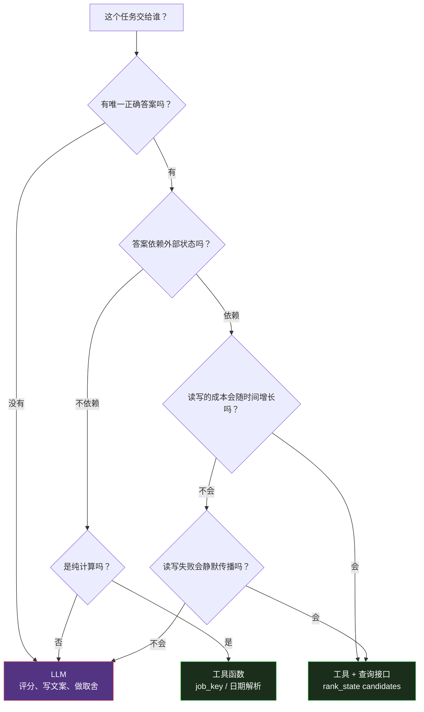

# （六）确定性与 LLM 的分工——把哪些活儿从模型手里拿走

> 本文基于 commit `0f6480d`。主要文件：`tools/rank_state.py`（516 行）、`tools/job_key.py`（251 行）。

## 一条判断标准

这套仓库里有一个反复出现的模式：

> **如果一件事的正确答案不依赖判断，就不要让 LLM 做。**

听起来像废话，但实际工程里很难划这条线。模型太擅长"顺手把事办了"，于是很多本该是代码的活儿被留在了 prompt 里：

- "把 JSON 里符合条件的那几条读出来" → 模型读了整个文件
- "给这个岗位生成一个去重 key" → 每次运行 slugify 得不一样
- "看看这一页排版空不空" → 模型肉眼判断，漏掉 273pt 的空洞
- "这条申请的截止日过了没有" → 模型自己算日期

这些活儿都有三个共同点：

1. **有唯一正确答案**
2. **错了会静默传播**
3. **用代码实现比用 prompt 便宜**

第 6 篇讲三件被明确移走的活儿。

## 一、状态读写：`rank_state.py`

### 问题

`/rank` 原本的流程是：

1. 读整个 `seen_jobs.json`（包含所有历史职位，大部分是 `skipped`）
2. 在上下文里筛选出这次要评分的几条
3. 把整个文件重新输出，写回磁盘

`rank_state.py` 的 docstring 把账算得很清楚（`rank_state.py:4-8`）：

> `/rank` reads the whole of `seen_jobs.json` into the model's context to filter it by eye (Step 1), then re-emits the whole file to record scores (Step 4). That cost is paid on every run regardless of how many jobs are actually scored, and it grows for the life of the workspace, since seen_jobs.json is append-only by design and most stored entries are `skipped`.

三个失败点：

| 失败 | 后果 |
|------|------|
| 读整个文件 | token 成本随使用时间线性增长 |
| 模型筛 | 筛选规则可能漂移（漏一条、多一条） |
| 模型重写整个 JSON | 格式、字段顺序、遗漏都可能出错 |

### 解决

三个子命令，各管一件事：

```bash
python3 tools/rank_state.py candidates --limit 10   # 选候选，只投影 7 个字段
python3 tools/rank_state.py sweep --write           # 按存储的截止日扫过期
python3 tools/rank_state.py apply --results r.json  # 写回评分结果
```

`candidates` 只输出评分 agent 真正需要的字段：

```python
selected.append(
    {
        "key": key,
        "title": entry.get("title"),
        "company": entry.get("company"),
        "url": entry.get("url"),
        "portal": entry.get("portal"),
        "deadline": entry.get("deadline"),
        "posted_date": entry.get("posted_date"),
    }
)
```

而 `apply` 把写回规则全部编码：

- 未知 key → error
- 未知 status → error（不是 fall-through）
- 已过期截止日 → 直接标 `expired`
- 缺 deadline 不算"修正"（absence is not a correction）
- `location` 字段的 legacy verdict 迁移
- `strengths` / `gaps` 原样存、最多 3 条

注意最后一条的哲学：**"没有值"和"值是空"是两回事。** 一次抓取退化到列表页时拿不到 deadline，如果把它当成"职位删掉了截止日"，就会抹掉真实日期；而规则 6 对"没有 deadline"的条目是跳过不检查的——于是这条职位永远不会过期。

### 失败状态要分得比"成功/失败"更细

`/rank` 用两个状态描述"没拿到职位"：

| 状态 | 含义 | 证据 |
|------|------|------|
| `expired` | 职位确实关了 | 页面说不再接受申请、410、重定向到列表页 |
| `unreachable` | 不确定，可能还开着 | 401/403、404、超时、5xx、空页面 |

`rank_state.py:324-366` 处理重试：

```python
if status == "unreachable":
    # A stored deadline that has already passed is positive evidence the
    # posting is closed, whatever the fetch did: expire it, as the scored
    # path and rule 6 would, instead of retrying it and later listing it
    # as possibly live.
    deadline = parse_iso(entry.get("deadline"))
    if deadline is not None and deadline < today:
        entry["status"] = "expired"
        ...
        continue

    previous = entry.get("fetch_attempts")
    valid = isinstance(previous, int) and not isinstance(previous, bool)
    attempts = (previous if valid else 0) + 1
    first = parse_timestamp(entry.get("first_unreachable")) or now
    ...
    if attempts >= UNREACHABLE_MAX_ATTEMPTS and now - first >= UNREACHABLE_MIN_SPAN:
        entry["status"] = "expired"
        entry["expired_reason"] = "unreachable"
        gave_up.append(row)
```

两个数字值得注意：

- `UNREACHABLE_MAX_ATTEMPTS = 3`
- `UNREACHABLE_MIN_SPAN = timedelta(hours=48)`

为什么要有 48 小时的下限？注释说：

> The 48-hour floor matters because a scheduled run plus a manual one on the same day would otherwise burn every attempt on one short outage.

这是很典型的"状态机 + 时间窗"设计：**重试次数和重试跨度必须同时满足。** 否则用户一天点三次，把一个暂时 502 的职位判死刑了。

## 二、去重键：`job_key.py`

### 问题：同一条职位存了两次

`/scrape` 的 `seen_jobs.json` 用 `company+title` 做 key。规则原本只写在散文里，于是每次运行都按自己的方式 slugify。`job_key.py` 开头列了两个真实故障（`job_key.py:8-20`）：

```text
* Keys carrying characters that break things downstream. `/apply` and
  `/outcome` derive an archive folder name from the same company+role pair,
  and documents/README.md's subfolder rule exists because a "/" splits that
  path across directories. Real examples found in a live workspace:
  "deloitte_junior-cybersecurity-analyst-(ot/iot)",
  "neverhack-estonia_penetration-tester-/-red-teamer",
  "ops-consulting,-llc_malware-analyst".

* The same job stored twice under different keys, because one run truncated
  the title at a different point than the next. "deloitte_cyber-intelligence-
  center-security-analy" and "deloitte_cyber-intelligence-center-security-
  analyst-at" are one posting, one URL, two entries - and dedup is the whole
  point of the file.
```

两个故障对应两个设计：

1. **key 必须能安全地当文件夹名** → 严格字符白名单
2. **key 必须是职位的纯函数** → 同样的输入永远同样的输出

### 解决：截断 + 哈希

```python
def _cap(slug: str, limit: int) -> str:
    """Cap length without making truncation lossy across runs.

    A bare truncation is what produced the duplicate Deloitte entries: two runs
    cut the same title at different points and the file gained a second key for
    one job. Appending a hash of the *full* slug makes the result deterministic
    for a given title and distinct for any other.
    """
    if len(slug) <= limit:
        return slug
    digest = hashlib.sha1(slug.encode("utf-8")).hexdigest()[:HASH_LEN]
    return f"{slug[:limit].rstrip('-')}-{digest}"
```

一个小细节：截断后 append 一个**完整 slug 的 SHA-1 前 6 位**。

- 不截断 → 两段标题可能共用一个前缀，key 冲突
- 截断但不哈希 → 截止位置不同，key 不同
- 截断 + 哈希 → 确定 + 唯一

### 非拉丁文字怎么办

SQLite 式的 slugify 有一个经典问题：`slugify("Программист 1С")` 会得到 `"1"`，`slugify("Аналитик 1С")` 也会得到 `"1"`。两个不同职位碰撞。

`job_key.py` 的处理是：**先判断这次 ASCII 折叠有没有丢字母**，再决定用不用 fallback。

```python
def _lost_letters(text: str) -> bool:
    """True when the ASCII fold dropped non-Latin letters, so the slug under-identifies."""
    if not text:
        return False
    for ch in unicodedata.normalize("NFKD", str(text)):
        if ord(ch) < 128 or not ch.isalpha():
            continue
        if not unicodedata.name(ch, "LATIN").startswith("LATIN"):
            return True
    return False
```

然后 fallback 的顺序是：

1. URL 里的 6 位以上数字 job id（最稳定）
2. URL 的哈希
3. 标题的哈希（没有 URL 时）

注意注释里的一条经验：

> Hash the URL alone when there is one. The URL is the posting's identity; the title is not. Including the title made the key change whenever a portal re-listed the same posting with the title altered, which stores one job twice.

**用 URL 做身份，不用标题。** 标题会被门户改，URL 不会。

### audit 而不是自动修复

`job_key.py --audit` 只报告不修改：

```python
drift = [
    k for k, v in seen.items()
    if is_canonical(k) and k != make_key(v.get("company", ""), v.get("title", ""), v.get("url", ""))
]
```

为什么？注释在 `is_legacy_shape` 里：

> Harmless - they carry no path-breaking character - but they are not what make_key produces, so a later run would store the same job under a new key and reintroduce a duplicate. Reported apart from real damage so the fix stays a decision rather than an automatic rename.

**改名会破坏 tracker 的 company+role 匹配。** 所以工具只告诉你"哪些 key 不符合当前规则"，改不改、什么时候改，由人决定。

## 三、判断边界

把上面几个例子抽象一下，可以得到一棵决策树：



换成更口语的版本：

| 信号 | 该交给 |
|------|--------|
| 需要判断"好不好" | LLM |
| 同一个输入应该永远同一输出 | 代码 |
| 失败后很难发现 | 代码 |
| 成本随数据量线性增长 | 代码（查询接口） |
| 需要解释理由 | LLM |
| 需要精确、可审计、可复现 | 代码 |

## 四、优秀代码：原子写 + 防御性解析

`rank_state.py` 的 `save_state`（`rank_state.py:93-103`）只有十行，但两个细节都值得抄：

```python
def save_state(path: Path, doc: dict) -> None:
    """Atomic replace: a half-written seen_jobs.json loses the scrape history."""
    fd, tmp = tempfile.mkstemp(dir=str(path.parent), prefix=".seen_jobs.", suffix=".tmp")
    try:
        with os.fdopen(fd, "w", encoding="utf-8") as fh:
            json.dump(doc, fh, indent=2, ensure_ascii=False)
            fh.write("\n")
        os.replace(tmp, path)
    except BaseException:
        Path(tmp).unlink(missing_ok=True)
        raise
```

### 好在哪

1. **临时文件放在同一目录**（`dir=str(path.parent)`）——跨文件系统的 `os.replace` 不保证原子
2. **`os.replace` 而不是 `os.rename`**——Windows 上 `rename` 不能覆盖已有文件，`replace` 可以
3. **异常时清理临时文件**——避免每次崩溃留下一个 `.seen_jobs.xxx.tmp`
4. **`BaseException` 而不是 `Exception`**——Ctrl-C 也会清理

配套的 `parse_iso` 则体现了"缺席不是零"：

```python
def parse_iso(value) -> date | None:
    """Rule 6's defensive-parse rule: anything that is not YYYY-MM-DD is treated
    exactly like an absent value - never compared, never guessed at."""
    if not isinstance(value, str) or not ISO.match(value.strip()):
        return None
    try:
        return date.fromisoformat(value.strip())
    except ValueError:
        return None
```

再看调用方：

```python
raw = entry.get("deadline")
if raw in (None, ""):
    continue
parsed = parse_iso(raw)
if parsed is None:
    unparseable.append({"key": key, "portal": entry.get("portal"), "deadline": raw})
    continue
```

解析不了的值**不会被当成"已过期"或"还早"**，而是进入 `unparseable_deadlines` 报告，让用户去追源头。

这个模式可以总结成一句话：

> **缺席不是零，畸形不是零，未知不是否。**

### 模式

**Atomic persistence + total parsing**（原子持久化 + 全函数解析）。写要么完全成功要么完全不变；解析要么返回确定值，要么返回"不可判定"，绝不抛异常或猜。

### 骨架代码

```python
def save_json_atomic(path: Path, doc) -> None:
    fd, tmp = tempfile.mkstemp(dir=path.parent, prefix=".tmp-", suffix=".json")
    try:
        with os.fdopen(fd, "w", encoding="utf-8") as fh:
            json.dump(doc, fh, ensure_ascii=False, indent=2)
            fh.write("\n")
        os.replace(tmp, path)
    except BaseException:
        Path(tmp).unlink(missing_ok=True)
        raise


def parse_iso_date(value) -> date | None:
    if not isinstance(value, str) or not ISO_RE.match(value.strip()):
        return None
    try:
        return date.fromisoformat(value.strip())
    except ValueError:
        return None
```

## 五、移走之后，LLM 还剩什么

这是最后一个值得警惕的问题：如果状态、去重、日期、版面都交给代码了，模型是不是只剩"写小作文"？

不是。看 `/rank` 的模型仍然要做：

- 抓取失败时判断该走哪条升级路径
- 把职位描述映射到五个评分维度
- 写出具体、诚实、可引用的 strengths / gaps
- 区分"职位关了"和"抓不到"
- 决定是否 FLAG 而不是 FAIL

这些都是**判断**。工具负责的只是判断之后的那一步：

| 模型输出 | 工具接管 |
|---------|---------|
| `{status: "unreachable", fetch_error: "403 after curl retry"}` | 累计次数、判断是否放弃 |
| `{scores: {...}}` | 加权求和、分档 |
| `{deadline: "2026-08-15"}` | 存、比较、扫过期 |
| `{strengths: [...], gaps: [...]}` | 原样持久化 |

这个分工让模型只管它擅长的事，同时让系统整体保持可复现。

## 总结

| 移走的活儿 | 交给谁 | 换来什么 |
|-----------|--------|---------|
| 状态筛选与写回 | `rank_state.py` | token 成本不随历史增长；写回规则固定 |
| 去重 key | `job_key.py` | 同一职位永远同一 key |
| 日期解析 | `parse_iso` | 坏数据被报告，不被猜测 |
| 版面测量 | `verify_layout.py` | 273pt 空洞也能抓 |
| 文本层检查 | `verify_pdf.py` | ATS 视角的失败可见 |

下一篇进入代码量最大的部分：**6 个门户搜索 skill 的插件契约**。它们用 Bun + TypeScript 写成，每个都能独立安装、独立测试、独立降级——而且这套契约是 `/add-portal` 能自动生成新门户的前提。
