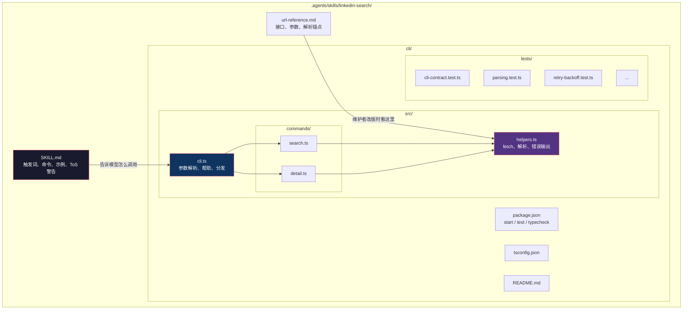
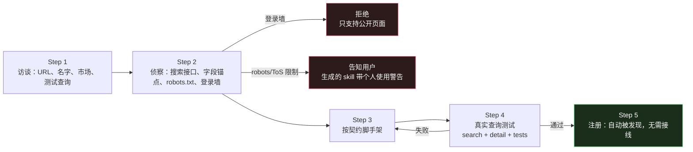

# （七）门户搜索 Skill——6 个站点、一套契约、零依赖

> 本文基于 commit `0f6480d`。主要目录：`.agents/skills/`（92 个 TypeScript 文件，9,953 行）、`.claude/commands/add-portal.md`。

## 为什么每个招聘网站都要单独写一个 CLI

有人会问：为什么不直接用 `WebSearch` + `WebFetch`？

因为招聘网站有三个特点，让通用抓取很不可靠：

1. **搜索接口有自己的参数**：关键词、城市、发布时间、页码，每个站点的参数名都不同
2. **结果页结构不同**：JSON API、HTML 列表、需要 XHR header 的接口
3. **反爬策略不同**：有的 403，有的登录墙，有的限流

通用抓取只能拿到"某个搜索引擎索引到的页面"，拿不到"按条件搜索"的能力。所以仓库给每个门户写了一个小 CLI，把"搜索"和"取详情"变成两个稳定的命令。

目前有 6 个：

| Skill | 市场 | 数据源 | 依赖 |
|-------|------|--------|------|
| `jobindex-search` | 丹麦 | HTML | 有（`@bunli/*` + `zod`） |
| `jobbank-search` | 丹麦 | HTML | 同上 |
| `jobdanmark-search` | 丹麦 | HTML | 同上 |
| `jobnet-search` | 丹麦 | HTML | 同上（无 HTML parser） |
| `linkedin-search` | 全球 | jobs-guest HTML | **零运行时依赖** |
| `freehire-search` | 多市场 | REST JSON | **零运行时依赖** |

前四个是维护者自己的市场，默认 `enabled: false`（装了但不跑）；后两个是国家无关的参考实现。

## 一、一个 skill 的解剖



三个文件各有不同的读者：

| 文件 | 读者 | 作用 |
|------|------|------|
| `SKILL.md` | LLM | 什么时候用、怎么调用、输出长什么样 |
| `url-reference.md` | 人类维护者 | 站点改版时，去哪找解析锚点 |
| `cli/` | 运行时 | 真正干活 |

这个分离很重要：**LLM 不需要读解析代码就能正确调用 CLI；维护者不需要翻 prompt 就能修解析器。**

## 二、契约：6 个 skill 必须长得一样

`/add-portal` 的 Step 3 把契约写死（`add-portal.md:74-85`）：

```markdown
### The portal-skill contract (every generated skill MUST honor this)

These conventions are what make portal skills interchangeable for `/scrape` and for users reading any skill's docs:

- **Commands:** `search` and `detail <id|url>`.
- **Search flags:** `--query`/`-q`, `--jobage <days>` (posting age; map to the portal's parameter, note in SKILL.md if unsupported), `--page <n>` (1-indexed), `--limit <n>` (client-side cap), `--format json|table|plain` (default `json`). Add `--location`/`-l` if the portal supports location as a parameter...
- **JSON output shape:** `{ "meta": { "count": ..., "page": ... }, "results": [...] }` where each result has at least `id`, `title`, `company`, `location`, `date`, `url` (missing values are `null`, never omitted).
- **Errors:** written to **stderr** as `{ "error": "...", "code": "..." }`, exit code `1`. Never write errors to stdout.
- **Fetching:** an honest User-Agent that names the tool... never a full browser impersonation...
- **HTML parsing:** split the response into per-result chunks and parse each independently, so one malformed card cannot break the rest...
- **Dependencies:** default to **zero runtime dependencies** (plain `bun` + `fetch` + regex parsing)...
- **Credentials:** a skill that needs an API key reads it **only** from an environment variable named `<SERVICE>_API_TOKEN`. Never hardcode it, never accept it as a CLI flag (flags leak into shell history and process listings)...
```

逐条看，每一条都在防一个具体问题：

| 契约 | 防的问题 |
|------|---------|
| `search` / `detail` 两个命令 | `/scrape` 和 `/apply` 可以统一调用，不需要为每个站点写特判 |
| 统一 flag 名 | 模型不会因为站点不同而记错参数 |
| `null` 而不是省略字段 | 下游不用区分"字段不存在"和"值为空" |
| 错误走 stderr + exit 1 | stdout 永远是纯数据，可以直接 pipe 给 `jq` |
| 诚实 UA | 不伪装浏览器；需要升级时走 `robots.txt` 门禁 |
| 分块解析 | 一条坏卡片不会毁掉整页 |
| 零运行时依赖 | 克隆下来只要有 bun 就能跑 |
| 凭据只从环境变量读 | 不进入 shell history、ps 输出、git |

第 7 条"零依赖"不是教条，而是一个明确的可审计性目标：

> `bun install` should only pull dev types.

一个门户 skill 要能在用户机器上被预授权运行（`.claude/settings.json` 里有它的完整路径），依赖越少，审计面越小。

## 三、发现式加载：没有注册表

`/scrape` 怎么知道该跑哪些门户？不是靠一个列表，而是靠目录约定（`job-scraper/SKILL.md:61-63`）：

```markdown
Discover all installed portal CLI skills by reading every `SKILL.md` found under `.agents/skills/*/SKILL.md`. Each file documents that portal's exact CLI flags and usage examples. **Use each portal's own documented interface — do not guess flags.** This approach automatically includes any new portals added via `/add-portal` without requiring changes to this file.

**Honor the `enabled` toggle.** A portal is enabled unless its `SKILL.md` frontmatter sets `enabled: false` (a missing key means enabled — the default). Skip each disabled portal and record it for the Step 5 summary.
```

两条规则：

1. **目录即注册** —— 放进 `.agents/skills/` 就被发现
2. **默认启用，显式关闭** —— 少写一个字段不会让门户静默消失

安装脚本也用同样的发现逻辑（`install_portal_clis.py:1-10`）：

> The CLIs are discovered, not listed: every `.agents/skills/*/cli/package.json` is installed, the same glob CI's discover-clis job uses. A portal generated by `/add-portal` or copied from another fork is therefore picked up on a fresh clone without anyone editing an install loop, and a portal removed from the tree stops being asked for.

CI 里也是 glob（`ci.yml:188-204`）：

```yaml
discover-clis:
  # The matrix is discovered, not hardcoded, so a portal CLI added in a fork
  # (the /add-portal path) gets typechecked and tested without the fork
  # having to edit this workflow - the same reason security-guards globs
  # .agents/**/package.json instead of naming the shipped portals.
```

**同一个发现规则被三处复用**：运行时、安装、CI。加一个门户，三处自动生效；删一个门户，三处自动忘记。没有任何"记得去改列表"的地方。

## 四、优秀代码：拒绝未知参数

`linkedin-search/cli/src/cli.ts:86-103`：

```typescript
  // Reject unknown flags instead of silently discarding them: a discarded
  // filter changes what the search returns with no error (a wrong flag name
  // once returned an entire portal's database as if it matched the query).
  // add-portal.md's contract requires a bogus flag to exit 1 with a JSON
  // error on stderr.
  const knownFlags = KNOWN_FLAGS[cmd]
  if (knownFlags) {
    for (const key of Object.keys(flags)) {
      if (key === "_" || knownFlags.has(key)) continue
      process.stderr.write(
        JSON.stringify({
          error: `unknown flag --${key} for '${cmd}' - flags are never silently ignored, because a discarded filter changes what the search returns; see --help for the supported flags`,
          code: "UNKNOWN_FLAG",
        }) + "\n",
      )
      return 1
    }
  }
```

### 好在哪里

注释里那句是真实事故：

> a wrong flag name once returned an entire portal's database as if it matched the query

一个拼错的 filter 被静默忽略，结果返回了整个数据库，而调用方以为这是一次精确搜索。**比报错更可怕的是"看起来成功了，其实是错的"。**

这十行代码做了三件事：

1. **白名单**：每个 subcommand 声明自己认识的 flag
2. **失败关闭**：不认识的 flag 直接 exit 1
3. **错误可机读**：stderr 是 JSON，带 `code`

顺便还有一个细节：`parseFlags` 在解析时把 `-q` 映射到 `query`、`-l` 映射到 `location`、`-n` 映射到 `limit`，所以白名单只需维护长名。

### 模式

**Strict argument parsing / fail-closed CLI**。和很多 Unix 工具的"忽略未知选项"相反，这里选择了更安全的语义。

### 骨架代码

```typescript
const KNOWN: Record<string, Set<string>> = {
  search: new Set(["query", "location", "limit", "format", "help"]),
  detail: new Set(["format", "help"]),
}

const known = KNOWN[cmd]
if (known) {
  for (const key of Object.keys(flags)) {
    if (key === "_" || known.has(key)) continue
    fail(`unknown flag --${key}`, "UNKNOWN_FLAG")
    return 1
  }
}

function fail(error: string, code: string): void {
  process.stderr.write(JSON.stringify({ error, code }) + "\n")
}
```

任何会被自动化调用的 CLI 都适用：CI 脚本、数据管道、Agent 工具。**未知输入必须报错，不能当成默认值。**

## 五、解析：分块，而不是整页

`helpers.ts:137-144`：

```typescript
/**
 * Parse the search response: a flat list of <li> job cards. We split on the
 * job-posting URN and parse each chunk independently so one malformed card
 * cannot break the rest.
 */
export function parseJobCards(html: string): JobCard[] {
  const results: JobCard[] = []
  const chunks = html.split(/data-entity-urn="urn:li:jobPosting:/).slice(1)
  ...
```

这个选择很实用。整页正则匹配的典型故障是：一条卡片的 HTML 变形，导致后面所有卡片都匹配偏移，要么全空、要么错位。

分块之后：

- 一条坏卡片 → 跳过这一条
- 其余卡片 → 正常返回
- 整体仍然 exit 0

配套的 `extractDivContent` 还处理了嵌套 `<div>`：

```typescript
export function extractDivContent(html: string, className: string): string | null {
  ...
  let i = open.index + open[0].length
  let depth = 1

  while (depth > 0 && i < html.length) {
    const nextOpen = html.indexOf('<div', i)
    const nextClose = html.indexOf('</div>', i)
    ...
```

不引入 DOM 解析器，而是用**深度计数**找到匹配的闭合标签。注释解释了为什么：

> the markup is shallow and stable; a full DOM parser is unnecessary and node-html-parser has known nesting bugs on LinkedIn cards

这是一个务实的取舍：**为特定站点写解析器，不必追求通用 HTML 解析。** 但代价是站点改版时解析器会坏——所以才需要 `url-reference.md` 和健康检查。

## 六、健康检查：抓取器会"静默腐烂"

门户 skill 最危险的失效不是崩溃，而是**返回 0 条或一堆 null**。`/scrape` 的 Step 4.75 专门处理这个（`job-scraper/SKILL.md:209-222`）：

```markdown
### Step 4.75: Portal Health Check

Scraper-based portal CLIs rot silently: when a portal changes its markup, the parser usually exits 0 with zero results or with null/garbled fields, and the Step 1c fallback never fires because it only triggers on hard failure. This step catches that from evidence the run already holds.

**Free pass (no extra requests).** For each enabled portal that ran in Step 1b:
- **Degraded scan:** inspect the results it returned this run. Flags: `company` null or empty on every result, empty titles, undecoded entities (`&amp;`) or HTML fragments in titles, URLs that do not point at the portal...
- **Yield history:** if the portal returned zero results across all of this run's queries, check whether `job_scraper/seen_jobs.json` holds prior entries from it...

**Escalation (bounded, on suspicion only).** A suspect portal gets **one** sentinel probe... If that returns nothing, retry **once** with a single common word. Only then is the verdict **broken**. A 429 or block page is **never** evidence of breakage - record the portal as **inconclusive (rate-limited)**, back off, and do not retry.
```

三个设计值得学：

1. **免费检查优先** —— 先用本轮已有的输出判断，不发额外请求
2. **探测有界** —— 一次 sentinel + 一次重试，绝不变成爬虫
3. **限流不等于坏** —— 429 是"我不知道"，不是"你坏了"

第 3 点尤其重要：把"被限流"误判为"解析器坏了"，会导致用户去修一个没坏的东西，甚至把好门户禁用掉。

## 七、`/add-portal`：生成器是通用的，产物是你的

`/add-portal` 的流程是：



它对"不要做什么"写得很清楚：

> Auth-walled portals are declined, and portals with restrictive terms get a prominent personal-use-only warning in the generated skill.

以及 Step 2.5 的一条边界：

> **This step never overrides Step 2.4:** if `robots.txt` or the portal's terms disallow access, that is decided there, and a paid fetching service does not change the answer.

翻译：**花钱买代理也不能绕过站点明确的拒绝。**

## 八、测试：契约、解析、重试各测各的

92 个 TypeScript 文件里，一半是测试（5,137 行）。下面是各门户 `tests/` 里出现过的测试名（合并列举，不是某一个门户的完整清单）——文件名本身就是行为清单：

| 测试 | 测什么 |
|------|--------|
| `cli-contract.test.ts` | 命令、flag、输出格式 |
| `cli-flag-validation.test.ts` | 非法参数 exit 1 |
| `parsing.test.ts` | 搜索页解析 |
| `detail-parsing.test.ts` | 详情页解析 |
| `request-timeout.test.ts` | 超时 |
| `retry-backoff.test.ts` | 429/5xx 退避 |
| `missing-option-values.test.ts` | flag 缺值 |
| `documented-search.test.ts` | 文档里的示例命令真的能跑 |

最后一条很有意思：**文档里的示例是测试用例。** 如果 SKILL.md 写了一个 `bun run ... search -q "x"` 的示例，测试会确保这个命令不会因为参数变化而失效。

CI 只跑 typecheck + 离线测试，不跑真实网络：

> Deliberately NOT here: live smoke tests of the job-portal CLIs. They hit real portals (network-flaky, and the linkedin-search skill is personal-use only per its own ToS warning - CI-automated requests would violate that).

又是一个"边界写进 CI"的例子：**自动化测试不做的事，用注释说明为什么不 automate。**

## 总结

| 设计 | 价值 |
|------|------|
| 每个门户一个 skill + 一个 CLI | 站点特有逻辑隔离，失败互不影响 |
| 统一契约 | `/scrape` 不需要为站点写特判 |
| 发现式加载 | 加/删门户不需要改任何列表 |
| 零运行时依赖 | 审计面小，克隆即用 |
| 未知参数报错 | 防止"静默返回错误结果" |
| 分块解析 | 一条坏卡片不毁整页 |
| 有界健康检查 | 抓取器腐烂时能被发现 |
| 生成器通用 / 产物市场专属 | 上游保持干净，fork 各自扩展 |

下一篇讲这套仓库的"基础设施"：供应链安全、权限白名单、版本戳、CI。这些不是求职功能，但决定了这套东西**能不能安全地让陌生人 fork 后直接跑**。
