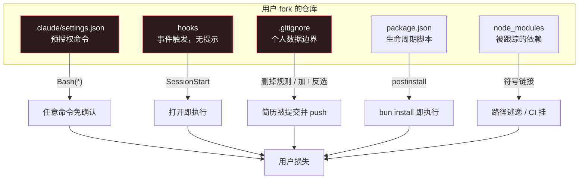

# （八）供应链与仓库纪律——让陌生人 fork 后能安全运行

> 本文基于 commit `0f6480d`。主要文件：`tools/security_guards.py`（329 行）、`tools/lint_skills.py`、`tools/check_framework_version.py`、`.github/workflows/ci.yml`（252 行）。

## 一个不寻常的威胁模型

大多数开源项目担心的是"我的代码有漏洞"。这个仓库担心的是另一件事：

> This repo ships pre-approved Claude Code permissions and CLI code that every fork user executes.

用户 fork 之后，`.claude/settings.json` 里的权限是**预授权**的。也就是说，仓库里的某些命令会**不弹确认框直接运行**。

这把"代码审查"的重要性提高了一个量级：

- 普通仓库：恶意代码需要用户主动运行
- 这个仓库：克隆 + 打开 Claude Code，某些命令已经可以免确认执行

于是仓库把最危险的几个面全部做了白名单。

## 一、五个攻击面



`security_guards.py` 的 docstring 把设计意图说得很清楚（`security_guards.py:6-11`）：

> These guards make the dangerous changes LOUD, not impossible: a PR that intentionally needs one of them must update the allowlists in this file in the same diff, so the change is explicit and reviewable rather than buried.

**不是"禁止"，是"让变危险的操作变显眼"。**

## 二、权限白名单：精确到每个 CLI

`.claude/settings.json` 里只有 18 条权限，每条都指向一个具体的文件：

```json
"Bash(bun run .agents/skills/jobbank-search/cli/src/cli.ts:*)",
"Bash(bun run .agents/skills/jobdanmark-search/cli/src/cli.ts:*)",
"Bash(bun run .agents/skills/jobindex-search/cli/src/cli.ts:*)",
"Bash(bun run .agents/skills/jobnet-search/cli/src/cli.ts:*)",
"Bash(bun run .agents/skills/linkedin-search/cli/src/cli.ts:*)",
"Bash(bun run .agents/skills/freehire-search/cli/src/cli.ts:*)",
```

`security_guards.py:42-46` 解释了为什么不用更宽松的写法：

```python
    # Narrowed from the upstream template's blanket Bash(bun run:*), which
    # pre-approved `bun run <any file>`. One entry per shipped portal CLI,
    # matching what each SKILL.md already declares in its allowed-tools.
    # A portal added by /add-portal needs its own entry here and in
    # .claude/settings.json - that review step is the point.
```

`Bash(bun run:*)` 意味着用户可以运行仓库里**任意**脚本。逐个列出 CLI 路径，意味着新增一个可执行入口必须同时改两个文件——而那个 diff 就是人工审查点。

同样，Python 工具也是逐条列：

```python
"Bash(python tools/rank_state.py:*)",
"Bash(python3 tools/rank_state.py:*)",
"Bash(python tools/job_key.py:*)",
...
```

### hooks 更危险

`security_guards.py:132-142`：

```python
# Hook commands the template legitimately ships, as "<Event>:<command>" strings.
# Empty by design - the template ships no hooks at all.
#
# A hook is strictly more dangerous than a permissions.allow entry. A permission
# pre-approves something Claude may choose to do; a hook runs unconditionally when
# its event fires, with no prompt and no model decision in between. Cloning a repo
# and opening it is enough. This is the vector the Shai-Hulud worm used in its
# August 2026 wave, planting a SessionStart hook in .claude/settings.json that
# executed on session start:
# https://research.jfrog.com/post/shai-hulud-is-back-august/
ALLOWED_HOOKS: set[str] = set()
```

三种危险程度：

| 机制 | 触发条件 | 是否需要模型决定 |
|------|---------|----------------|
| `permissions.deny` | 用户或模型尝试 | 否（直接拒绝） |
| `permissions.allow` | 模型选择执行 | 是 |
| `hooks` | 事件发生 | **否** |

所以 hooks 的白名单是**空的**。模板一个 hook 都不带；如果哪个 PR 想加，必须在同一个 diff 里改 `ALLOWED_HOOKS`，让审查者看到。

### 未知 hook 形状直接判失败

`_hook_commands` 有一个很值得学的细节（`security_guards.py:147-168`）：

```python
def _hook_commands(event: str, entries: object):
    """Yield "<Event>:<command>" for every command a hook event would run.

    Fails closed: any shape this does not recognise yields a marker that cannot
    be in the allowlist, so an unfamiliar hook layout is rejected rather than
    silently skipped.
    """
    unrecognised = f"{event}:<unrecognised hook shape>"
    if not isinstance(entries, list):
        yield unrecognised
        return
    for entry in entries:
        if not isinstance(entry, dict):
            yield unrecognised
            continue
        inner = entry.get("hooks")
        if not isinstance(inner, list):
            yield unrecognised
            continue
        for hook in inner:
            command = hook.get("command") if isinstance(hook, dict) else None
            yield f"{event}:{command}" if isinstance(command, str) else unrecognised
```

如果只想抓 `command` 字段，遇到没见过的结构时最常见的写法是 `continue`——跳过。但攻击者正好可以利用这一点：用一个解析器不认识的结构藏一个 hook。

这里的写法是：**不认识的形状 → 产生一个永远不会在白名单里的标记 → 必然失败。**

这就是 fail-closed 的具体实现。

## 三、`.gitignore` 是安全配置

这个仓库的 `.gitignore` 不是"方便"，而是**隐私边界**。审核它的是 `check_gitignore()`：

```python
def check_gitignore() -> None:
    path = ROOT / ".gitignore"
    ...
    rules = set(lines)
    for rule in REQUIRED_IGNORE_RULES:
        if rule not in rules:
            errors.append(
                f".gitignore: required personal-data rule missing: {rule!r}. "
                ...
```

`REQUIRED_IGNORE_RULES` 里有 28 条，包括：

```python
    "**/job_scraper/seen_jobs.json",
    "**/job_scraper/notion_sync.json",
    "**/job_scraper/*.md",
    "cv/main_*.*",
    "!cv/main_example.tex",
    "cv/*.txt",
    "cover_letters/cover_*.*",
    "cover_letters/Cover_*.*",
    "documents/cv/**",
    "documents/linkedin/**",
    "documents/diplomas/**",
    "documents/references/**",
    "documents/projects/**",
    "documents/applications/**",
    "job_search_tracker.csv",
    ...
```

### 为什么有的规则要 `**/` 前缀

注释记录了一个真实的坑（`security_guards.py:68-73`）：

```python
    # Depth-independent: the job-scraper skill resolves `job_scraper/` relative
    # to its own directory, so the state file lands under .claude/skills/... and
    # a repo-rooted rule silently fails to match it.
    "**/job_scraper/seen_jobs.json",
```

`.gitignore` 里的 `job_scraper/seen_jobs.json` 只匹配仓库根目录下的路径。如果 skill 把文件写到了 `.claude/skills/job-scraper/job_scraper/seen_jobs.json`，规则就失效了——文件会被提交。

所以规则必须和**实际写入路径**一致，而不是和"理想写入路径"一致。

### 为什么还要检查 `!` 反选

`check_gitignore()` 的后半段：

```python
    for line in lines:
        if line.startswith("!") and line not in ALLOWED_IGNORE_NEGATIONS:
            errors.append(
                f".gitignore: negation rule not in the reviewed allowlist: {line!r}. "
                "A negation re-includes a path an earlier rule excluded and can silently "
                "re-expose personal data (a required ignore rule stays present but stops "
                "taking effect)."
            )
```

这是 .gitignore 最容易忽略的语义：**后面的 `!` 会覆盖前面的忽略规则。**

一个攻击者（或者一个不小心的贡献者）可以这样绕过：

```gitignore
documents/applications/**     # 规则还在
!documents/applications/**    # 但被反选了
```

只检查"必需规则存在"是抓不到的。所以必须同时检查"没有未经批准的反选"。

允许的反选只有四条：

```python
ALLOWED_IGNORE_NEGATIONS = {
    "!cover_letters/OpenFonts/fonts/**",
    "!cv/main_example.tex",
    "!cover_letters/cover_example.tex",
    "!documents/**/.gitkeep",
}
```

## 四、`package.json`：安装时执行代码

```python
FORBIDDEN_SCRIPTS = {"preinstall", "install", "postinstall", "prepare", "prepack"}
```

`check_package_manifests()` 扫 `.agents/**/package.json`，发现任一生命周期脚本就失败：

> they execute arbitrary code during `bun install` on every fork user's machine.

还包括 `trustedDependencies`：

> it re-enables dependency lifecycle scripts that bun blocks by default.

`install_portal_clis.py` 复用了同一个集合（`install_portal_clis.py:17-19`）：

> A manifest that declares an npm/bun lifecycle script or trustedDependencies is skipped and reported instead of installed: those are the hooks that run code during `bun install`, and tools/security_guards.py forbids them in-tree. A borrowed portal that carries one gets read by a human before it runs.

注意 "a borrowed portal"——从别人的 fork 复制来的门户 skill 也可能带恶意脚本。安装器不会替你信任它。

## 五、`lint_skills.py`：prompt 文件的结构检查

前面提过它检查 command 的标题格式。完整的检查项：

- 每个 `SKILL.md` 有可解析的 YAML frontmatter，`name` 和 `description` 非空
- `allowed-tools` 里的 `Bash(bun run <path> *)` 指向真实存在的文件
- 每个 command 以 `# /<name>` 开头
- `settings.json` 是合法 JSON，`permissions.allow` 是列表

第二条特别有用。它防止一种静默失效：

```yaml
allowed-tools: Bash(bun run .agents/skills/jobindex-search/cli/src/cli.ts *)
```

如果这个路径写错了，skill 仍然会加载，但调用时会被权限系统拒绝。用户看到的是"命令跑不了"，而不是"配置写错了"。lint 让这个问题在 CI 阶段暴露。

## 六、`framework_version`：防止规则悄悄漂移

`check_framework_version.py` 做两件事：

1. 所有框架文件必须有 `framework_version` frontmatter
2. 如果文件被修改，版本号必须变化

第二点的实现有一个很细的处理（`check_framework_version.py:112-123`）：

```python
    # Editing a version line is not necessarily a bump: YAML quoting and
    # whitespace can change while the parsed marker stays the same.
    if version_changed:
        rc, base_text, _ = run_git(["show", f"{base_commit}:{rel_path}"])
        if rc != 0 or (
            parse_frontmatter_text(base_text).get("framework_version")
            != parse_frontmatter(file_path).get("framework_version")
        ):
            return False

    # If there are meaningful changes but the version was not changed
    return meaningful_changes > 0
```

它比较的是**解析后的版本值**，不是 diff 里有没有 `framework_version` 这一行。

为什么重要？因为如果有人只是把 `1.2.0` 加上引号（`"1.2.0"`），diff 里有版本行的变化，但版本没变。如果只看 diff，就会误判为"已经 bump 过"。

这个检查的用途是**上游同步**：fork 通过版本戳判断"哪些 framework 文件变了"，不需要读完整的 diff。

## 七、CI 的八个 job

下表把 `discover-clis` 和 `cli-checks` 合并成了一行（它们是上下游关系）。

| Job | 作用 |
|-----|------|
| `lint` | skill / command / settings 结构 |
| `security-guards` | 权限、hooks、gitignore、manifest、node_modules |
| `python-tests` | Python 3.10 ~ 3.14 矩阵 |
| `dependency-review` | PR 新增依赖的漏洞检查（可选开启） |
| `latex-smoke` | 两条 TeX Live 编译 + PDF 断言 |
| `discover-clis` / `cli-checks` | 发现所有门户 CLI，逐个 typecheck + test |
| `placeholder-integrity` | upstream 模板必须保留占位符 |

`placeholder-integrity` 只在 upstream 跑：

```yaml
- name: Tracked template files must keep their placeholder tokens
  run: |
    fail=0
    check() {
      if ! grep -q "$2" "$1"; then
        echo "::error file=$1::expected placeholder token $2 - personal data may have been committed"
        fail=1
      fi
    }
    check CLAUDE.md '\[YOUR_NAME\]'
    check cv/main_example.tex '\\name{\[First\]}{\[Last\]}'
    ...
```

这是一条防"误把真实信息提交回上游"的检查。f fork 用户的 CI 会自动跳过（因为 `if: github.repository == ...`）。

### CI 自己也承认边界

`ci.yml:16-24`：

```yaml
# Security posture: this template ships pre-approved Claude Code permissions
# and CLI code that every fork user executes, so the security-guards job
# fails PRs that widen settings.json permissions, weaken the personal-data
# gitignore rules, or add package lifecycle scripts; dependency-review flags
# newly introduced vulnerable/malicious dependencies. Honest limit: a PR can
# edit this workflow itself, so these guards catch accidents and casual
# attempts, not a determined author - branch protection with required checks
# and human review of workflow/settings diffs remain the real backstop.
# Actions are pinned to commit SHAs; the token is read-only.
```

三句话三层意思：

1. guards 抓得到什么：意外和随意尝试
2. guards 抓不到什么：能改 workflow 本身的作者
3. 真正的兜底是什么：分支保护 + 人工审查

**不假装 CI 是安全边界。** 这是很成熟的表达。

## 八、优秀代码：仓库不跟踪 `node_modules` 的"残余通道"

`check_tracked_node_modules()` 处理一个很隐蔽的问题（`security_guards.py:283-308`）：

```python
    """Fail on any tracked path with a ``node_modules`` component.

    ``.gitignore``'s old ``node_modules/`` rule matched directories only, so a
    symlink or plain file named ``node_modules`` (a contributor's local symlink
    to an absolute path, #623) was committed, broke ``bun install`` in CI with a
    dangling link, and checked out as a text file on Windows. The rule now has
    no trailing slash; this check catches what the rule cannot, such as a copy
    force-added or inherited from before the rule changed.
    """
```

### 好在哪里

它区分了三种"忽略"：

| 手段 | 能挡住什么 | 挡不住什么 |
|------|-----------|-----------|
| `.gitignore` 规则 | 未跟踪的新文件 | `git add -f` 强制添加、历史遗留 |
| `.gitignore` 无尾斜杠 | 文件/符号链接/目录 | 已被跟踪的 |
| `git ls-files` 检查 | **所有被跟踪的** | 无 |

最后一行才是真相来源：**不管你怎么加进来的，只要在索引里，就查得到。**

这体现了一个通用原则：**忽略规则不是审计。** 需要审计时，直接查索引。

### 模式

**Index-level audit**（索引级审计）。不信任声明式配置，直接检查最终状态。

### 骨架代码

```python
def check_tracked_paths(pattern: str) -> list[str]:
    """Return tracked paths containing a forbidden component."""
    out = subprocess.run(["git", "ls-files", "-z"], capture_output=True, text=True).stdout
    return [
        p for p in out.split("\0")
        if p and pattern in p.split("/")
    ]

# 用于：node_modules、.env、大文件、生成的产物
```

## 总结

| 风险 | 防线 | 失败方式 |
|------|------|---------|
| 权限过宽 | 逐条白名单 | 新增权限必须改两个文件 |
| hook 自动执行 | 空白名单 + fail-closed 形状解析 | 未审查即失败 |
| 个人数据被提交 | 必需规则 + 反选白名单 | 规则缺失或反选都报错 |
| 安装时执行代码 | 禁止生命周期脚本 / trustedDependencies | manifest 检查 |
| 被跟踪的依赖 | `git ls-files` 审计 | 索引级检查 |
| 框架规则悄悄改 | `framework_version` 必须 bump | 比较解析后的值 |
| CI 自身的局限 | 显式声明 + 分支保护 | 不假装是沙箱 |

下一篇讲这套仓库怎么处理"上游一直在动，而每个 fork 都有自己的改动"这个分布式难题。
