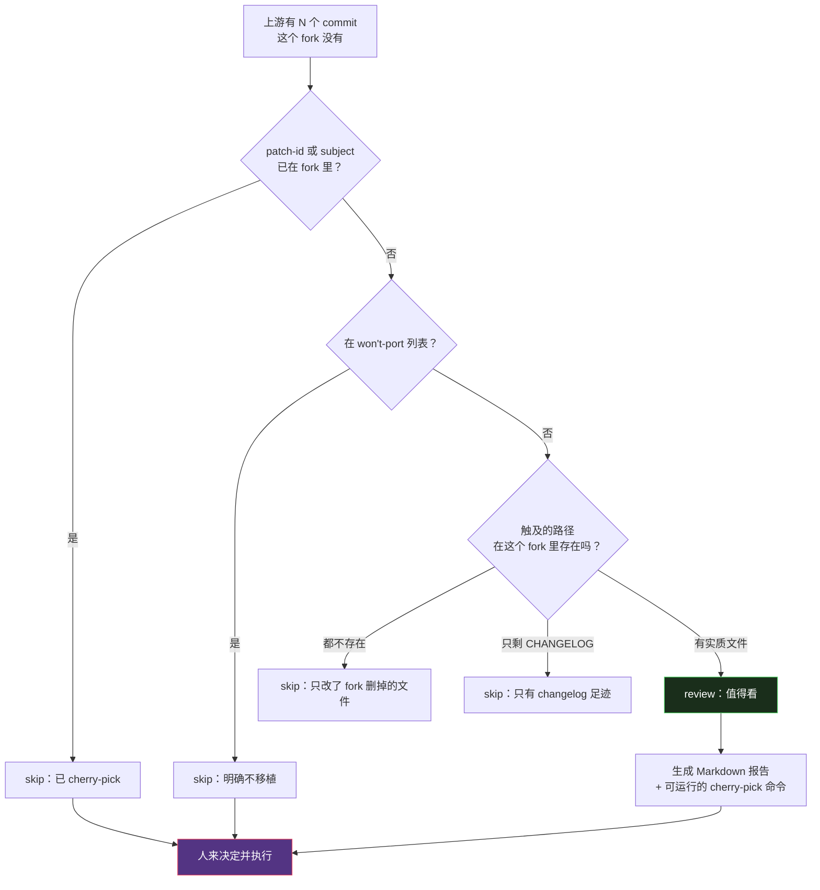

# （九）上游同步——"能干净地 cherry-pick"不等于"正确"

> 本文基于 commit `0f6480d`。主要文件：`tools/upstream_triage.py`（252 行）、`.github/workflows/upstream-watch.yml`、`CONTRIBUTING.md`。

## 一个所有 fork 都会遇到的问题

这个仓库的定位决定了它必然被 fork：

- 每个国家的求职者要换成本地招聘网站
- 每种语言要改 CV / 求职信模板
- 每个人要填自己的履历

于是上游和 fork 会同时演进：

- upstream：加通用功能、修 bug、改方法论
- fork：删掉丹麦门户、加本地门户、调评分权重、换模板

半年后，fork 想合并上游的一次修复。`git cherry-pick` 干净地成功了。**然后出问题了。**

`upstream_triage.py` 的 docstring 把这个陷阱写得很直白（`upstream_triage.py:5-10`）：

> It never merges, pushes, or edits anything - it only reads git history and prints. This is the deliberate report/act boundary: on a fork "applies cleanly" is not "correct" - a commit for portals the fork dropped can cherry-pick fine and still be wrong, and that silent-wrong case is worse than a conflict. So the report stops at ready-to-run cherry-pick lines; a human runs them.

翻译：**冲突至少会喊一声；静默地错误应用不会。**

## 一、两个问题，两个工具

仓库把上游同步拆成了两个不同的问题：

| 问题 | 工具 | 输入 |
|------|------|------|
| "哪些**框架文件**变了？" | `check_upstream_updates.py` | `framework_version` 版本戳 |
| "哪些**上游 commit** 值得看？" | `upstream_triage.py` | commit 历史 |

`upstream_triage.py:12-15` 说得很清楚：

> This is the commit-level companion to check_upstream_updates.py. That tool answers "which of my personalized framework files changed" (version stamps); this one answers "which upstream commits deserve my attention" (commit history). Two tools, two questions - each cross-references the other in its output.

这和上一篇文章提到的"一条规则只实现一次"是同一个思路：**不同粒度的问题，用不同工具。**

## 二、分诊逻辑



### 信号 1：patch-id，而不是 SHA

Cherry-pick 会产生**新的 SHA**，但 patch 内容相同。所以直接比较 SHA 会把已经应用过的 commit 误报为缺失。

```python
def patch_id(sha: str) -> str | None:
    """Stable patch-id for a commit, or None if it has no diff."""
    show = subprocess.run(
        ["git", "show", sha], capture_output=True, text=True, encoding="utf-8", errors="replace", check=True
    ).stdout
    r = subprocess.run(
        ["git", "patch-id", "--stable"], input=show, capture_output=True, text=True, encoding="utf-8", errors="replace"
    )
    line = r.stdout.strip()
    return line.split()[0] if line else None
```

然后：

```python
fork_patch_ids = {p for p in (patch_id(s) for s in fork_only) if p}
fork_subjects = {subject(s) for s in fork_only}
...
if patch_id(sha) in fork_patch_ids or subj in fork_subjects:
    skip.append((short, sha, subj, "already applied (cherry-picked)"))
    continue
```

`--stable` 很重要：默认的 `patch-id` 输出会受空白和行号影响，`--stable` 用更稳定的算法，让"同一份修改"在不同上下文里比对得上。

用 subject 兜底也有道理：有些人手工重写了提交，patch 不同但语义相同。

### 信号 2：路径相关性

一个 commit 改了 5 个文件，其中 4 个是 fork 删掉的丹麦门户，1 个是通用工具。它值得看吗？值得。

一个 commit 只改了 fork 删掉的文件，值得看吗？不值得。

判断逻辑（`upstream_triage.py:177-191`）：

```python
        touched = files_touched(sha)
        relevant = [
            f for f in touched
            if path_exists(f) or common_base is None or not path_exists(f, common_base)
        ]
        # A commit whose only surviving footprint is the changelog is one whose
        # real change lives in files this fork removed - the code doesn't apply,
        # only a doc line would. Low signal; demote it.
        substantive = [f for f in relevant if f != "CHANGELOG.md"]
        if touched and not relevant:
            skip.append((short, sha, subj, "touches only files not in this fork"))
        elif relevant and not substantive:
            skip.append((short, sha, subj, "changelog-only footprint in this fork"))
        else:
            review.append((short, sha, subj, substantive))
```

`relevant` 的判定有三段：

1. 文件在 fork 的 `HEAD` 里存在 → 相关
2. 找不到共同祖先（历史不共享）→ 无法判断，算相关（保守）
3. 文件在共同祖先里不存在 → 这是上游新增的路径，算相关

第 3 条处理"上游新增了一个文件"的情况：它在 fork 的 HEAD 里不存在，但也不是被 fork 删掉的，而是以前根本没有。所以要看共同祖先。

### 信号 3：changelog-only 降级

最后一个判断很细：

> A commit whose only surviving footprint is the changelog is one whose real change lives in files this fork removed - the code doesn't apply, only a doc line would.

如果 `CHANGELOG.md` 是唯一还有效的文件，说明真正的代码改动都在被删掉的文件里。这个 commit 只会给 fork 加一行 changelog，没有实质价值。

## 三、report/act 边界

工具生成报告，**不执行任何操作**。`upstream_triage.py` 的退出码永远是 0：

> Exits 0 always (a report, not a gate).

报告里确实会给出可运行的命令：

```python
        lines.append("<details><summary>Ready-to-run cherry-picks (review each before running)</summary>")
        lines.append("")
        lines.append("```bash")
        # Report rows stay newest first; commands must apply ancestors first.
        for short, sha, subj, _ in reversed(review):
            lines.append(f"git cherry-pick {sha}  # {subj}")
        lines.append("```")
```

但它只**打印**，不执行。注释解释了顺序：

> Report rows stay newest first; commands must apply ancestors first.

报告按时间倒序（最新的在上），cherry-pick 命令按时间正序（祖先先应用）。这个细节说明作者真的用过这个工具。

`upstream-watch.yml:9-14` 把这条边界称为 "deliberate and load-bearing"：

```yaml
# The report/act boundary is deliberate and load-bearing: the report stops at
# ready-to-run cherry-pick lines and never opens a draft PR or merges. On a
# fork "applies cleanly" is not "correct" - a commit for portals the fork
# dropped can cherry-pick fine and still be wrong, and that silent-wrong case
# is worse than a conflict. Merges stay a human decision, the same posture
# /apply keeps (it drafts, never submits). Keep it that way.
```

最后一句很有意思：**`/apply` 起草但不投递，上游同步生成命令但不执行。** 同一种"把最终动作留给人"的姿态，出现在两个完全不同的模块里。

## 四、周报工作流

`upstream-watch.yml` 每周一 08:00 UTC 跑一次：

```yaml
on:
  schedule:
    - cron: "0 8 * * 1" # 08:00 UTC every Monday
  workflow_dispatch:
```

它只在一个滚动 issue 里更新报告，不建 PR、不合并：

> It fetches the upstream template, runs `tools/upstream_triage.py` ... and writes the result into a single rolling issue. You read it and port anything worth porting by hand.

三个安全细节：

1. **只建一个 issue**，每次都编辑同一个，不会刷屏
2. **只在 fork 上跑**：`if: github.repository != 'MadsLorentzen/ai-job-search'`
3. **`GH_REPO` 显式绑定当前仓库**

第 3 点的注释解释了一个很隐蔽的坑：

```yaml
          # Pin to this fork. Without it, the `upstream` git remote added above
          # makes gh's remote resolution target the base repo, so the digest
          # would land on upstream's tracker instead of the fork's.
          GH_REPO: ${{ github.repository }}
```

工作流刚加了 `upstream` remote，`gh` 解析"当前仓库"时可能选中它，于是报告被发到了上游的 issue 列表。显式指定 `GH_REPO` 堵掉这个歧义。

## 五、优秀代码：把"已应用"定义成 patch 等价

选 `patch_id()` 这段，因为它纠正了一个很常见的错误直觉：

> Cherry-pick 之后 commit 不一样了，所以它还是"缺失"的。

```python
def patch_id(sha: str) -> str | None:
    show = subprocess.run(["git", "show", sha], ...).stdout
    r = subprocess.run(["git", "patch-id", "--stable"], input=show, ...)
    line = r.stdout.strip()
    return line.split()[0] if line else None
```

### 好在哪里

1. **用内容定义身份，不用元数据。** SHA 是元数据，patch 内容才是语义。
2. **`--stable` 而不是默认。** 同一份修改在不同上下文里行号不同，默认算法会给出不同 id。
3. **保留 subject 兜底。** 手工重写的提交 patch 不同，但 subject 往往相同。
4. **无 diff 的 commit 返回 None。** 空提交不应该参与比较。

### 模式

**Content-addressed identity**（内容寻址身份）。和 Git 本身的对象模型、内容寻址存储、构建缓存是同一个思路。

### 骨架代码

```python
def patch_identity(commit: str) -> str | None:
    """Semantic identity of a change, independent of commit metadata."""
    diff = subprocess.run(
        ["git", "show", commit],
        capture_output=True, text=True, check=True,
    ).stdout
    out = subprocess.run(
        ["git", "patch-id", "--stable"],
        input=diff, capture_output=True, text=True, check=True,
    ).stdout.strip()
    return out.split()[0] if out else None


def already_applied(upstream_commit: str, fork_commits: list[str]) -> bool:
    target = patch_identity(upstream_commit)
    return target is not None and target in {
        p for p in map(patch_identity, fork_commits) if p
    }
```

任何"比较两个分支的变更集合"的场景都适用：多仓同步、镜像仓库、变更审计、发布比对。

## 六、fork 治理：什么该进上游，什么该留下

同步问题的根因是**边界不清**。`CONTRIBUTING.md` 用三条规则把边界划死：

### 规则 1：市场专属的留在 fork

> **Market- or country-specific skills and content.** One country's portal opens the door to every country's portal; there is no principled stopping point. Precedent: [#31] (India), [#39] (France, despite an honest and excellent PR), [#67] (China).

理由不是"我们不想要"，而是**没有原则性的停止点**：

> It is the same arithmetic that keeps market-specific portals in forks.

### 规则 2：运行时移植只做"薄指针"

> A parallel command tree for another runtime (Codex, Antigravity, Gemini CLI, ...) would ship untested on every change - CI cannot run those harnesses - and each accepted runtime makes the next one harder to refuse.

上游只维护三样东西给其他 runtime：

- 通用 Agent Skills 格式的 portal skills（Codex / Antigravity 能直接发现）
- 根目录 `AGENTS.md` 指向工作流规范
- `framework_version` 版本戳

其余靠 fork 自己维护，并且推荐"reference the specs here instead of copying them"。

### 规则 3：模板永远 person-agnostic

> **Personal profile data.** The template ships placeholders; your populated profile lives in your fork. CI enforces this (`placeholder-integrity`).

这条由 CI 强制执行，不是靠自觉。

### 版本化发布

`CHANGELOG.md` 有 2,126 行、10 个已发布版本（1.0.0 → 1.7.2）。README 建议：

> Upstream moves fast. Rather than pulling raw `master` and hoping, update your fork to a tagged release - a vetted checkpoint described in CHANGELOG.md.

**按 tag 更新，不跟 master。** 这又是一个"降低不确定性"的选择：release 是人工审过的检查点，master 是随时可能半成品。

## 七、一个反例：PR 打错了仓库

`CONTRIBUTING.md` 里有一条很接地气的警告：

> One practical warning: when you open a PR from a fork, GitHub targets this upstream repo by default, not your own - three personalized-fork PRs landed here by accident in a single week.

这是 fork-first 工作流的真实摩擦：用户在自己的 fork 里改完，点 "Compare & pull request"，GitHub 默认把 base 指向 upstream 而不是自己的 fork。结果是一份带个人信息的 PR 发到了公共仓库。

仓库的应对：

- 文档里明确警告
- CI 的 `placeholder-integrity` 会挂
- 但最终还是靠人看 base repository 下拉框

**工具能降低概率，不能消除误操作。**

## 总结

| 问题 | 解法 |
|------|------|
| 上游一直在动 | 按 tag 更新，不跟 master |
| fork 有自己的改动 | 按文件粒度看 `framework_version`，按 commit 粒度看 triage |
| cherry-pick 后 SHA 变了 | 用 patch-id 判断"已应用" |
| 上游改了被删掉的文件 | 按路径相关性过滤，changelog-only 降级 |
| 自动合并可能静默错误 | report/act 边界：只出报告和命令，人执行 |
| 什么该进上游 | 三条规则：市场专属、运行时移植、个人信息都留在 fork |
| 报告发错地方 | `GH_REPO` 显式绑定 + 只在 fork 跑 |

下一篇是系列约定的 Prompt 全集：把散落在 12 个 command、3 个 skill、1 个 agent 里的核心指令整理成中英对照，并按功能分组。
