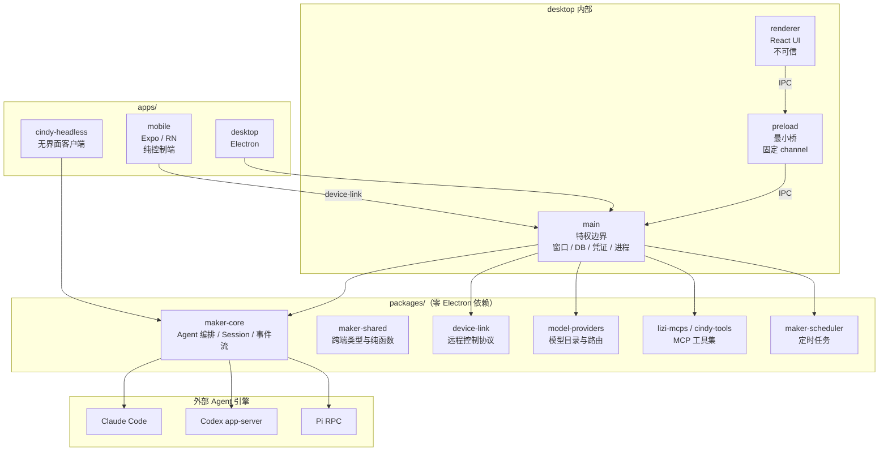
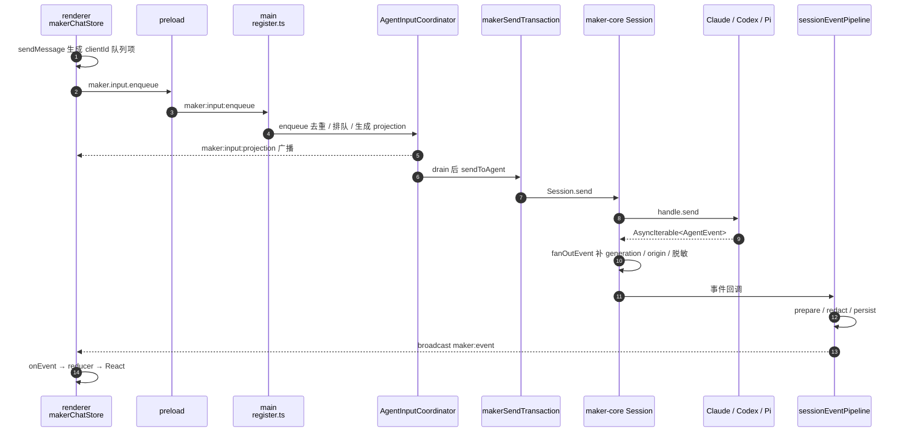

# Cindy 源码阅读（一）：一个 Agent 客户端如何把自己拆成连接层

> 基于 [makecindy/cindy](https://github.com/makecindy/cindy) 源码分析。commit `2ce93d36`，2026-11-02，Apache-2.0。
> 系列：Cindy 源码阅读（1/10）。

## 一句话概括

Cindy 是一个**开箱即用的开源 AI Agent 客户端**：桌面端（Electron）负责真正执行任务，手机端（Expo / React Native）作为远程控制端，中间通过自研的 device-link 协议连接；Claude Code、Codex、Pi 三种 Agent 引擎被统一到同一个会话界面里，再配上 MCP、Skill、插件、定时任务和 IM 渠道。

它想解决的不是“再做一个 Agent Loop”，而是更产品化的问题：**让不想折腾 Key、CLI、MCP 和运行环境的用户，也能在自己电脑上用上完整的 Agent 工作流，并且能在多台设备之间连续工作。**

## 生活比喻：一栋自己家的智能公寓

把 Cindy 想成一栋你自己家的公寓：

| 角色 | 对应模块 | 职责 |
|------|---------|------|
| **前台** | `apps/desktop/src/renderer` | 接待你、展示房间状态、收集你的指令 |
| **物业与钥匙** | `apps/desktop/src/preload` | 只开固定的几扇门，不把整串钥匙交给前台 |
| **物业办公室** | `apps/desktop/src/main` | 真正持有钥匙、水电、档案和安保权限 |
| **外包管家** | `packages/maker-core` | 安排 Claude Code / Codex / Pi 干活，自己不碰房子 |
| **对讲机** | `packages/device-link` | 让你在手机上指挥家里这台电脑 |
| **外部服务商** | Claude Code / Codex / Pi | 真正提供“智能”的一方，Cindy 只负责连接 |

这个比喻里最重要的一句是：**前台不可信，物业办公室才是权限边界。** 后面的所有架构选择，几乎都能从这句话推出来。

## 仓库长什么样

这是一个 pnpm monorepo，`pnpm-workspace.yaml` 只声明了 `apps/*` 和 `packages/*`：

```text
cindy/
├── apps/
│   ├── desktop/            Electron 桌面端
│   ├── mobile/             Expo / React Native 手机端
│   ├── cindy-headless/     无界面的 headless 客户端
│   └── *-bin/              随桌面端分发的 CLI 二进制资产
├── packages/               34 个 workspace 包
├── config/                 CN / Global 端点清单
├── docs/                   dev-rules / product-rules / design-rules
├── scripts/                仓库级工程脚本与 guard
└── tools/                  claude / codex / pi / ripgrep 版本 pin
```

规模上要有心理准备：仓库里约 **1.36 万个 TS/TSX 文件**，其中几处巨型文件会反复出现在阅读路径上：

| 文件 | 行数 | 说明 |
|------|------|------|
| `apps/desktop/src/main/maker-ipc/register.ts` | 26,473 | main 侧 IPC 与会话编排的集中接线 |
| `apps/desktop/src/renderer/lib/makerChatStore.ts` | 20,058 | 渲染层聊天状态机 |
| `apps/desktop/src/preload/preload.ts` | 8,577（约 423KB） | 主窗口 preload 桥 |

这不是“代码写得差”的证据，而是产品面积大的结果：桌面端把 Agent、文件、浏览器、远程桌面、插件、IM、计费、更新器全装进了一个应用。读这个仓库不能从头读到尾，只能按行为入口定位。

## 分层与依赖方向



依赖方向可以压缩成三句话：

1. `apps/desktop → packages`，packages 不反向 import main / renderer。
2. `renderer → preload → main`，renderer 不直接碰 Node、Electron、磁盘和数据库。
3. `mobile → packages + device-link → desktop main`，手机本地不跑 agent、不持有权威会话库，只保留本地历史/缓存（AsyncStorage / SQLite）；所有执行都回到桌面。

服务端不在这个仓库里。`README.md:141-142` 明确写了 backend 位于独立仓库，`AGENTS.md:8-9` 也规定不要跨仓修改服务端。客户端通过 `config/endpoint.json` 和 auth-client 与服务端建立契约；即使不登录，也可以用 “Skip Sign-In” 跑本地 Agent。这是有意的仓库边界：**客户端可以独立构建、审计和 fork，但完整云能力依赖外部服务。**

## 一次任务从 UI 到 Agent 再回来

以桌面端发送一条消息为例，完整链路如下：



几个容易忽略的细节：

- **队列在 main，不在 renderer。** renderer 只生成带 `clientId` 的队列项，真正的去重、排队、插话和 projection 由 `AgentInputCoordinator`（`maker-ipc/agent-input-coordinator.ts`）持有。这样多窗口、手机远控、IM 渠道可以共享同一套输入事务。
- **持久化只在 main。** `sessionEventPipeline` 先落库再广播，手机端复用同一份事件 reducer，但不写数据库。
- **远程会话走同一条 IPC。** 手机发起的 `maker:*` 调用经 device-link 转发到被控端，被控端用同一个 handler 处理。`device-link/src/allowlist.ts` 决定哪些 channel 可以被远程调用。

## 三个关键设计决策

### 1. maker-core 零 Electron 依赖

`packages/maker-core/package.json` 的依赖只有 Claude Agent SDK、Anthropic SDK、maker-shared、model-providers、diff、gray-matter，没有 Electron、React、Expo。凭证、网络、窗口等宿主能力通过 `MakerDeps` 注入；但 core 并非完全零文件系统：部分路径解析和文件读取仍直接使用 `node:fs`：

```ts
// packages/maker-core/src/maker.ts:129-162（节选）
export interface MakerDeps {
  agents: Partial<Record<AgentKind, BaseAgent>>;
  startDeviceAgentSession?: (input: {...}) => Promise<AgentSessionHandle>;
  storage: SessionStorage;
  logger: Logger;
  lifecycleHooks?: SessionLifecycleHooks;
  makerMemory?: MakerMemoryManager;
  visionBridge?: VisionBridgeHook;
  toolLoopReviewer?: ToolLoopReviewer;
}
```

**WHY**：同一套编排核心可以跑在 Desktop、`cindy-headless` 和测试环境里；凭证、网络、窗口这些平台差异留在宿主。少量路径解析和文件读取仍在 core 内，但核心不承担宿主级的存储语义，越纯越容易单测。

### 2. main 进程禁止运行时动态 `import()`

`docs/dev-rules/architecture-invariants.md:30-33` 把“main 进程禁止运行时动态 `import()`”写成架构不变量。原因不是风格洁癖，而是一次真实事故：Rollup 会把 `import()` 拆成跨 chunk 的 `require`，而 bootstrap chunk 因为 `electron-store` 的副作用删除过 `require.cache`，跨 chunk require 会重新执行整个 main bundle，导致 IPC 二次注册，直到 OOM。

**WHY**：Electron main 的加载时机、打包边界和错误路径比普通 Node 程序复杂得多。动态 import 把“什么时候加载、加载几次、失败怎么处理”变成了运行时问题；静态 import 让这些问题在构建期暴露。

### 3. package 通过注入获得宿主能力

`packages/device-link` 不自己创建 WebSocket：`DeviceLinkClientOptions` 要求宿主注入 `createWebSocket`、token、设备信息。`maker-core` 也不自己 spawn CLI，`AgentDeps.binaryPath` 由宿主准备好再传进来。

**WHY**：这样 package 可以被桌面、headless、远程 daemon 复用，测试可以注入 fake 实现；凭证和网络出口始终归宿主，不会散落在每个 package 里。

## 优秀代码一：preload 的引用计数 fan-out

`apps/desktop/src/preload/preload.ts:530-560`

```ts
function createIpcFanOut(channel: string): FanOut {
  const listeners = new Set<IpcCallback>();
  let bound = false;
  const bridge = (_event: Electron.IpcRendererEvent, data: unknown, ownerStamp?: unknown) => {
    listeners.forEach((cb) => {
      cb(data, ownerStamp);
    });
  };
  const subscribe = ((callback: IpcCallback): (() => void) => {
    listeners.add(callback);
    if (!bound) {
      ipcRenderer.on(channel, bridge);
      bound = true;
    }
    return () => {
      listeners.delete(callback);
      if (listeners.size === 0 && bound) {
        ipcRenderer.removeListener(channel, bridge);
        bound = false;
      }
    };
  }) as FanOut;
  subscribe.__reset = (): void => {
    listeners.clear();
    if (bound) {
      ipcRenderer.removeListener(channel, bridge);
      bound = false;
    }
  };
  return subscribe;
}
```

**好在哪**：

- 每个 channel 只向 `ipcRenderer` 注册一个监听器，多个 React 订阅者共享它，避免监听器数量随组件数量增长。
- 引用计数到 0 才解绑，正确调用 unsubscribe 时不会留下泄漏。
- `bridge` 丢弃 `IpcRendererEvent`，只把业务 payload 交给订阅者，renderer 拿不到 Electron 的事件对象。
- `__reset` 专门处理 HMR：热更新会重复执行模块，不清理就会叠加监听器。

**模式**：ref-counted lazy singleton + pub/sub + 显式 teardown。

**骨架**：

```ts
function createFanOut<T>(channel: string) {
  const listeners = new Set<(value: T) => void>();
  let bound = false;
  const bridge = (_e: unknown, value: T) => listeners.forEach((cb) => cb(value));
  return (cb: (value: T) => void) => {
    listeners.add(cb);
    if (!bound) { ipcRenderer.on(channel, bridge); bound = true; }
    return () => {
      listeners.delete(cb);
      if (listeners.size === 0 && bound) {
        ipcRenderer.removeListener(channel, bridge); bound = false;
      }
    };
  };
}
```

## 优秀代码二：IPC 薄适配器的“校验 → 清洗 → 盖章 → 委托”

`apps/desktop/src/main/maker-ipc/sessionSendHandler.ts:35-62`（节选，省略了部分注释与字段处理）

```ts
registry.handle(
  MAKER_INVOKE.SEND,
  async (
    _e,
    sessionId: unknown,
    message: unknown,
    createOpts?: unknown,
    sendOpts?: unknown,
  ): Promise<TResult> => {
    if (typeof sessionId !== 'string') {
      throwIpcError('INVALID_PARAMS', 'sessionId required');
    }
    const boundaryStamp = await deps.assertRemoteInputControlBoundary?.(sessionId, sendOpts);
    const mainOwnedBoundaryStamp =
      boundaryStamp && typeof boundaryStamp === 'object' ? boundaryStamp : undefined;
    // sendOpts 来自 wire: 剥掉只允许 main 写的字段，然后由 main 重新盖章。
    return await deps.sendToAgentAccepted(
      sessionId,
      message,
      createOpts,
      attachMainOwnedInputBoundary(sendOpts, mainOwnedBoundaryStamp),
    );
  },
);
```

**好在哪**：

- 适配器只做边界工作：运行时校验、剥掉 wire 中仅供 main 使用的字段、由 main 重新盖章，然后委托给事务层。
- renderer 自报的 `fromMobileClient`、`sourceDevice`、`origin`、`turnPermissionPolicy` 都不可信；main 重新生成，避免远程端伪造来源或权限。
- 本 handler 的参数错误统一走 `throwIpcError`，错误码和消息协议一致；`deps` 注入让 handler 可以直接单测。

**模式**：ports-and-adapters 的薄边界 + capability stamping。

**骨架**：

```ts
registry.handle(CHANNEL, async (_e, input: unknown, opts?: unknown) => {
  if (!isValid(input)) throwIpcError('INVALID_PARAMS', '...');
  const trusted = sanitize(opts);
  const stamped = attachMainOwnedFields(trusted, await assertBoundary(input));
  return deps.delegate(input, stamped);
});
```

## 这个架构的优点与代价

| 优点 | 代价 |
|------|------|
| 特权边界清楚：renderer 被 XSS 也拿不到 Node / DB / 凭证 | main 是巨型单体，`register.ts` 2.6 万行，认知与 review 成本高 |
| 核心可移植：Desktop 和 headless 复用 maker-core | 不变量靠文档 + review，尚未完全机器化；生产 main 里仍有动态 import |
| 本地与远控共用 handler 和 reducer，手机端复用度高 | preload API 面很宽，新增能力要同步 shared / preload / main / 错误协议 / 测试 |
| 事件管线单向，main 单写持久化，避免多窗口重复行 | 手机执行依赖桌面在线；服务端在仓外，协议兼容成本高 |
| 文档把 WHY 写进仓库，新人和 Agent 都能按索引进入 | 规则总量大，文档与代码存在漂移（例如 mobile 依赖包数量） |

## 系列导读

后面九篇会沿着这张图往下拆：

1. **本篇**：整体分层与依赖方向
2. `maker-core`：Maker / Session / BaseAgent 的编排骨架
3. 三个引擎：Claude Code、Codex、Pi 如何统一成一条事件流
4. 会话可靠性：看门狗、工具循环守卫、中断续跑
5. device-link：手机控制电脑的协议
6. 权限与自动审核：原生优先、Cindy 保底
7. 插件、Skill 与 Ghost 渐进发现
8. Electron 安全与布局树
9. Prompt 全集（中英双语）
10. 文档驱动的工程治理

---

**相关文章**

- [Cindy 源码阅读（二）：Maker、Session、BaseAgent 的三层骨架](02-maker-core.md)
- [Cindy 源码阅读（五）：device-link，手机如何控制电脑](05-device-link.md)
- [Cindy 源码阅读（八）：Electron 进程边界与布局树](08-electron-security.md)
