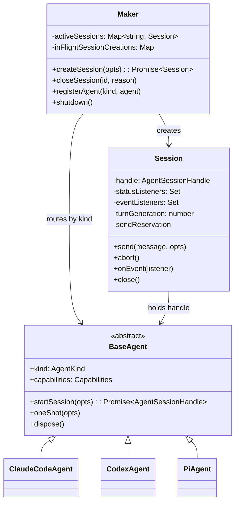
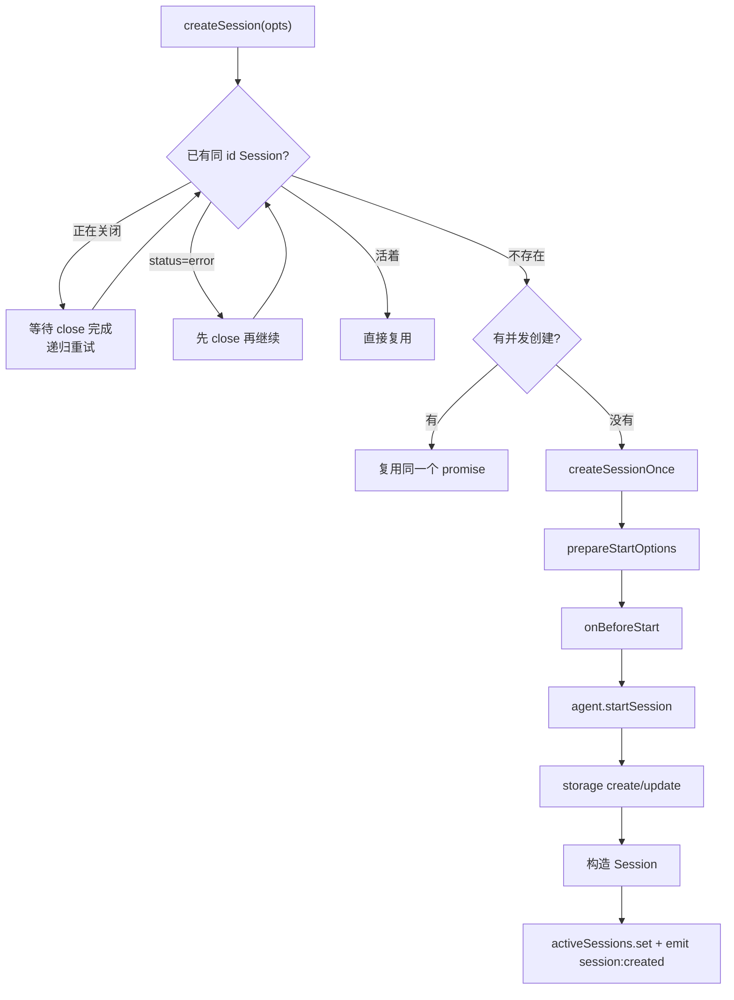

# Cindy 源码阅读（二）：Maker、Session、BaseAgent 的三层骨架

> 基于 [makecindy/cindy](https://github.com/makecindy/cindy) 源码分析。commit `2ce93d36`，2026-11-02。
> 系列：Cindy 源码阅读（2/10）。

## 一句话概括

`packages/maker-core` 是 Cindy 的 Agent 编排中枢，只有三层：

- **Maker**：注册中心 + 工厂。按 `(agentKind, workDir)` 创建、复用、关闭 Session。
- **Session**：单次会话的包装。把 Agent 的异步事件流变成订阅 API，管理发送、中断、交互和生命周期。
- **BaseAgent**：引擎抽象。Claude Code、Codex、Pi 各自实现 `startSession`，其余共享能力由基类兜底。

它不依赖 Electron / React / UI，但并不是完全不碰文件系统：部分路径解析和文件读取仍直接使用 `node:fs`；凭证、网络、窗口、持久化等宿主能力通过依赖注入进来。

## 生活比喻：一家餐厅的前厅、订单和后厨

| 角色 | 对应模块 | 职责 |
|------|---------|------|
| **餐厅经理** | `Maker` | 决定开哪张桌、找哪位厨师、什么时候翻台 |
| **订单** | `Session` | 记录这一桌的需求、上菜进度、加菜和退菜 |
| **厨师接口** | `BaseAgent` | 定义“开火、上菜、收工”的通用动作，不同菜系各自实现 |

经理不炒菜，订单不决定菜谱，厨师也不管餐厅怎么排桌。三层各管一件事，才能在换厨师（Claude / Codex / Pi）时不把整家店重装一遍。

## 三层关系



## Maker：注册中心与单飞工厂

Maker 的职责在文件头注释里写得很明确（`packages/maker-core/src/maker.ts:1-16`）：

- 持有按 `AgentKind` 注册的 `BaseAgent` 实例；
- 按 `(agentKind, workDir)` 创建 Session；
- 维护 Session 列表。

它**不做** UI 状态、权限弹窗、业务 token 管理——这些是宿主的责任。

### createSession 的关键路径



这里最值得学的是**单飞（single-flight）+ 所有权围栏**：同一 id 的并发创建只允许一个真正执行，其他调用共享 promise；但复用之前必须先确认旧 Session 真的关闭成功，否则会出现“新 handle 和仍存活的旧 transport 并存”。

### 生命周期钩子

`MakerDeps.lifecycleHooks`（`maker.ts:94-127`）让宿主在关键节点插入副作用：

| 钩子 | 时机 | 失败语义 |
|------|------|---------|
| `prepareStartOptions` | Agent 启动前补齐参数 | 阻断创建 |
| `onBeforeStart` | Agent 启动前的宿主准备 | 只记日志 |
| `onStartSucceeded` | Session 创建成功、对外发布前 | 只记日志 |
| `onStartFailed` | 启动失败，区分 prepare / agent-start / storage | 不覆盖原始错误 |
| `onStartCleanupSucceeded` | 延迟清理终于完成 | 只记日志 |
| `onClose` | Session 关闭 | 只记日志 |

这个设计的意图是：**核心只声明“这里有一个生命周期节点”，不关心宿主拿它做什么。** Desktop 用它来管 worktree、临时文件、持久化和审计记录；headless 可以什么都不做。

## Session：事件流的单一收口

Session 是单次会话的上层包装（`packages/maker-core/src/session.ts:1-11`）：

- 统一暴露能力和运行时切换接口；
- 把 `AgentSessionHandle` 的 `AsyncIterable<AgentEvent>` 转成订阅 API；
- 管理 `InteractionResolver`（权限、提问、计划审阅三合一）；
- 持有 turn generation、send reservation、看门狗等会话级状态。

### 为什么要再包一层

底层每个 Agent 都会产出事件流，但它们的语义差异很大：

- Claude Code 的 SDK 事件是 `SDKMessage`；
- Codex 的 app-server 是 JSON-RPC notification；
- Pi 是 RPC event。

如果让 UI 直接消费三套 AsyncIterable，每个入口都要重复处理“终态怎么收口、迟到事件怎么丢、后台任务算不算进展、usage 归哪个 turn”。Session 把这些统一成一条 `AgentEvent` 流，宿主只订阅一种协议。

`fanOutEvent`（`session.ts:2798-3051`）在分发前做几件事：

1. 补 `sessionInstanceId`、turn generation、origin、attempt token；
2. 对监听者做脱敏；
3. 判断是否终态、是否后台事件、是否刷新看门狗；
4. 把事件分发给所有 `onEvent` 监听者。

监听器异常被单独捕获，不会互相影响。

### 发送与中断

`Session.send` 不是简单地调 `handle.send`。它要先过：

- host lease（这台电脑是否还有权执行）；
- 权限变更；
- 运行中检查；
- send reservation（防止同一 turn 被并发发送）；
- turn generation 分配。

`handle.send` resolve 才算“已接受”，而不是“已发出”。这个区分很重要：只有接受边界之后，宿主才能安全地认为这条消息进入了 Agent 的输入队列。

`Session.abort` 会取消 reservation、清看门狗、置 `aborting`、调 `handle.abort`，并在 finally 恢复 `active`；同时排一个 15 秒复核（手动 Stop）或 10 秒复核（看门狗），确认 turn 真的停了。

## BaseAgent：模板方法 + 能力协商

BaseAgent 的抽象面很薄（`agents/base-agent.ts:2685-2687, 2785`）：

- `kind`：引擎类型；
- `capabilities`：能力声明；
- `startSession`：唯一必须实现的启动方法。

其余方法都有默认实现：

- `oneShot`、`forkSdkSession`、memory 读写、账号额度等默认 `throwNotSupported`；
- 命令 / Skill / 定制发现默认返回空集合；
- `dispose` 默认 no-op。

这就是“**不实现即不支持，且不暴露**”的原则：UI 在创建会话前读 `capabilities` 就能决定按钮和降级文案，而不是等到调用时才崩。

能力协商还体现在运行时校验：Session 在 steer、异步提问前会再查一次能力；Maker 在设备托管、远端 Codex 场景会降级 `rewind`。能力不是静态标签，而是“声明 + 运行时兜底”。

## 优秀代码一：单飞创建与所有权围栏

`packages/maker-core/src/maker.ts:712-740`

```ts
// 进程内已经活着或正在启动的 session, 直接复用 (避免 spawn 第二个 SDK)。
// close() 失败的 Session 不能继续收消息，但也不能立刻从 activeSessions
// 摘掉并与可能仍存活的底层 transport 并存。先重试同一个 close；只有真实
// 关闭成功、status listener 将其移除后，才允许创建新的 handle。
const existing = this.activeSessions.get(opts.id);
if (existing?.hasStartedClosing()) {
  await this.waitForSessionCleanup(existing.close(), signal);
  return this.createSessionWhileRunning(opts, signal);
}
if (existing?.getStatus() === 'error') {
  await existing.close();
  signal?.throwIfAborted();
}
const reusable = this.activeSessions.get(opts.id);
if (reusable) return reusable;

const inFlight = this.inFlightSessionCreations.get(opts.id);
if (inFlight) return inFlight.promise;

const creation = { promise: this.createSessionOnce(opts, signal), signal };
this.inFlightSessionCreations.set(opts.id, creation);
try {
  return await creation.promise;
} finally {
  // entry 身份比较防御未来替换 / 重试逻辑误删更新的占位。
  if (this.inFlightSessionCreations.get(opts.id) === creation) {
    this.inFlightSessionCreations.delete(opts.id);
  }
}
```

**好在哪**：

- 先处理“正在关闭”和“error”两种不可复用状态，再判断可复用，顺序不能反。
- 关闭失败不会立刻从 `activeSessions` 摘掉，避免新 handle 和旧 transport 并存。
- promise 在 `await` 之前入表，保证并发调用拿到同一个 pending promise。
- `finally` 用身份比较删除，防止未来的重试逻辑误删别人的占位。

**模式**：single-flight / promise memoization + ownership fencing。

**骨架**：

```ts
async function getOrCreate(key: string) {
  const existing = live.get(key);
  if (existing?.closing) { await existing.close(); return getOrCreate(key); }
  if (existing?.error) await existing.close();
  const reusable = live.get(key);
  if (reusable) return reusable;
  const pending = inFlight.get(key);
  if (pending) return pending.promise;
  const entry = { promise: create(key) };
  inFlight.set(key, entry);
  try { return await entry.promise; }
  finally { if (inFlight.get(key) === entry) inFlight.delete(key); }
}
```

## 优秀代码二：交互等待的作用域守卫

`packages/maker-core/src/session.ts:2314-2338`

```ts
async runHostInteraction(
  request: InteractionRequest,
  resolve: () => Promise<InteractionDecision>,
): Promise<InteractionDecision> {
  // Native async questions use the same card resolver, but never suspend turn
  // protection or register a waiting interaction with the lifecycle observer.
  if (request.kind === 'ask_user_question' && request.delivery === 'async') return resolve();
  const isQuestion = request.kind === 'ask_user_question';
  if (isQuestion) {
    this.pendingUserQuestions += 1;
    this.asyncUserQuestions.expire('superseded');
  }
  this.pendingInteractions += 1;
  const runtime = this.observeInteractionStarted(request);
  this.armTurnStallWatchdog();
  try {
    return await resolve();
  } finally {
    if (isQuestion) this.pendingUserQuestions -= 1;
    this.pendingInteractions = Math.max(0, this.pendingInteractions - 1);
    this.observeInteractionSettled(runtime);
    this.armTurnStallWatchdog();
  }
}
```

**好在哪**：

- 异步问题走快速路径，不暂停 turn 保护，也不登记为阻塞交互——用户可能几分钟后才答，不能因此让看门狗停表。
- 同步等待前后都重算看门狗：等待期间暂停计时，回答后重新起表，避免“等用户时被误杀”或“恢复后忘记重新计时”。
- 计数在 `await` 前加、`finally` 里减，并用 `Math.max(0, ...)` 防御异常路径下的负计数。

**模式**：scope guard / bracket + 状态派生。

**骨架**：

```ts
async function withInteraction<T>(req: Request, run: () => Promise<T>): Promise<T> {
  if (req.async) return run();
  busy += 1;
  refreshWatchdog();
  try { return await run(); }
  finally { busy = Math.max(0, busy - 1); refreshWatchdog(); }
}
```

## 优秀代码三：死句柄自愈，重建交给工厂

`packages/maker-core/src/session.ts:3490-3525`（节选）

```ts
// handle.events() 自然结束 (iterator return) = 底层 handle 已死、不会再发任何事件。
// 此前没有这条兜底, status 一直停在 'active' → Maker.activeSessions 永远不 delete
// → 下次 maker:send 拿到老 Session → handle.send 把消息塞进死的 inputQueue →
// 用户感知"发了没反应"。
if (this.terminationStarted || this.status === 'closed' || this.status === 'error') return;
const unfinishedTurn = this.hasUnsettledTurn();
this.logger.debug('event loop ended (handle dead), auto-closing session', { unfinishedTurn });
this.runtimeInitiatedClose = true;
this.terminationStarted = true;
this.closePromise = Promise.resolve();
this.settleUnfinishedTurn('Session event loop stopped unexpectedly without a terminal event');
this.clearTurnStallWatchdog();
this.cancelSendReservation(this.sendReservation);
this.sendReservation = null;
this.unacceptedSendGeneration = null;
this.currentTurnOrigin = null;
this.currentTurnAttemptToken = null;
this.turnControlState?.toolLoopMonitor?.dispose();
this.turnControlState = null;
this.setStatus('closed');
```

**好在哪**：

- 把“事件迭代器自然结束”这个最容易被忽略的退出路径显式收口；在此之前，这种情况会让 Session 永远停在 `active`。
- 先 fence 新工作（`terminationStarted`），再结算未完成 turn，再清 per-turn 资源，最后通知所有者。
- 不尝试原地复活，而是置 `closed`，让 Maker 的 status listener 移除它；下一次 send 走 lazy create 重建。

**模式**：失败自愈状态机 + 工厂重建。

**骨架**：

```ts
function onTransportEnded() {
  if (terminated || status !== 'active') return;
  terminated = true;
  settleUnfinishedTurn('transport ended');
  clearTimers();
  releaseReservations();
  setStatus('closed'); // 上层监听器负责删除并触发重建
}
```

## 设计取舍与风险

| 决策 | 收益 | 代价 |
|------|------|------|
| Maker 不做自动重启池，依赖宿主下次 send 触发 lazy create | 核心简单，不猜重建时机 | 宿主没有下一次发送就不会自愈 |
| 生命周期钩子多数 fail-open | 宿主副作用失败不阻断主流程 | 审计记录、worktree 等副作用可能静默丢失 |
| Session 单迭代器集中收口 | 事件语义统一，宿主只订阅一种协议 | `session.ts` 已是高复杂度状态机，跨 turn 状态位多 |
| BaseAgent 默认 `NotSupportedError` | 能力边界清晰，不假装支持 | `AgentDeps` 是约 890 行的可选依赖袋，真实必填项难发现 |

具体风险：

1. `createSessionOnce` 约 545 行（`maker.ts:744-1289`），多个失败阶段各自回滚，新增步骤容易漏一条清理路径。
2. `session.ts` 3672 行，generation、reservation、terminal drain 互相依赖，作者在 `992-998` 也标注了已知的 origin 单槽位竞态。
3. `shutdown` 只收集 session detach 失败，agent dispose 失败仅进日志，调用方可能低估残留进程风险。
4. Maker 的 `registerAgent` 只能追加、不能注销，Pi 这类可选运行时依赖宿主装配顺序。

---

**相关文章**

- [Cindy 源码阅读（一）：一个 Agent 客户端如何把自己拆成连接层](01-architecture.md)
- [Cindy 源码阅读（三）：三种引擎，一条事件流](03-agent-adapters.md)
- [Cindy 源码阅读（四）：看门狗、循环守卫与中断续跑](04-session-reliability.md)
