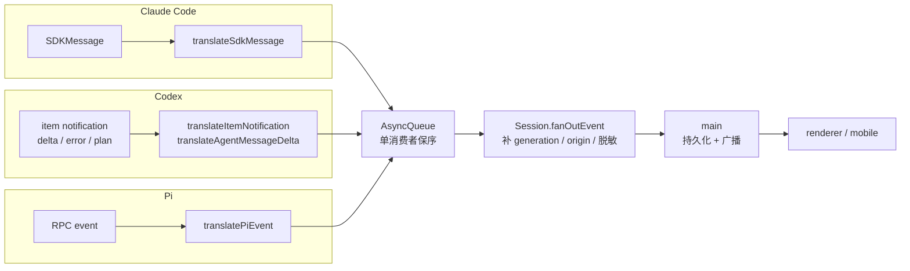

# Cindy 源码阅读（三）：三种引擎，一条事件流

> 基于 [makecindy/cindy](https://github.com/makecindy/cindy) 源码分析。commit `2ce93d36`，2026-11-02。
> 系列：Cindy 源码阅读（3/10）。

## 一句话概括

Cindy 同时接入 Claude Code、Codex、Pi 三种 Agent 引擎。它们的进程模型、事件协议、权限入口完全不同，但最终都被翻译成同一条 `AgentEvent` 流。上层的 Session、main、UI 只认识这一种事件。

这就是“连接层”的核心工作：**不重新实现智能，只把不同引擎的方言翻译成同一种普通话。**

## 生活比喻：三个说不同语言的厨师

Claude Code、Codex、Pi 像三位厨师：

- Claude Code 用 SDK 点菜，食材由 CLI 子进程处理；
- Codex 用 app-server 的 JSON-RPC 点菜，一个后厨同时服务多张桌；
- Pi 用 RPC 点菜，每个请求有 id，响应靠 id 对号入座。

Cindy 不教他们做菜，只在传菜口安排一位翻译：不管后厨说什么语言，传到前厅的必须是同一份菜单——文字、思考、工具调用、工具结果、终态。

## 三种接入方式

| 维度 | Claude Code | Codex | Pi |
|------|-------------|-------|-----|
| 接入形态 | `@anthropic-ai/claude-agent-sdk` 的 `query()` | 自建 `AppServerHost`，共享 `codex app-server` 子进程 | `spawn pi --mode rpc` |
| 传输 | SDK 进程内调用 + CLI 子进程 stdio | JSON-RPC NDJSON（本地 spawn / 远端 daemon） | JSONL over stdio，严格 LF 分帧 |
| 多会话 | 同一时刻一条 SDK 查询（rewind/重启会重建） | 一个 app-server 用 `thread_id` 多路复用 N 个会话 | 每个 Session 一个 Pi 子进程 |
| 事件单位 | `SDKMessage` | item notification（started/updated/completed） | RPC event |
| 权限入口 | `canUseTool` | server request handler | `extension_ui_request` |
| 翻译文件 | `claude-code/translator.ts` | `codex/translator.ts` | `pi/translator.ts` |

几个关键位置：

- Claude 的 `query()` 参数构造在 `packages/maker-core/src/agents/claude-code/index.ts:4384-4510`，实际调用在 `:4548-4555`；prompt 是 `AsyncQueue<SdkUserInput>` 流式输入（`:2017`）。
- Codex 的 `AppServerHost` 在 `agents/codex/index.ts:3288`，`thread_id` 路由在 `:13058`。
- Pi 的 RPC 客户端在 `agents/pi/rpc-client.ts:1-12`，子进程启动在 `agents/pi/index.ts:2131-2139`。

## 统一事件协议

`AgentEventType` 一共 17 种（`packages/maker-core/src/types/events.ts:27-44`）：

```text
text
thinking
tool_use
tool_result
tool_result_full
agent_task_update
image
account_usage
turn_diff
interaction_request
interaction_dismissed
plan_mode_changed
status
compact_boundary
session_id
done
error
```

`usage` 不是独立事件，而是展开进 `status` 的 `UsageSnapshot`（`events.ts:414-428`）。这样 UI 只需要处理一种状态事件，不需要同时监听“文本增量”和“用量心跳”。

### 翻译管线



关键约束：

- translator 在 vendor 回调里**同步** `queue.push`，中间没有 `await`；单消费者 `AsyncQueue` 保证顺序（`agents/shared/async-queue.ts:17-57`）。
- 流式只发 delta，完成时发 `isFinal` 全文覆盖；Claude 还会用 `result.result` 与已发文本做前缀 diff，只补缺失尾部（`claude-code/translator.ts:2326-2356`）。
- 未知 vendor 事件按设计 warn 后丢弃，不猜测语义（`types/events.ts:3-8`；Claude `:977-985`；Codex `:525-527`）。

## 优秀代码一：Codex 的 delta 与快照双游标

Codex 的正文可能来自两个通道：专用 `agentMessage/delta` 流，以及 `item/updated` 里的完整快照。两者同时出现时，不能简单拼接，否则会重复；快照缺席时，又不能丢掉实时性。

`packages/maker-core/src/agents/codex/translator.ts:1231-1256`

```ts
export function translateAgentMessageDelta(
  params: AgentMessageDeltaNotification['params'],
  queue: AsyncQueue<AgentEvent>,
  ctx: CodexTranslateContext,
): void {
  if (!params.delta) return;
  samplingSegment(ctx.rt, params.threadId, params.turnId).itemIds.add(params.itemId);
  const currentText = ctx.rt.itemRawText.get(params.itemId) ?? '';
  const previousDeltaText = ctx.rt.itemDeltaText.get(params.itemId) ?? '';
  let rawText: string;
  if (currentText.startsWith(previousDeltaText) && currentText.length > previousDeltaText.length) {
    // 快照已经比 dedicated delta 游标超前：新 chunk 可能是延迟重放的补齐段，
    // 也可能是漏帧之后的真新文本。先消费与快照 gap 的重叠，再把剩余部分追加。
    const snapshotGap = currentText.slice(previousDeltaText.length);
    if (snapshotGap.startsWith(params.delta)) {
      rawText = previousDeltaText + params.delta;
    } else if (params.delta.startsWith(snapshotGap)) {
      rawText = currentText + params.delta.slice(snapshotGap.length);
    } else {
      rawText = currentText + params.delta;
    }
  } else {
    rawText = previousDeltaText + params.delta;
  }
  ctx.rt.itemDeltaText.set(params.itemId, rawText);
  reconcileAgentMessageProgress(params.itemId, queue, ctx);
}
```

**好在哪**：

- 同一段文本有两个来源，代码维护两个游标：`itemRawText`（快照）和 `itemDeltaText`（增量）。
- 分三种重叠情况处理：delta 已被快照覆盖、delta 覆盖了快照 gap、完全不相交。
- 重放、漏帧、乱序都能收敛到唯一文本，且不会重复发增量。
- 注释写清了“为什么不能简单拼接”，后续维护者不需要重新推导。

**模式**：双游标对账 / 幂等重放合并。

**骨架**：

```ts
function mergeDelta(prev: string, snapshot: string, delta: string): string {
  if (snapshot.startsWith(prev) && snapshot.length > prev.length) {
    const gap = snapshot.slice(prev.length);
    if (gap.startsWith(delta)) return prev + delta;
    if (delta.startsWith(gap)) return snapshot + delta.slice(gap.length);
    return snapshot + delta;
  }
  return prev + delta;
}
```

## 优秀代码二：Claude 的终态代际围栏

用户按 Stop 后，被中断的 turn 可能还会迟到一条 `result`。如果这条 `result` 被当成当前 turn 的终态，就会错误地关闭新 turn 的 usage 桶、提前发 `done`。

`packages/maker-core/src/agents/claude-code/translator.ts:2007-2023`

```ts
// 被打断 turn 的迟到 result, 且其后新 send 已接管(代际前进): 整条丢弃。
// 不能走任何收尾 —— usage endTurn 会关错新 turn 的桶, status Done/done 会被
// main 当作当前 turn 边界提前终结新 turn(见 TurnState.generation)。标记随
// 消费清除;被打断 turn 的 usage 尾巴随之丢失(可接受: 打断路径自身已推过
// 带 reason 的 terminal error, 记账以新 turn 为准)。
if (
  msg.is_error &&
  ctx.turn.interruptRequested &&
  ctx.turn.generation !== ctx.turn.interruptGeneration
) {
  ctx.turn.interruptRequested = false;
  ctx.log.debug('dropping stale interrupted result (superseded by a newer send)', {
    generation: ctx.turn.generation,
    interruptGeneration: ctx.turn.interruptGeneration,
  });
  return;
}
```

**好在哪**：

- 用 generation（代际）判断事件是否还属于当前 turn，而不是靠时间戳或“最近一次”猜测。
- 过期终态整条丢弃，不记账、不发 `error`、不发 `status`、不发 `done`，避免连锁误收口。
- 注释写清了代价：被打断 turn 的 usage 尾巴会丢失，但打断路径自己已经推过带 reason 的 terminal error，记账以新 turn 为准。

**模式**：fencing token / 代际围栏。

**骨架**：

```ts
function onTerminal(event: TerminalEvent) {
  if (event.generation !== current.generation) {
    log.debug('drop stale terminal', { event: event.generation, current: current.generation });
    return;
  }
  settleUsage(event);
  emitDone(event);
}
```

## 优秀代码三：Pi 的 thinking 懒建块

Pi 的 thinking 事件可能省略 `start`，也可能中途切换成 redacted。如果直接按事件顺序渲染，会出现空卡、重复卡或没有 blockId 的 delta。

`packages/maker-core/src/agents/pi/translator.ts:1455-1477`

```ts
function ensureThinkingBlock(
  contentIndex: number,
  queue: AsyncQueue<AgentEvent>,
  ctx: PiTranslateContext,
  redacted = false,
): PiThinkingBlock {
  const existing = ctx.thinkingBlocks.get(contentIndex);
  if (existing) return existing;
  const block = {
    blockId: `${ctx.thinkingIdPrefix}-${++ctx.thinkingSeq}`,
    startedAt: Date.now(),
    redacted,
  };
  ctx.thinkingBlocks.set(contentIndex, block);
  if (!redacted) {
    queue.push({
      type: 'thinking',
      data: { stage: 'start', blockId: block.blockId, startedAt: block.startedAt },
      source: 'pi',
    });
  }
  return block;
}
```

**好在哪**：

- 按 `contentIndex` get-or-create，第一次出现时才分配 blockId 并发 `start`。
- 如果第一个事件就是 redacted，只创建块不发送内容，避免空卡。
- 后续 delta / final 复用同一个 blockId，保证 `start → delta → final` 的逻辑顺序，即使 vendor 没有按这个顺序发。

**模式**：懒建状态 + 每 key 状态机。

**骨架**：

```ts
function ensureBlock(key: string) {
  let block = blocks.get(key);
  if (!block) {
    block = { id: nextId() };
    blocks.set(key, block);
    emit({ stage: 'start', id: block.id });
  }
  return block;
}
```

## 最容易出错的四条边界

### 1. tool_use / tool_result 必须按 id 配对

Claude 的 `content_block_start` 只登记 tool id，完整 assistant 消息才 emit `tool_use`；`tool_result_full` 来自 user echo，`tool_result` 来自可能批量的 `tool_use_summary`。如果完整 assistant 丢失，会出现“有 result 无 use”。

Codex 用 `emittedToolUse` 防止 started + updated 重复 emit；completed 可以补 emit，但重复/迟到的 completed 只允许 background 作用域。Pi 的 start/end 按 `toolCallId`，update 只做进度。

### 2. thinking 的父子流交错

Claude 的 `currentThinking` 是单一全局 buffer（`:146, 1815-1837`），父子流交错时 blockId 可能串。这是整个翻译层最脆的边界之一。Codex 的 reasoning 是 summary/content 数组，空 reasoning 不建块；Pi 处理 redacted 中途切换。

### 3. usage 的归属

- Claude：`result.usage` 是 session 累计，必须转成 turn delta；空响应/超限轮不得覆盖 `lastApi`。
- Codex：`tokenUsage.total` 是 thread 单调游标，重放/乱序只认前进；daemon 重启换代清零。
- Pi：逐 message 记账，缺失 usage 时用流式估算，但不能覆盖已报值；子代理用量单独并入。

### 4. 终态不一定叫 done

- Claude：失败 turn 仍需 `error → status Done → done` 以保留计费；空响应只发 `error`。
- Codex：`turn/completed` 可能早于 `turn/start` 响应，必须缓冲/墓碑，重复只收一次。
- Pi：`agent_end` 不是终态，只有 `agent_settled` 才是。

## 设计取舍与风险

| 决策 | 收益 | 代价 |
|------|------|------|
| 每个引擎维护独立 translator | 可以针对 vendor 语义做精确处理 | 三套翻译逻辑，修复一个问题要检查三处 |
| 未知事件 warn 后丢弃 | 不让未知事件污染事件流 | vendor 新增重要事件时需要及时补映射 |
| 流式 delta + final 全文覆盖 | 实时性好，最终可校准 | 需要处理重复、乱序、漏帧 |
| 终态用 generation fencing | 迟到事件不会误收口 | generation 状态本身需要严格维护 |

主要风险：

1. `claude-code/index.ts` 8,246 行、`codex/index.ts` 15,683 行、`pi/index.ts` 9,935 行，三个适配器本身就是巨型文件。
2. 文档里反复强调“translator 不得丢事件、错序、错配类型”，因为这类回退 typecheck 和单测都抓不到。
3. 三套 usage 记账规则不同，跨引擎切换时最容易出现 token 对不上。
4. 父子 Agent、后台任务、子代理事件的作用域标记，是另一个高频出错点。

---

**相关文章**

- [Cindy 源码阅读（二）：Maker、Session、BaseAgent 的三层骨架](02-maker-core.md)
- [Cindy 源码阅读（四）：看门狗、循环守卫与中断续跑](04-session-reliability.md)
- [Cindy 源码阅读（九）：Prompt 全集（中英双语）](09-prompts.md)
