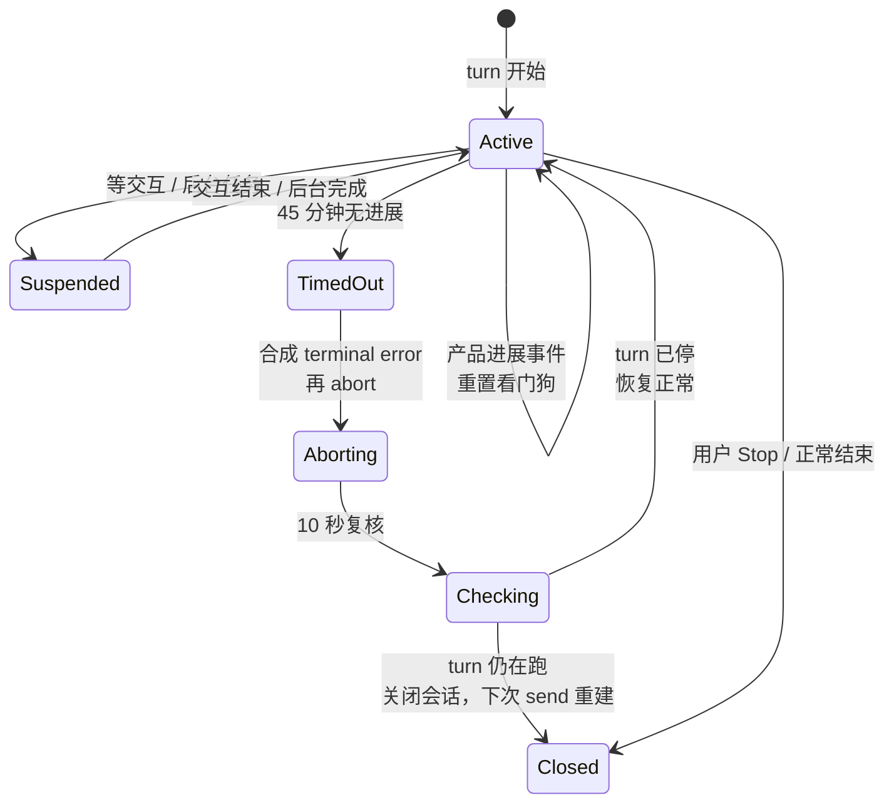

# Cindy 源码阅读（四）：看门狗、循环守卫与中断续跑

> 基于 [makecindy/cindy](https://github.com/makecindy/cindy) 源码分析。commit `2ce93d36`，2026-11-02。
> 系列：Cindy 源码阅读（4/10）。

## 一句话概括

Agent 会话有两种“看起来还活着”的失败：

1. **没有任何事件**——进程卡死、stdio 阻塞、MCP 不返回；
2. **一直有事件，但原地打转**——模型反复调用同一个工具，结果也差不多。

Cindy 用两层机制分别兜住：**Session 零事件看门狗**处理第一种，**ToolLoopGuard + 辅助模型复核**处理第二种。两者都不依赖 prompt 自觉。

## 生活比喻：工地上的监工和质检员

- **看门狗**像工地监工：只要工地连续 45 分钟没有任何进展，就拉闸停工，而不是永远等下去。
- **ToolLoopGuard** 像质检员：工人一直在干活、一直在报进度，但每块砖都一样、每道工序都在重复——这时候监工不会拉闸，质检员要出来判断“你是在认真施工，还是在原地打转”。

监工管“有没有动静”，质检员管“动静有没有意义”。两种失败模式，需要两套判据。

## 零事件看门狗：45 分钟从哪来

`packages/maker-core/src/session.ts:107`

```ts
const DEFAULT_TURN_STALL_MS = 45 * 60_000;
```

可以用环境变量 `XDT_SESSION_TURN_STALL_MS` 覆盖，`0` 关闭（`session.ts:93, 165-170`）。

为什么是 45 分钟？因为 agent 层已经有一层 30 分钟的 upstream-idle 看门狗：

- Claude Code 30 分钟（`agents/claude-code/index.ts:745-761`）；
- Codex 30 分钟（`agents/codex/index.ts:1020`）。

但 agent 层的看门狗只在“球在上游、等模型回话”时计时，**工具执行期间刻意停表**。如果 MCP 卡住、SDK 与子进程的 stdio 通道 wedge，agent 层不会报错，turn 可以永久挂着。Session 层的 45 分钟就是补这个洞：不区分球在谁手里，只看有没有产品进展。45 分钟大于 30 分钟，保证正常情况下 agent 先自愈，不被上层抢跑。

### 什么算“产品进展”

`packages/maker-core/src/types/events.ts:274-293` 是白名单：

- 有实质文字的 `text` / `thinking`；
- `tool_use` / `tool_result` / `tool_result_full`；
- `agent_task_update`；
- `image`；
- `interaction_request`。

`status`、`account_usage`、后台事件、只有空白字符的文本都不算。`status` 是传输层心跳，`account_usage` 是用量心跳——它们证明“连接还在”，不证明“任务在推进”。

### 分片计时与睡眠排除

看门狗不是简单 `setTimeout(45min)`。它按 60 秒分片累加（`session.ts:155`），片尾核对真实壁钟耗时：

```ts
// session.ts:161
const TURN_STALL_SUSPEND_GAP_MS = 30_000;
```

如果一片 60 秒实际过了 90 秒以上，说明进程被系统挂起过（合盖睡眠），该片作废、不扣额度，重新起表。否则一次午休就能把 45 分钟静默额度“睡没”，醒来立刻误杀一条其实正常的会话。

### 起表条件

`session.ts:3194-3204` 在起表前排除：

- Session 已关闭；
- 没有正在跑的 turn；
- 正在等用户交互（权限、提问、计划审阅）；
- 有后台任务在跑。

这些场景没有事件是正常的。等用户回答后，`runHostInteraction` 的 `finally` 会重新起表。

### 超时之后：先合成终态，再 abort，再复核



关键顺序：

1. 先复核条件（`session.ts:3286-3330`）；
2. 合成终态 `error`，reason 是 `turn_no_event_timeout`（Claude 准备轮次是 `bridge_turn_no_event_timeout`）；
3. 再 `abort()`；
4. 复核定时器**先于** abort 排定，且不挂在 abort Promise 上——因为 interrupt RPC 可能永远不返回，如果复核依赖它，就永远不会执行。

看门狗路径的复核宽限是 10 秒（`session.ts:125`），手动 Stop 是 15 秒（`:135`）。复核用 turn generation 栅栏：如果同一 turn 还在跑，就 `closeFromRuntime()`，让下一次 send 由 Maker lazy create 重建；如果已经换到新 generation，就不误关。

## ToolLoopGuard：四层判定

`packages/maker-core/src/agents/shared/loop-guard.ts` 是核心。它按从强到弱四层判断：

| 层 | 判据 | 处理 |
|----|------|------|
| 1 | `name+input+output` 完全相同连续 4 次（`:8`） | 疑似，交复核 |
| 2 | 12 次滑动窗口内不同 `name+input` 指纹 ≤2（`:16-18`） | 疑似，抓 ABAB 短循环 |
| 3 | 16 次窗口内不同指纹 ≤4（`:26-28`） | 疑似，抓 3-4 个调用的长轮转 |
| 4 | 同类契约错误连续被拒 3 次（`:62-68`；运行时阈值关闭） | 原本用于中断，当前不生效 |

长只读轮转是独立于这四层的硬停判据：最近 128 次读/搜结果，完整指纹种类 ≤32，且 ≥90% 属于重复 ≥4 次的指纹（`:34-36, 522-544`）。

写操作或命令会清空长只读窗口。契约错误层阈值是 3（`:68`），但运行时把 `contractConsecutiveLimit` 设为 `Infinity` 关闭（`session.ts:2403`）——因为同类错误可能是在修正参数，而且 Pi / Codex 没有可靠的模型响应批次标识。

### 节奏轮询豁免

如果一次普通调用距上次普通调用开始，或结果距上次结果到达，已经 ≥30 秒（`:47, 434-442`），视为在等外部进度（sleep 后再查 CI、命令内自带等待、慢推理），不计入第 1-3 层，只续接 60 分钟的最终时长上限。

Codex code mode 还有 2 秒突发重复豁免（`CODEX_BURST_REPEAT_GAP_MS`，`session.ts:140, 2409`），因为后台脚本会在两次模型采样之间快速重复调用。

### 疑似不等于立即杀

`ToolLoopMonitor` 把证据交给辅助模型后台复核（`tool-loop-review.ts:33-37`）：

- 20 秒超时；
- 每个 turn 最多复核 3 次；
- 只有明确 `STOP` 才中断；
- `CONTINUE`、超时、异常、没有 reviewer 都放行；
- 放行后接下来 20 个普通结果不再报疑似。

复核结论如果晚于 turn 结束、用户目标变化、模式被打破或替换，直接丢弃。

只有三种情况**不经复核直接硬停**：

1. 快速完全相同调用连续 30 次；
2. 完全相同结果（含节奏轮询）持续 60 分钟；
3. 长只读轮转（独立硬停判据）。

### 为什么不用 prompt 解决

文档 `docs/dev-rules/maker-core-and-agent-behavior.md:30-43` 明确要求复用 `ToolLoopGuard`，不能靠缩短无事件超时处理。

原因很实际：

- 代码能逐条拿到 `tool_use` / `tool_result` 的指纹与时间；
- 模型无法可靠审计自己的完整调用轨迹；
- prompt 只是建议，约束不了 token / 额度消耗；
- 代码判定可测试、可复现，prompt 行为不可复现。

这就是 Cindy 的一条核心工程原则：**能用代码保证的确定性，不交给 prompt。**

## 优秀代码一：可取消、带代际复核的异步问题等待

`packages/maker-core/src/agents/shared/async-user-questions.ts:42-72`

```ts
private async waitForAnswer(requestId: string, entry: PendingQuestion, questions: AskUserQuestionItem[]): Promise<void> {
  let onAbort!: () => void;
  const cancelled = new Promise<null>((resolve) => {
    onAbort = () => resolve(null);
    entry.abort.signal.addEventListener('abort', onAbort, { once: true });
  });
  try {
    const answer = await Promise.race([
      this.deps.resolve({ kind: 'ask_user_question', requestId, questions, delivery: 'async' }), cancelled,
    ]);
    if (!answer || answer.kind !== 'ask_user_question' || answer.dismissed
      || entry.abort.signal.aborted || !this.deps.isActive(entry.generation)) return;
    // Keep delivery cancellable without expiring the card already resolved by the host.
    entry.answered = true;
    const answered = questions.flatMap(({ question, header }) => {
      const value = answer.answers[question] ?? (header ? answer.answers[header] : undefined);
      return typeof value === 'string' && value.trim() ? [{ question, answer: value }] : [];
    });
    if (answered.length === 0) return;
    // A user reply is ordinary same-turn input, never a new send or an inferred choice.
    await this.deps.deliver(
      `The user answered the asynchronous question:\n${JSON.stringify(answered)}`,
      entry.abort.signal,
    );
  } catch (error) {
    if (!entry.abort.signal.aborted && this.deps.isActive(entry.generation)) this.deps.reportError(error);
  } finally {
    entry.abort.signal.removeEventListener('abort', onAbort);
    this.pending.delete(requestId);
  }
}
```

**好在哪**：

- `Promise.race` 让等待可取消；取消只结束等待，不误 dismiss 已被宿主解析的卡片。
- `await` 之后重新校验 `dismissed`、`aborted`、`isActive(generation)`，杜绝 turn 结束后迟到投递。
- `answered` 只在解析成功且校验通过后置位，finally 单点清理监听和 pending。
- 空答案过滤掉；用户回答被当作“同 turn 的普通输入”投递，绝不当作新 send，也不推断未答选项。

**模式**：可取消异步请求 + 代际栅栏（epoch fencing）。

**骨架**：

```ts
async function waitForAnswer(req, entry) {
  const cancelled = new Promise<null>((resolve) =>
    entry.signal.addEventListener('abort', () => resolve(null), { once: true }));
  try {
    const answer = await Promise.race([resolve(req), cancelled]);
    if (!answer || entry.signal.aborted || !isActive(entry.generation)) return;
    entry.answered = true;
    if (answer.value) await deliver(answer.value, entry.signal);
  } finally {
    entry.signal.removeEventListener(...);
    pending.delete(req.id);
  }
}
```

## 优秀代码二：带代际与睡眠感知的 abort 复核

`packages/maker-core/src/session.ts:3340-3382`（节选）

```ts
const generation = this.turnGeneration;
if (this.abortRecoveryScheduledFor === generation) return;
this.abortRecoveryScheduledFor = generation;
// 宽限也要排除系统挂起:合盖睡眠期间 transport 一个字节都收不到,而裸定时器一旦在
// 唤醒后到期就立刻开火 —— 一次午休就能让"给 interrupt 的 10s / 60s"变成 0s 有效时间,
// 复核于是关掉一条其实还响应得动的会话。
this.armAbortRecoverySlice(generation, graceMs, graceMs, trigger);

private armAbortRecoverySlice(generation, remainingMs, graceMs, trigger) {
  const slice = Math.min(remainingMs, TURN_STALL_SLICE_MS);
  const startedAt = Date.now();
  const timer = setTimeout(() => {
    const elapsed = Date.now() - startedAt;
    if (elapsed > slice + TURN_STALL_SUSPEND_GAP_MS) {
      this.logger.info('abort recovery skipped a suspended slice', {...});
      this.armAbortRecoverySlice(generation, remainingMs, graceMs, trigger);
      return;
    }
    const left = remainingMs - Math.max(0, elapsed);
    if (left > 0) {
      this.armAbortRecoverySlice(generation, left, graceMs, trigger);
      return;
    }
    void this.recoverIfTurnStillRunning(generation, { graceMs, trigger });
  }, slice);
}
```

**好在哪**：

- 复核不依赖可能永不 settle 的 abort Promise，自己用分片定时器推进。
- 同一 turn 幂等：`abortRecoveryScheduledFor === generation` 只排一次。
- generation 防止宽限期内新 turn 被误杀。
- 片尾用壁钟差识别睡眠，不把午休算成“清醒静默”。

**模式**：看门狗之看门狗（cascaded watchdog）+ 代际栅栏 + 睡眠感知分片。

**骨架**：

```ts
function scheduleRecovery(generation, remainingMs) {
  if (scheduledFor === generation) return;
  scheduledFor = generation;
  const started = Date.now();
  setTimeout(() => {
    const elapsed = Date.now() - started;
    if (elapsed > SLICE + SUSPEND_GAP) return scheduleRecovery(generation, remainingMs);
    const left = remainingMs - elapsed;
    if (left > 0) return scheduleRecovery(generation, left);
    recoverIfStillRunning(generation);
  }, Math.min(remainingMs, SLICE));
}
```

## 优秀代码三：有界滑窗的长只读轮转判定

`packages/maker-core/src/agents/shared/loop-guard.ts:522-544`

```ts
// 长只读轮转证据已足够强,不经复核
if (READ_ONLY_TOOL_NAMES.has(toolUse.name)) {
  this.stableReadWindow.push(fullFingerprint);
  if (this.stableReadWindow.length > STABLE_READ_WINDOW_SIZE) this.stableReadWindow.shift();
  if (this.stableReadWindow.length === STABLE_READ_WINDOW_SIZE) {
    const counts = new Map<string, number>();
    for (const fingerprint of this.stableReadWindow) {
      counts.set(fingerprint, (counts.get(fingerprint) ?? 0) + 1);
    }
    const repeated = [...counts.values()].reduce((sum, count) =>
      sum + (count >= STABLE_READ_MIN_REPEATS ? count : 0), 0);
    if (counts.size <= STABLE_READ_DISTINCT_LIMIT &&
      repeated >= Math.ceil(STABLE_READ_WINDOW_SIZE * 0.9)) {
      return {
        kind: 'hard', reason: 'rotation', count: STABLE_READ_WINDOW_SIZE, toolName: toolUse.name, final: true,
      };
    }
  }
} else {
  this.stableReadWindow = [];
}
```

**好在哪**：

- 不是“某次结果相同”就判死，而是要求窗口填满、指纹种类少、且 90% 结果来自重复至少 4 次的指纹。
- 只读工具才进入窗口；写/命令立刻清空，避免把合法排查误杀。
- `final: true` 表示证据足够强，跳过辅助模型，节省一次 20 秒复核。
- 有界窗口保证内存不随 turn 长度增长。

**模式**：有界滑动窗口频次坍缩判定。

**骨架**：

```ts
function observe(fingerprint, isReadOnly) {
  if (!isReadOnly) { window = []; return; }
  window.push(fingerprint);
  if (window.length > SIZE) window.shift();
  if (window.length === SIZE && isCollapsed(window)) return 'hard-stop';
}
```

## 中断续跑：白名单与 CONTINUE-only

`apps/desktop/src/main/maker-ipc/interruptedTurnAutoResume.ts:102-105` 明确写着：**白名单制，不是黑名单。**

- 黑名单漏一条 → 对确定性失败反复烧额度；
- 白名单漏一条 → 只是少一次自愈，用户可以手动重试。

白名单（`:200-244`）包括：

1. SSE 流中途截断；
2. 网络类错误（502/503/504、errno、fetch failed、socket hang up 等）；
3. 上游过载（529/overloaded、Codex capacity）；
4. 无产品进展的假运行：`turn_no_event_timeout`、`upstream_response_idle_timeout`、`codex_reconnect_stalled`；
5. `empty-response`、`upstream-overload`。

排除：OAuth 账号池不可用、`usageLimit`、4xx、`authentication_*`、`billing_error`、`rate_limit`、`invalid_request`、`permission_error`、`insufficient_quota`、`context_length_exceeded`。`tool_use_loop_detected` 也不进白名单，避免熔断后立刻重复原循环。

### 为什么只发 CONTINUE，不重放原 prompt

`turn_no_event_timeout`、`upstream_response_idle_timeout`、`codex_reconnect_stalled` 发生在 vendor 已经 accept 本 turn 之后（`:141-146`）。turn 可能已经执行工具、写文件、甚至 push 提交。克隆原 prompt 会重放副作用，所以只发一条隐藏的 CONTINUE 指令，让模型从当前状态继续。

只有“零产出且非 continuation-only”的 admission 失败，才允许克隆重发原文。自动续跑保留原 Plan 和权限选项，不因隐藏 CONTINUE 降权。

### 额度与退避

- 连续失败最多 5 次（`:310`），只要 assistant 可见文本或工具调用出现就清零；
- 一次真人介入周期最多 10 次（`:313`）；
- 自动补发的 CONTINUE 不算真人介入，否则会自己给自己充值；
- 退避 3 秒起指数增长，封顶 20 秒，±25% jitter（`:316-342`）。

## 设计取舍与风险

| 决策 | 收益 | 代价 |
|------|------|------|
| 45 分钟看门狗 | 不抢跑 agent 层的 30 分钟自愈 | 工具卡死时用户可能干等 45 分钟 |
| 分片计时排除睡眠 | 不会因合盖误杀 | 事件循环长时间停顿会不断作废分片，理论上可无限推迟 |
| LoopGuard 交辅助模型复核 | 减少误杀，保留硬上限 | 有成本、有延迟，证据可能被恶意工具输出影响 |
| 自动续跑白名单 + CONTINUE-only | 不重放副作用，不烧额度 | 白名单漏项时少一次自愈，需要人工重试 |
| 每任务只保留一张异步问题卡 | 避免卡片堆叠、答案串线 | 用户晚答会丢失，不做持久化答案队列 |

其他风险：

- `agent-input-coordinator.ts` 7,602 行，自动续跑在多个 `await` 后反复校验 recovery / attemptToken / 用户接手；新增恢复路径漏一处复验，就可能让旧 attempt 复活或重复 CONTINUE。
- `tool_use_loop_detected` 不进续跑白名单，用户必须手动继续——这是有意的熔断语义，但对无人值守任务不够友好。
- abort 复核失败会关闭会话，丢失当前内存态；这是跨所有 agent 唯一通用的重建路径，但关闭本身失败时仍可能留下不可用会话。

---

**相关文章**

- [Cindy 源码阅读（二）：Maker、Session、BaseAgent 的三层骨架](02-maker-core.md)
- [Cindy 源码阅读（三）：三种引擎，一条事件流](03-agent-adapters.md)
- [Cindy 源码阅读（六）：权限档位与自动审核](06-permissions.md)
