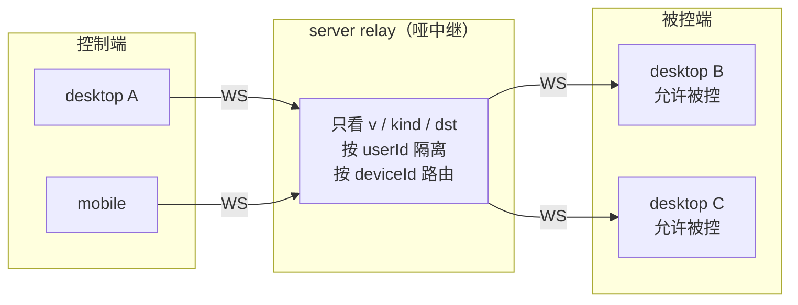
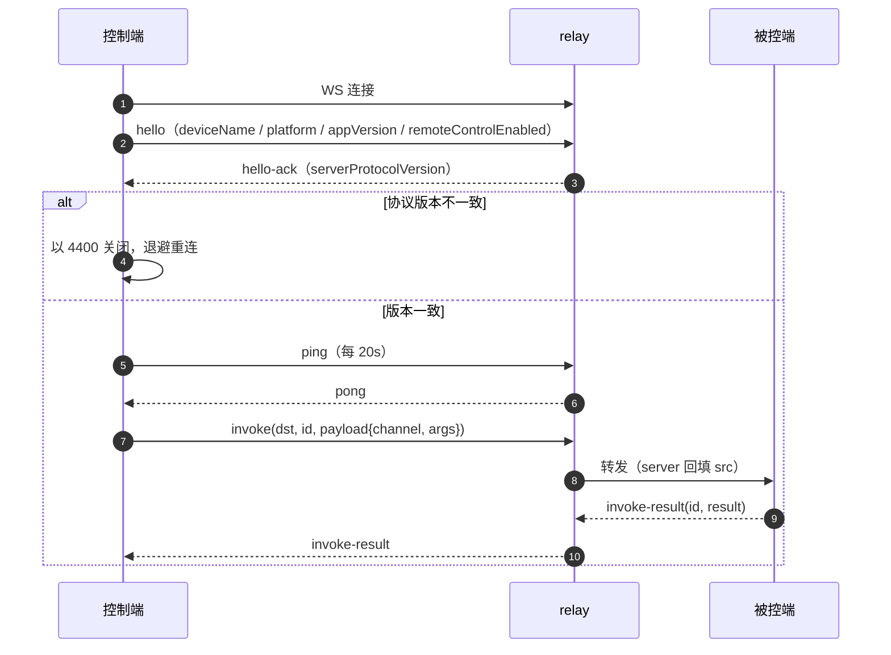

# Cindy 源码阅读（五）：device-link，手机如何控制电脑

> 基于 [makecindy/cindy](https://github.com/makecindy/cindy) 源码分析。commit `2ce93d36`，2026-11-02。
> 系列：Cindy 源码阅读（5/10）。

## 一句话概括

`packages/device-link` 是同账号跨设备远程控制的传输 / 协议层。桌面端既是控制端也是被控端，手机端是纯控制端；服务端只是一个**哑中继**——只看路由头，不看 payload，按 `userId` 隔离、按 `deviceId` 路由。

手机本地不跑 agent、不持有权威会话库，只保留本地历史/缓存。你在手机上点的每一条消息，都会被封装成 `invoke`，经中继转发到桌面端，由桌面端的 main 进程用同一个 IPC handler 执行。

## 生活比喻：快递分拣中心

device-link 的中继像一个快递分拣中心：

- 它只看包裹上的地址（`dst`）和单号（`id`），不拆开看里面是什么（`payload`）；
- 同一个用户（`userId`）的包裹放在同一个区，不会串到别人家；
- 收件人不在线，包裹不会丢，等下次连接再送；
- 如果包裹太大，会拆成多个小箱，按顺序编号，收件人按编号重组。

真正的“拆包”和“执行”发生在被控端，不在分拣中心。

## 角色与拓扑



几个关键设定（`packages/device-link/README.md`）：

- **控制端-only 是一等公民**：手机从不开“允许被控”，只发 `link-open` / `invoke`，只收 `push` / `presence-changed`，hello 里 `remoteControlEnabled=false`（`README.md:18, 27`）。
- **身份在 WS 握手时由 server 用 JWT 固化**，`Envelope.src` 由 server 回填，客户端传值会被覆盖，防止伪造（`README.md:19`）。
- **同账号才可互达**；中继按 `userId` 命名空间隔离。
- 一个被控端与 relay 只有一条连接，所有控制端共享这条 1:N 链路（`docs/dev-rules/remote-and-mobile-adaptation.md:150`）。

## 连接生命周期



细节：

- `hello` 必须是进站第一帧。`hello-ack` 带 `serverProtocolVersion`，不一致时不进 online，主动以 4400 关闭并走退避（`client.ts:2781-2800`）。
- `PROTOCOL_VERSION` 当前为 1，只升不降；能力集 append-only，新能力只有双方声明才启用（`README.md:148-152`）。
- online 后每 20s 发 ping；pong 或任意有效入站帧都算存活，连续 miss 超过 3 且无入站至少 4 个周期才判僵死（`client.ts:2481-2521`）。
- 断线退避 1s→30s，带 0.7–1.0 向下抖动；稳定在线 10s 才清零（`client.ts:349-430`）。
- relay 1013 有独立 5s→30s 冷却，15 分钟才清连击；握手有 15s watchdog（`client.ts:472-495, 2421-2480`）。

## invoke / push 与 allowlist

`invoke` 是有请求-响应的：

```text
Envelope {
  kind: 'invoke',
  dst: deviceId,
  id: requestId,
  payload: { channel, args }
}
```

响应必须 `id` 和 `kind` 双匹配（`client.ts:1963-2120, 2843-2846`）。默认 30 秒超时，按 channel 覆盖（`allowlist.ts:888-937`）。首次写入 socket 前另有最多 10 秒等待，没写出去就报 `BACKPRESSURE`；首次写入后才开始响应预算，避免把本地排队误报成设备无响应。

`push` 是 fire-and-forget 的单向事件流，没有响应配对；只有 `PUSH_FORWARD_ALLOWLIST` 里的 channel 才转发（`allowlist.ts:768`）。

### allowlist 是安全核心

`packages/device-link/README.md` 和 `allowlist.ts:1-20` 写得很清楚：默认拒绝。一个 channel 要被远程调用，必须满足：

- handler 不依赖 `event.sender`；
- 没有本机 UI / shell 副作用；
- 语义在被控端成立。

以下永远不放行：auth / api-key、全局设置写、裸 DB 写、updater、窗口类。

安全意义：隧道只暴露逐条论证过的最小能力面。控制端即使被攻破，也不能借 `invoke` 调任意本机 IPC。但要注意——**allowlist 只挡 channel，不挡 args**，参数仍由各自 handler 收敛。

被控端在 `apps/desktop/src/main/device-link/dispatch.ts:4575-4596` 依次检查：被控开关、逐设备撤权、`REMOTE_INVOKE_ALLOWLIST`。`allowlistHash` 用 FNV-1a 计算并随 `link-accept` 回传，用于提示两端版本差异（`allowlist.ts:938-950`）。

## reliable-transport-v1：弱网可靠传输

只有双方在 `link-open` / `link-accept` 的 `capabilities` 里同时声明，可靠层才启用。wrapper 仍沿用原 `kind` / `payload`，relay 不需要理解（`transport.ts:1-9`）。

| 机制 | 规则 |
|------|------|
| 流与序号 | 每个 peer 独立 `streamId + seq` |
| 交付顺序 | 接收端只按序交付；窗口 64 个 seq，重组槽 16 个 |
| 分片 | 单条逻辑消息 ≤4MiB；按 UTF-8 字节切成 128KiB 片，最多 64 片 |
| ACK | 累计确认，但只有 handler 成功接收后才推进 |
| 重传 | 基准 2s，RFC 6298 的 SRTT/RTTVAR 自适应，最多 5 次 |
| 跨重启 | 帧和握手都带 `baseSeq`，接收端重启后按新基线跨过旧 seq |
| 背压 | pending 64 条 / 16MiB；接收缓存 16MiB；WS buffered 超过 8MiB 收敛 |
| outbox | 已执行但发不出的结果，64 条 / 16MiB，每 500ms 重试；保留 2× 该 channel 的客户端预算，逐 channel 收窄，全局上限 22 分钟 |

`reliable-link-confirm-v1` 还解决了一个微妙问题：先开放接收方向，控制端装好基线后带 `linkRequestId` 回 transport ACK，被控端才开放发送方向并 replay。否则“accept 已写入 socket”会被误当成“对端已提交”（`transport.ts:20-28`，`client.ts:4742-4785`）。

## 优秀代码一：UTF-8 安全分片

`packages/device-link/src/transport.ts:235-262`

```ts
/**
 * 把 JSON 文本按 UTF-8 字节切开，不从多字节字符中间切断。
 * for...of 按 code point 遍历，因此不会拆开 surrogate pair。
 */
function splitUtf8(text: string, maxBytes: number): string[] {
  if (maxBytes <= 0) throw new Error('maxBytes must be positive');
  const chunks: string[] = [];
  let chunkStart = 0;
  let offset = 0;
  let chunkBytes = 0;
  for (const char of text) {
    const codePoint = char.codePointAt(0)!;
    const charBytes = codePoint <= 0x7f
      ? 1
      : codePoint <= 0x7ff
        ? 2
        : codePoint <= 0xffff
          ? 3
          : 4;
    if (offset > chunkStart && chunkBytes + charBytes > maxBytes) {
      chunks.push(text.slice(chunkStart, offset));
      chunkStart = offset;
      chunkBytes = 0;
    }
    // 单个 code point 不可能超过 4 bytes；保留这个分支让边界参数错误
    // 变成显式失败，而不是生成一个超过约定大小的片段。
    if (charBytes > maxBytes) throw new Error('transport chunk size is smaller than one code point');
    offset += char.length;
    chunkBytes += charBytes;
  }
  if (offset > chunkStart || text.length === 0) chunks.push(text.slice(chunkStart, offset));
  return chunks;
}
```

**好在哪**：

- 一次遍历同时完成“按 code point 计数”和“按 UTF-8 字节限额切分”。
- `for...of` 按 code point 遍历，不会拆开 surrogate pair，中文和 emoji 不会被切成乱码。
- 单字符超过 `maxBytes` 时显式抛错，而不是生成一个超限片。
- 空字符串也会产出一个空片，保持分片数量与消息的一一对应。

**模式**：游标式字节安全切分（boundary-safe framing）。

**骨架**：

```ts
function splitUtf8(text: string, maxBytes: number): string[] {
  const chunks: string[] = [];
  let start = 0, offset = 0, bytes = 0;
  for (const ch of text) {
    const size = utf8Size(ch);
    if (offset > start && bytes + size > maxBytes) {
      chunks.push(text.slice(start, offset)); start = offset; bytes = 0;
    }
    offset += ch.length; bytes += size;
  }
  chunks.push(text.slice(start, offset));
  return chunks;
}
```

## 优秀代码二：业务提交后才推进累计 ACK

`packages/device-link/src/client.ts:3321-3341`

```ts
let handled: boolean;
try {
  handled = isTransportSkipPayload(logical.payload)
    ? true
    : await this.dispatchEnvelope(logical);
} finally {
  stream.deliveringSeq = null;
}
if (!handled) {
  this.applyReceiveStreamBase(stream);
  if (stream.lastDeliveredSeq >= nextSeq) continue;
  this.log.warn(`reliable payload handler failed seq=${nextSeq}; waiting for retry`);
  break;
}
stream.ready.delete(nextSeq);
const deliveredBytes = byteLength(ready.json);
stream.bufferedBytes -= deliveredBytes;
stream.lastDeliveredSeq = nextSeq;
this.applyReceiveStreamBase(stream);
deliveredSinceAck += 1;
deliveredBytesSinceAck += deliveredBytes;
```

**好在哪**：

- ACK 的语义是“已进入本地状态机”，不是“已写入 socket”。慢 handler 或失败 handler 都不会让发送端误以为已消费。
- handler 失败时保留队头 seq，等发送端重传；不会跳过一条实际没处理的消息。
- `deliveringSeq` 在 finally 里清除，异常路径不会留下“正在投递”的假状态。
- 累加 ACK 批量发送，避免每帧一个 ACK 包。

**模式**：有序至少一次交付 + 提交后推进累计确认（at-least-once with post-commit ACK）。

**骨架**：

```ts
async function deliverNext() {
  const head = ready.get(nextSeq);
  if (!head) return;
  const ok = await handler(head);
  if (!ok) return; // 保留 seq，等重传
  ready.delete(nextSeq);
  lastDelivered = nextSeq;
  maybeSendAck();
}
```

## 优秀代码三：invoke 结果的条件编码

`packages/device-link/src/invokeTransfer.ts:80-107`

```ts
export function encodeInvokeResultTransfer(
  options: InvokeTransferOptions,
  payload: InvokeResultPayload,
  codec: DeviceLinkTransferCodec,
): InvokeResultPayload {
  if (!payload.ok || payload.transfer) return payload;
  let text: string | undefined;
  try {
    text = JSON.stringify(payload.result);
  } catch {
    return payload;
  }
  if (text === undefined || text.length < INVOKE_TRANSFER_MIN_CHARS
    || text.length > INVOKE_TRANSFER_MAX_CHARS) return payload;
  const tag = codec.contentTag?.(text);
  if (tag !== undefined && options.ifNoneMatch === tag) {
    return { ok: true, result: null, transfer: { tag, notModified: true } };
  }
  if (options.gzip && codec.gzipBase64) {
    const gzipBase64 = codec.gzipBase64(text);
    // Base64 is ASCII, whereas Chinese/emoji JSON takes multiple UTF-8 bytes
    // per character. Compare transmitted bytes, not JS string lengths.
    if (gzipBase64.length < byteLength(text) * 0.9) {
      return { ok: true, result: null, transfer: { ...(tag ? { tag } : {}), gzipBase64 } };
    }
  }
  return tag ? { ...payload, transfer: { tag } } : payload;
}
```

**好在哪**：

- handler 始终真实执行，优化只作用于**结果表示**，不影响业务语义。
- `ifNoneMatch === tag` 时返回 `notModified`，避免重复传输大结果。
- gzip 只在净省超过 10% 时启用，而且比较的是传输字节，不是 JS 字符串长度——中文和 emoji 的 JSON 字符数会低估实际 UTF-8 字节。
- 只有 `ok` 且还没有 transfer 的结果才编码，错误结果原样返回。

**模式**：条件响应 + 内容协商（ETag / gzip）。

**骨架**：

```ts
function encodeResult(result, opts) {
  const text = JSON.stringify(result);
  const tag = hash(text);
  if (opts.ifNoneMatch === tag) return { notModified: true, tag };
  if (opts.gzip && gzip(text).length < byteLength(text) * 0.9) {
    return { gzip: gzip(text), tag };
  }
  return { result, tag };
}
```

## 安全模型与取舍

### 安全边界

- **同账号**才可互达；中继按 `userId` 隔离。
- **允许被控**是设备级开关；还有逐设备撤权。
- **IPC allowlist** 默认拒绝，只暴露逐条论证过的 channel。
- **远程桌面**收敛到单一 channel `device-link:remote-desktop:v1`，按 `op` 解析；12 秒 lease、180KB 帧上限、16K 剪贴板、输入事件不超过 64 条且键码白名单（`remoteDesktop.ts:12-25, 234-260, 540-567`）。
- 自建中转使用只对该中转有效的 `CindyRelay` 设备凭证，从不发送账号 token；一次性加入码 10 分钟有效，还需主人本机同意（`selfHostedRelay.ts:1-11, 318-322`）。

### 明确不承诺的东西

- **不是 exactly-once**：invoke 是至少一次，靠 `requestId + payload fingerprint` 去重。
- **控制端 30 秒超时不等于副作用未执行**：`ipcMain` 没有统一取消信号；被控端按 2× 该 channel 预算回收（默认 30s channel 约 60s，长任务可达 22 分钟）。
- **中继不看 payload 是行为约束，不是密码学机密性**：自建中转的帧签名只保完整性与设备身份，不加密业务内容。
- **首次加入仍信任账号服务和 relay**，不防恶意 relay，也不是双向证明（`README.md:169`）。

### 主要风险

1. **1:N 共享 relay 的故障半径**：一个休眠 peer 不应拆掉所有 peer 的连接。文档用 #1187 事故要求回答“故障半径三问”（`remote-and-mobile-adaptation.md:150-174`）。当前默认仍保留 legacy 整连接重连，只有 `isolate-peer` 或协商能力才局部化。
2. **状态机复杂度高**：超时、重放、skip、ACK、outbox、presence 三态、熔断与直连回退交织，线上出现过队列冻结和重连风暴。
3. **版本门多**：reliable、link-confirm、transport-timeout-close 等能力组合复杂；旧端会把未知 `link-close` reason 当永久关闭，所以新语义必须能力门控（`protocol.ts:185-200`）。
4. **allowlist 只挡 channel 不挡 args**：每个 handler 仍要自己校验参数、路径、大小和归属。

---

**相关文章**

- [Cindy 源码阅读（一）：一个 Agent 客户端如何把自己拆成连接层](01-architecture.md)
- [Cindy 源码阅读（六）：权限档位与自动审核](06-permissions.md)
- [Cindy 源码阅读（八）：Electron 进程边界与布局树](08-electron-security.md)
