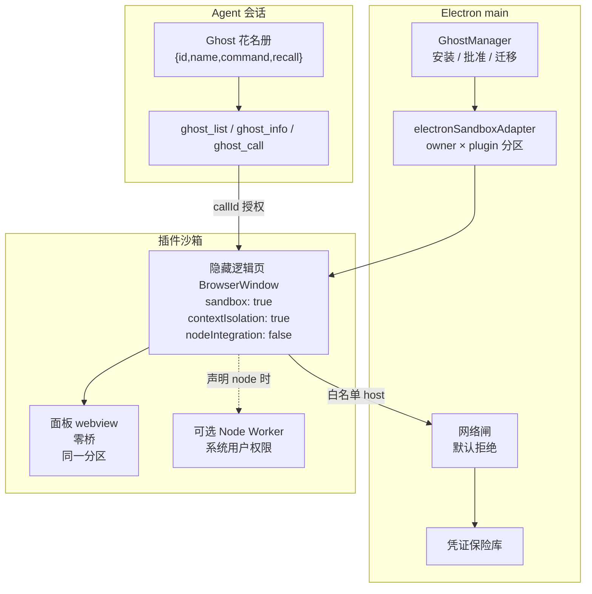

# Cindy 源码阅读（七）：插件沙箱、Skill 与 Ghost 渐进发现

> 基于 [makecindy/cindy](https://github.com/makecindy/cindy) 源码分析。commit `2ce93d36`，2026-11-02。
> 系列：Cindy 源码阅读（7/10）。

## 一句话概括

Cindy 把能力分成三层：

- **Core**：所有用户共用的宿主基础设施；
- **Skill**：用自然语言、脚本或工具编排描述“工作怎么做”；
- **插件（.cindy）**：运行在沙箱里的小程序，承担人机富交互、结构化状态和专用能力。

插件不是“往 Core 里加功能”，而是“在 Core 的沙箱里开一家店”。Core 只提供水电网和门禁，店里卖什么、怎么装修，由插件自己决定。

## 生活比喻：商场、店铺和操作手册

| 角色 | 对应概念 | 职责 |
|------|---------|------|
| **商场** | Cindy Core | 提供场地、水电、消防、门禁、统一收银和物业管理 |
| **店铺** | 插件（.cindy） | 自己装修、自己陈列、自己接待顾客；不能私接电线、不能绕过消防 |
| **操作手册** | Skill | 告诉店员“这类活按什么步骤做”，通常没有独立店面 |
| **商场导购屏** | Ghost 花名册 | 只显示店铺名和一句话介绍，不把每家店的库存全贴出来 |

产品原则写得很清楚（`docs/product-rules/core-product-principles.md:162-227`）：

- 工作流程进入 Skill；
- 外部能力、数据接入和富交互界面进入插件；
- 个人、团队、行业、组织特有的流程不得进入 Core；
- 边界不清晰时，先在 Skill / 插件里验证，不直接扩张 Core；
- 官方能力只要可以由插件承载，也优先作为官方插件分发。

## 插件的运行形态

`.cindy` 是一个 zip 包，`ghost.json` 是身份卡，现行 `kind: 'chip'`。manifest v3 取消了 `slots`，顶层字段本身就是能力声明（`packages/plugin-protocol/src/manifest.ts:893-1054`）：

```text
entry
tools
panel / mainView / taskView
settingsHtml
network
node
skill
subscribe
card / fs / library
manual
```

v2 的 `slots` 只做兼容映射；未知合法 slot 不授权、不阻止安装（`manifest.ts:91-93, 1382-1384`）。

### 运行隔离



关键点：

- 每个插件一个隐藏逻辑页 `BrowserWindow`，`sandbox:true`、`contextIsolation:true`、`nodeIntegration:false`，使用 owner × plugin 的内存 session 分区（`electronSandboxAdapter.ts:955-980`）。
- 面板是同一分区的零桥 webview；attach 时由 Main 核对分区、地址和已装清单（`webview-security.ts:183-210`）。
- 网络默认拒绝：同源协议放行；唯一外部例外是 HTTPS 图片（`` 和 CSS 图片），HTTP、XHR/fetch、脚本、样式、字体、媒体、WebSocket 继续拒绝（`electronSandboxAdapter.ts:498-525`）。
- 凭证由主机保险库按声明的 host 注入，沙箱读不回明文（`docs/dev-rules/plugin-security-and-authoring.md:486-686`）。
- `fs` 分 `data` / `workdir` / `save` 三档；附件和媒体走 grant / deposit / ledger；`library` 是持久作品库，只接受库内相对路径，SQL 采用首词白名单（`apps/desktop/resources/system-skills/cindy-plugin-creator/references/plugin-files-and-library.md:1-220`）。
- 消息 hook：入口 `will-user-message` 3 秒，出口 `will-assistant-message` 5 分钟；超时或崩溃 fail-open；连续 3 次失败熔断（`subscriptionGateway.ts:7-15`）。

### 插件里的 `skill` 是特殊能力

插件 manifest 的 `skill` 字段是唯一**越出沙箱**的能力：技能指令由主 Agent 以用户全部权限执行，全局生效，不受 workdir 停用影响。

安全边界是“声明一致性”：`SKILL.md` frontmatter 的 name / description 必须与 manifest 逐字一致，Host 固化快照与字节指纹。但正文和辅助文件并不在同等校验内（`plugin-security-and-authoring.md:424-456`）。这也是后面要说的主要风险之一。

## Ghost 渐进发现：别把整个仓库塞进上下文

如果每个插件的每个工具都直接进 system prompt，上下文会被 schema 撑爆。Cindy 的做法是：

1. system prompt 里只放**花名册**：`{id, name, command, recall}`；
2. 模型先用 `ghost_info` 查某个插件的完整信息；
3. 未命中或怀疑清单过期，才用 `ghost_list` 做全量回查；
4. 长流程用 `ghost_manual` 按需读取；
5. 真正执行才用 `ghost_call`。

花名册有严格预算（`docs/ghost-progressive-discovery.md:114-120`）：

- 单条 recall 最多 300 字；
- 最多 16 条；
- 总预算 8000 字符；
- 不含工具 schema、参数或业务规则。

大型 API 由插件自己声明 `list_tools` / `call_tool` 两段式目录。连 `ghost_info` 也只暴露这两个元工具，具体操作和参数要到类别下钻时才进入上下文。Manual-only 插件没有 `ghost_call` 能力（`ghost-progressive-discovery.md:21-82`）。

### 花名册在会话装配时求值一次

这和 prompt cache 直接相关：花名册必须逐字节稳定。会话中途的安装/启停，不重建 system prompt，而是靠实时 `ghost_list` 和运行期门禁修正。`workingDir` 不可解析时 fail-closed，绝不回退全量。

每次 `ghost_info` / `ghost_call` 都由 `classifyGhostVisibility` 重新校验：存在、已下线、登录、目录停用、启用状态（`apps/desktop/src/main/mcp-integrations/ghost.ts:1935, 2232`；`ghostVisibility.ts:4-8`）。

## 优秀代码一：不可信作者文本的有界投影

`packages/cindy-tools/src/ghost/mcpServer.ts:299-331`

```ts
export function formatGhostRoster(
  items: Array<Pick<CindyGhostInfo, "id" | "name" | "command" | "recall" | "namespace">>,
): string {
  if (items.length === 0) return "";
  const lines = [...items]
    .sort((a, b) => a.id.localeCompare(b.id))
    .slice(0, ROSTER_MAX_ITEMS)
    .map((g) => {
      const normalize = (value: string): string =>
        value.replace(/\s+/g, " ").trim();
      return JSON.stringify({
        id: normalize(g.id),
        ...(g.namespace !== undefined ? { namespace: g.namespace } : {}),
        name: normalize(g.name).slice(0, 64),
        command: g.command ? normalize(g.command).slice(0, 32) : "",
        recall: g.recall
          ? normalize(g.recall).slice(0, ROSTER_DESC_MAX)
          : "",
      }).replace(/[<>]/g, (char) => (char === "<" ? "\\u003c" : "\\u003e"));
    });
  const render = (): string =>
    [
      GHOST_ROSTER_PREFIX,
      GHOST_ROSTER_OPEN,
      ...lines,
      GHOST_ROSTER_CLOSE,
      GHOST_ROSTER_SUFFIX,
    ].join("\n");
  while (lines.length > 0 && render().length > ROSTER_CHAR_BUDGET) {
    lines.pop();
  }
  return lines.length > 0 ? render() : "";
}
```

**好在哪**：

- 插件作者可控的 `recall` 被当作**数据**，用 JSONL 行封装，固定前后缀不能伪造。
- 空白折叠、JSON 转义、`<>` 转义，防止作者文本提前闭合 XML 标签或注入指令。
- 排序、截断、总预算三层限制，保证不会突破单行和上下文预算。
- 空列表返回空字符串，不会生成空壳块。

**模式**：不可信数据信封 + 有界规范化投影。

**骨架**：

```ts
function renderRoster(items) {
  const lines = items
    .sort(byId)
    .slice(0, MAX_ITEMS)
    .map((item) => JSON.stringify({
      id: normalize(item.id),
      name: normalize(item.name).slice(0, 64),
      recall: normalize(item.recall).slice(0, 300),
    }).replace(/[<>]/g, escapeAngle));
  while (render(lines).length > BUDGET) lines.pop();
  return lines.length ? wrap(lines) : "";
}
```

## 优秀代码二：默认拒绝的插件出网闸

`apps/desktop/src/main/cindy-brain/runtime/electronSandboxAdapter.ts:498-525`

```ts
// 每个 owner 都会得到新的内存 session；权限与下载必须显式拒绝，不能
// 因为分区是新建的就依赖 Electron 默认行为。
ses.setPermissionRequestHandler((_webContents, _permission, callback) => callback(false));
ses.setPermissionCheckHandler(() => false);
ses.on('will-download', (event) => event.preventDefault());
// 分区级网络闸：默认只放行自己协议同 id 下的资源；唯一外部例外是
// 任意插件页面发出的 HTTPS image 请求（ 与 CSS 图片共用该资源类型）。
// HTTP 图片、XHR/fetch、脚本、样式、字体、媒体、外部 WebSocket 与其它协议继续拒绝；回环嵌入是唯一例外，允许同一主机端口的 XHR/WebSocket。
const selfPrefix = `${SCHEME}://${ghostId}/`;
const loopbackEmbed = ghostPanelLoopbackEmbedAllowed(ghost.manifest);
const htmlCsp = loopbackEmbed ? `${GHOST_HTML_CSP}; ${GHOST_LOOPBACK_FRAME_CSP}` : GHOST_HTML_CSP;
ses.webRequest.onBeforeRequest((details, callback) => {
  let allowed = details.url.startsWith(selfPrefix);
  if (!allowed && isGhostProtocolOwnerActive(owner) && details.resourceType === 'image') {
    try {
      allowed = new URL(details.url).protocol === 'https:';
    } catch {
      allowed = false;
    }
  }
  if (!allowed && loopbackEmbed && isGhostProtocolOwnerActive(owner)) {
    allowed = loopbackEmbedRequestAllowed(details, selfPrefix);
  }
  callback({ cancel: !allowed });
});
```

**好在哪**：

- 不依赖 Electron 默认行为：权限、权限检查、下载先全部显式拒绝。
- 同源协议默认放行，外部只开 HTTPS 图片一个窄口；HTTP 图片、fetch、WebSocket 继续拒绝。
- 回环嵌入只允许同一主机端口，且仍校验 owner 有效。
- CSP 和请求闸互相补位，单层绕过不成立。
- 注释把“为什么是图片、为什么是 HTTPS”写清楚，后续维护者不会为了图省事放宽。

**模式**：默认拒绝的出境闸 + 显式窄例外 + 双层防线。

**骨架**：

```ts
ses.setPermissionRequestHandler((_wc, _perm, cb) => cb(false));
ses.setPermissionCheckHandler(() => false);
ses.webRequest.onBeforeRequest((details, cb) => {
  const allowed = details.url.startsWith(selfPrefix)
    || (isOwnerActive() && isHttpsImage(details))
    || (isLoopbackEmbed() && isSameHostPort(details));
  cb({ cancel: !allowed });
});
```

## 优秀代码三：存量插件迁移的一次性门

Cindy 有一条硬性兼容红线（`plugin-security-and-authoring.md:687-753`），核心要求是：

> 升级不得让用户本地已安装、已启用的插件不可用，也不得要求重新安装、重新确认权限、重新配置凭证或重新落技能。漏迁移 = P0。

`GhostManager.ts:2296-2327`（节选，省略了部分注释）是这条红线的实现核心：

```ts
// 一次性门(状态机见 GhostLegacyMigrationLedger 头注释),判据缺一不可:
// 1) 台账 completed(或存在但读不出)= 迁过,不再迁;in-progress = 上一轮中途
//    崩溃,按钉死的 pendingIds 续跑 —— receipt 首写自动落台账的守卫只在
//    "完全没有台账"时动笔,不会把 in-progress 焊死。
// 2) 首轮必须先扫描完整安装根,不能因任意一个有效 receipt 提前关门。#1080
//    曾经写出 receipt 却没有 migration ledger；那类历史 mixed 状态里 A 已批准、
//    B 仍是 legacy，提前 completed 会让 B 永久失效。
if (this.receiptStore.migrationDoorClosed()) {
  if (this.receiptStore.hasMigrationLedger() && !this.receiptStore.readMigrationLedger()) {
    (this.options.log?.error ?? this.options.log?.warn)?.call(
      this.options.log,
      'legacy migration ledger unreadable; migration door kept closed',
      { path: this.receiptStore.rootDir() },
    );
  }
  return result;
}
const resumeLedger = this.receiptStore.readMigrationLedger();
const resumePending =
  resumeLedger?.state === 'in-progress' ? new Set(resumeLedger.pendingIds ?? []) : null;
```

**好在哪**：

- “是否已经迁过”放在状态根，不是内存；进程重启不会重迁。
- `in-progress` 按钉死的 `pendingIds` 续跑，崩溃不会把迁移焊死。
- 台账存在但读不出时保守关门，并记录可观测日志——这意味着状态根被外力改写过。
- 首轮必须扫描完整安装根，不能因为任意一个 receipt 就提前关门；这是 #1080 的真实教训。
- 瞬时 IO 错误下一轮重试，确定性内容错误 fail-closed。

**模式**：持久状态机 + 一次性门 + fail-closed 续跑。

**骨架**：

```ts
function migrateOnce(root) {
  if (ledger.closed) return;
  const pending = ledger.state === 'in-progress' ? new Set(ledger.pendingIds) : null;
  if (!pending) scanEntireRoot(); // 不能因单个 receipt 提前关门
  for (const item of candidates(pending)) migrate(item);
  ledger.complete();
}
```

## 安全模型：强隔离，但不是绝对边界

Cindy 的安全模型按“插件作者不守约”设计。安装/更新确认只决定本次落位，不是运行期授权；prompt 和前端展示都不构成安全边界。真正的权限由 manifest 声明、详情展示和 Host 运行时守门共同决定（`plugin-security-and-authoring.md:223-275`）。

主要风险：

1. **Node 工作进程不在浏览器沙箱内。** 声明 `node` 的插件拥有当前系统用户级本机权限；`node.secretBindings` 还会把指定凭证明文交给 Worker。这是最大的攻击面。
2. **插件 `skill` 越出沙箱。** 技能正文由主 Agent 以全部用户权限执行；Host 主要校验 frontmatter 和快照字节，正文/辅助文件不是同等安全审查对象。
3. **安装内容运行期可变。** 逻辑页代码从安装目录现读，`packageSha256` 只是安装时点来源指纹，没有运行期完整性校验。
4. **批准状态根没有签名/MAC 或 OS 写保护。** 同权限进程理论上可伪造结构合法的 receipt；技能快照在“核对之后、Agent 读取之前”也有消费侧瞬时窗口。
5. **HTTPS 图片是唯一页面直连例外。** 它会向第三方暴露用户网络地址和完整 URL；作者若把秘密拼进图片 URL 就会外泄。
6. **消息 hook 可读全量用户消息/助手回复**，并改写或替换呈现。render 会净化、原文保留，但敏感内容仍会进入插件逻辑。
7. **安装确认存在豁免路径。** 服务端 `defaultInstall` 首装和后续更新可免确认；权限没变多的自动更新也静默完成。

缓解措施包括：独立沙箱与 owner×plugin 分区、零桥面板、Main 反查 webContents 身份、默认拒绝网络、CSP、凭证不回读、文件只给指纹/相对路径、媒体归属账本、`library` 路径四层校验与 SQL 白名单、hook fail-open/熔断、迁移和恢复全程 owner/approval/revision 复核。

结论：**这是“强隔离 + 强审计”，但不是“不可信原生代码的绝对安全边界”。** 装插件前看权限详情，仍然是用户自己的责任。

---

**相关文章**

- [Cindy 源码阅读（一）：一个 Agent 客户端如何把自己拆成连接层](01-architecture.md)
- [Cindy 源码阅读（六）：权限档位与自动审核](06-permissions.md)
- [Cindy 源码阅读（八）：Electron 进程边界与布局树](08-electron-security.md)
