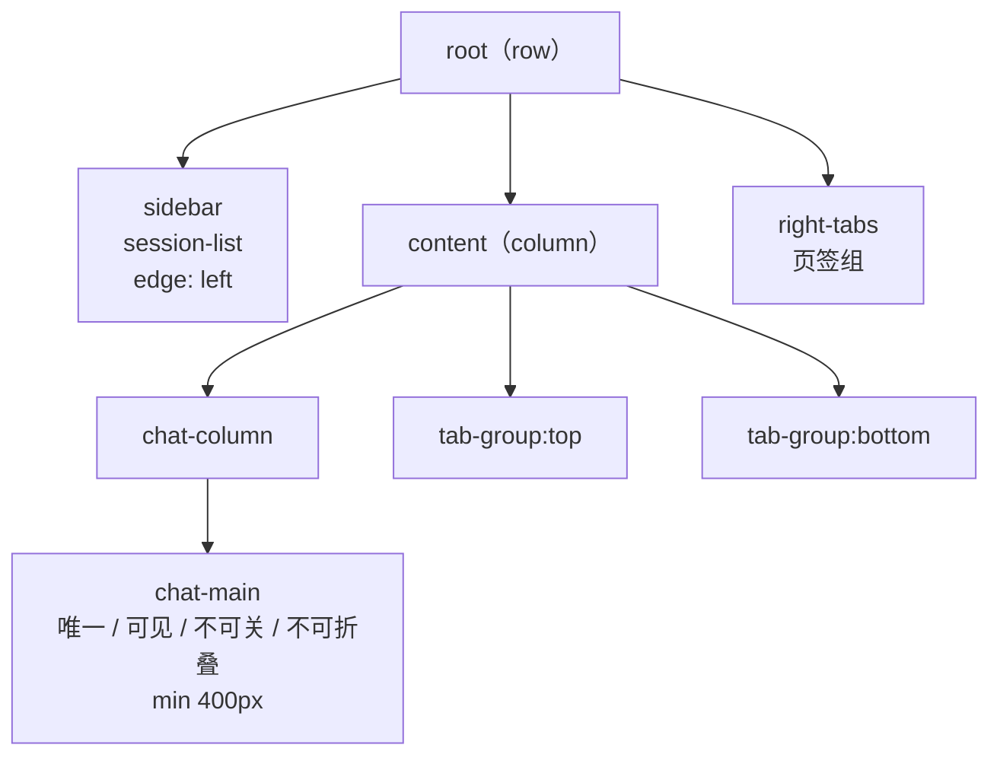

# Cindy 源码阅读（八）：Electron 进程边界与布局树

> 基于 [makecindy/cindy](https://github.com/makecindy/cindy) 源码分析。commit `2ce93d36`，2026-11-02。
> 系列：Cindy 源码阅读（8/10）。

## 一句话概括

Cindy 的桌面端按“**Renderer 不可信、preload 是最小桥、Main 是特权边界**”来切分。Agent 输出、Markdown、文件预览、网页内容、插件内容和用户输入都可能携带恶意数据；即使 Renderer 发生 XSS，也不能因此拿到 Node、文件系统、数据库、凭证或任意 IPC。

主界面则用一棵全局递归的布局树来管理面板。树里有一条不可协商的规则：`chat-main` 必须恰好一个、始终可见、不可关闭、不可折叠。

## 生活比喻：写字楼的门禁

- **Renderer** 是大堂：谁都能进，展示信息、接待访客，但不能进机房。
- **preload** 是前台窗口：只办理固定的几项业务，不给通用门禁卡。
- **Main** 是安保室：真正持有钥匙、监控、档案和机房权限。
- **IPC** 是前台递进去的申请表：表上的内容要逐项核对，不能因为“是前台递的”就信。

布局树则像楼层平面图：大堂（`chat-main`）必须一直存在、一直可见；其他房间可以拆、可以合并、可以换用途，但不能把大堂改成仓库。

## 信任模型

`docs/dev-rules/electron-security-and-process-boundaries.md:14-23` 定义了信任模型：

- Renderer 是不可信 UI 环境；XSS 不得兑换 Node、文件、数据库、凭证或任意 IPC。
- preload 是最小权限桥，不是 Renderer 的通用后门。
- Main 是特权与信任边界：系统 API、持久化、网络凭证、文件访问、进程管理和权限判断都在这里。
- **IPC payload、URL、路径和 Renderer 自报的身份都不可信。** Main 必须重新验证来源、类型、长度、范围、归属和权限。

为什么 TypeScript 类型不够？因为类型在运行时被擦除。Renderer 可以传任意结构、任意长度、任意枚举和路径；它自报的 `userId`、窗口 ID、归属和权限结论，也都可能是伪造的。身份必须从 `event.sender`、`senderFrame` 反查顶层 frame 与登记窗口，再验证 payload。

## BrowserWindow 安全基线

新增 `BrowserWindow` 时必须显式配置（`electron-security-and-process-boundaries.md:53-67`）：

```text
sandbox: true
contextIsolation: true
nodeIntegration: false
nodeIntegrationInSubFrames: false
nodeIntegrationInWorker: false
webSecurity: true
allowRunningInsecureContent: false
experimentalFeatures: false
不设置 enableBlinkFeatures
plugins: false
navigateOnDragDrop: false
```

资源用量窗（`main/resource-usage-window/window.ts:59-73`）和侧栏宿主窗（`main/right-sidebar-window/window.ts:76-94`）都显式满足。侧栏因为内置浏览器保留 `webviewTag:true`，由 `webview-security.ts:983` 起的全局 `will-attach-webview` hardener 强制覆盖安全字段。

主窗 `main/bootstrap-electron.ts:4069-4112` 显式写了 preload、节流、`webviewTag`、`navigateOnDragDrop`、`additionalArguments`、`spellcheck` 等，`sandbox` 等依赖 Electron 42.11.12 的安全默认值（docs 里仍写 Electron 41，已漂移）。文档的“增量适用”原则不要求改造存量，但默认值变化会导致回归——这是一处需要持续关注的债务。

## 优秀代码一：零信任的 IPC sender 身份闸

`apps/desktop/src/main/security/trustedAppRenderer.ts:69-86`

```ts
/** 与生产判定相同，但允许测试显式传入 renderer 地址。 */
export function isTrustedTopLevelCindyRendererEventForLocation(
  event: MainIpcEvent,
  options: TrustedRendererUrlOptions,
): boolean {
  const frame = event.senderFrame;
  if (!frame || frame !== event.sender.mainFrame || frame.parent !== null) return false;
  return isTrustedAppRendererUrl(frame.url, options);
}

/** 与生产判定相同，但允许测试显式传入 renderer 地址。 */
export function isTrustedAppRendererEventForLocation(
  event: MainIpcEvent,
  options: TrustedRendererUrlOptions,
): boolean {
  if (!isTrustedTopLevelCindyRendererEventForLocation(event, options)) return false;
  const win = BrowserWindow.fromWebContents(event.sender);
  if (!isAppContentWindow(win)) return false;
  return true;
}
```

**好在哪**：

- 不读 Renderer 自报的任何字段，身份来自 Electron 持有的 `senderFrame` 和 Main 的窗口登记。
- 同时卡三层：frame 必须是顶层 frame、URL 命中 dev/packaged 白名单、窗口已被登记为 app-content。
- 单层被绕过（例如子 frame 伪造 URL）仍然过不了另外两层。
- 生产与测试使用同一个判定函数，只是允许测试传入地址，避免测试路径和生产路径分叉。

**模式**：zero-trust sender guard。

**骨架**：

```ts
function assertTrusted(event) {
  const frame = event.senderFrame;
  if (!frame || frame !== event.sender.mainFrame || frame.parent) throw new Error('untrusted frame');
  if (!isAllowedUrl(frame.url)) throw new Error('untrusted url');
  if (!isRegisteredWindow(BrowserWindow.fromWebContents(event.sender))) throw new Error('untrusted window');
}
```

## 布局树：一张全局平面图

布局树是 `apps/desktop/src/shared/layoutTree.ts` 定义、`main/layout/LayoutStore.ts` 持久化的全局递归 split / pane 树。

### 结构



结构约束（`layoutTree.ts:16-35, 230-283, 297-332`）：

- 深度不超过 8；
- id 全局唯一；
- split 至少 2 个子节点；
- fraction 为正且和约等于 1（0.05 是插入/转移时的夹取下限，不是 validator 的校验项）；
- `sidebar` 必须是 `session-list` 且 `edge:'left'`；
- `content` 恰好一个 `chat-main`；
- `chat-main` 不可折叠；
- `session-list` 不得进入 `content`；
- `float` 必须为空。

所有操作经 `finishOp` 出口校验，`chat-main` 无法被删除（`:361-365, 457-473`）。

### 身份只认 panelKind

`panelKind` 是业务身份，**禁止用“左栏/右栏”等当前位置充当身份**。PanelKind 是开放命名空间：未注册、历史遗留、未来新增的 kind 在存档中仍然合法；渲染层查不到只隐藏并回流空间，不能清树重置（`layoutTree.ts:41-56`；`renderer/panels/registry.ts:6-15, 107-114`）。

这条规则的意义：布局是用户的记忆。今天一个面板在右边，明天可能被拖到上边；如果业务代码按“右边那个”来找它，拖动一次就全乱。按 `panelKind` 找，位置怎么变都不影响身份。

### 持久化与首帧

`LayoutStore` 同步读写（`main/layout/LayoutStore.ts:33-45, 52-80, 86-100, 126-145`）：

- 读路径损坏 → 回退默认并立即重写；
- 写路径非法 → 直接拒绝；
- tmp + rename 原子落盘；
- 启动时 `ensurePersisted`（`main/layout/index.ts:37-46`）。

Renderer 在 `useState` 初始化器里 `sendSync('layout:get')`，首帧就是用户布局，之后订阅 `layout:changed`（`renderer/layout/LayoutRoot.tsx:920-924`；`preload.ts:1336-1345`）。禁止先画默认布局再跳成用户布局——那是可见的闪烁。

### 页签组与停放

右侧组沿用 `right-tabs`，左/上/下用 `tab-group:<边>`。左右组插入根 row，上下组与 `chat-main` 同处 `chat-column` 纵向分割（`layoutTree.ts:508-512, 551-642`）。

组第一次有页签时 `ensureTabGroupPane` 插入；之后组空了只隐藏/注销，不删除 pane。边组只有“在聊天页出现过”才挂载；离开聊天页（设置页除外）转为**停放**：

- pane 原位挂载；
- 容器 0×0；
- `aria-hidden` / `inert`；
- 不画分割线；
- 不进份额账本；
- `fraction` 不动。

解除停放必须同 key 同类型，否则 React 会重挂载，webview 的 `webContents` 会被销毁，回来整页重载（#8081）。相关实现见 `tabGroupPanes.ts:157-174`、`LayoutRoot.tsx:95-100, 153-200, 1065-1085`。

## 优秀代码二：不可信布局输入的 fail-closed 归一化

`apps/desktop/src/shared/layoutTree.ts:334-354`

```ts
/**
 * 把来源不可信的数据(持久化文件、IPC 入参)转成一份**必然合法**的布局。
 * 任何解析/校验失败都静默回退默认树,只带回 reason 供调用方打日志——永不抛异常。
 * 这是"存档改坏 → 重启自动复原"行为的实现基础。
 */
export function coerceLayout(raw: unknown): CoerceResult {
  if (!isRecord(raw)) {
    return { layout: createDefaultLayout(), fallback: true, reason: 'not an object' };
  }
  let cloned: Layout;
  try {
    // 深拷贝隔离外部引用;不可序列化的输入(函数、Symbol 等)会在此抛出并走回退。
    // structuredClone 本身支持循环引用,不会为此抛错;循环引用的回退由后续 validateLayout 完成。
    cloned = structuredClone(raw) as Layout;
  } catch {
    return { layout: createDefaultLayout(), fallback: true, reason: 'not cloneable' };
  }
  const v = validateLayout(cloned);
  if (!v.ok) return { layout: createDefaultLayout(), fallback: true, reason: v.reason };
  return { layout: cloned, fallback: false };
}
```

**好在哪**：

- 持久化文件和 IPC 入参两个不可信入口共用一个纯函数边界。
- 失败永远产出合法树，不把异常抛给启动链；启动链不需要为坏存档写 try/catch。
- `structuredClone` 先隔离外部引用，防止调用方之后修改原对象影响布局。
- reason 只用于日志，不参与控制流。

**模式**：fail-closed normalization（parse, don't trust）。

**骨架**：

```ts
function coerce(raw: unknown): Layout {
  if (!isObject(raw)) return defaultLayout();
  const cloned = clone(raw);      // 不可克隆 → 默认
  return validate(cloned) ? cloned : defaultLayout();
}
```

## 独立辅助窗口的生命周期基线

资源用量窗是权威基线（`main/resource-usage-window/controller.ts`）：

1. **预热**：主窗 `ready-to-show` 后延迟 1.5 秒，才用 `show:false` 建隐藏窗，避开主窗首帧争 CPU（`bootstrap-electron.ts:4264-4283`）。
2. **双阶段握手**：`rendererReady` 表示壳已挂载，`presentationReady` 表示首份内容已提交；后者才 `show`。5 秒超时若壳已在则展示 Loading，壳不在则作废重建（`controller.ts:107-163, 313-328`）。
3. **隐藏复用**：普通关闭只 `hide`，保留 renderer 和最后快照；主窗真正销毁或退出才 `destroy`（`controller.ts:265-270`；主窗销毁时见 `bootstrap-electron.ts:4127-4135`）。
4. **隐藏时重置**：暂停采样、清除焦点、重建 chrome（`ResourceUsageWindowLayout.tsx:60-72`）。
5. **故障隔离**：同步建窗异常、`did-fail-load`、`render-process-gone` 只影响该辅助窗；自动恢复最多 1 次，稳定运行 30 秒后才恢复额度（`controller.ts:23, 242-301, 529-537, 561-585`）。

`sidebar-tab-window` 是等价变体：预热一扇未指派的 spare 窗口，弹出时“指派 → 首份内容 → show”；崩溃则把页签交回侧边栏，不进入 renderer 重建循环（`main/sidebar-tab-window/controller.ts:10-24`）。

## 优秀代码三：双阶段就绪

`apps/desktop/src/main/resource-usage-window/controller.ts:137-163`

```ts
/** renderer 根组件已挂载；用于确认超时兜底至少有 React 壳可展示。 */
markRendererReady(sender: WebContents): boolean {
  const win = this.windowForSender(sender);
  if (!win) return false;
  this.rendererReady = true;
  if (this.locale) this.sendLocale(win, this.locale);
  this.setSamplingActive(win, this.samplingActive);
  if (!this.samplingActive && !this.visible && !this.pendingOpen) this.clearPrewarmTimeout();
  return true;
}

/** 首份快照已提交；完成待显示内容，隐藏时停止后台采样但保留表格状态。 */
markPresentationReady(sender: WebContents): boolean {
  const win = this.windowForSender(sender);
  if (!win) return false;
  this.presentationReady = true;
  this.scheduleRecoveryStabilityReset(win);
  this.clearPrewarmTimeout();
  if (this.pendingOpen) {
    this.showAndFocus(win);
    return true;
  }
  if (!this.visible && !this.pendingOpen && this.deps.pauseWhenHidden !== false)
    this.setSamplingActive(win, false);
  return true;
}
```

**好在哪**：

- 把“壳挂载”和“首份内容提交”分开，避免把 Electron 的 `ready-to-show` 当成内容就绪。
- 每个信号先校验真实 sender，再驱动状态转移；未知窗口直接返回 false。
- 首份内容就绪才 `show`，用户不会看到空白窗口。
- 隐藏时停止采样但保留表格状态，二次打开是热启动。

**模式**：两阶段握手 + 显式状态机。

**骨架**：

```ts
markShellReady(sender) { if (!known(sender)) return false; shellReady = true; return true; }
markContentReady(sender) {
  if (!known(sender)) return false;
  contentReady = true;
  if (pendingOpen) show();
  else if (!visible) pauseSampling();
  return true;
}
```

## 复杂度与风险

1. **布局 IPC 缺 sender 闸。** `main/layout/index.ts:44-63` 的 get/set/reset 没有 `assertTrustedAppRendererEvent`，`layout:changed` 还无条件广播给所有 `BrowserWindow`。这与文档 §5 和 `trustedAppRenderer.ts:92-95` 对出站广播的警告不一致；payload 校验只能防坏树，不能防未授权改写或泄漏给已导航窗口。
2. **主窗安全配置依赖默认值。** 主窗未逐项显式写 `sandbox/contextIsolation/nodeIntegration`，升级 Electron 或改动 `webPreferences` 时容易失守；`webviewTag:true` 扩大攻击面，只能依赖全局 hardener。
3. **preload 面积不均。** 主 preload 约 8.6k 行、`electronAPI` 面极宽；专用辅助窗 preload 只有百行级，确实更接近最小桥。大 preload 虽未暴露裸 IPC，但回归和审计成本高。
4. **结构合法不等于语义合法。** validator 保证深度、id、split 子节点数、fraction 正且和约 1、sidebar / float / chat-main 约束；但不检查 `chat-main` 的 400px 最小宽、非 chat 面板的重复 kind、tab-group 是否真在 `chat-column`。`removeRootSplitPaneByKind` 按 kind 删第一个，重复 kind 会让身份和操作目标含糊。
5. **隐藏模式叠加。** 未注册隐藏、停放、设置页接管、面板最大化共存；停放依赖同 key 同类型和路由例外，任何重构都可能重挂 webview（#8081）。
6. **同步 I/O。** 布局读写是同步主线程 I/O，文件膨胀或磁盘慢会阻塞启动/交互。

---

**相关文章**

- [Cindy 源码阅读（一）：一个 Agent 客户端如何把自己拆成连接层](01-architecture.md)
- [Cindy 源码阅读（五）：device-link，手机如何控制电脑](05-device-link.md)
- [Cindy 源码阅读（七）：插件沙箱、Skill 与 Ghost 渐进发现](07-plugins-skills.md)
