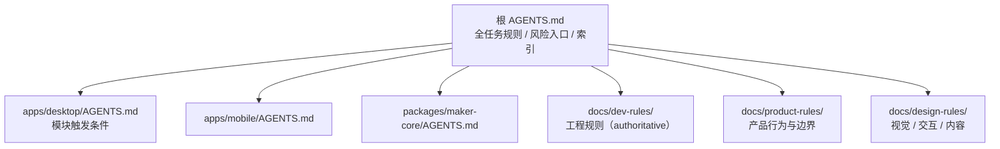

# Cindy 源码阅读（十）：文档即约束，测试即门禁

> 基于 [makecindy/cindy](https://github.com/makecindy/cindy) 源码分析。commit `2ce93d36`，2026-11-02。
> 系列：Cindy 源码阅读（10/10）。

## 一句话概括

Cindy 最特别的地方不是某个模块，而是它把**工程治理写进了仓库**：

- `AGENTS.md` 是给人和 Agent 共用的规则索引；
- `docs/dev-rules/`、`docs/product-rules/`、`docs/design-rules/` 是权威规则正文；
- 每条规则都标注“读取时机、必须/禁止、验证方式、例外”；
- 能自动化的规则一律落成 `scripts/` 里的 guard，接进 CI；
- 测试有“价值门槛”和“性能预算”，不是越多越好；
- 每个 commit 必须带 DCO 签名，PR 有模板、自动 review 和分片 CI。

它试图回答一个很现实的问题：**当一个仓库大到没人能通读时，怎么让新人和 Agent 不做错事？**

## 生活比喻：把规矩写在墙上，也装成门禁

很多项目的规范是“写在 wiki 里，靠自觉”。Cindy 的做法更像一栋写字楼：

- **墙上的告示**：`AGENTS.md` 和 `docs/` 告诉你“进这个房间前必须先读什么”；
- **门禁**：`scripts/check-*.mjs` 和 CI 把“不能做的事”变成失败；
- **验收单**：PR 模板要求你逐项填写改了什么、验证了什么、没验证什么；
- **签名簿**：DCO 要求每个 commit 留下 `Signed-off-by`，明确谁对这次提交负责。

告示可以绕过去，门禁绕不过去。两者配合，才是治理。

## 规则体系



### 分层原则

- 根 `AGENTS.md` 只放**所有任务都适用**的规则、风险入口和文档索引；`CLAUDE.md` 只有一行 `@AGENTS.md`，避免两处维护。
- 模块专属规则放到对应目录的嵌套 `AGENTS.md`，例如 `apps/desktop/AGENTS.md`、`packages/maker-core/AGENTS.md`。
- 工程、产品、设计分别落 `docs/dev-rules/`、`docs/product-rules/`、`docs/design-rules/`；`docs/README.md:5` 用 `authoritative` / `参考` 标注约束力。
- `docs/dev-rules/README.md:5-12` 要求每条规则写清：触发条件、必须/禁止、验证方式、例外；能自动化的必须同时落到脚本。

### “读取时机”机制

这是 Cindy 文档体系里最实用的设计。根 `AGENTS.md` 不按目录罗列所有规则，而是按**你要做的事**给触发条件：

> 修改任何进入模型 system 段的提示词前，必须先读 `docs/dev-rules/maker-core-and-agent-behavior.md`。
>
> 新增或修改任何界面、组件、布局、样式、动效或 UI 文案前，必须先读权威设计规范 `docs/design-rules/DESIGN.md`。

每条规则正文开头再标一次状态和读取时机。这样规则只有一份正本，入口只维护“什么时候该读哪份”，不会复制内容导致漂移。

### 为什么把裁决写进仓库

`docs/dev-rules/development-workflow.md:146-167` 说得很清楚：

- 跨人、跨机接手所需的知识默认属于仓库；
- 实现约束进代码/测试；
- 规则与排错结论进 `docs/`；
- 个人路径、设备标识、账号偏好、凭据、私聊原文留在本地。

这样规则可以被 review、被引用、被测试断言；不会只存在于某个人的聊天记录里。

## 测试策略：少而准

### 选测，而不是全量

`pnpm test:unit:related` 不是“猜几个文件跑一下”。`scripts/test-related.mjs:54-57, 187-225, 243-350` 会：

1. 汇总已提交、暂存、未暂存、未跟踪的变更；
2. 基准优先 `upstream`，其次 `origin`，最后本地 `main`；
3. 文档/图片跳过；
4. 根依赖清单、锁文件、调度脚本变更 → 全量；
5. 公共包源码变更 → 依赖它的包跑整包；
6. `package.json`、Vitest 配置或删除文件 → 该包整包；
7. 选测失败 → 回退全量。

### Tier 是可执行清单

`scripts/test-workspaces.config.mjs:331-446` 定义了多个 tier：

| Tier | 说明 |
|------|------|
| unit | required，默认单测 |
| integration | 跨模块集成 |
| e2e | 端到端 |
| db | 数据库回归 |
| migration | migration 专项 |
| db-perf | 数据库性能 |
| git-integration | 真实 Git 操作 |
| guard | 跨文件安全/权限/协议/设计契约 |

重型 tier 是 manual + allowlist，guard 是 required + allowlist。CI 用 4 个 Linux + 4 个 Windows 分片并集覆盖 unit，另跑 guard、device-link、Git integration、DB 回归和 runner 自测（`.github/workflows/ci.yml:58-128, 130-347`）。

### 新增测试的价值门槛

`docs/dev-rules/engineering-conventions.md:121-137` 要求新增或改写测试时回答四个问题：

1. 它从哪个**真实生产入口**验证什么**可观察结果**？
2. 依据哪个 Bug 或规则？现有覆盖缺口是什么？
3. 最小失败输入是什么？
4. 属于哪个 tier？

再加一条：**实测耗时**。

只验证真实结果、错误、权限、持久化、协议或时序差异；禁止复制常量 / JSX / CSS / 源码字面量后比对；回归要先红后绿；没有新的分支或结果差异就停止增加用例。

### 性能预算

`docs/dev-rules/engineering-conventions.md:146-168` 把“测试要快”写成了可测预算：

- 新增或改写的单测文件单独运行应在 5 秒内；超过 10 秒必须在 PR 写明原因，并优先改用文件级 fixture、依赖注入或迁移 tier；
- 模块只加载一次，`vi.resetModules()` 只用于验证“重启/重新加载”语义；
- 不做 ≥100ms 的真实等待，改用 fake timers 或事件；
- jsdom 按需；
- 不超过 3 条用例的新文件必须说明为什么不能并入已有文件；
- 重 I/O 下沉到专用 tier。

`pnpm check:test-hygiene` 静态阻断三类问题，基线只减不增，并从可信 Git 基准校验（`scripts/check-test-hygiene.mjs:1-20, 1331-1347, 1373-1399`）。

## 优秀代码/配置一：把测试性能写成预算

`docs/dev-rules/engineering-conventions.md:146-168`（节选）

```text
#### 性能预算（与价值门槛同等强制）

单测的成本主要不在用例条数，而在每个文件的准备、收集（导入模块）和环境初始化。2026-10-16
实测 Desktop 每个分片的 worker 时间里，收集阶段与执行测试相当；一个逐用例重置模块的文件
（codexProxyHost.test.ts）就占全部文件耗时的约 10%，不重置时同样 285 条用例从 105 秒降到
7 秒。新增或改写测试时：

- 单文件预算：新增或改写的单测文件单独运行应在 5 秒内（本机），超过 10 秒必须在 PR
  写明原因，并优先改用文件级 fixture、依赖注入或迁移 tier；不得用放宽 timeout 掩盖。
- 模块只加载一次：默认在文件顶部静态 import 被测模块。需要干净的模块级状态时，调用
  生产代码已有的 dispose／reset 或注入依赖；vi.resetModules() 只用于确实在验证「重启／
  重新加载」语义的边界。
- 不做真实等待：不用 ≥100ms 的 setTimeout／sleep 等异步结果，改用 vi.useFakeTimers()、
  vi.waitFor／事件，或直接 await 被测 Promise。
```

**好在哪**：

- 不是喊“测试要快”，而是给出可量化预算和实测反例：285 条用例从 105 秒降到 7 秒。
- 例外必须内联理由，不能靠放宽 timeout 掩盖。
- 配套静态门禁 + 只减不增的基线，形成棘轮效应。
- 预算和“价值门槛”同等强制，避免为了覆盖率堆测试。

**模式**：预算化测试契约 + ratchet（棘轮）。

**骨架**：

```text
单文件预算 → 超预算必须写原因 → CI 静态扫描 → 基线只减不增
```

## 优秀代码/配置二：本地检查与权威门禁同向

`scripts/check-dco.mjs:144-177`

```js
export function validateCommit(commit) {
  const signOffs = parseSignOffs(commit.message);
  if (signOffs.length === 0) {
    return ['No Signed-off-by trailer.'];
  }

  // 与 App 一致：只看 author.email（缺失时回落 committer.email）。改成「两者都非法才
  // 失败」会比 App 宽松，反而制造本地绿、PR 红。
  const email = commit.authorEmail || commit.committerEmail;
  if (!looksLikeEmail(email)) {
    return [`${email} is not a valid email address.`];
  }

  const identities = [
    { name: normalizeName(commit.authorName), email: normalizeEmail(commit.authorEmail) },
    { name: normalizeName(commit.committerName), email: normalizeEmail(commit.committerEmail) },
  ];
  // 签名侧只 lowercase、不 trim（App 亦然）；commit 侧 trim 是安全的，git ident 本身
  // 不带前后空白。两边处理方式刻意不同，正是为了让「Alice 」这种写法在本地也失败。
  const matches = (signOff) =>
    identities.some(
      (identity) =>
        identity.name === String(signOff.name).toLowerCase() &&
        identity.email === String(signOff.email).toLowerCase()
    );
  if (signOffs.some(matches)) return [];

  const got = signOffs.map((signOff) => `"${signOff.name} <${signOff.email}>"`).join(', ');
  return [
    `Expected a sign-off from "${commit.authorName} <${commit.authorEmail}>" or ` +
      `"${commit.committerName} <${commit.committerEmail}>", got ${got}. ` +
      'The name and the address have to match one of them as a whole.',
  ];
}
```

**好在哪**：

- 本地检查以外部权威（DCO App）为准，宁可偏严不可偏宽，避免“本地绿、PR 红”。
- 身份成对比较，拒绝可伪造的 bot 邮箱豁免。
- 注释写清了“签名侧只 lowercase、不 trim；commit 侧 trim”——两边处理刻意不同，是为了让 `Alice ` 这种写法在本地也失败。
- 错误信息包含期望值和实际值，贡献者可以直接修复。

**模式**：fail-closed 权威镜像。

**骨架**：

```ts
function validate(commit) {
  const signOffs = parse(commit.message);
  if (!signOffs.length) return ['missing Signed-off-by'];
  const ok = signOffs.some((s) => matchesAuthorOrCommitter(s, commit));
  return ok ? [] : [`expected ${expected(commit)}, got ${got(signOffs)}`];
}
```

## 优秀代码/配置三：用 allowlist 固化 tier 边界

`scripts/test-workspaces.config.mjs:355-375`

```js
command: unitVitestCommand(
  desktopUnitWorkerCount(),
  desktopUnitPool(),
),
exclude: [
  '**/*.git-integration.test.ts',
  '**/*.integration.test.ts',
  '**/*.e2e.test.ts',
  'src/main/localDb/**',
  'src/main/__tests__/*Migration.test.ts',
  'src/main/__tests__/schemaDriftRepair.test.ts',
  'src/main/__tests__/betterSqliteFactory.test.ts',
  'src/main/__tests__/*LocalSessions.test.ts',
  'src/main/__tests__/codexHistoryPromptInit.test.ts',
  'src/main/__tests__/orcaStaleIndexCleanup.test.ts',
  'src/main/scheduler-host/__tests__/*.db.test.ts',
  'src/main/__tests__/directSessionSendGuard.test.ts',
  'src/main/__tests__/makerSendToSessionOrdering.test.ts',
  ...desktopGuardInclude,
  '**/*.bench.ts',
],
```

**好在哪**：

- unit 的 `exclude` 与 guard 的 `include` 共用同一份显式 allowlist，静态契约无法悄悄混入默认单测。
- `coverage: 'allowlist'` 让边界可执行；新增重型测试必须显式改清单，不会因为文件名没匹配上就误入 unit。
- 每条排除都有明确语义：真实子进程、真实 SQLite、真实 Git、benchmark，不能让它们拖慢默认反馈。

**模式**：allowlist 化 tier 边界。

**骨架**：

```ts
const guardFiles = ['src/security/**', 'src/protocol/**'];
unit.exclude.push(...guardFiles);
guard.include = guardFiles; // 同一份清单，避免漂移
```

## 交付门禁

### DCO 签名

每个非 merge commit 都必须带 `Signed-off-by`，且名字与邮箱要与 author 或 committer 整体匹配（`AGENTS.md:216-225`）。用 `git commit -s` 生成；`pnpm dco:install-hook` 可以装 `prepare-commit-msg` 钩子；`pnpm check:dco` 本地自查。PR 上以 DCO App 为准。

一个细节：review 沙箱 checkout 出的 HEAD 可能是平台合成的瞬时 commit（不存在于本仓库），对这类 SHA 跑 `check:dco` 失败不构成缺签证据。判定 DCO 是否通过，一律以 PR 上的 DCO App check 和真实提交范围（`origin/main..PR head`）为准。

### PR 模板

`.github/PULL_REQUEST_TEMPLATE.md:9-114` 要求：

- 单一目标、类型、范围；
- UI 变化与设计依据；
- 自动/手工/未执行验证分别列出；
- 风险分类、影响与回滚；
- 提交前清单；
- 新增测试逐文件填“测试价值”。

UI 路径命中时，`pr-design-basis` 会校验“引用的设计规范”非空：可以引用设计文档，也可以写“不涉及 + 理由”（`scripts/check-pr-design-basis.mjs:20-31, 84-119`）。

### 自动 review 是建议性的

`REVIEW.md:18-51` 给出严重度映射与“不复报机器门禁”；fork / dependabot / draft 的运行条件在 `.github/workflows/pr-code-review.yml:30-64`：

- 只对同仓非 draft PR 运行；
- fork（secrets 不可见 + prompt 注入）与 dependabot 不跑；
- P0 → 评论 P1，P1 → P2，P2 不上报；
- 不复报机器门禁。

它是建议性检查，不替代人工 review，也不替代 `client-ci` 的机器门禁。

### Guard 脚本

除了测试，Cindy 还有一批“规则即代码”的 guard：

| 脚本 | 管什么 |
|------|--------|
| `check:endpoints` | 生产 URL / 飞书 App ID 单一来源 |
| `check:i18n` | i18n key 完整性 |
| `check:i18n-glossary` | 术语与标点，decided 阻断、proposed 告警、baseline 只减不增 |
| `check:brand-terminology` | 品牌术语一致性 |
| `check:design-colors` | 硬编码颜色审计 |
| `check:design-inventory` | 设计资产清单 |
| `ui:check` | UI 页面截图与主题检查 |
| `check:test-hygiene` | 测试价值门槛与性能预算 |
| `check:dco` | DCO 签名 |
| `scheduler-ci-guard` | 调度器边界 |

CI 用 `always()` 汇总分片为稳定的 required check，避免“某个分片失败但整体显示绿”（`ci.yml:191-206, 298-312`）。

## 这套治理的成本与风险

| 收益 | 成本 |
|------|------|
| 新人/Agent 可以按“读取时机”进入，不必通读全仓 | 规则总量大：`AGENTS.md` 243 行、`engineering-conventions.md` 约 30KB |
| 裁决可 review、可引用、可测试 | 文档与代码会漂移，只有部分由 `dev-docs-contract` 锁定 |
| 测试有价值和性能门槛，反馈快 | 门槛主观，容易变成 review 摩擦 |
| guard 把“不能做”变成失败 | 规则可能被形式化满足，真正的风险仍在语义层 |
| DCO + PR 模板 + 自动 review | 贡献摩擦增加；fork 和 dependabot 是自动 review 盲区 |

几个具体风险：

1. **“必须先读”无法机检。** 一个 PR 可以完全不读规则就提交，CI 只能检查结果，不能检查过程。
2. **性能预算可能把行为验证推向 guard。** 5 秒/10 秒阈值需要持续维护，否则大家会把慢测试塞进 guard。
3. **文档漂移。** 例如 `repo-map.md` 说 mobile 依赖 5 个包，实际 `apps/mobile/package.json` 是 6 个；`claude-code/index.ts` 的 prompt 段数注释与实际数组不一致。
4. **过度治理。** 小改动可能背多份文档和多个 guard；裁决入仓也可能把一次错误决策固化下来。
5. **CI 反馈慢。** 8 个 unit 分片 + Windows + guard + DB 回归，完整跑一轮不便宜。

## 收尾：这个仓库最值得带走的三件事

1. **连接层要有边界。** Cindy 不重造 Agent Loop，只把 Claude Code / Codex / Pi 连接起来；核心零 Electron，宿主注入一切。这让它可以在 Desktop、headless、测试环境复用同一套编排。
2. **确定性交给代码，语言理解交给模型。** 工具循环、权限裁决、会话恢复、插件迁移都用代码和状态机实现；prompt 只负责真正需要语言理解的部分。
3. **把 WHY 写进仓库。** 不只是“怎么做”，还有“为什么是这个数、这条规则防的是哪次事故”。这让一个 1.36 万文件、几十万行的仓库仍然可以被新人或 Agent 逐步接手。

Cindy 不是一个完美的仓库：它有巨型文件、文档漂移、未完全机器化的不变量和复杂到需要多轮 review 的状态机。但它展示了一种很现实的工程态度：**当复杂度无法消除时，至少让它可见、可查、可验证。**

---

**相关文章**

- [Cindy 源码阅读（一）：一个 Agent 客户端如何把自己拆成连接层](01-architecture.md)
- [Cindy 源码阅读（四）：看门狗、循环守卫与中断续跑](04-session-reliability.md)
- [Cindy 源码阅读（九）：Prompt 全集（中英双语）](09-prompts.md)
