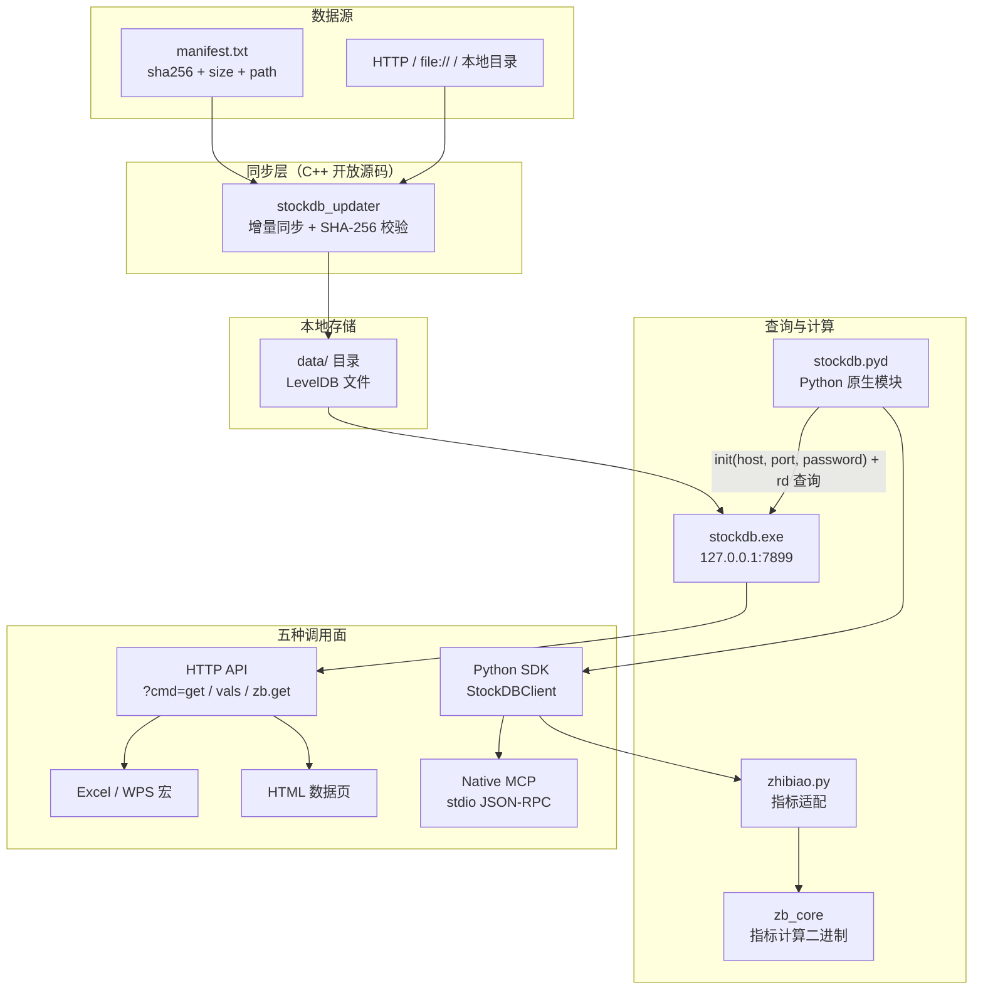
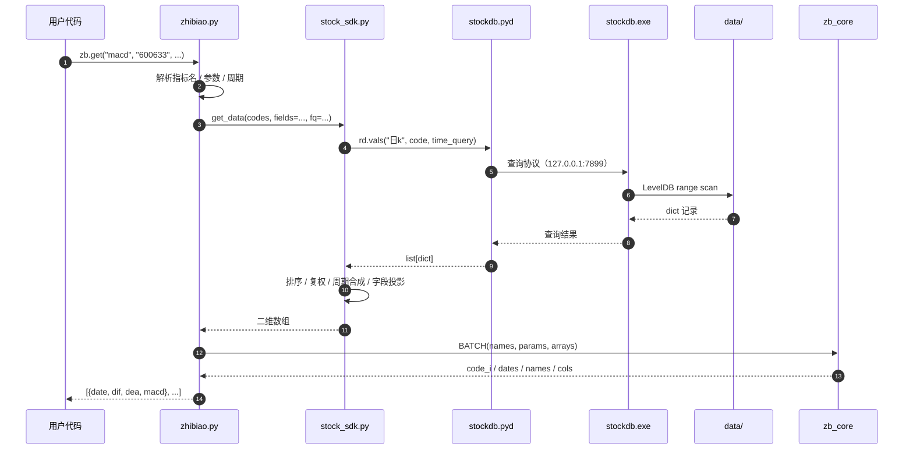

# free-stockdb 源码阅读（一）：一个本地数据引擎的边界

> 基于 [hello245m/free-stockdb](https://github.com/hello245m/free-stockdb) 源码分析。commit `f352641`，2026-10-05，Windows 优先。
> 系列：free-stockdb 源码阅读（1/10）。

## 一句话概括

free-stockdb 是一个**本地 A 股数据引擎**：先把日 K、分钟 K、复权因子、板块关系同步到本机，再用 LevelDB 组织成可以直接批量查询和计算的 K-V 数据库，最后通过 Python SDK、HTTP、Excel/WPS、HTML、MCP 五个入口暴露出去。

它想解决的问题不是"怎么算指标"，而是更底层的：**把全市场数据工程从策略代码里拿出来，变成一次同步、长期本地可查的数据底座。**

## 生活比喻：一家本地图书馆

把这个项目想成一家图书馆：

| 角色 | 对应模块 | 职责 |
|------|---------|------|
| **书库** | `data/` 下的 LevelDB 文件 | 按 key 排好序的数据，查询只读本地 |
| **采购与上架** | `stockdb_updater` | 按 `manifest.txt` 增量同步、校验、替换 |
| **管理员** | `stockdb.exe` / `stockdb.pyd` | 打开书库，响应查询、计算请求 |
| **前台** | Python SDK / HTTP / Excel / HTML / MCP | 五种接待方式，共用同一个书库 |
| **编目规则** | `日k:code:date` 等 key 设计 | 决定"怎么找书"的协议 |

有趣的是：**这个仓库公开了前台的接待流程和编目规则，但没有公开真正按内容检索的编目引擎。** Python 层 `from stockdb import init, rd`（`pybao/stock_sdk.py:7`）和 `import zb_core`（`pybao/zhibiao.py:4`）引用的都是二进制模块；仓库里看不到 `stockdb.pyd`、`zb_core` 的实现。

这不是一句"代码不全"就能带过的细节，它决定了我们应该怎么读这个项目。

## 整体架构



这张图里有三条独立的主线：

1. **数据怎么进来**：`stockdb_updater` 按清单同步，和查询服务解耦。
2. **数据怎么被读**：C++ 服务器打开本地库；Python 原生模块通过 `init(host, port)` 连到服务，不直接碰 LevelDB 文件。
3. **数据怎么被用**：Python、HTTP、Excel、HTML、MCP 都是薄适配层。

真正把三条线连起来的是 **key 协议**，而不是某个类。只要 key 还是 `日k:600633:20260625`，换一个前台、换一个客户端，查询语义都不变。

## 分层：开放源码与二进制边界

| 层 | 文件 | 是否可读 | 作用 |
|----|------|---------|------|
| 同步器 | `cpp/src/updater.cpp`（301 行） | ✅ 完整 | manifest 解析、下载/复制、校验、原子替换 |
| 参考服务 | `cpp/src/server.cpp`（371 行） | ✅ 完整 | LevelDB 封装、socket/HTTP、基础查询路由 |
| 参考客户端 | `cpp/src/client.cpp`（147 行） | ⚠️ 部分 | 连接结构 + MA/EMA/MACD；`get_kdata` 等是空实现 |
| Python SDK | `pybao/stock_sdk.py`（605 行） | ✅ 完整 | 查询编排、周期合成、复权、DataFrame |
| 指标适配 | `pybao/zhibiao.py`（544 行） | ✅ 完整 | 参数校验、指标名解析、结果整形 |
| 指标核心 | `zb_core` | ❌ 二进制 | 38 个普通指标 + 指数计算的实际数学实现 |
| MCP 框架 | `pybao/native_mcp.py`（482 行） | ✅ 完整 | 自己实现的 JSON-RPC / MCP 服务器 |
| 多端客户端 | `调用方式/`、`数据网页版.html` | ✅ 完整 | HTTP URL、WPS 宏、HTML 页面 |

所以更准确的说法是：**这是一个"开放适配层 + 参考 C++ 实现 + 二进制核心引擎"的项目。**

这带来两个直接后果：

- 你不能靠读这个仓库复刻出全部指标/指数公式；`zhibiao.py` 只负责把输入整理成数组，真正的公式在 `zb_core` 里。
- 你可以完整学习它的**数据协议、同步协议、查询编排、MCP 实现**。这些恰好是"把本地数据引擎接进自己的系统"最难、最值得学的部分。

## 一次查询的完整路径

以 `zb.get("macd", "600633", start=..., end=...)` 为例：



注意 `stock_sdk.py` 在这条链路里做的是**编排**：它不实现指标公式，也不实现 LevelDB 扫描；它负责把业务参数翻译成底层查询，再把底层返回的松散记录整理成稳定的矩阵。

## 为什么这个架构成立

### 1）数据同步与查询解耦

同步器只关心"本地文件是否与清单一致"；查询服务只读本地。数据源挂了，已经同步的数据仍然能查；换数据源也不影响查询接口。这是 local-first 系统的核心收益。

### 2）一个引擎，多个前台

同一套 key 协议和查询语义，可以同时服务 Python 回测、Excel 公式、浏览器页面和 AI 助手。前台之间不互相依赖，新增一个前台不需要改引擎。

### 3）把"重计算"放在本地

指标计算、周期合成、复权都在本地完成，避免了远程 API 的限频、网络抖动和数据搬运。`zb_core` 用编译实现做向量化计算，Python 只做参数与结果整形。

### 4）代价：开放边界不完整

因为核心是二进制，源码阅读者能验证的只有"接口行为"，不能验证"指标公式"。这也是为什么这个系列会把重点放在：
- 可读的协议与编排；
- 能复用的工程模式；
- 明确标注哪些结论来自源码、哪些只能从文档和调用行为推断。

## 这套架构适合什么、不适合什么

| 适合 | 不适合 |
|------|--------|
| 个人/小团队的低频到中频研究 | 需要毫秒级行情和交易 |
| 全市场批量回测的数据底座 | 多租户、强权限、审计合规场景 |
| 离线、内网、数据可控的环境 | 必须完全开源、可审计每一行计算的场景 |
| 用 Excel / AI 做快速探索 | 高频写入、实时流式更新 |

README 里说"30 分钟从零到可运行"，指的是**发行包**的体验；从源码构建则要面对 LevelDB、libcurl、OpenSSL、二进制模块等依赖，这是两件不同的事。

## 优秀代码：两个"薄"的边界

### 1）同步器只认 manifest，不认数据源

`cpp/src/updater.cpp` 把"从哪里拿"和"怎么校验"分开了：

```cpp
// updater.cpp:28-30
bool is_http_url(const std::string& value) {
    return value.rfind("http://", 0) == 0 || value.rfind("https://", 0) == 0;
}
```

上层只传一个字符串，同步器自己判断是 HTTP 还是本地目录。新增一种源（比如对象存储）只需要改 `load_manifest` / `fetch_entry`，不用动校验和替换逻辑。

### 2）Python SDK 只认 `rd` 协议，不认具体引擎

```python
# stock_sdk.py:7
from stockdb import init, rd
```

`StockDBClient` 的构造函数尝试 `init(host, port, password)`；如果它返回 `None`，才退回模块级 `rd`；如果抛出 `ImportError`（底层二进制缺失），则重新抛出 `ImportError`，其他异常继续向上传播（`stock_sdk.py:20-26`）。这意味着：
- 引擎可以是本地进程，也可以是远程服务；
- 测试时可以注入一个假的 `rd`；
- Python 层不需要知道 LevelDB 的存在。

**模式**：依赖倒置（Dependency Inversion）——高层编排依赖抽象的 `rd` 查询协议，而不是具体的存储实现。

## 骨架代码：一个 local-first 查询层

去掉股票业务，这个结构可以直接复用：

```python
class LocalQueryClient:
    def __init__(self, backend):
        self.backend = backend

    def query(self, table, key, time_expr):
        rows = self.backend.range(table, key, time_expr)
        return self._normalize(rows)

    def _normalize(self, rows):
        # 存储层返回松散记录，编排层负责稳定形状
        return [r for r in rows if isinstance(r, dict)]
```

关键不是这个类有多复杂，而是：**存储层返回什么形状、编排层承诺什么形状，要分开定义。**

## 这一系列的路线

1. **架构全景与边界**（本文）
2. Key 即协议：LevelDB 的 key 设计与查询 DSL
3. 增量同步器：manifest + SHA-256 + 原子替换
4. C++ 参考服务：371 行能教什么，不能教什么
5. Python SDK：同步/异步、批量 pipeline 与结果整形
6. 周期合成：周 K、月 K 与分钟 K 的时间轴对齐
7. 复权：全市场因子、二分查找与内存折算
8. 指标层：薄适配器 + 编译核心的分工
9. 板块索引与私有存储：一张内存倒排表
10. 自实现 MCP 与五种调用面

> 下一章从最底层、也最像"协议"的东西开始：**key 长什么样。**
