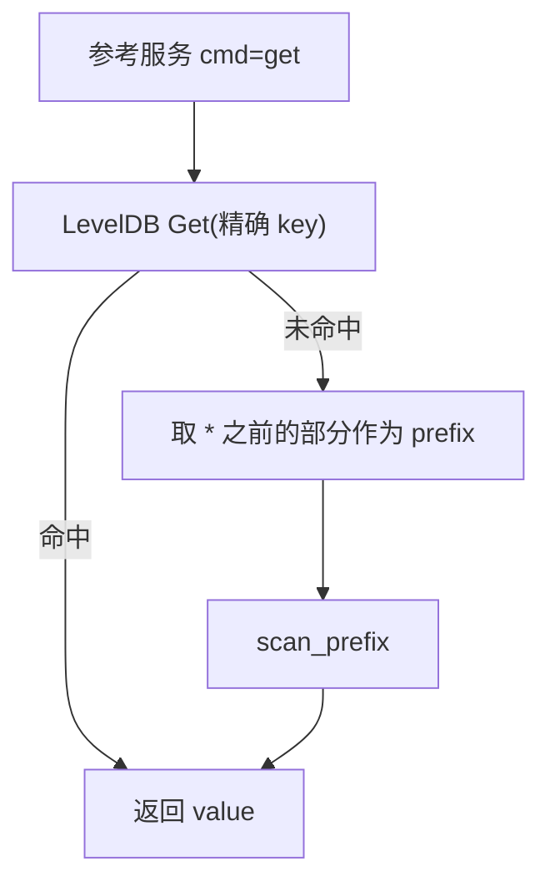

# free-stockdb 源码阅读（二）：Key 就是 API

> 基于 commit `f352641`，2026-10-05。
> 系列：free-stockdb 源码阅读（2/10）。

## 一句话概括

free-stockdb 没有 SQL 表结构，也没有 ORM。它把"表、股票、时间"全部编码进 LevelDB 的 key：`日k:600633:20260625`。

**key 的顺序就是查询能力**——想按时间范围扫，key 里就必须把时间放在最后；想按股票扫，股票代码就必须在时间前面。读这个项目，先读懂 key。

## Key 的语法

从 `调用方式/python/rd_test.py` 和 `stock_sdk.py` 的查询可以还原出这套命名：

| 数据 | key 形态 | value |
|------|----------|-------|
| 日 K | `日k:{code}:{YYYYMMDD}` | dict：open/high/low/close/volume/amount/… |
| 分钟 K | `分钟k:{code}:{YYYYMMDDHHMMSS}` | dict：open/high/low/close/volume/amount/code/date（字段比日 K 少） |
| 复权因子 | `复权:{code}:{YYYYMMDD}` | dict：至少包含 `cum`；投影 `.get("cum")` 后是 float |
| 板块 | `板块:{code}` 或 `板块:{name}` | dict：code/name/category/symbols/… |
| 股票代码 | `股票代码` | dict：按首位分组，如 `{"6": ["600000", ...]}` |
| 退市 | `退市...` | 列表 |

这个设计非常"LevelDB"：

- LevelDB 按 key 字节序排序；
- 相同前缀的 key 连续存储；
- 一次 `Seek(prefix)` + `Next()` 就能扫完一个股票的所有日 K；
- 不需要为"按股票查时间范围"再建索引。

代价是：**key 设计一旦成为对外协议，就不能随便改。** 客户端的 `rd.get`、HTML 的 `extractCodes`、WPS 宏的 URL 都直接依赖这些前缀。

## 查询 DSL：`>` 和 `<` 不是数学比较

`stock_sdk.py` 里最有意思的一段是 `_build_time_query`（`stock_sdk.py:48-63`）：

```python
def _build_time_query(self, start, end, desc):
    if not start and not end:
        return "*"

    # 单日查询优化
    if start and (not end or start == end):
        return start

    op = "<" if desc else ">"
    s_val = start if start else "N"
    e_val = end if end else "N"
    return f"{s_val}{op}{e_val}"
```

这里的 `>` / `<` 不是"大于/小于"，而是底层 `rd` 协议的**遍历方向符**：

- `desc=False` 用 `>`，表示从 start 向 end 的方向扫；
- `desc=True` 用 `<`，表示反向；
- `N` 表示没有边界的那一端；
- 不传 start/end 就是 `*`，全量。

测试里的写法很直观（`rd_test.py:48-51`）：

```python
rd.get("日k", "600633", "20260620<20260626")
rd.get("日k", "600633", "20260620<N")[:3]
rd.get("日k", "600633", "20260620>20260626")[:3]
rd.vals("日k", "600633", "20260620>20260626")[-3:]
```

**不要用数学不等号去理解它。** 这是"从哪往哪扫"的指令，具体返回顺序由底层决定；SDK 则在拿到结果后按需要反转。

还有两个细节：

1. **单日查询直接退化成点查**：`start == end` 时不再构造范围表达式，直接返回日期 key。这是最常用的路径，少一层范围扫描。
2. **分钟级日期自动补全**：`build_time_query_for_retrieval`（`stock_sdk.py:595-605`）会把 8 位日期补成 14 位：start 补 `000000`，end 补 `235959`，否则分钟 K 的字符串比较会漏掉当天数据。

## 服务端怎么执行这些 key

C++ 参考服务里有一个很小的 `StorageEngine`（`server.cpp:36-131`），核心只有两个扫描：

```cpp
// server.cpp:97-112
std::vector<std::pair<std::string, std::string>>
scan_prefix(const std::string& prefix, int limit = 10000) {
    std::unique_ptr<leveldb::Iterator> it(db_->NewIterator(ro));
    for (it->Seek(prefix); it->Valid(); it->Next()) {
        std::string key = it->key().ToString();
        if (key.compare(0, prefix.size(), prefix) != 0) break;
        results.emplace_back(key, it->value().ToString());
        if (static_cast<int>(results.size()) >= limit) break;
    }
    return results;
}
```

`scan_range` 只是把终止条件从"前缀不同"换成"key >= end_key"。但要注意：**参考服务的 `cmd=get` 只用了精确 `Get` + 前缀扫描，没有解析 `<` / `>` / `N`**（`server.cpp:280-301`）。`scan_range` 唯一被调用的地方是演示版 `process_zb_get`（`server.cpp:318`）。完整的范围/方向 DSL 在发行版引擎里，参考实现没有实现它。

所以参考服务的 `cmd=get` 实际只有两条路径：

- `股票代码`、`日k:600633:20260625` → 精确 `Get`，命中即返回
- `日k:600633:*`、`板块:*` → 去掉 `*` 后的前缀扫描；未命中时也会退化成"整串 key 作为前缀"再扫一次
- `<`、`>`、`N` → 参考服务不解析；要按范围查，需要完整引擎



这就是为什么 key 的顺序必须是 **表 → 股票 → 时间**。如果写成 `日k:20260625:600633`，按股票扫时间就会变成全表扫描。**key 是协议，参考服务只是协议的一个最小实现。**

> 本文后续讲"范围扫描"时，指的是完整的 `rd` 引擎语义；参考 C++ 服务只证明了前缀扫描这条路径。

## `get` / `vals` / `keys` / `pipe` 的区别

同一份数据有四种取法，语义不同：

| 方法 | 返回 | 适合 |
|------|------|------|
| `rd.get(...)` | key/value 对或 dict | 要看 key 和 value 的完整记录 |
| `rd.vals(...)` | 只返回值 | 只关心记录内容 |
| `rd.keys(...)` | 只返回 key | 先探测有哪些日期/代码 |
| `rd.pipe().mget(...)` | 批量请求，一次拿多个 | 全市场批量查询 |

`rd.vals("日k", "600633", "2026062*").get("code,date,amount,high")` 还能做列投影，返回二维数组：

```text
[['600633', 20260622, 258471420, 11.08],
 ['600633', 20260623, 213739197, 11.08],
 ...]
```

投影是一个很重要的性能开关：全字段 dict 在 Python 层复制成本高，列投影直接把结果压成数组，后面接 DataFrame 或 NumPy 更顺。

## 优秀代码：把"时间表达式"收在一个函数里

`_build_time_query` 只有十几行，但它把所有时间语义收在一个地方：

- 全量 → `*`
- 单日 → 点查
- 开区间 → `N`
- 升降序 → `<` / `>`
- 分钟补齐 → `build_time_query_for_retrieval`

**好在哪**：查询构造是业务代码最容易散落的地方。如果每个调用点都自己拼字符串，`start`/`end` 的空值、单日、分钟补零很快就会各写一套。集中到一个函数后，底层协议怎么变，只改这一处。

**模式**：Query Object / 表达式构造器。把"用户意图"翻译成"存储协议"的逻辑独立出来。

## 这套 key 设计的优缺点

| 优点 | 代价 |
|------|------|
| 查询路径可预测，范围扫描高效 | key 即协议，改前缀等于破坏兼容 |
| 不需要 schema migration | 字段类型靠约定，没有列约束 |
| 前缀天然分组，便于按股票/表遍历 | 二级索引要应用层自己建（如板块倒排） |
| 可以直接暴露给 URL/HTTP | key 里的特殊字符要 URL 编码 |
| LevelDB 顺序读取友好 | 单条 value 是 dict，字段重复存储，空间换灵活 |

一个具体例子：板块查询没有走 LevelDB 的二级索引，而是 `zhibiao.py` 启动时把 `板块*` 全量读进内存，自己建 `by_stock`、`by_name`、`by_category` 倒排表。这是典型的"存储层只给主键，复杂查询在应用层做索引"。

## 骨架代码：key 生成器

```python
def daily_key(code: str, date: str) -> str:
    return f"日k:{code}:{date}"

def daily_range(code: str, start: str | None, end: str | None, desc=False) -> str:
    if not start and not end:
        return "*"
    if start and (not end or start == end):
        return start
    op = "<" if desc else ">"
    return f"{start or 'N'}{op}{end or 'N'}"

# 你的项目里：先定查询模式，再定 key 顺序
# 按股票查时间 → 表:股票:时间
# 按时间查全市场 → 表:时间:股票（需要另一个索引）
```

## 下一章

Key 决定了"怎么查"，但数据怎么安全地落到本地？下一章看同步器：**manifest + SHA-256 + `.part` 原子替换**。

---

> 系列导航：[（一）架构全景](01-architecture.md) · [（三）增量同步器](03-updater.md)
