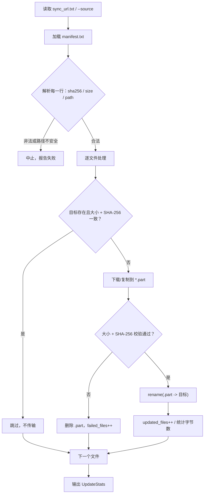

# free-stockdb 源码阅读（三）：增量同步器的四个安全动作

> 基于 commit `f352641`，2026-10-05。
> 系列：free-stockdb 源码阅读（3/10）。

## 一句话概括

`stockdb_updater` 做的事很朴素：读 `manifest.txt`，把镜像里的数据文件同步到 `./data`。

但"同步文件"这四个字里藏着四个安全动作：**跳过已验证文件、先写 `.part`、校验大小和 SHA-256、最后原子替换**。这四步决定了它是"可靠的数据更新器"，还是"一个会把半截数据库留给你的下载脚本"。

## 数据源与清单

数据源配置在 `sync_url.txt`，支持三种形态（`docs/DATA_SOURCE.md:5-9`）：

```text
D:/stockdb-mirror                 # 本地目录
file:///D:/stockdb-mirror         # file://
https://data.example.com/stockdb  # HTTP(S)
```

镜像根目录必须有 `manifest.txt`，每行：

```text
<sha256> <size-in-bytes> <relative-path>
```

示例（`docs/DATA_SOURCE.md:21-25`）：

```text
# sha256 size path
e3b0c44298fc1c149afbf4c8996fb92427ae41e4649b934ca495991b7852b855 0 CURRENT
1d5e4a2b3c4d5e6f718293a4b5c6d7e8f90123456789abcdef0123456789abcd 4096 000001.ldb
```

`manifest.txt` 是同步器唯一信任的"目录"。它不扫描镜像目录、不猜文件列表，只按清单办事。这个选择很关键：**文件集合是显式声明的，不会因为镜像里多了一个临时文件就被同步下来。**

## 同步流程



对应代码在 `cpp/src/updater.cpp:216-277`。核心判断是：

```cpp
// 已存在且校验一致 → 跳过
if (fs::exists(target, error) && !error &&
    fs::file_size(target, error) == entry.size && !error &&
    sha256_file(target) == expected_hash) {
    continue;
}

// 先写临时文件
const fs::path temporary = target.string() + ".part";
fs::remove(temporary, error);
if (error || !fetch_entry(data_source_, entry, temporary) ||
    fs::file_size(temporary, error) != entry.size || error ||
    sha256_file(temporary) != expected_hash) {
    fs::remove(temporary, error);
    ++stats.failed_files;
    continue;
}

// 校验通过后才替换
fs::rename(temporary, target, error);
```

## 四个安全动作

### 1）跳过已验证文件：增量不是"重新下载"

同步器不是按修改时间判断，而是按 **size + SHA-256**。这比 mtime 可靠：镜像重建、文件复制、时区变化都不影响判断；只要内容一样就跳过。

代价是要对每个已存在文件做一次完整 SHA-256，文件多时 I/O 成本不低。它用"正确性优先"换掉了"用 mtime 猜"的不确定性。

### 2）先写 `.part`：不污染目标文件

下载/复制直接写目标文件，最怕中途失败：目标文件被截断，下次查询读到半截 LevelDB 文件，可能直接打不开。

`.part` 的作用是隔离写过程：目标文件要么是旧的完整版本，要么是新的完整版本，不会出现"写了一半"的状态。

### 3）大小 + SHA-256：双重校验

只看大小不够，大小相同但内容损坏的情况真实存在；只看 SHA 又需要先算完整个文件。两个都查，成本可接受。不过当前实现把两个条件合并成一个 `if`，失败时只打印一条 `Failed integrity check`，**并不会区分是大小不对还是 SHA 不对**。

`sha256_file` 用 OpenSSL EVP 分块读取（`updater.cpp:49-82`），不会把整个大文件读进内存。

### 4）原子替换：`rename` 是最后一步

校验通过后 `fs::rename(temporary, target)`。同一文件系统内的 rename 通常是原子的；如果目标已存在，Windows 上可能失败，代码做了降级：

```cpp
// updater.cpp:258-263
fs::rename(temporary, target, error);
if (error) {
    fs::remove(target, error);
    error.clear();
    fs::rename(temporary, target, error);
}
```

先删目标再 rename，严格来说有一个短暂窗口目标不存在。这是跨平台文件替换的常见妥协；如果要绝对原子，应该用平台特定的 `ReplaceFile` / `renameat2`。

## 一个容易被忽略的防线：路径穿越

manifest 来自镜像，镜像可能是不可信的。如果某一行写：

```text
<sha> <size> ../../.ssh/authorized_keys
```

同步器就会把文件写到目标目录之外。代码在解析时直接拒绝（`updater.cpp:41-47`）：

```cpp
bool is_safe_relative_path(const fs::path& path) {
    if (path.empty() || path.is_absolute()) return false;
    for (const auto& component : path) {
        if (component == "..") return false;
    }
    return true;
}
```

这是一个很小的函数，但它是"同步器"和"远程文件写入漏洞"的分界线。**任何从外部清单读路径的系统，都应该有这一行。**

## 这套实现的边界

| 能做到 | 做不到 |
|--------|--------|
| 文件级增量（内容一致就跳过） | 字节级断点续传 |
| HTTP / file:// / 本地目录 | 对象存储、认证、代理配置 |
| 传输损坏检测 | 镜像发布者身份认证（SHA 不是签名） |
| 单文件通常原子替换（Windows 回退路径有短暂窗口） | 整个 LevelDB 快照的事务性切换 |
| 失败计数，不中断其他文件 | 并发下载 / 多线程同步 |

尤其注意最后一点：**LevelDB 快照不是"一个文件"**。`docs/DATA_SOURCE.md:31-33` 明确要求：同步期间停止本地服务，清单要包含同一快照的 `CURRENT`、`MANIFEST-*`、`.ldb` 和必要日志；同步完成后再启动服务。同步器只能保证单个文件完整，不能保证多个文件属于同一个一致快照。

另外，README 宣传的"Zstd 压缩传输、断点续传"是发行包的卖点；这个开放的 `stockdb_updater` 是整文件 HTTP/文件复制 + curl，不使用 Zstd，也没有 Range 断点续传。**不要把产品文案当成这份源码的实现说明。**

## 代码里可以再改进的地方

1. **`curl_global_init` / `curl_global_cleanup` 每次请求调用一次**（`updater.cpp:135-177`）。libcurl 的全局初始化应该进程级做一次，否则多文件同步会反复初始化/清理。
2. **没有 HTTP 超时、重试、Range 请求**。网络抖动时只能整文件重来。
3. **`sync_incremental(KType ktype)` 的 `ktype` 被 `(void)ktype` 忽略**（`updater.cpp:216-217`）。接口保留了"按周期同步"的意图，但当前实现是清单驱动，周期不影响行为。
4. **没有清单签名**。SHA-256 只能证明"下载内容与清单一致"，不能证明"清单来自可信发布者"。公网镜像必须依赖 HTTPS 和发布者信任。
5. **`fs::exists` 与 `file_size` 之间没有锁**。如果同步器和查询服务同时跑，仍可能读到正在替换的数据库文件；文档要求停服务，是必要的运维约束。

## 优秀代码：一个可复用的"内容寻址同步"骨架

```python
from pathlib import Path
import hashlib, os, shutil, tempfile

def sha256(path: Path) -> str:
    h = hashlib.sha256()
    with path.open("rb") as f:
        for chunk in iter(lambda: f.read(65536), b""):
            h.update(chunk)
    return h.hexdigest()

def sync_entry(source, target: Path, expected_sha: str, expected_size: int):
    if target.exists() and target.stat().st_size == expected_size and sha256(target) == expected_sha:
        return "skipped"

    target.parent.mkdir(parents=True, exist_ok=True)
    tmp = target.with_suffix(target.suffix + ".part")
    try:
        shutil.copyfile(source, tmp)
        if tmp.stat().st_size != expected_size or sha256(tmp) != expected_sha:
            raise ValueError("integrity check failed")
        os.replace(tmp, target)   # 同一文件系统内原子替换
        return "updated"
    finally:
        tmp.unlink(missing_ok=True)
```

**模式**：Content-Addressed Sync。清单是真相，文件是内容；先验证内容，再让它出现在目标位置。

## 下一章

同步器把数据安全地放到本地，接下来要看谁在本地读它。下一章拆 `cpp/src/server.cpp`：一个 371 行的 C++ 参考服务，以及它明确没有解决的问题。

---

> 系列导航：[（二）Key 即协议](02-data-model.md) · [（四）C++ 参考服务](04-cpp-server.md)
