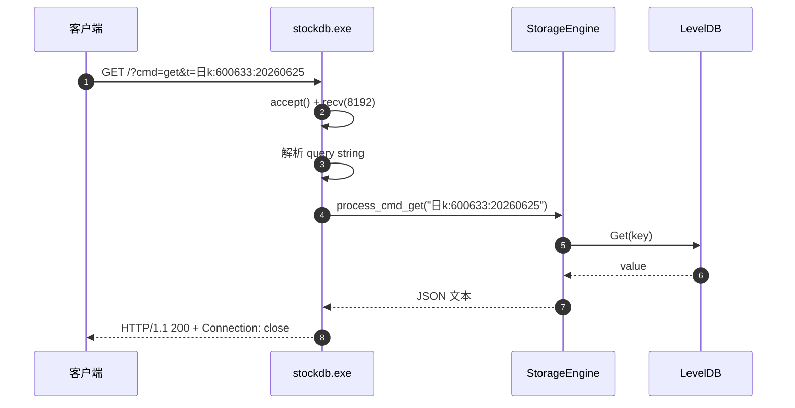

# free-stockdb 源码阅读（四）：371 行 C++ 服务，能教什么，不能教什么

> 基于 commit `f352641`，2026-10-05。
> 系列：free-stockdb 源码阅读（4/10）。

## 一句话概括

`cpp/src/server.cpp` 是一个**参考实现**：用 PImpl 包住一个 LevelDB，监听 TCP，解析极简 HTTP，按 `cmd=get/set/zb.get/bk.get` 路由，然后用前缀/范围扫描返回 JSON。

它能教你 LevelDB 的 key 扫描怎么写、PImpl 怎么用、一个本地服务的最小骨架长什么样；但它**不是** README 里那个支持全市场指标、Zstd、并发查询的生产引擎。

## 服务骨架



整个服务只有一个 accept 循环（`server.cpp:221-250`）：

```cpp
void accept_loop() {
    while (running.load()) {
        SOCKET cfd = accept(listen_fd, ...);
        char buf[8192] = {0};
        int n = recv(cfd, buf, sizeof(buf) - 1, 0);
        if (n > 0) {
            std::string body = route(std::string(buf, n));
            // 手拼 HTTP 响应
            send(cfd, r.c_str(), r.size(), 0);
        }
        closesocket(cfd);
    }
}
```

一次连接只读一次、只回一次、马上关闭。没有 keep-alive，没有请求体解析，没有线程池；`ServerConfig.thread_count` 虽然存在（`server.hpp:18`），但这个实现里没有使用。

## LevelDB 封装：小但完整

`StorageEngine`（`server.cpp:36-131`）做了四件事：

1. 打开/创建数据库；
2. 配置 Snappy 压缩、write buffer、block size、LRU block cache、Bloom filter；
3. 提供 `get` / `put` / `write_batch`；
4. 提供 `scan_prefix` / `scan_range`。

```cpp
// server.cpp:42-54
options_.create_if_missing = true;
options_.compression = cfg.compression ? leveldb::kSnappyCompression
                                       : leveldb::kNoCompression;
options_.write_buffer_size = cfg.write_buffer_size * 1024 * 1024;
options_.block_size = cfg.block_size * 1024;
if (cfg.cache_size > 0) {
    options_.block_cache = leveldb::NewLRUCache(
        static_cast<size_t>(cfg.cache_size) * 1024 * 1024);
}
options_.filter_policy = leveldb::NewBloomFilterPolicy(10);
```

这是很标准的 LevelDB 读多写少配置：Bloom filter 减少不存在 key 的磁盘查找，LRU 缓存热 block，Snappy 压缩降低存储。

## 路由：四个命令

`route` 只做字符串解析（`server.cpp:252-276`）：

```cpp
const std::string& cmd = params["cmd"];
if (cmd == "get")    return process_cmd_get(params["t"]);
if (cmd == "set")    return process_cmd_set(params["key"], params["val"]);
if (cmd == "zb.get") return process_zb_get(params["name"], params["codes"],
                                           params["start"], params["end"]);
if (cmd == "bk.get") return process_bk_get(params["x"], params["category"]);
```

其中 `process_cmd_get` 是核心：

```cpp
// 先精确匹配
if (engine->get(expr, &val)) return val;

// 有 * 就退化成前缀扫描
size_t star = prefix.find('*');
if (star != std::string::npos) prefix = prefix.substr(0, star);

auto rows = engine->scan_prefix(prefix);
// 输出 [["key", value], ...]
```

`process_zb_get` 和 `process_bk_get` 则明显是"演示级"：

- `zb.get` 忽略 `name`，把存储 value 直接 `std::stod` 当价格（`server.cpp:311-338`）。真实日 K 的 value 是 dict，`stod` 会抛异常，`prices` 为空，最终返回 `data: []`；如果 value 恰好是数字字符串，它才会算一个 MA5。
- `bk.get` 不看 `category`，要么精确取一个板块，要么返回全部板块（`server.cpp:341-355`）。

所以不要把这里的 `zb.get` 当成 README 宣称的指标实现——README 说 39 个指标/指数，它自己的枚举实际是 38 个普通指标 + zhishu。真正的指标计算在 `zb_core`；这里只是路由与扫描的骨架，连"读真实 dict 记录"都没打通。

## 这份参考实现的局限

| 局限 | 位置 | 后果 |
|------|------|------|
| 单连接串行处理 | `accept_loop` | 一个慢请求阻塞后面所有连接 |
| 一次 `recv` 读 8KB | `server.cpp:231-232` | 大请求/慢网络可能截断 |
| 不解析 Content-Length | 同上 | 只适合简单 GET |
| 不做 URL 解码 | `route` | `%E6%97%A5k...` 这类编码 key 无法命中 |
| 手拼 JSON | `process_cmd_get` | value 里有引号/换行时可能生成非法 JSON |
| `password` 配置未使用 | `server.hpp:17` | 没有认证 |
| `thread_count` 配置未使用 | `server.hpp:18` | 没有并发 |
| CORS 固定 `*` | `server.cpp:238` | 任意网页可发起请求 |
| `KRecord` 注释写 32 字节 | `client.hpp:28` | 实际按当前字段/对齐是 40 字节，且未用于存储 |

这些不是"作者不会写"，而是**参考实现刻意只保留主线**。README 说 `cpp/` 包含服务、同步器、客户端示例；它没有承诺这份 C++ 代码就是发行版引擎。

## 优秀代码：MA 的滑动窗口

`client.cpp` 里的 `compute_ma` 是全文最值得抄的一段（`client.cpp:70-86`）：

```cpp
double sum = 0.0;
for (int i = 0; i < period; ++i) sum += records[i].close;
ma[period - 1] = sum / period;

for (size_t i = period; i < n; ++i) {
    sum += records[i].close - records[i - period].close;
    ma[i] = sum / period;
}
```

**好在哪**：不是对每个 i 再循环 period 次（O(n·period)），而是维护一个滑动和，每根 K 线只做一次加法和一次减法，O(n)。

**模式**：Sliding Window。凡是"固定窗口求和/均值/方差"的指标，都应该先想能不能增量更新，而不是重算窗口。

`compute_ema` 和 `compute_macd` 也是同一个思路：EMA 用递推，MACD 复用 EMA 结果，避免重复计算。

## 优秀代码：PImpl 隐藏实现

```cpp
// server.hpp:28-54
class StockDbServerImpl;

class StockDbServer {
public:
    explicit StockDbServer(const ServerConfig& config = ServerConfig());
    ~StockDbServer();
    bool start();
    void stop();
    // ...
private:
    std::unique_ptr<StockDbServerImpl> pimpl_;
};
```

**好在哪**：头文件不暴露 LevelDB、socket、线程；使用方只依赖稳定接口，实现可以换。对库来说，这是 ABI 稳定的基础。

**模式**：PImpl（Pointer to Implementation）/ 编译防火墙。

## 骨架代码：LevelDB 前缀扫描

如果要在自己的项目里做一个本地时序库，最小查询骨架可以这样：

```cpp
std::vector<std::pair<std::string, std::string>>
scan_prefix(leveldb::DB* db, const std::string& prefix, int limit = 10000) {
    std::vector<std::pair<std::string, std::string>> out;
    leveldb::ReadOptions ro;
    std::unique_ptr<leveldb::Iterator> it(db->NewIterator(ro));
    for (it->Seek(prefix); it->Valid(); it->Next()) {
        auto key = it->key().ToString();
        if (key.compare(0, prefix.size(), prefix) != 0) break;
        out.emplace_back(key, it->value().ToString());
        if ((int)out.size() >= limit) break;
    }
    return out;
}
```

关键点不是这段代码，而是：**prefix 必须在 key 最左边；limit 必须存在；迭代器必须及时停止。**

## 下一章

服务端的参考实现讲完了。下一章看 Python 层真正的"编排"：同步/异步 `get_data`、批量 pipeline、复权钩子和结果整形。

---

> 系列导航：[（三）增量同步器](03-updater.md) · [（五）Python SDK](05-python-sdk.md)
